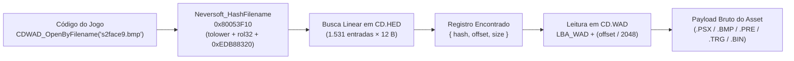

# 🔗 Entendendo a Relação entre `CD.HED` e `CD.WAD`

> **Documentação Técnica:** Arquitetura do sistema de arquivos virtual da Neversoft Engine no *Tony Hawk's Pro Skater 2 (PS1 — `SLUS-01066`)*, algoritmo de hash `0x80053F10`, regras de alinhamento de setor e pipeline completo de `unpack`/`repack` bit-a-bit.

---

## 1. Por Que Existem Dois Arquivos (`CD.HED` + `CD.WAD`)?

O leitor de CD-ROM do PlayStation 1 possui tempo de *seek* mecânico lento e o sistema ISO-9660 sofre sobrecarga ao abrir centenas de arquivos pequenos. Para resolver isso, a Neversoft empacotou todos os **1.531 assets internos** em um único bloco contíguo (**`CD.WAD`**) e criou um índice compacto que fica residente na RAM (**`CD.HED`**, apenas `18.372 bytes`).



---

## 2. Anatomia Binária de `CD.HED` (12 Bytes por Entrada)

Cada uma das **1.531 entradas** em `CD.HED` é uma estrutura Little-Endian de exatos **12 bytes**, seguida ao final do arquivo por um terminador de 4 bytes (`0x00000000` ou `0xFFFFFFFF`):

```c
typedef struct {
    uint32_t hash;    // +0x00: Hash 32-bit case-insensitive do nome do arquivo (0x80053F10)
    uint32_t offset;  // +0x04: Offset em bytes dentro de CD.WAD (SEMPRE múltiplo de 2048 = 0x800!)
    uint32_t size;    // +0x08: Tamanho real do asset em bytes (sem o padding de setor)
} CDHedEntry;         // Total: 12 bytes × 1.531 = 18.372 B (+ 4 B terminador)
```

### Algoritmo Exato de Hash (`Neversoft_HashFilename @ 0x80053F10`)

Diferente do CRC-32 IEEE tradicional, o THPS2 usa **rotação circular à esquerda (`rol32`)** sem inversão final:

```javascript
function nsHash(str) {
  let h = 0xFFFFFFFF >>> 0;
  for (let i = 0; i < str.length; i++) {
    let c = str.charCodeAt(i);
    if (c >= 65 && c <= 90) c += 32; // tolower()
    let x = (c ^ h) & 0xFF;
    for (let k = 0; k < 8; k++) {
      h = ((h << 1) | (h >>> 31)) >>> 0; // rol32(h, 1)
      if (x & 1) h = (h ^ 0xEDB88320) >>> 0;
      x >>>= 1;
    }
  }
  return h >>> 0;
}
```

> **Conquista de Engenharia Reversa:** cruzando esse algoritmo com o dicionário de strings extraído de `SLUS_010.66`, overlays `.BIN` e headers `.PSH`, o script [`Scripts/thps2_wad.js`](../Scripts/thps2_wad.js) resolve automaticamente **mais de 1.161 nomes reais** entre os 1.531 arquivos!

---

## 3. Regras Invioláveis de Alinhamento no `CD.WAD`

Ao reconstruir ou editar o `CD.WAD`, existem **3 invariantes críticas** exigidas pelo leitor de CD-ROM do PS1:

1. **Alinhamento Obrigatório de 2.048 Bytes (`0x800`):** todo arquivo começa em um limite exato de setor CD-ROM. O espaço restante entre `offset + size` e o próximo múltiplo de `2048` é preenchido com zeros (`0x00`).
2. **Regra das Entradas de 0 Bytes (`idx 525` e `idx 527`):** o `CD.HED` original contém 2 arquivos vazios (`size = 0`). Mesmo com zero bytes úteis, **cada entrada vazia ocupa 1 setor inteiro de `2.048 bytes` no `CD.WAD`** (`Math.max(1, Math.ceil(size / 2048)) * 2048`). Ignorar essa regra desloca todos os offsets subsequentes e quebra a integridade SHA-256!
3. **Atualização Dupla para Assets em Pacotes `.PRE`:** vários assets (como os retratos `s2face*.bmp` dos skatistas e fontes da UI) existem **tanto soltos em `CD.WAD` quanto empacotados dentro de sub-arquivos `.PRE`** (ex.: `options.pre`, `CD.HED idx=45`). Se você editar apenas o arquivo solto sem atualizar o `.PRE` correspondente, o jogo continuará exibindo a versão antiga na tela!

---

## 4. Fluxo Prático com `Scripts/thps2_wad.js` (Validado SHA-256 Bit-a-Bit)

```powershell
# 1. Listar todos os 1.531 arquivos com índice, hash, tipo, offset, tamanho e nome real
node Scripts/thps2_wad.js list

# 2. Desempacotar CD.WAD inteiro + todos os 14 pacotes .PRE internos
node Scripts/thps2_wad.js unpack work_wad --pre

# 3. Reempacotar CD.HED + CD.WAD reconstruindo também os .PRE alterados
node Scripts/thps2_wad.js repack work_wad CD.HED CD.WAD --from-pre
```

> **Teste de Round-Trip:** executar `unpack --pre` seguido de `repack --from-pre` sem edições produz `CD.HED` e `CD.WAD` com **SHA-256 100% idêntico** aos arquivos originais Redump.

---

## 5. Referências Cruzadas

- [Tabela Completa dos 1.531 registros de `CD.HED`](02_Arquivos_mapeados_cd_hed.md)
- [MAPA 06 — Censo de Texturas, Fontes e Todos os 14 `.PRE`](MAPA_06_TEXTURAS_FONTES_E_WAD.md)
- [MAPA 10 — Anatomia Binária dos Modelos 3D `.PSX`](MAPA_10_MODELOS_3D_PSX_SKINNING_E_TEXTURAS.md)
