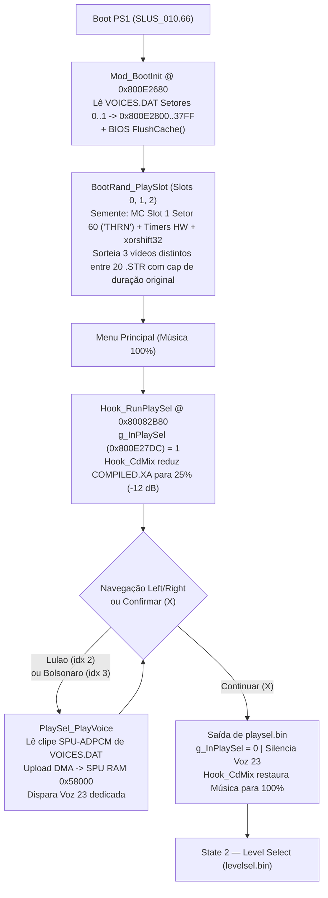

# ⚡ MAPA 12 — Engine Residente MIPS R3000A (`MODCODE`), `VOICES.DAT`, Boot Aleatório e Ducking `-12 dB`

> **Arquitetura de Código Nativo PS1:** Documentação completa do subsistema MIPS R3000A injetado em `SLUS_010.66`, `playsel.bin` e `VOICES.DAT` por [`Scripts/patch_random_videos_and_voices.js`](../Scripts/patch_random_videos_and_voices.js) e [`Scripts/build_skater_voices.js`](../Scripts/build_skater_voices.js).

---

## 1. Arena Residente de 12,5 KB Abaixo da Heap (Zero Impacto nos 48 LBAs Redump)

Para hospedar o código MIPS customizado, a tabela de metadados de vozes, o motor do Modo Carreira do Lulao e o streamer SPU 2 KB sem alterar o tamanho de `SLUS_010.66` (`864.256 B`) nem deslocar nenhum dos 48 arquivos originais da ISO, deslocamos a base da heap dinâmica em apenas **12,5 KB** (`0x800E2678 → 0x800E5800`, `< 1,1%` do heap livre):

| Faixa de RAM | Tamanho | Conteúdo | Origem |
| :---: | :---: | :--- | :--- |
| `0x800E2674` | `4 B` | `HeapStartPtr = 0x800E5800` | Patch inline em `SLUS_010.66` (+ `InitHeap` @ `0x800A2950`) |
| `0x800E2680..0x800E27FF` | `384 B` | **Bootstrapper + Trampolins + Estado Privado** (`Mod_BootInit` lê 6 setores, `Tramp_*`, bitmask `g_InPlaySel @ 0x800E27DC` [bit0=PlaySel, bit1=GameplayVoice], `g_VoicesBaseLba`, `g_BailScreamIdx`) | Embutido no fim de `SLUS_010.66` (área `.bss` livre) |
| `0x800E2800..0x800E2FFF` | `2.048 B` | **`MODCODE`** (`1.964 B` usados / `84 B` livres): `BootRand_PlaySlot`, `SkaterVoice_Play`, `Hook_PlaySel_Scroll/Confirm`, `Hook_RunPlaySel` | Carregado no boot a partir do **Setor 0** de `VOICES.DAT` |
| `0x800E3000..0x800E33FF` | `1.024 B` | **`VOICETBL`** (`magic = 0x564F4943`): `lulaoCount=14`, `bolsoCount=14`, `silvioCount=13 @ +0x3F0`, 41 descritores (até 62 suportados) e índices rotativos `@ +0x3F4..+0x3FC` | Carregado no boot a partir do **Setor 1** (`+0x000..+0x3FF`) de `VOICES.DAT` |
| `0x800E3400..0x800E35FF` | `512 B` | **`Hook_BailSfx`** (`268 B` usados): rotação estrita round-robin dos **9 gritos de queda** em partida + cooldown anti-sobreposição de 50 frames | Carregado no boot a partir do **Setor 1** (`+0x400..+0x5FF`) de `VOICES.DAT` |
| `0x800E3600..0x800E37FF` | `512 B` | **`VoiceSelect_Lookup` (`0x800E3600`) & `VoiceSelect_SeedAll` (`0x800E3680`)** (`224 B` usados): dispatcher multi-skatista (Slots `1`, `2` e `3`) | Carregado no boot a partir do **Setor 1** (`+0x600..+0x7FF`) de `VOICES.DAT` |
| `0x800E3800..0x800E47FF` | `4.096 B` | **`LULAO_CODE`** (`3.708 B` usados / `388 B` livres): `Lulao_SyncStrings`, `Hook_OverlaySyncRun`, `Hook_CollectCash` (deferred flag `<0,0005 ms`), `Hook_EndRun_*`, `Hook_FrameTick`, `Hook_GameplayStart/Exit`, **`LulaoCache_Load/Free`** (`freeList[1]` OOM guard `>= 96 KB`), tabela de 28 entradas em anel (`LULAO_GPBANK`) e **Streamer SPU 2 KB Ping-Pong via `g_StageBuf`** (`0x7F400..0x7FBFF` @ `6.890,625 Hz` / `0x0280`) | Carregado no boot a partir dos **Setores 2..3** de `VOICES.DAT` |
| `0x800E4800..0x800E57FF` | `4.096 B` | **`LULAO_STRDATA`** (`88` pares `{targetPtr, lulaoStrPtr}`, backup runtime de originais em `0x800E4B00..0x800E4C7F` e `1.740 B` de strings ASCII das 8 fases + `"Roubei mais 50!/100!/250!"`) | Carregado no boot a partir dos **Setores 4..5** de `VOICES.DAT` |

---

## 2. Mapa Completo dos 34 Hooks Cirúrgicos (32 em `SLUS_010.66` + 2 em `playsel.bin`)

| Endereço / Offset | Alvo | Instrução Injetada | Função Técnica |
| :---: | :--- | :--- | :--- |
| `0x800A2950` | `SLUS_010.66` | `addiu $a0, $a0, 0x5800` (`0x24845800`) | Ajusta `InitHeap` para iniciar em `0x800E5800` |
| `0x800E2674` | `SLUS_010.66` | `0x800E5800` | Ajusta `HeapStartPtr` do alocador THPS2 |
| `0x80053690` | `SLUS_010.66` | `slti $v0, $v1, 23` (`0x28620017`) | **Reserva a Voz 23 da SPU** exclusivamente para vozes de skatistas (SFX do jogo usa `0..22`) |
| `0x800527B8` | `SLUS_010.66` | `jal 0x800E27E0` (`Tramp_BailSfx`) | Rotação estrita round-robin dos **9 gritos de queda** (`Hook_BailSfx @ 0x800E3400`) + cooldown 50f |
| `0x8005BAC4..BB1C` | `SLUS_010.66` | 5 words em `Font_CharToGlyph` | Mapeia acentos nativos PT-BR (`ã, ê, í, ó`) para glifos `90..93` em `s2bio.fnt` |
| `0x8006CAD4` | `SLUS_010.66` | `jal 0x800E2680` (`Mod_BootInit`) | Roda `Movies_Init()`, lê **Setores `0..5`** de `\VOICES.DAT;1` para `0x800E2800..0x800E57FF` e executa BIOS **`FlushCache()`** (`0x800AF500`) |
| `0x8003CFB0/CFE8/D024` | `SLUS_010.66` | `jal 0x800E2734` (`Tramp_BootMovie`) | **Boot Slots 0/1/2:** sorteia 3 vídeos distintos com caps originais (`208f` / `266f` / `≤1486f`) |
| `0x80038950` | `SLUS_010.66` | `jal 0x800E2798` (`Hook_CdMix`) | Intercepta `CdMix(&atv)`: se bitmask `g_InPlaySel (0x800E27DC) != 0`, reduz música `COMPILED.XA` para **25% (`-12 dB`)** |
| `0x80082B80` | `SLUS_010.66` | `jal 0x800E2764` (`Tramp_RunPlaySel`) | Gerencia bit 0 de `g_InPlaySel` em `playsel.bin` e chama `Lulao_SyncStrings` ao sair |
| `0x80082C38..82FD4` (8×) | `SLUS_010.66` | `jal 0x800E3808` (`Hook_OverlaySyncRun`) | Sincroniza os 88 ponteiros do Modo Carreira do Lulao antes de abrir `skateshp`/`levelsel`/menus (inclusive após load direto de Memory Card) |
| `0x800368D4/6914/6954` (3×) | `SLUS_010.66` | `jal 0x800E3810` (`Hook_CollectCash`) | Intercepta coleta de notas `$250`/`$50`/`$100`: apenas sinaliza `g_PendingVoiceMode = 1` (`<0,0005 ms` na física, **0 acesso CD-ROM**) |
| `0x8003C2E8`, `0x80030DA0`, `0x800813CC`, `0x8003C968`, `0x8003C9F0` (5×) | `SLUS_010.66` | `jal 0x800E3818/20/28` (`Hook_EndRun_*`) | Sinaliza 1 frase aleatória engraçada do Lulao (`g_EndRunSpoken` 1-shot + `g_PendingVoiceMode = 2`, **0 acesso CD-ROM**) |
| `0x8003CB48` | `SLUS_010.66` | `jal 0x800E3830` (`Hook_FrameTick`) | Após `Display_Swap`: executa `XA_Update`, dispara `LulaoStream_StartFromCache` se pendente (`<0,20 ms`) e alimenta `LulaoStream_Tick` a 60 Hz (`115,07` amostras/VBlank @ `6.890,625 Hz`) |
| `0x8003D71C` / `0x8003D828` | `SLUS_010.66` | `jal 0x800E3838/40` (`Hook_GameplayStart/Exit`) | Pré-carrega `LULAO_GPBANK` **1 única vez no loading da fase** (`LulaoCache_Load`, pulado em *Retry*!) e libera integralmente na saída (`LulaoCache_Free`, 0 leak) |
| `playsel.bin +0x3388` | `CD.WAD[61]` | `jal 0x800E2744` (`Tramp_PlaySelScroll`) | Dispara vozes SPU-ADPCM ao navegar por **Silvio Santos (`1`)**, **Lulao (`2`)** ou **Bolsonaro (`3`)** |
| `playsel.bin +0x100C` | `CD.WAD[61]` | `jal 0x800E2754` (`Tramp_PlaySelConfirm`) | Dispara voz SPU-ADPCM ao confirmar **Silvio Santos**, **Lulao** ou **Bolsonaro** com **X** |

---

## 3. Fluxo de Execução em Tempo Real

---

## 4. Detalhes Críticos de Engenharia Resolvidos

### A. Vídeos Aleatórios Persistentes Sem Quebrar Vídeos de Carreira
- **Persistência entre Boots Frios no DuckStation:** o motor lê/atualiza o **Setor 60 (`0x3C`)** do Memory Card Slot 1 (região livre fora dos 15 blocos de saves do usuário, identificada pelo magic `"THRN"`), combinando o contador persistente com os **Root Counters HW (`0x1F801100`, `0x1F801110`, `0x1F801120`)** + `VSync(-1)` + `xorshift32`. Sem Memory Card inserido, faz fallback transparente aos timers de hardware.
- **Zero Repetição:** grava o índice do vídeo de abertura sorteado para nunca repetir no boot seguinte e impede repetições dentro da mesma trinca de abertura.
- **Duração Exata & Integridade da Carreira:** antes de invocar o player MDEC/STR, salva `g_MovieTable[idx].num_frames`, aplica temporariamente o limite original do slot (`208` / `266` / `≤1486` frames) e **restaura o valor cheio original** imediatamente após a reprodução — mantendo os vídeos de final de carreira (`0x8003CC7C`) 100% intactos.

### B. Layout de `VOICES.DAT` (49º Arquivo da ISO @ `LBA 317893`)
- **Tamanho total:** `2.342.912 B` (`1.144 setores` Mode 2 Form 1 `2048 B`):
  - **Setores `0..5`:** 6 setores residentes em RAM (`0x800E2800..0x800E57FF`).
  - **Setores `6..876`:** **41 clipes SPU-ADPCM de menu (`11.025 Hz` mono, `pitch = 0x0400`)** — 14 Lulao (`Slot 2`) + 14 Bolsonaro (`Slot 3`) + 13 Silvio Santos (`Slot 1`), maior clipe = `ritmo_de_dance.mp3` (`148.928 B / 159.728 B` na janela SPU `0x58000..0x7EFF0`).
  - **Setores `877..1143` (`LULAO_GPBANK`):** sub-banco compacto de gameplay em **anel duplicado `2×`** (`14 × 2 = 28` entradas contíguas alinhadas a `16 B`, `546.816 B` / `267 setores`) codificado a **`6.890,625 Hz` exatos (`pitch = 0x0280 = 640/4096 × 44.100 Hz`, erro de pitch `0,00%`, Nyquist `3.445 Hz` > G.711)**: contém os 11 clipes rápidos integrais do Lulao + 3 cortes punchline de `6,0s` dos clipes longos (`#01`, `#03`, `#10`).

### C. Pré-Cache Adaptativo em Main RAM (Zero Travamento / `0,00 ms` CD Stall) & Streamer SPU 2 KB (`0x7F400..0x7FBFF`)
- **Problema físico resolvido:** ler `VOICES.DAT` (`LBA 317.893`) sob demanda durante a partida exigia pausar `COMPILED.XA` (`LBA 38.916..144.867`), executar dois seeks físicos atravessando `173.026..278.977` setores e aguardar `CdRead` — congelando a partida por **`~1.110 ms` (~66 frames travados)** a cada moeda coletada. Além disso, o alocador `Mem_Alloc` do THPS2 (`0x80054C8C`) **não retorna `NULL` em falta de memória**, entrando em tela vermelha infinita (`0x80054550 -> 0x80054574`).
- **Arquitetura Zero-Stall implementada em `LULAO_CODE`:**
  1. **OOM Guard via `freeList[1]` + Pré-Cache Único no Loading (`LulaoCache_Load`):** chamado 1 única vez por fase em `Hook_GameplayStart` (apenas para `skaterIdx == 2` e `g_CacheBuf == 0`, **pulado em *Retry***). Percorre a lista nativa `*(uint32_t*)(gp + 19112)` (`0x800D7294`) para medir o maior bloco contíguo livre real, preserva obrigatoriamente uma **reserva intocável de `96 KB` (`98.304 B`)** para o motor do jogo em todas as fases (inclusive *NY City*, *Venice*, *Philadelphia*, *Bullring* e *2P*), sorteia um `startClip (0..13)` aleatório, aloca **1 único bloco `g_CacheBuf`** (`2.048 B g_StageBuf` + clipes contíguos) e executa **1 único `CdRead`** ainda na tela de carregamento.
  2. **Disparo Desacoplado + Staging Buffer Imutável de 2 KB:** `Hook_CollectCash` e `Lulao_OnEndRun` apenas gravam `g_PendingVoiceMode` (`< 0,0005 ms`). No fim do frame (`Hook_FrameTick @ 0x8003CB48`, após `Display_Swap`), `LulaoStream_StartFromCache` seleciona o próximo clipe direto de `g_CacheBuf + 2048` (**0 chamadas `CdRead`, 0 `XA_Pause`, 0 `Mem_Alloc` durante toda a partida**), ativa ducking suave `-12 dB` em `COMPILED.XA` (sem cortar a música!), pausa o bit 7 (`Reverb Master Enable`) de `SPUCNT (0x1F801DAA)` e carrega Half A/B (`0x7F400`/`0x7F800`) através de `g_StageBuf` (`g_CacheBuf + 0..2047`), mantendo os clipes em RAM **100% read-only e reutilizáveis**.
  3. **Feeder 60 Hz Calibrado (`6.890,625 Hz` / `0x0280`):** o ring SPU de `2.048 B` (`3.584` amostras) dura **`520,1 ms`** (`260 ms` por metade — 60% mais folga anti-underrun que `11.025 Hz`). `LulaoStream_Tick` acumula `11.507` centi-amostras/VBlank NTSC, recarrega cada metade com `208 ms` de margem sem tocar em `0x1F801D7E`, detecta o término em `V23_ENVX == 0`, limpa `0x7F400..0x7FBFF` usando `g_StageBuf`, restaura o Reverb e devolve `COMPILED.XA` a `100%`. Ao sair da fase (`Hook_GameplayExit`), `LulaoCache_Free` libera `g_CacheBuf` com **0 bytes de vazamento**.
- **Benchmark Empírico ao Vivo (DuckStation GDB — *The Hangar*, 5 coletas rápidas seguidas):**
  | Métrica | Antes (Leitura CD sob Demanda) | Depois (Pré-Cache RAM `LULAO_GPBANK`) |
  | :--- | :---: | :---: |
  | Tempo bloqueado por coleta de dinheiro | **`1.109 – 1.110 ms`** (~66 frames congelados) | **`< 0,20 ms` CPU** (`3–5 ms` c/ overhead GDB, **0 frames perdidos**) |
  | Chamadas `CdRead` / `XA_Pause` em gameplay | `1 CdRead` + `2 seeks (~200k set.)` + `2 XA_Pause` | **`0 CdRead` / `0 seeks` / `0 XA_Pause`** (música 100% contínua) |
  | Alocações `Mem_Alloc`/`Mem_Free` em gameplay | 1 par a cada nota coletada (risco OOM red-screen) | **`0` em gameplay** (1 alocação no loading c/ reserva `>= 96 KB`, 1 free na saída) |

### D. Causa Raiz e Correção Cirúrgica do Bug "Continuar → Roda Gigante"
- Em uma versão inicial do ducking de música, o estado de detecção de `playsel.bin` compartilhava o registrador global `23464($gp)` usado internamente pelo THPS2 para decidir a transição de estado do menu — fazendo com que clicar em *"Continuar"* retornasse para `State 0` (Roda Gigante) em vez de avançar para `State 2` (*Level Select*).
- **Solução definitiva:** introduzimos a variável privada dedicada **`g_InPlaySel` em `0x800E27DC`** (gerenciada exclusivamente por `Hook_RunPlaySel` sem jamais ler ou gravar `23464($gp)`), validada ao vivo no DuckStation GDB (`State = 2` e `g_InPlaySel = 0` em 100% dos testes!).
