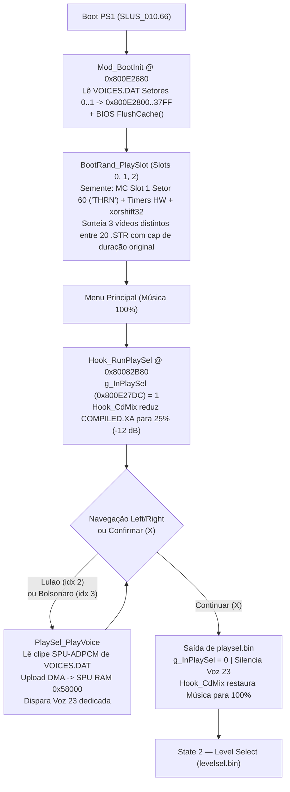

# ⚡ MAPA 12 — Engine Residente MIPS R3000A (`MODCODE`), `VOICES.DAT`, Boot Aleatório e Ducking `-12 dB`

> **Arquitetura de Código Nativo PS1:** Documentação completa do subsistema MIPS R3000A injetado em `SLUS_010.66`, `playsel.bin` e `VOICES.DAT` por [`Scripts/patch_random_videos_and_voices.js`](../Scripts/patch_random_videos_and_voices.js) e [`Scripts/build_skater_voices.js`](../Scripts/build_skater_voices.js).

---

## 1. Arena Residente de 12,5 KB Abaixo da Heap (Zero Impacto nos 48 LBAs Redump)

Para hospedar o código MIPS customizado, a tabela de metadados de vozes, o motor do Modo Carreira do Lulao e o streamer SPU 2 KB sem alterar o tamanho de `SLUS_010.66` (`864.256 B`) nem deslocar nenhum dos 48 arquivos originais da ISO, deslocamos a base da heap dinâmica em apenas **12,5 KB** (`0x800E2678 → 0x800E5800`, `< 1,1%` do heap livre):

| Faixa de RAM | Tamanho | Conteúdo | Origem |
| :---: | :---: | :--- | :--- |
| `0x800E2674` | `4 B` | `HeapStartPtr = 0x800E5800` | Patch inline em `SLUS_010.66` (+ `InitHeap` @ `0x800A2950`) |
| `0x800E2680..0x800E27FF` | `384 B` | **Bootstrapper + Trampolins + Estado Privado** (`Mod_BootInit` lê 6 setores, `Tramp_*`, bitmask `g_InPlaySel @ 0x800E27DC` [bit0=PlaySel, bit1=GameplayVoice], `g_VoicesBaseLba`, `g_BailScreamIdx`) | Embutido no fim de `SLUS_010.66` (área `.bss` livre) |
| `0x800E2800..0x800E2FFF` | `2.048 B` | **`MODCODE`** (`1.964 B` usados / `84 B` livres): `BootRand_PlaySlot`, `SkaterVoice_Play`, `Hook_PlaySel_Scroll/Confirm`, `Hook_RunPlaySel` | Carregado no boot a partir do **Setor 0** de `VOICES.DAT` |
| `0x800E3000..0x800E33FF` | `1.024 B` | **`VOICETBL`** (`magic = 0x564F4943`): `lulaoCount=14`, `bolsoCount=14`, `silvioCount=13 @ +0x3F0`, 41 descritores (até 62 suportados) e índices rotativos `@ +0x3F4..+0x3FC` | Carregado no boot a partir do **Setor 1** (`+0x000..+0x3FF`) de `VOICES.DAT` |
| `0x800E3400..0x800E35FF` | `512 B` | **`Hook_BailSfx`** (`268 B` usados): rotação estrita round-robin dos **9 gritos de queda** em partida + cooldown anti-sobreposição de 50 frames | Carregado no boot a partir do **Setor 1** (`+0x400..+0x5FF`) de `VOICES.DAT` |
| `0x800E3600..0x800E37FF` | `512 B` | **`VoiceSelect_Lookup` (`0x800E3600`) & `VoiceSelect_SeedAll` (`0x800E3680`)** (`224 B` usados): dispatcher multi-skatista (Slots `1`, `2` e `3`) | Carregado no boot a partir do **Setor 1** (`+0x600..+0x7FF`) de `VOICES.DAT` |
| `0x800E3800..0x800E47FF` | `4.096 B` | **`LULAO_CODE`** (`2.816 B` usados / `1.280 B` livres): `Lulao_SyncStrings`, `Hook_OverlaySyncRun`, `Hook_CollectCash`, `Hook_EndRun_*`, `Hook_FrameTick`, `Hook_GameplayStart/Exit` e **Streamer SPU 2 KB Ping-Pong** (`0x7F400..0x7FBFF`) | Carregado no boot a partir dos **Setores 2..3** de `VOICES.DAT` |
| `0x800E4800..0x800E57FF` | `4.096 B` | **`LULAO_STRDATA`** (`88` pares `{targetPtr, lulaoStrPtr}`, backup runtime de originais em `0x800E4B00..0x800E4C7F` e `1.740 B` de strings ASCII das 8 fases + `"Roubei mais 50!/100!/250!"`) | Carregado no boot a partir dos **Setores 4..5** de `VOICES.DAT` |

---

## 2. Mapa Completo dos 34 Hooks Cirúrgicos (32 em `SLUS_010.66` + 2 em `playsel.bin`)

| Endereço / Offset | Alvo | Instrução Injetada | Função Técnica |
| :---: | :--- | :--- | :--- |
| `0x800A2950` | `SLUS_010.66` | `addiu $a0, $a0, 0x5800` (`0x24845800`) | Ajusta `InitHeap` para iniciar em `0x800E5800` |
| `0x800E2674` | `SLUS_010.66` | `0x800E5800` | Ajusta `HeapStartPtr` do alocador THPS2 |
| `0x80053690` | `SLUS_010.66` | `slti $v0, $v1, 23` (`0x28620017`) | **Reserva a Voz 23 da SPU** exclusivamente para vozes de skatistas (SFX do jogo usa `0..22`) |
| `0x800527B8` | `SLUS_010.66` | `jal 0x800E27E0` (`Tramp_BailSfx`) | Rotação estrita round-robin dos **9 gritos de queda** (`Hook_BailSfx @ 0x800E3400`) + cooldown 50f |
| `0x8005BAC4..BB1C` | `SLUS_010.66` | 5 words em `Font_CharToGlyph` | Mapeia acentos nativos PT-BR (`ã, ê, í, ó`) para glifos `90..93` em `s2bio.fnt` |
| `0x8006CAD4` | `SLUS_010.66` | `jal 0x800E2680` (`Mod_BootInit`) | Roda `Movies_Init()`, lê **Setores `0..5`** de `\VOICES.DAT;1` para `0x800E2800..0x800E57FF` e executa BIOS **`FlushCache()`** (`0x800AF500`) |
| `0x8003CFB0/CFE8/D024` | `SLUS_010.66` | `jal 0x800E2734` (`Tramp_BootMovie`) | **Boot Slots 0/1/2:** sorteia 3 vídeos distintos com caps originais (`208f` / `266f` / `≤1486f`) |
| `0x80038950` | `SLUS_010.66` | `jal 0x800E2798` (`Hook_CdMix`) | Intercepta `CdMix(&atv)`: se bitmask `g_InPlaySel (0x800E27DC) != 0`, reduz música `COMPILED.XA` para **25% (`-12 dB`)** |
| `0x80082B80` | `SLUS_010.66` | `jal 0x800E2764` (`Tramp_RunPlaySel`) | Gerencia bit 0 de `g_InPlaySel` em `playsel.bin` e chama `Lulao_SyncStrings` ao sair |
| `0x80082C38..82FD4` (8×) | `SLUS_010.66` | `jal 0x800E3808` (`Hook_OverlaySyncRun`) | Sincroniza os 88 ponteiros do Modo Carreira do Lulao antes de abrir `skateshp`/`levelsel`/menus (inclusive após load direto de Memory Card) |
| `0x800368D4/6914/6954` (3×) | `SLUS_010.66` | `jal 0x800E3810` (`Hook_CollectCash`) | Intercepta coleta de notas `$250`/`$50`/`$100`: dispara fala aleatória do Lulao via Streamer SPU 2 KB |
| `0x8003C2E8`, `0x80030DA0`, `0x800813CC`, `0x8003C968`, `0x8003C9F0` (5×) | `SLUS_010.66` | `jal 0x800E3818/20/28` (`Hook_EndRun_*`) | Dispara 1 frase aleatória engraçada do Lulao (`g_EndRunSpoken` 1-shot) no fim de partida (*Time is up*, *Pause → End Run* e competições) |
| `0x8003CB48` | `SLUS_010.66` | `jal 0x800E3830` (`Hook_FrameTick`) | Chama `XA_Update` + `LulaoStream_Tick` a 60 Hz (feeder Ping-Pong travado no cristal `VSync(-1)`) |
| `0x8003D71C` / `0x8003D828` | `SLUS_010.66` | `jal 0x800E3838/40` (`Hook_GameplayStart/Exit`) | Limpa stream/Reverb/`Mem_Free`, zera `g_EndRunSpoken` e sincroniza strings no início/retry/saída da fase |
| `playsel.bin +0x3388` | `CD.WAD[61]` | `jal 0x800E2744` (`Tramp_PlaySelScroll`) | Dispara vozes SPU-ADPCM ao navegar por **Silvio Santos (`1`)**, **Lulao (`2`)** ou **Bolsonaro (`3`)** |
| `playsel.bin +0x100C` | `CD.WAD[61]` | `jal 0x800E2754` (`Tramp_PlaySelConfirm`) | Dispara voz SPU-ADPCM ao confirmar **Silvio Santos**, **Lulao** ou **Bolsonaro** com **X** |

---

## 3. Fluxo de Execução em Tempo Real

---

## 4. Detalhes Críticos de Engenharia Resolvidos

### A. Vídeos Aleatórios Persistentes Sem Quebrar Vídeos de Carreira
- **Persistência entre Boots Frios no DuckStation:** o motor lê/atualiza o **Setor 60 (`0x3C`)** do Memory Card Slot 1 (região livre fora dos 15 blocos de saves do usuário, identificada pelo magic `"THRN"`), combinando o contador persistente com os **Root Counters HW (`0x1F801100`, `0x1F801110`, `0x1F801120`)** + `VSync(-1)` + `xorshift32`. Sem Memory Card inserido, faz fallback transparente aos timers de hardware.
- **Zero Repetição:** grava o índice do vídeo de abertura sorteado para nunca repetir no boot seguinte e impede repetições dentro da mesma trinca de abertura.
- **Duração Exata & Integridade da Carreira:** antes de invocar o player MDEC/STR, salva `g_MovieTable[idx].num_frames`, aplica temporariamente o limite original do slot (`208` / `266` / `≤1486` frames) e **restaura o valor cheio original** imediatamente após a reprodução — mantendo os vídeos de final de carreira (`0x8003CC7C`) 100% intactos.

### B. Layout de `VOICES.DAT` (49º Arquivo da ISO @ `LBA 317893`)
- **Tamanho total:** `1.796.096 B` (`877 setores` Mode 2 Form 1 `2048 B`): Setores `0..5` residentes em RAM (`0x800E2800..0x800E57FF`) + Setores `6..876` com os 41 payloads SPU-ADPCM.
- **Codificação SPU-ADPCM:** `11.025 Hz` mono (`pitch = 0x0400`), normalização via `ffmpeg`, **14 falas de Lulao (`Slot 2`) + 14 de Bolsonaro (`Slot 3`) + 13 de Silvio Santos (`Slot 1`)** (`41` clipes no total; maior clipe = `ritmo_de_dance.mp3` com `148.928 B` dentro da janela dedicada `0x58000..0x7EFF0` = `159.728 B` na SPU RAM no menu).

### C. Streamer SPU Ping-Pong de 2 KB em Gameplay (`0x7F400..0x7FBFF`) & Proteção de Reverb
- Durante uma partida, `skate2g.vab + level.vab` ocupam até `0x7F360` (em `bullring.vab`, restando apenas `3.216 B` livres na SPU RAM) e fases fechadas como *The Hangar* ativam *Reverb* em `0x800531B0` gravando eco PCM no topo da SPU RAM.
- Para tocar qualquer clipe completo do Lulao (até `108.224 B` / `17,18 s`) ao coletar dinheiro ou no fim de partida com **0 bytes de corrupção nos 17 `.VAB`**, o `LULAO_CODE` implementa um **ring buffer circular de 2.048 B (`0x7F400..0x7FBFF`, Half A `1.024 B` + Half B `1.024 B`)**:
  1. `LulaoStream_Start` pausa o bit 7 (`Reverb Master Enable`) de `SPUCNT (0x1F801DAA)`, seta bit 1 de `g_InPlaySel (0x800E27DC)` (`-12 dB` ducking), carrega o clipe de `VOICES.DAT` para Main RAM (`Mem_Alloc`) e inicia a Voz 23 em loop circular (`Half A[0] flags=0x04`, `Half B[63] flags=0x03`).
  2. `LulaoStream_Tick` (chamado a 60 Hz por `Hook_FrameTick @ 0x8003CB48`) acompanha o relógio mestre `VSync(-1)` (`184,12` amostras/VBlank NTSC), recarregando cada metade sempre 40 ms dentro da metade oposta (`122 ms` de margem) sem nunca reescrever `0x1F801D7E` durante playback (imune a `ignore_loop_address` da SPU).
  3. Ao gravar o último chunk (`flags = 0x01`), detecta `V23_ENVX (0x1F801D7C) == 0`, chama `LulaoStream_Stop` (silencia Voz 23, zera `0x7F400..0x7FBFF`, restaura bit 7 do Reverb em `0x1F801DAA`, libera `g_StreamBuf` via `Mem_Free` e devolve `COMPILED.XA` a 100%).

### D. Causa Raiz e Correção Cirúrgica do Bug "Continuar → Roda Gigante"
- Em uma versão inicial do ducking de música, o estado de detecção de `playsel.bin` compartilhava o registrador global `23464($gp)` usado internamente pelo THPS2 para decidir a transição de estado do menu — fazendo com que clicar em *"Continuar"* retornasse para `State 0` (Roda Gigante) em vez de avançar para `State 2` (*Level Select*).
- **Solução definitiva:** introduzimos a variável privada dedicada **`g_InPlaySel` em `0x800E27DC`** (gerenciada exclusivamente por `Hook_RunPlaySel` sem jamais ler ou gravar `23464($gp)`), validada ao vivo no DuckStation GDB (`State = 2` e `g_InPlaySel = 0` em 100% dos testes!).
