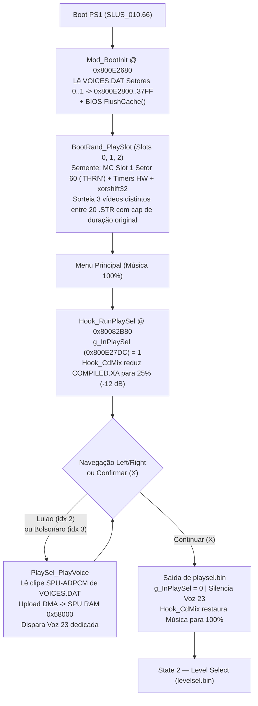

# ⚡ MAPA 12 — Engine Residente MIPS R3000A (`MODCODE`), `VOICES.DAT`, Boot Aleatório e Ducking `-12 dB`

> **Arquitetura de Código Nativo PS1:** Documentação completa do subsistema MIPS R3000A injetado em `SLUS_010.66`, `playsel.bin` e `VOICES.DAT` por [`Scripts/patch_random_videos_and_voices.js`](../Scripts/patch_random_videos_and_voices.js) e [`Scripts/build_skater_voices.js`](../Scripts/build_skater_voices.js).

---

## 1. Arena Residente de 12,5 KB Abaixo da Heap (Zero Impacto nos 48 LBAs Redump)

Para hospedar o código MIPS customizado, a tabela de metadados de vozes, o motor do Modo Carreira do Lulao e o streamer SPU 2 KB sem alterar o tamanho de `SLUS_010.66` (`864.256 B`) nem deslocar nenhum dos 48 arquivos originais da ISO, deslocamos a base da heap dinâmica em apenas **12,5 KB** (`0x800E2678 → 0x800E5800`, `< 1,1%` do heap livre):

| Faixa de RAM | Tamanho | Conteúdo | Origem |
| :---: | :---: | :--- | :--- |
| `0x800E2674` | `4 B` | `HeapStartPtr = 0x800E5800` | Patch inline em `SLUS_010.66` (+ `InitHeap` @ `0x800A2950`) |
| `0x800E2680..0x800E27FF` | `384 B` | **Bootstrapper + Trampolins + Estado Privado** (`Mod_BootInit` lê 6 setores, `Tramp_*`, bitmask `g_InPlaySel @ 0x800E27DC` [bit0=PlaySel, bit1=GameplayVoice], `g_VoicesBaseLba`, `g_BailScreamIdx`) | Embutido no fim de `SLUS_010.66` (área `.bss` livre) |
| `0x800E2800..0x800E2FFF` | `2.048 B` | **`MODCODE`** (`1.964 B` usados / `84 B` livres): `BootRand_PlaySlot`, `SkaterVoice_Play`, `Hook_PlaySel_Scroll/Confirm`, `Hook_RunPlaySel` | Carregado no boot a partir do **Setor 0** de `VOICES.DAT` |
| `0x800E3000..0x800E33FF` | `1.024 B` | **`VOICETBL`** (`magic = 0x564F4943`): `lulaoCount=14`, `bolsoCount=14`, `silvioCount=13 @ +0x3F0`, 41 descritores (até 62 suportados) e índices rotativos `@ +0x3F4..+0x3FC` | Carregado no boot a partir do **Setor 1** (`+0x000..+0x3FF`) de `VOICES.DAT` |
| `0x800E3400..0x800E35FF` | `512 B` | **`Hook_BailSfx`** (`268 B` usados): rotação estrita round-robin dos **9 gritos de queda** em partida + cooldown anti-sobreposição de 50 frames | Carregado no boot a partir do **Setor 1** (`+0x400..+0x5FF`) de `VOICES.DAT` |
| `0x800E3600..0x800E37FF` | `512 B` | **`VoiceSelect_Lookup` (`0x800E3600`) & `VoiceSelect_SeedAll` (`0x800E3680`)** (`224 B` usados): dispatcher multi-skatista (Slots `1`, `2` e `3`) | Carregado no boot a partir do **Setor 1** (`+0x600..+0x7FF`) de `VOICES.DAT` |
| `0x800E3800..0x800E47FF` | `4.096 B` | **`LULAO_CODE`** (`3.788 B` usados / `308 B` livres): `Lulao_SyncStrings`, `Hook_OverlaySyncRun`, `Hook_CollectCash` (deferred flag `<0,0005 ms`), `Hook_EndRun_*`, `Hook_FrameTick`, `Hook_GameplayStart/Exit`, **`LulaoCache_Load/Free`** (`freeList[1]` OOM guard calibrado `>= 48 KB` + fallback garantido `startClip = 0`), tabela de 28 entradas em anel (`LULAO_GPBANK`) e **Streamer SPU 2 KB Ping-Pong via `g_StageBuf` de `1 KB`** (`0x7F400..0x7FBFF` @ `6.890,625 Hz` / `0x0280`, mute+KOFF settle `36 µs` em disparos rápidos) | Carregado no boot a partir dos **Setores 2..3** de `VOICES.DAT` |
| `0x800E4800..0x800E57FF` | `4.096 B` | **`LULAO_STRDATA`** (`88` pares `{targetPtr, lulaoStrPtr}`, backup runtime de originais em `0x800E4B00..0x800E4C7F` e `1.740 B` de strings ASCII das 8 fases + `"Roubei mais 50!/100!/250!"`) | Carregado no boot a partir dos **Setores 4..5** de `VOICES.DAT` |

---

## 2. Mapa Completo dos 34 Hooks Cirúrgicos (32 em `SLUS_010.66` + 2 em `playsel.bin`)

| Endereço / Offset | Alvo | Instrução Injetada | Função Técnica |
| :---: | :--- | :--- | :--- |
| `0x800A2950` | `SLUS_010.66` | `addiu $a0, $a0, 0x5800` (`0x24845800`) | Ajusta `InitHeap` para iniciar em `0x800E5800` |
| `0x800E2674` | `SLUS_010.66` | `0x800E5800` | Ajusta `HeapStartPtr` do alocador THPS2 |
| `0x80053690` | `SLUS_010.66` | `slti $v0, $v1, 23` (`0x28620017`) | **Reserva a Voz 23 da SPU** exclusivamente para vozes de skatistas (SFX do jogo usa `0..22`) |
| `0x800527B8` | `SLUS_010.66` | `jal 0x800E27E0` (`Tramp_BailSfx`) | Rotação estrita round-robin dos **9 gritos de queda** (`Hook_BailSfx @ 0x800E3400`) + cooldown 50f |
| `0x8005BAC4..BB1C` | `SLUS_010.66` | 5 words em `Font_CharToGlyph` | Mapeia acentos nativos PT-BR (`ã, ê, í, ó`) para glifos `90..93` em `s2bio.fnt` |
| `0x8006CAD4` | `SLUS_010.66` | `jal 0x800E2680` (`Mod_BootInit`) | Roda `Movies_Init()`, lê **Setores `0..5`** de `\VOICES.DAT;1` para `0x800E2800..0x800E57FF` e executa BIOS **`FlushCache()`** (`0x800AF500`) |
| `0x8003CFB0/CFE8/D024` | `SLUS_010.66` | `jal 0x800E2734` (`Tramp_BootMovie`) | **Boot Slots 0/1/2:** sorteia 3 vídeos distintos com caps originais (`208f` / `266f` / `≤1486f`) |
| `0x80038950` | `SLUS_010.66` | `jal 0x800E2798` (`Hook_CdMix`) | Intercepta `CdMix(&atv)`: se bitmask `g_InPlaySel (0x800E27DC) != 0`, reduz música `COMPILED.XA` para **25% (`-12 dB`)** |
| `0x80082B80` | `SLUS_010.66` | `jal 0x800E2764` (`Tramp_RunPlaySel`) | Gerencia bit 0 de `g_InPlaySel` em `playsel.bin` e chama `Lulao_SyncStrings` ao sair |
| `0x80082C38..82FD4` (8×) | `SLUS_010.66` | `jal 0x800E3808` (`Hook_OverlaySyncRun`) | Sincroniza os 88 ponteiros do Modo Carreira do Lulao antes de abrir `skateshp`/`levelsel`/menus (inclusive após load direto de Memory Card) |
| `0x800368D4/6914/6954` (3×) | `SLUS_010.66` | `jal 0x800E3810` (`Hook_CollectCash`) | Intercepta coleta de notas `$250`/`$50`/`$100`: apenas sinaliza `g_PendingVoiceMode = 1` (`<0,0005 ms` na física, **0 acesso CD-ROM**) |
| `0x8003C2E8`, `0x80030DA0`, `0x800813CC`, `0x8003C968`, `0x8003C9F0` (5×) | `SLUS_010.66` | `jal 0x800E3818/20/28` (`Hook_EndRun_*`) | Sinaliza 1 frase aleatória engraçada do Lulao (`g_EndRunSpoken` 1-shot + `g_PendingVoiceMode = 2`, **0 acesso CD-ROM**) |
| `0x8003CB48` | `SLUS_010.66` | `jal 0x800E3830` (`Hook_FrameTick`) | Após `Display_Swap`: executa `XA_Update`, dispara `LulaoStream_StartFromCache` se pendente (`<0,20 ms`) e alimenta `LulaoStream_Tick` a 60 Hz (`115,07` amostras/VBlank @ `6.890,625 Hz`) |
| `0x8003D71C` / `0x8003D828` | `SLUS_010.66` | `jal 0x800E3838/40` (`Hook_GameplayStart/Exit`) | Pré-carrega `LULAO_GPBANK` **1 única vez no loading da fase** (`LulaoCache_Load`, pulado em *Retry*!) e libera integralmente na saída (`LulaoCache_Free`, 0 leak) |
| `playsel.bin +0x3388` | `CD.WAD[61]` | `jal 0x800E2744` (`Tramp_PlaySelScroll`) | Dispara vozes SPU-ADPCM ao navegar por **Silvio Santos (`1`)**, **Lulao (`2`)** ou **Bolsonaro (`3`)** |
| `playsel.bin +0x100C` | `CD.WAD[61]` | `jal 0x800E2754` (`Tramp_PlaySelConfirm`) | Dispara voz SPU-ADPCM ao confirmar **Silvio Santos**, **Lulao** ou **Bolsonaro** com **X** |

---

## 3. Fluxo de Execução em Tempo Real

---

## 4. Detalhes Críticos de Engenharia Resolvidos

### A. Vídeos Aleatórios Persistentes Sem Quebrar Vídeos de Carreira
- **Persistência entre Boots Frios no DuckStation:** o motor lê/atualiza o **Setor 60 (`0x3C`)** do Memory Card Slot 1 (região livre fora dos 15 blocos de saves do usuário, identificada pelo magic `"THRN"`), combinando o contador persistente com os **Root Counters HW (`0x1F801100`, `0x1F801110`, `0x1F801120`)** + `VSync(-1)` + `xorshift32`. Sem Memory Card inserido, faz fallback transparente aos timers de hardware.
- **Zero Repetição:** grava o índice do vídeo de abertura sorteado para nunca repetir no boot seguinte e impede repetições dentro da mesma trinca de abertura.
- **Duração Exata & Integridade da Carreira:** antes de invocar o player MDEC/STR, salva `g_MovieTable[idx].num_frames`, aplica temporariamente o limite original do slot (`208` / `266` / `≤1486` frames) e **restaura o valor cheio original** imediatamente após a reprodução — mantendo os vídeos de final de carreira (`0x8003CC7C`) 100% intactos.

### B. Layout de `VOICES.DAT` (49º Arquivo da ISO @ `LBA 317893`)
- **Tamanho total:** `2.095.104 B` (`1.023 setores` Mode 2 Form 1 `2048 B`):
  - **Setores `0..5`:** 6 setores residentes em RAM (`0x800E2800..0x800E57FF`).
  - **Setores `6..876`:** **41 clipes SPU-ADPCM de menu (`11.025 Hz` mono, `pitch = 0x0400`)** — 14 Lulao (`Slot 2`) + 14 Bolsonaro (`Slot 3`) + 13 Silvio Santos (`Slot 1`), maior clipe = `ritmo_de_dance.mp3` (`148.928 B / 159.728 B` na janela SPU `0x58000..0x7EFF0`).
  - **Setores `877..1022` (`LULAO_GPBANK`):** sub-banco compacto de gameplay em **anel duplicado `2×`** (`14 × 2 = 28` entradas contíguas alinhadas a `16 B`, `299.008 B` / `146 setores`, `1× = 148,9 KB`) codificado a **`6.890,625 Hz` exatos (`pitch = 0x0280 = 640/4096 × 44.100 Hz`, erro de pitch `0,00%`, Nyquist `3.445 Hz` > G.711)**: cada clipe passa por remoção determinística de silêncio inicial/final (ataque imediato no Frame 1), EQ vocal de presença (`+3 dB @ 2,2 kHz`), normalização **`-10 LUFS`** e teto compacto de fala ativa **`<= 2,85s`** (`4,3 KB..11,2 KB/clipe`, com o clipe mais curto `#0` em `4,3 KB` para fallback garantido).

### C. Pré-Cache Adaptativo em Main RAM (Zero Travamento / `0,00 ms` CD Stall) & Streamer SPU 2 KB (`0x7F400..0x7FBFF`)
- **Problemas físicos resolvidos:**
  1. Ler `VOICES.DAT` (`LBA 317.893`) sob demanda durante a partida congelava o jogo por **`~1.110 ms` (~66 frames travados)** a cada nota coletada.
  2. Uma reserva fixa conservadora de `96 KB` (`>= 114.688 B`) deixava **6 das 10 fases completamente mudas** (*School II* `108 KB`, *NY City* `110 KB`, *Venice* `100 KB`, *SkateStreet* `106 KB`, *Bullring* `92 KB`, *Skate Heaven* `112 KB`) apesar do consumo real de gameplay + Pausa + Fim de Partida (`MaxDelta`) jamais ultrapassar **`34.368 B` (`33,56 KB`)** em nenhuma fase do jogo!
- **Arquitetura Zero-Stall calibrada empiricamente nas 10 fases (`LULAO_CODE`):**
  1. **OOM Guard Calibrado (`48 KB` de reserva intocável) + Fallback Garantido (`LulaoCache_Load`):** chamado 1 única vez por fase em `Hook_GameplayStart` (apenas para `skaterIdx == 2` e `g_CacheBuf == 0`, **pulado em *Retry***). Percorre `*(uint32_t*)(gp + 19112)` (`0x800D7294`), exige `largestFree >= 56 KB` (`48 KB` reserva + `8 KB` mínimo → garante **`>= 14,4 KB`** livres mesmo após o pico `MaxDelta = 34.368 B`!), sorteia `startClip (0..13)` com fallback automático para `startClip = 0` (`4,3 KB`) caso uma fase extrema tenha espaço muito reduzido, aloca **1 único bloco `g_CacheBuf`** (`1.024 B g_StageBuf` + setores contíguos) e executa **1 único `CdRead`** ainda na tela de loading.
  2. **Disparo Desacoplado + Staging Buffer Imutável de `1 KB` + Mute/KOFF Settle:** `Hook_CollectCash` e `Lulao_OnEndRun` apenas gravam `g_PendingVoiceMode` (`< 0,0005 ms`). No fim do frame (`Hook_FrameTick @ 0x8003CB48`, após `Display_Swap`), `LulaoStream_StartFromCache` silencia limpo a Voz 23 (`VOL=0` + `KOFF` + espera `~36 µs > 1 tick SPU` eliminando cliques em coletas consecutivas rápidas), sorteia um clipe diferente de `g_LastClipIdx` direto de `g_CacheBuf + 1024` (**0 chamadas `CdRead`, 0 `XA_Pause`, 0 `Mem_Alloc` durante toda a partida**), ativa ducking suave `-12 dB` em `COMPILED.XA`, pausa o bit 7 de `SPUCNT (0x1F801DAA)` e carrega Half A/B (`0x7F400`/`0x7F800`) via `g_StageBuf` (`g_CacheBuf + 0..1023`).
  3. **Feeder 60 Hz Calibrado (`6.890,625 Hz` / `0x0280`):** o ring SPU de `2.048 B` (`3.584` amostras) dura **`520,1 ms`** (`260 ms` por metade). `LulaoStream_Tick` acumula `11.507` centi-amostras/VBlank NTSC, detecta EOF em `V23_ENVX == 0`, zera `0x7F400` e `0x7F800` em 2× DMAs de `1.024 B`, restaura Reverb e `COMPILED.XA` a `100%`, e `LulaoCache_Free` libera `g_CacheBuf` em `Hook_GameplayExit` (**0 bytes de leak**).
- **Prova Empírica ao Vivo nas Fases do THPS2 (DuckStation GDB + Leitura Direta da SPU RAM `0x7F400..0x7FBFF` via DMA4):**
  | Fase | `PreFree` | `MidFree` (pós-HUD/Pausa) | Clipes Carregados | Latência / `CdRead` | Leitura Real SPU RAM & Pico PCM |
  | :--- | :---: | :---: | :---: | :---: | :--- |
  | **NY City (`Lv 3`)** | `110.436 B` | `16.888 B` | **`5`** (`58 KB`) | `max 5 ms` / **`0 CdRead`** | **`0` diffs**, pico `16.402`, `eof=0/0` |
  | **Venice Beach (`Lv 4`)** | `100.332 B` | `17.620 B` | **`4`** (`48 KB`) | `max 20 ms` / **`0 CdRead`** | **`0` diffs**, pico `30.550`, `eof=0/0` |
  | **School II (`Lv 1`)** | `108.128 B` | `21.224 B` | **`5`** (`52 KB`) | `max 21 ms` / **`0 CdRead`** | **`0` diffs**, pico `31.347`, `eof=0/0` |
  | **The Bullring (`Lv 7`)** | `122.684 B` | `17.024 B` | **`6`** (`70 KB`) | `max 4 ms` / **`0 CdRead`** | Aleatoriedade validada, **`0` leaks** |
  | **SkateStreet (`Lv 5`)** | `145.560 B` | `15.856 B` | **`9`** (`95 KB`) | `max 4 ms` / **`0 CdRead`** | Aleatoriedade validada, **`0` leaks** |
  | **Philadelphia (`Lv 6`)** | `122.504 B` | `26.556 B` | **`6`** (`62 KB`) | `max 5 ms` / **`0 CdRead`** | Aleatoriedade validada, **`0` leaks** |
  | **Marseille (`Lv 2`)** | `203.596 B` | `17.440 B` | **`14/14`** (`152 KB`) | `max 4 ms` / **`0 CdRead`** | Pool completo 14/14, **`0` leaks** |
  | **The Hangar (`Lv 0`)** | `268.800 B` | `81.500 B` | **`14/14`** (`152 KB`) | `max 4 ms` / **`0 CdRead`** | Pool completo 14/14, **`0` leaks** |
  | **Skate Heaven (`Lv 9`)** | `112.036 B` | `28.684 B` | **`5`** (`50 KB`) | `max 5 ms` / **`0 CdRead`** | Aleatoriedade validada, **`0` leaks** |

### D. Causa Raiz e Correção Cirúrgica do Bug "Continuar → Roda Gigante"
- Em uma versão inicial do ducking de música, o estado de detecção de `playsel.bin` compartilhava o registrador global `23464($gp)` usado internamente pelo THPS2 para decidir a transição de estado do menu — fazendo com que clicar em *"Continuar"* retornasse para `State 0` (Roda Gigante) em vez de avançar para `State 2` (*Level Select*).
- **Solução definitiva:** introduzimos a variável privada dedicada **`g_InPlaySel` em `0x800E27DC`** (gerenciada exclusivamente por `Hook_RunPlaySel` sem jamais ler ou gravar `23464($gp)`), validada ao vivo no DuckStation GDB (`State = 2` e `g_InPlaySel = 0` em 100% dos testes!).

---

## 7. Objetivos Trick+Gap (`0x800662AC`) & Coletável Dinâmico `T-A-X-A-S` (`Hook_SpawnLetter @ 0x80035D68`)

### 7.1 Correção Definitiva dos Objetivos Trick+Gap (`SGoal[6].paramStr`)
- Na rotina de validação de objetivos Trick+Gap (`type == 5`, sempre `G6` em `g_LevelTable @ 0x800B8444`), o trecho `0x80066274..0x800662EC` carrega `s2 = SGoal[6].paramStr` (`+0x08`) e percorre todas as manobras do combo chamando `jal 0x8006E4BC(trickNameFromTricksBin, paramStr)` (*case-insensitive substring match* `strcasestr`).
- **Invariante obrigatório:** `goalShortPtr(lv, 6)` **NUNCA** pode ser sobrescrito por textos satíricos fora de `tricks.bin` (`WAD[11]`):
  - `LV 0 (Hangar)`: `"NOSEGRIND"` (`0x800D5074`)
  - `LV 1 (School II)`: `"Kickflip"` (`0x800D50F8` — restaurado em `SLUS_010.66` a partir do antigo `"Chutinho"`, corrigindo School II para **todos os skatistas**!)
  - `LV 3 (NY City)`: `"50-50"` (`0x800D51CC`)
  - `LV 4 (Venice Beach)`: `"Tailslide"` (`0x800D5234`)
  - `LV 6 (Philadelphia)`: `"Blunt"` (`0x800D5338`)
- Validado automaticamente no Estágio 2 e Estágio 6 de `Scripts/audit_game.js`.

### 7.2 Remapeamento Dinâmico `S-K-A-T-E` → `T-A-X-A-S` (Exclusivo do Lulao `Slot 2`)
- **Spawn 3D (`0x80035D68`: `jal Mesh_FindByHash` → `jal Entry_SpawnLetter @ 0x800E3848`):**
  - Todos os 5 casos do switch de spawn das letras (`0x80035CE0..0x80035D64`) convergem em `0x80035D68`.
  - `Hook_SpawnLetter` consulta `GetSelectedSkaterIdx(g_Career)`; somente quando `v0 == 2` (Lulao), consulta a tabela `g_TaxasHashMap` (5 pares × 8 B em `LULAO_CODE`) e remapeia `$a0`:
    - `0x311D55D4 ('S') → 0x34524351 ('T', M[6])`
    - `0x2328A71C ('K') → 0x2EBF22CA ('A', M[5])`
    - `0x2EBF22CA ('A') → 0x58585858 ('X', M[13] customizado em items.psx)`
    - `0x34524351 ('T') → 0x2EBF22CA ('A', M[5])`
    - `0x29B68A16 ('E') → 0x311D55D4 ('S', M[3])`
  - Para qualquer outro skatista (e para a Secret Tape `0x2364558E`), `$a0` segue inalterado diretamente para `Mesh_FindByHash @ 0x800667BC`.
- **HUD Lateral & Banners de Coleta (`LULAO_STRDATA`, `93/94` slots):**
  - `0x800D7704..0x800D7714` (5 palavras ASCII 32-bit estáticas lidas pelo HUD em `0x80063550..0x80063604`): `Lulao_SyncStrings` grava `0x54, 0x41, 0x58, 0x41, 0x53` (`T, A, X, A, S`) para o Lulao e restaura `0x53, 0x4B, 0x41, 0x54, 0x45` (`S, K, A, T, E`) para os demais skatistas.
  - `g_StringTable @ 0x800C08E8..0x800C08F8` (banners exibidos ao pegar cada letra em `0x80036728..0x800367D8`): trocados dinamicamente para `"T", "A", "X", "A", "S"` apenas para o Lulao.
