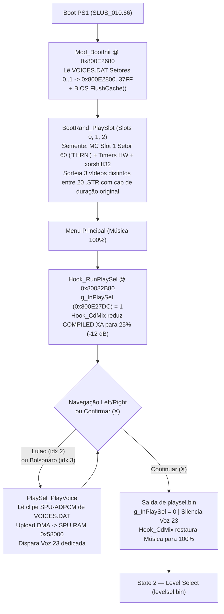

# ⚡ MAPA 12 — Engine Residente MIPS R3000A (`MODCODE`), `VOICES.DAT`, Boot Aleatório e Ducking `-12 dB`

> **Arquitetura de Código Nativo PS1:** Documentação completa do subsistema MIPS R3000A injetado em `SLUS_010.66`, `playsel.bin` e `VOICES.DAT` por [`Scripts/patch_random_videos_and_voices.js`](../Scripts/patch_random_videos_and_voices.js) e [`Scripts/build_skater_voices.js`](../Scripts/build_skater_voices.js).

---

## 1. Arena Residente de 4,5 KB Abaixo da Heap (Zero Impacto nos 48 LBAs Redump)

Para hospedar o código MIPS customizado e a tabela de metadados de vozes sem alterar o tamanho de `SLUS_010.66` (`864.256 B`) nem deslocar nenhum dos 48 arquivos originais da ISO, deslocamos a base da heap dinâmica em apenas **4.5 KB** (`0x800E2678 → 0x800E3800`):

| Faixa de RAM | Tamanho | Conteúdo | Origem |
| :---: | :---: | :--- | :--- |
| `0x800E2674` | `4 B` | `HeapStartPtr = 0x800E3800` | Patch inline em `SLUS_010.66` (+ `InitHeap` @ `0x800A2950`) |
| `0x800E2680..0x800E27FF` | `384 B` | **Bootstrapper + Trampolins + Estado Privado** (`Mod_BootInit`, `Tramp_*`, `g_InPlaySel @ 0x800E27DC`, `g_VoicesLba`, `g_PlaySelState`) | Embutido no fim de `SLUS_010.66` (área `.bss` livre) |
| `0x800E2800..0x800E2FFF` | `2.048 B` | **`MODCODE`** (`1.936 B` usados / `112 B` livres): `BootRand_PlaySlot`, `SkaterVoice_Play`, `Hook_PlaySel_Scroll/Confirm`, `Hook_RunPlaySel` | Carregado no boot a partir do **Setor 0** de `VOICES.DAT` |
| `0x800E3000..0x800E33FF` | `1.024 B` | **`VOICETBL`** (`magic = 0x564F4943`): `lulaoCount=14`, `bolsoCount=14`, `silvioCount=13 @ +0x3F0`, 41 descritores (até 62 suportados) e índices rotativos `@ +0x3F4..+0x3FC` | Carregado no boot a partir do **Setor 1** (`+0x000..+0x3FF`) de `VOICES.DAT` |
| `0x800E3400..0x800E35FF` | `512 B` | **`Hook_BailSfx`** (`268 B` usados): rotação estrita round-robin dos **9 gritos de queda** em partida + cooldown anti-sobreposição de 50 frames | Carregado no boot a partir do **Setor 1** (`+0x400..+0x5FF`) de `VOICES.DAT` |
| `0x800E3600..0x800E37FF` | `512 B` | **`VoiceSelect_Lookup` (`0x800E3600`) & `VoiceSelect_SeedAll` (`0x800E3680`)** (`224 B` usados): dispatcher multi-skatista (Slots `1`, `2` e `3`) | Carregado no boot a partir do **Setor 1** (`+0x600..+0x7FF`) de `VOICES.DAT` |

---

## 2. Mapa Completo dos 11 Hooks Cirúrgicos (9 em `SLUS_010.66` + 2 em `playsel.bin`)

| Endereço / Offset | Alvo | Instrução Injetada | Função Técnica |
| :---: | :--- | :--- | :--- |
| `0x800A2950` | `SLUS_010.66` | `addiu $a0, $a0, 0x3800` (`0x24843800`) | Ajusta `InitHeap` para iniciar em `0x800E3800` |
| `0x800E2674` | `SLUS_010.66` | `0x800E3800` | Ajusta `HeapStartPtr` do alocador THPS2 |
| `0x80053690` | `SLUS_010.66` | `slti $v0, $v1, 23` (`0x28620017`) | **Reserva a Voz 23 da SPU** exclusivamente para vozes de skatistas (SFX do jogo usa `0..22`) |
| `0x8006CAD4` | `SLUS_010.66` | `jal 0x800E2680` (`Mod_BootInit`) | Roda `Movies_Init()`, lê Setores `0..1` de `\VOICES.DAT;1` para `0x800E2800..0x800E37FF` e executa BIOS **`FlushCache()`** (`0x800AF500`) |
| `0x8003CFB0` | `SLUS_010.66` | `jal 0x800E2734` (`Tramp_BootMovie`) | **Boot Slot 0 (Activision):** sorteia vídeo aleatório com cap exato de **`208` frames (`13,87s`)** |
| `0x8003CFE8` | `SLUS_010.66` | `jal 0x800E2734` (`Tramp_BootMovie`) | **Boot Slot 1 (Neversoft):** sorteia vídeo aleatório com cap exato de **`266` frames (`17,73s`)** |
| `0x8003D024` | `SLUS_010.66` | `jal 0x800E2734` (`Tramp_BootMovie`) | **Boot Slot 2 (Intro):** sorteia vídeo aleatório com cap de **`≤ 1.486` frames (`99,07s`)** |
| `0x80038950` | `SLUS_010.66` | `jal 0x800E2798` (`Hook_CdMix`) | Intercepta `CdMix(&atv)` em `XA_UpdateVolume`: se `g_InPlaySel != 0`, atenua volume da música `COMPILED.XA` para **25% (`vol >> 2`, `-12 dB`)** |
| `0x80082B80` | `SLUS_010.66` | `jal 0x800E2764` (`Tramp_RunPlaySel`) | Envolve a execução de `playsel.bin`: seta `g_InPlaySel = 1` + aplica ducking ao entrar; ao sair, zera `g_InPlaySel = 0`, silencia Voz 23 e restaura música a **100%** |
| `playsel.bin +0x3388` | `CD.WAD[61]` | `jal 0x800E2744` (`Tramp_PlaySelScroll`) | Ao passar **Left/Right** por **Lulao (`idx 2`)** ou **Bolsonaro (`idx 3`)**, avança o índice rotativo e dispara o próximo clipe SPU-ADPCM na Voz 23 |
| `playsel.bin +0x100C` | `CD.WAD[61]` | `jal 0x800E2754` (`Tramp_PlaySelConfirm`) | Ao confirmar **Lulao** ou **Bolsonaro** com **X**, toca o chime + próximo clipe SPU-ADPCM do skatista |

---

## 3. Fluxo de Execução em Tempo Real

---

## 4. Detalhes Críticos de Engenharia Resolvidos

### A. Vídeos Aleatórios Persistentes Sem Quebrar Vídeos de Carreira
- **Persistência entre Boots Frios no DuckStation:** o motor lê/atualiza o **Setor 60 (`0x3C`)** do Memory Card Slot 1 (região livre fora dos 15 blocos de saves do usuário, identificada pelo magic `"THRN"`), combinando o contador persistente com os **Root Counters HW (`0x1F801100`, `0x1F801110`, `0x1F801120`)** + `VSync(-1)` + `xorshift32`. Sem Memory Card inserido, faz fallback transparente aos timers de hardware.
- **Zero Repetição:** grava o índice do vídeo de abertura sorteado para nunca repetir no boot seguinte e impede repetições dentro da mesma trinca de abertura.
- **Duração Exata & Integridade da Carreira:** antes de invocar o player MDEC/STR, salva `g_MovieTable[idx].num_frames`, aplica temporariamente o limite original do slot (`208` / `266` / `≤1486` frames) e **restaura o valor cheio original** imediatamente após a reprodução — mantendo os vídeos de final de carreira (`0x8003CC7C`) 100% intactos.

### B. Layout de `VOICES.DAT` (49º Arquivo da ISO @ `LBA 317893`)
- **Tamanho total:** `1.787.904 B` (`873 setores` Mode 2 Form 1 `2048 B`).
- **Codificação SPU-ADPCM:** `11.025 Hz` mono (`pitch = 0x0400`), normalização via `ffmpeg`, **14 falas de Lulao (`Slot 2`) + 14 de Bolsonaro (`Slot 3`) + 13 de Silvio Santos (`Slot 1`)** (`41` clipes no total; maior clipe = `ritmo_de_dance.mp3` com `148.928 B` dentro da janela dedicada `0x58000..0x7EFF0` = `159.728 B` na SPU RAM, `10.800 B` de folga).

### C. Causa Raiz e Correção Cirúrgica do Bug "Continuar → Roda Gigante"
- Em uma versão inicial do ducking de música, o estado de detecção de `playsel.bin` compartilhava o registrador global `23464($gp)` usado internamente pelo THPS2 para decidir a transição de estado do menu — fazendo com que clicar em *"Continuar"* retornasse para `State 0` (Roda Gigante) em vez de avançar para `State 2` (*Level Select*).
- **Solução definitiva:** introduzimos a variável privada dedicada **`g_InPlaySel` em `0x800E27DC`** (gerenciada exclusivamente por `Hook_RunPlaySel` sem jamais ler ou gravar `23464($gp)`), validada ao vivo no DuckStation GDB (`State = 2` e `g_InPlaySel = 0` em 100% dos testes!).
