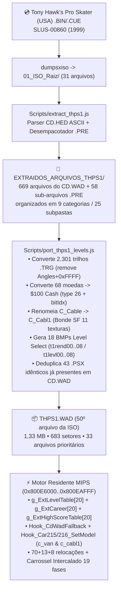

# 🏛️ MAPA 14 — Enciclopédia Forense Completa de *Tony Hawk's Pro Skater 1* (`SLUS-00860`) & Integração Intercalada das 9 Fases no Motor do THPS2

> **Disco Analisado:** *Tony Hawk's Pro Skater (USA / NTSC-U `SLUS-00860`)* — Neversoft / Activision (Agosto de 1999)  
> **Pasta de Extração Categorizada Local:** `EXTRAIDOS_ARQUIVOS_THPS1/`  
> **Escopo Documentado:** **31 arquivos da raiz da ISO** + **669 arquivos internos do `CD.WAD`** + **58 sub-arquivos desempacotados dos 6 pacotes `.PRE`** + **arquitetura binária completa da integração das 9 fases do THPS1 intercaladas no Modo Carreira do THPS2 (`SLUS-01066`)**.

---

## 1. Visão Geral Didática: Como o Disco do THPS1 é Construído

Se você já explorou o [MAPA 01](MAPA_01_MEMORIA_E_EXECUTAVEL.md) e o [MAPA 06](MAPA_06_TEXTURAS_FONTES_E_WAD.md) do **THPS2**, vai reconhecer imediatamente o "DNA" da engine da Neversoft no **THPS1** — mas com **três diferenças arquiteturais fascinantes** que explicam por que os dois jogos são irmãos quase gêmeos e, ao mesmo tempo, exigem engenharia cirúrgica para rodarem juntos no PlayStation 1:

| Característica Técnica | *Tony Hawk's Pro Skater 1* (`SLUS-00860`, 1999) | *Tony Hawk's Pro Skater 2* (`SLUS-01066`, 2000) | Impacto na Integração THPS1 → THPS2 |
| :--- | :--- | :--- | :--- |
| **Tamanho Total do Disco** | **31 arquivos na raiz** (~621,87 MB de dados úteis) | **48 arquivos Redump** + `VOICES.DAT` + **`THPS1.WAD`** (50º arquivo) | Preserva 48/48 LBAs Redump do THPS2 sem mover 1 setor original! |
| **Executável `PS-X EXE`** | `SLUS_008.60` (`841.728 B`) | `SLUS_010.66` (`864.256 B`) | Motor residente MIPS de 20 fases em `0x800E6000..0x800EAFFF`. |
| **Índice `CD.HED`** | **ASCII em texto puro** (`15.461 B`, nome `\0` alinhado a 4 B + offset + size) | **Hashes Neversoft 32-bit** (`0x80053F10`, 12 B/entrada, sem nomes) | Extração do THPS1 revela 100% dos 669 nomes reais de fábrica! |
| **Contêiner `CD.WAD`** | `26.630.144 B` (**669 arquivos**) | `86.173.696 B` (**1.531 arquivos**) | **Descoberta forense:** 43 `.PSX` do THPS1 já estão idênticos em `CD.WAD[1127..1183]` do THPS2! |
| **Trilha Sonora** | **10 arquivos `.STR` separados** (`DK.STR`, `GOLDFING.STR`, `PRIMUS.STR`...) | **1 arquivo `COMPILED.XA`** de 8 canais intercalados | Hook em `XA_GetLevelTrack @ 0x80038C98` (`andi v1,v1,0xF`) toca faixas reais do THPS2 nas 9 fases! |
| **Geometria 3D `.PSX`** | Versão `0x00020004` com `SuperSectors` (chunk `0x0A`), faces 32 B | Versão `0x00020004` — **100% compatível no nível da GPU/GTE!** | As malhas e texturas 4bpp/8bpp das 9 fases rodam nativamente a 60 FPS no THPS2! |
| **Gatilhos `.TRG v2.0`** | **Trilhos `Type 10/11` têm +6 B (`Angles`) + `0xFFFF`**; moedas giratórias `Type 5 (21/22/23)` | **Trilhos `Type 10/11` sem `Angles`/terminador**; dinheiro `Type 5 (26 = $100)` | `Scripts/port_thps1_levels.js` converte **2.301 trilhos** + **68 nós de moedas → `$100` Cash**! |
| **Fases do Modo Carreira** | **9 fases** (6 regulares com 5 metas cada + 3 competições de medalhas) | **10 fases** (5 regulares com 10 metas + 3 comp. + 2 bônus) + Custom Park | **19 fases jogáveis intercaladas** (THPS2 ↔ THPS1) + Custom Park! |



---

## 2. Estrutura de Pastas Criada em `EXTRAIDOS_ARQUIVOS_THPS1/`

Todos os **31 arquivos da raiz**, **669 arquivos do `CD.WAD`** e **58 sub-arquivos dos 6 `.PRE`** foram extraídos e categorizados automaticamente por [`Scripts/extract_thps1.js`](../Scripts/extract_thps1.js):

| Subpasta dentro de `EXTRAIDOS_ARQUIVOS_THPS1/` | Qtd. Arquivos | Conteúdo |
| :--- | :---: | :--- |
| `01_ISO_Raiz/` | **31** | Imagem ISO bruta extraída (`SYSTEM.CNF`, `SLUS_008.60`, `CD.HED`, `CD.WAD`, 27 `.STR` + `license_data.dat`). |
| `02_Fases_do_Jogo/01_Warehouse_WoodlandHills/` | **6** | Fase 1 (*Warehouse*): 4 `.PSX` + `skware_t.trg` + `load_war.bmp`. |
| `02_Fases_do_Jogo/02_School_Miami/` | **7** | Fase 2 (*School*): 5 `.PSX` + `skschl_t.trg` + `load_sch.bmp`. |
| `02_Fases_do_Jogo/03_Mall_NewYork/` | **8** | Fase 3 (*Mall*): 6 `.PSX` + `skmall_t.trg` + `load_mal.bmp`. |
| `02_Fases_do_Jogo/04_SkatePark_Chicago_Comp/` | **7** | Fase 4 (*Skate Park Chicago — Comp*): 5 `.PSX` + `skvans_t.trg` + `loadcp1.bmp`. |
| `02_Fases_do_Jogo/05_Downtown_Minneapolis/` | **8** | Fase 5 (*Downtown*): 6 `.PSX` + `skdown_t.trg` + `load_dow.bmp`. |
| `02_Fases_do_Jogo/06_DownhillJam_Phoenix/` | **8** | Fase 6 (*Downhill Jam*): 6 `.PSX` + `skjam_t.trg` + `load_dhj.bmp`. |
| `02_Fases_do_Jogo/07_Burnside_Portland_Comp/` | **6** | Fase 7 (*Burnside — Comp*): 4 `.PSX` + `skburn_t.trg` + `loadcp2.bmp`. |
| `02_Fases_do_Jogo/08_Streets_SanFrancisco/` | **8** | Fase 8 (*Streets San Francisco*): 6 `.PSX` + `sksf_t.trg` + `load_san.bmp`. |
| `02_Fases_do_Jogo/09_Roswell_NewMexico_Comp/` | **8** | Fase 9 (*Roswell — Comp*): 6 `.PSX` + `skros_t.trg` + `loadcp3.bmp`. |
| `02_Fases_do_Jogo/10_Veiculos_e_Objetos_Compartilhados/` | **7** | Veículos (`c_taxi`, `c_van`, `c_police`, `c_cable`) + `items.psx`, `bits.psx`, `skmedals.psx`. |
| `03_Skatistas_Modelos_3D/Singleplayer_1P/` | **12** | Modelos 3D `.PSX` de gameplay dos 10 pros + Officer Dick + Private Carrera. |
| `03_Skatistas_Modelos_3D/Frontend_Selecao/` | **12** | Modelos 3D `.PSX` de alta resolução exibidos na tela de Seleção de Skatistas. |
| `03_Skatistas_Modelos_3D/Multiplayer_2P/` | **9** | Modelos 3D `.PSX` otimizados (Lo-LOD) para tela dividida (*Split-Screen*). |
| `04_Audio_Bancos_VAB/` | **10** | Todos os 10 bancos de efeitos sonoros SPU-ADPCM (`skate.vab`, `ware.vab`, `school.vab`, etc.). |
| `05_Pacotes_PRE/Arquivos_PRE_Originais/` | **6** | Os 6 pacotes `.PRE` originais do `CD.WAD`. |
| `05_Pacotes_PRE/Desempacotados/` | **58** | Todos os 58 sub-arquivos desempacotados de cada `.PRE` em pastas individuais. |
| `06_Fontes_FNT/` | **11** | Todas as 11 fontes bitmap Neversoft (`.FNT`) usadas no HUD, menus e créditos. |
| `07_Imagens_UI_e_Equipamentos_BMP/Menus_e_Fundos/` | **25** | Fundos de tela, painéis de menu, logos e molduras. |
| `07_Imagens_UI_e_Equipamentos_BMP/Selecao_de_Fases/` | **17** | Miniaturas `levsel0..9.bmp` e elementos visuais da tela de Seleção de Fases. |
| `07_Imagens_UI_e_Equipamentos_BMP/Telas_de_Loading/` | **7** | Imagens de carregamento gerais e telas de transição. |
| `07_Imagens_UI_e_Equipamentos_BMP/HUD_Icones_e_Medalhas/` | **39** | Ícones de HUD, fitas, botões do controle PS1, medalhas e indicadores. |
| `07_Imagens_UI_e_Equipamentos_BMP/Shapes_Decks/` | **369** | Toda a biblioteca de 369 *decks* (shapes) de marcas licenciadas de 1999! |
| `07_Imagens_UI_e_Equipamentos_BMP/Rodas_Wheels/` | **60** | Todos os 60 conjuntos de rodas (*wheels*) do Skate Shop do THPS1. |
| `07_Imagens_UI_e_Equipamentos_BMP/Trucks/` | **6** | Todos os 6 modelos de *trucks* metálicos. |
| `08_Demos_Replays_REC/` | **10** | Os 10 arquivos `.REC` de demonstração automática (*Attract Mode*). |
| `09_Textos_e_Outros/` | **3** | Arquivos auxiliares (`credits.txt`, tabelas de manobras/texto). |

---

## 3. Catálogo Completo dos 31 Arquivos da Raiz da ISO (`01_ISO_Raiz/`)

| # | Arquivo | Tipo ISO | Data Original (1999) | Tamanho | Papel no Jogo |
| :---: | :--- | :---: | :---: | :---: | :--- |
| 1 | `411.STR` | `mixed` | `1999-08-14 10:16:30` | 10.689.536 B (10,19 MB) | Vídeo bônus desbloqueável da revista em vídeo **411VM**. |
| 2 | `AARON.STR` | `mixed` | `1999-08-20 22:15:48` | 14.576.640 B (13,90 MB) | Vídeo bônus de créditos / homenagem especial (*Aaron / Neversoft Crew*). |
| 3 | `ATVILOGO.STR` | `mixed` | `1998-09-10 19:04:32` | 4.933.632 B (4,71 MB) | Vídeo FMV MDEC+XA de abertura: logo da **Activision**. |
| 4 | `BAILS.STR` | `mixed` | `1999-07-26 14:01:52` | 18.613.248 B (17,75 MB) | Vídeo bônus desbloqueável de quedas reais (*Neversoft Bails Tape*). |
| 5 | `BURNQUIS.STR` | `mixed` | `1999-08-02 02:06:12` | 10.988.544 B (10,48 MB) | Vídeo final de carreira do skatista **Bob Burnquist**. |
| 6 | `CAMPBELL.STR` | `mixed` | `1999-08-02 02:21:46` | 11.661.312 B (11,12 MB) | Vídeo final de carreira do skatista **Kareem Campbell**. |
| 7 | `CD.HED` | `data` | `1999-08-20 21:13:08` | 15.461 B (0,01 MB) | Índice em ASCII plaintext (4-byte aligned + offset u32 + size u32) dos 669 arquivos empacotados em `CD.WAD` (sem hash!). |
| 8 | `CD.WAD` | `data` | `1999-08-20 21:13:08` | 26.630.144 B (25,40 MB) | Contêiner principal de ativos (26,63 MB, alinhado a setores de 2.048 B) contendo todas as 9 fases, skatistas, decks, fontes, áudio `.VAB`, UI e `.PRE`. |
| 9 | `DK.STR` | `mixed` | `1999-08-17 07:24:30` | 43.879.424 B (41,85 MB) | Trilha sonora CD-XA multi-canal: **Dead Kennedys — *Police Truck*** (e faixas intercaladas). |
| 10 | `ERNIES.STR` | `mixed` | `1999-08-02 06:10:30` | 43.879.424 B (41,85 MB) | Trilha sonora CD-XA multi-canal: **The Ernies — *Here & Now*** (e faixas intercaladas). |
| 11 | `EVENRUDE.STR` | `mixed` | `1999-08-02 06:40:24` | 43.879.424 B (41,85 MB) | Trilha sonora CD-XA multi-canal: **Even Rude — *Vilified*** (e faixas intercaladas). |
| 12 | `GLIFBERG.STR` | `mixed` | `1999-08-02 07:04:34` | 11.287.552 B (10,76 MB) | Vídeo final de carreira do skatista **Rune Glifberg**. |
| 13 | `GOLDFING.STR` | `mixed` | `1999-06-18 02:33:06` | 43.804.672 B (41,78 MB) | Trilha sonora CD-XA multi-canal: **Goldfinger — *Superman*** (clássico tema do Warehouse!). |
| 14 | `HAWK.STR` | `mixed` | `1999-08-02 07:20:02` | 10.988.544 B (10,48 MB) | Vídeo final de carreira do skatista **Tony Hawk**. |
| 15 | `INTRO.STR` | `mixed` | `1999-08-19 07:11:18` | 23.247.872 B (22,17 MB) | Vídeo FMV MDEC+XA principal de introdução do jogo (*Intro Montage*). |
| 16 | `LASEK.STR` | `mixed` | `1999-08-10 08:29:08` | 11.511.808 B (10,98 MB) | Vídeo final de carreira do skatista **Bucky Lasek**. |
| 17 | `LOGO.STR` | `mixed` | `1999-08-19 19:59:54` | 4.223.488 B (4,03 MB) | Vídeo FMV MDEC+XA de abertura: logo da **Neversoft** (olho perfurado). |
| 18 | `MUSKA.STR` | `mixed` | `1999-08-10 08:29:18` | 10.689.536 B (10,19 MB) | Vídeo final de carreira do skatista **Chad Muska**. |
| 19 | `PRIMUS.STR` | `mixed` | `1999-08-08 16:07:04` | 43.916.800 B (41,88 MB) | Trilha sonora CD-XA multi-canal: **Primus — *Jerry Was a Race Car Driver*** (e faixas intercaladas). |
| 20 | `REYNOLDS.STR` | `mixed` | `1999-07-20 17:13:36` | 10.913.792 B (10,41 MB) | Vídeo final de carreira do skatista **Andrew Reynolds**. |
| 21 | `ROWLEY.STR` | `mixed` | `1999-06-28 19:52:08` | 10.764.288 B (10,27 MB) | Vídeo final de carreira do skatista **Geoff Rowley**. |
| 22 | `SLUS_008.60` | `data` | `1999-08-20 21:13:10` | 841.728 B (0,80 MB) | Executável principal `PS-X EXE` (MIPS R3000A) do THPS1 NTSC-U (841.728 B). Contém motor Neversoft v1, tabelas das 9 fases, física, GTE/SPU e lógica de carreira. |
| 23 | `SPEED.STR` | `mixed` | `1999-08-11 09:38:50` | 44.178.432 B (42,13 MB) | Trilha sonora CD-XA multi-canal: **Speedealer — *Screamer / Nothing to Me***. |
| 24 | `ST.STR` | `mixed` | `1999-07-23 18:24:56` | 43.842.048 B (41,81 MB) | Trilha sonora CD-XA multi-canal: **Suicidal Tendencies — *Cyco Vision***. |
| 25 | `STEAMER.STR` | `mixed` | `1999-08-10 08:29:28` | 10.315.776 B (9,84 MB) | Vídeo final de carreira da skatista **Elissa Steamer**. |
| 26 | `SUICIDE.STR` | `mixed` | `1999-06-17 05:47:24` | 42.877.280 B (40,89 MB) | Trilha sonora CD-XA multi-canal: **The Suicide Machines — *New Girl***. |
| 27 | `SYSTEM.CNF` | `data` | `1999-08-03 09:24:52` | 70 B (0,00 MB) | Arquivo de boot da BIOS PS1: aponta para `cdrom:\SLUS_008.60;1`, configura `TCB=4`, `EVENT=10`, `STACK=801FFF00`. |
| 28 | `THOMAS.STR` | `mixed` | `1999-08-11 09:39:02` | 11.287.552 B (10,76 MB) | Vídeo final de carreira do skatista **Jamie Thomas**. |
| 29 | `UNSANE.STR` | `mixed` | `1999-07-23 18:05:24` | 43.804.672 B (41,78 MB) | Trilha sonora CD-XA multi-canal: **Unsane — *Committed***. |
| 30 | `VANDALS.STR` | `mixed` | `1999-08-04 14:23:54` | 43.804.672 B (41,78 MB) | Trilha sonora CD-XA multi-canal: **The Vandals — *Euro-Barge***. |
| 31 | `license_data.dat` | `data` | `—` | 28.032 B (0,03 MB) | Arquivo de mídia/sistema do disco PS1. |

> **Curiosidade histórica de engenharia:** repare nos 10 arquivos `.STR` de ~43,8 MB (`DK.STR`, `GOLDFING.STR`, `PRIMUS.STR`, etc.). Diferente do THPS2 — que consolidou toda a trilha sonora em um único `COMPILED.XA` de 8 canais —, o THPS1 armazenava a trilha em múltiplos arquivos Mode 2 Form 2 multi-canal separados na raiz do disco!

---

## 4. A Descoberta Forense em `CD.WAD[1127..1183]` & O Compacto `THPS1.WAD`

Ao cruzar cada arquivo extraído do THPS1 com o `CD.WAD` comercial do THPS2 (`originals_backup/CD.WAD`), fizemos uma **descoberta arqueológica impressionante**:

> 🔎 **A Neversoft deixou resquícios de TODAS as 9 fases do THPS1 escondidos dentro do disco retail de THPS2 (`CD.WAD[1127..1183]`)**, provavelmente usados como bancos de teste durante o desenvolvimento do motor do THPS2!

Porém, **não era possível simplesmente apontar o THPS2 para essas sobras originais**, por três motivos críticos provados byte a byte:
1. **Todos os 9 `.TRG` deixados pela Neversoft em `CD.WAD[1127..1183]` estavam SEM conversão** (ainda continham moedas THPS1 `subtype 21/22/23` em vez de `$100 Cash`, e trilhos no formato antigo!).
2. **4 modelos `.PSX` diferiam da versão final USA do THPS1** (`skware.psx`, `skware_2.psx`, `skware_l.psx`, `skschl.psx`), **`skvans_t.psx`** (Skate Park Chicago) **estava ausente**, e **`c_cable.psx`** no THPS2 tinha apenas 1 textura placeholder em vez das 11 texturas reais do bonde de San Francisco.
3. **Os outros 43 arquivos `.PSX` eram 100% idênticos bit-a-bit ao THPS1 USA!**

### Solução Cirúrgica: Deduplicação + Prioridade Absoluta em `Hook_CdWadFallback`
Em vez de duplicar 7,7 MB de geometria já presente no disco, [`Scripts/port_thps1_levels.js`](../Scripts/port_thps1_levels.js) deduplica automaticamente esses 43 `.PSX` idênticos e empacota em **`THPS1.WAD`** (50º arquivo da ISO, imediatamente após `VOICES.DAT`, **zero deslocamento em 48/48 arquivos Redump**) **apenas os 33 arquivos novos ou divergentes** (**`1,33 MB` / `683 setores`** — reduzindo em 85% o tamanho do patch `.xdelta`!):
- **18 BMPs de Level Select** (`t1rend00..08.bmp` `176×48` + `t1levl00..08.bmp` `212×52`, posicionados **contiguamente no início de `THPS1.WAD`** para carregamento em apenas 2 seeks de laser!),
- **9 arquivos `.TRG` integralmente convertidos** (2.301 trilhos + 68 moedas → `$100 Cash` + `C_Cable → C_Cabl1`),
- **4 `.PSX` divergentes do THPS1 USA** (`skware.psx`, `skware_2.psx`, `skware_l.psx`, `skschl.psx`),
- **2 `.PSX` exclusivos ausentes no THPS2** (`skvans_t.psx` + `c_cabl1.psx` com as 11 texturas reais do bonde de São Francisco).

No executável, `Hook_CdWadFallback @ 0x80054190` consulta **`g_Thps1Hed` (33 entradas) PRIMEIRO** como sobreposição prioritária (sem nunca chamar `CdSearchFile` em runtime — calcula `thps1BaseLba = g_VoicesBaseLba + 1174` diretamente da RAM!) e só cai para o `CD.HED` original quando o arquivo não está na tabela prioritária.

### Tabela dos 33 Arquivos Empacotados em `THPS1.WAD`

| # | Arquivo | Hash Neversoft | Offset em `THPS1.WAD` | Tamanho | Setores | Função |
| :---: | :--- | :---: | :---: | :---: | :---: | :--- |
| 1 | `t1rend00.bmp` | `0XA63C72DB` | `0x00000000` | 9.526 B | 5 | Banner 3D/Render `176×48` 8bpp no carrossel do Level Select |
| 2 | `t1rend01.bmp` | `0XE5804B56` | `0x00002800` | 9.526 B | 5 | Banner 3D/Render `176×48` 8bpp no carrossel do Level Select |
| 3 | `t1rend02.bmp` | `0X9962D229` | `0x00005000` | 9.526 B | 5 | Banner 3D/Render `176×48` 8bpp no carrossel do Level Select |
| 4 | `t1rend03.bmp` | `0XDADEEBA4` | `0x00007800` | 9.526 B | 5 | Banner 3D/Render `176×48` 8bpp no carrossel do Level Select |
| 5 | `t1rend04.bmp` | `0XBF1364FE` | `0x0000A000` | 9.526 B | 5 | Banner 3D/Render `176×48` 8bpp no carrossel do Level Select |
| 6 | `t1rend05.bmp` | `0XFCAF5D73` | `0x0000C800` | 9.526 B | 5 | Banner 3D/Render `176×48` 8bpp no carrossel do Level Select |
| 7 | `t1rend06.bmp` | `0X804DC40C` | `0x0000F000` | 9.526 B | 5 | Banner 3D/Render `176×48` 8bpp no carrossel do Level Select |
| 8 | `t1rend07.bmp` | `0XC3F1FD81` | `0x00011800` | 9.526 B | 5 | Banner 3D/Render `176×48` 8bpp no carrossel do Level Select |
| 9 | `t1rend08.bmp` | `0X8290D3BA` | `0x00014000` | 9.526 B | 5 | Banner 3D/Render `176×48` 8bpp no carrossel do Level Select |
| 10 | `t1levl00.bmp` | `0X6A4AA54C` | `0x00016800` | 12.102 B | 6 | Cartão/Mapa `212×52` 8bpp no painel direito do Level Select |
| 11 | `t1levl01.bmp` | `0X29F69CC1` | `0x00019800` | 12.102 B | 6 | Cartão/Mapa `212×52` 8bpp no painel direito do Level Select |
| 12 | `t1levl02.bmp` | `0X551405BE` | `0x0001C800` | 12.102 B | 6 | Cartão/Mapa `212×52` 8bpp no painel direito do Level Select |
| 13 | `t1levl03.bmp` | `0X16A83C33` | `0x0001F800` | 12.102 B | 6 | Cartão/Mapa `212×52` 8bpp no painel direito do Level Select |
| 14 | `t1levl04.bmp` | `0X7365B369` | `0x00022800` | 12.102 B | 6 | Cartão/Mapa `212×52` 8bpp no painel direito do Level Select |
| 15 | `t1levl05.bmp` | `0X30D98AE4` | `0x00025800` | 12.102 B | 6 | Cartão/Mapa `212×52` 8bpp no painel direito do Level Select |
| 16 | `t1levl06.bmp` | `0X4C3B139B` | `0x00028800` | 12.102 B | 6 | Cartão/Mapa `212×52` 8bpp no painel direito do Level Select |
| 17 | `t1levl07.bmp` | `0X0F872A16` | `0x0002B800` | 12.102 B | 6 | Cartão/Mapa `212×52` 8bpp no painel direito do Level Select |
| 18 | `t1levl08.bmp` | `0X4EE6042D` | `0x0002E800` | 12.102 B | 6 | Cartão/Mapa `212×52` 8bpp no painel direito do Level Select |
| 19 | `skware_t.trg` | `0X15D7D0F6` | `0x00031800` | 10.070 B | 5 | `.TRG v2.0` convertido (trilhos THPS2 + moedas → `$100` Cash) |
| 20 | `skware.psx` | `0XA8020457` | `0x00034000` | 131.124 B | 65 | Geometria/Texturas THPS1 USA (override sobre sobra divergente do THPS2) |
| 21 | `skware_2.psx` | `0X4538DA9D` | `0x00054800` | 120.916 B | 60 | Geometria/Texturas THPS1 USA (override sobre sobra divergente do THPS2) |
| 22 | `skware_l.psx` | `0XB2BB1163` | `0x00072800` | 240.836 B | 118 | Geometria/Texturas THPS1 USA (override sobre sobra divergente do THPS2) |
| 23 | `skschl_t.trg` | `0XC3BA3679` | `0x000AD800` | 25.016 B | 13 | `.TRG v2.0` convertido (trilhos THPS2 + moedas → `$100` Cash) |
| 24 | `skschl.psx` | `0XB27B4B3F` | `0x000B4000` | 481.964 B | 236 | Geometria/Texturas THPS1 USA (override sobre sobra divergente do THPS2) |
| 25 | `skmall_t.trg` | `0X98266C2E` | `0x0012A000` | 26.244 B | 13 | `.TRG v2.0` convertido (trilhos THPS2 + moedas → `$100` Cash) |
| 26 | `skvans_t.trg` | `0X0A6195CD` | `0x00130800` | 6.900 B | 4 | `.TRG v2.0` convertido (trilhos THPS2 + moedas → `$100` Cash) |
| 27 | `skvans_t.psx` | `0X6835F66B` | `0x00132800` | 16.304 B | 8 | Geometria auxiliar de Skate Park Chicago (ausente no THPS2) |
| 28 | `skdown_t.trg` | `0X9BBAE136` | `0x00136800` | 29.364 B | 15 | `.TRG v2.0` convertido (trilhos THPS2 + moedas → `$100` Cash) |
| 29 | `skjam_t.trg` | `0X8AF0AF98` | `0x0013E000` | 17.708 B | 9 | `.TRG v2.0` convertido (trilhos THPS2 + moedas → `$100` Cash) |
| 30 | `skburn_t.trg` | `0XD90BFFD8` | `0x00142800` | 9.112 B | 5 | `.TRG v2.0` convertido (trilhos THPS2 + moedas → `$100` Cash) |
| 31 | `sksf_t.trg` | `0X9AAF54E0` | `0x00145000` | 31.348 B | 16 | `.TRG v2.0` convertido (trilhos THPS2 + moedas → `$100` Cash) |
| 32 | `skros_t.trg` | `0XC7400461` | `0x0014D000` | 11.960 B | 6 | `.TRG v2.0` convertido (trilhos THPS2 + moedas → `$100` Cash) |
| 33 | `c_cabl1.psx` | `0X85651A4D` | `0x00150000` | 21.004 B | 11 | Bonde de San Francisco (11 texturas originais THPS1) |

---

## 5. Anatomia Binária da Conversão `.TRG v2.0` (Trilhos + Moedas → `$100` Cash)

### 5.1 Conversão de Trilhos (`Type 10 RailDef` & `Type 11 RailPoint`) — **2.301 / 2.301 Convertidos**
Na engine Neversoft, todo corrimão ou borda de *grind* é uma cadeia ligada de nós `Type 10` e `Type 11` no arquivo `.TRG`. Entre o THPS1 e o THPS2, a estrutura binária desses nós encolheu em 8 bytes:

```text
[THPS1 Type 10/11] u16 type | u16 nLinks | u16 links[nLinks] | pad4 | i32 x,y,z | u16 angles[3] (6 B) | u16 terrain | u16 0xFFFF
[THPS2 Type 10/11] u16 type | u16 nLinks | u16 links[nLinks] | pad4 | i32 x,y,z | u16 terrain
```

- Remover os 6 bytes de `angles[3]` e o terminador `0xFFFF` exige cuidado cirúrgico com o **alinhamento absoluto de 4 bytes** (`curOff % 4`) de **todos** os nós subsequentes no `.TRG` (especialmente nós `Type 1, 2, 4, 5, 13, 14, 15` que possuem vetores `int32`). Nosso conversor preserva a paridade exata `(offset % 4)` de todos os nós não-trilho e valida 100% da tabela de offsets após a reconstrução!

### 5.2 Conversão de Todas as Moedas do THPS1 em Notas de `$100` do THPS2 (`Type 5 PowerUp`)
- No **THPS1**, cada moeda flutuante giratória é um nó `Type 5` com subtipo **`21`** (Bronze), **`22`** (Prata) ou **`23`** (Ouro).
- No **THPS2**, desmontando `PowerUp_Spawn @ 0x8004BA5C` e `Career_GetCashBitIndex @ 0x80024E4C`, provamos que o motor lê:
  - **Byte baixo** (`lbu s2, 0(s0)`): tipo do item — **`26` (`0x1A`) = Nota de `$100` Cash** (`case 26 @ 0x80035C10 → 0x80035E94`);
  - **Byte alto** (`lhu v0, 2(v1); srl v0, v0, 8`): índice único de persistência do bit de coleta (`coinIdx = 0..63`) salvo no array `cashBits[2]` de cada fase!
- Portanto, ao reescrever cada moeda para **`((coinIdx << 8) | 26)`**, cada moeda do THPS1 nasce automaticamente como uma **nota de `$100` nativa do THPS2** (exibindo inclusive o rosto do Lulão via `Hook_PsxUpload` e disparando `"Roubei mais 100!"` + fala aleatória zero-stall quando o Lulão está jogando!), soma diretamente em `totalCashEarned` e `currentCashSpendable` do skatista, persiste em `g_ExtCareer[skater]` para não renascer após coletada e **compra Stats, Manobras e Shapes no Skate Shop junto com o dinheiro do THPS2!**

### Resumo das 9 Fases Convertidas (Objetivos Originais, Trilhos e Moedas → `$100` Cash)

| ID THPS2 | Fase THPS1 | Tipo | Trilhos Convertidos | Moedas → `$100` (Ativas AutoExec / Total Nós) | Cash em Moedas | Objetivos Originais do THPS1 Preservados |
| :---: | :--- | :---: | :---: | :---: | :---: | :--- |
| `11` | **Warehouse** (*Woodland Hills*) | Carreira | **65** | 3 ativas (+3 teste dev) / 6 nós | **$300 ($600)** | 1) High Score - 5,000 (\$150); 2) Pro Score - 15,000 (\$250); 3) Collect S-K-A-T-E (\$200); 4) Smash the Boxes (\$200); 5) Get the Secret Tape (\$200) |
| `12` | **School** (*Miami*) | Carreira | **393** | 11 ativas / 11 nós | **$1.100** | 1) High Score - 7,500 (\$200); 2) Pro Score - 25,000 (\$350); 3) Collect S-K-A-T-E (\$250); 4) Grind 5 Lunch Tables (\$300); 5) Get the Secret Tape (\$300) |
| `13` | **Mall** (*New York*) | Carreira | **286** | 15 ativas / 15 nós | **$1.500** | 1) High Score - 10,000 (\$300); 2) Pro Score - 30,000 (\$500); 3) Collect S-K-A-T-E (\$400); 4) Smash 5 Mall Signs (\$400); 5) Get the Secret Tape (\$400) |
| `14` | **Skate Park** (*Chicago*) | Comp | **134** | 0 (Comp) | **$0 (Prêmio Medalha)** | Competição: Medalhas Ouro / Prata / Bronze (3 baterias) |
| `15` | **Downtown** (*Minneapolis*) | Carreira | **465** | 16 ativas / 16 nós | **$1.600** | 1) High Score - 15,000 (\$500); 2) Pro Score - 40,000 (\$800); 3) Collect S-K-A-T-E (\$600); 4) Smash 5 Signs (\$600); 5) Get the Secret Tape (\$700) |
| `16` | **Downhill Jam** (*Phoenix*) | Carreira | **136** | 14 ativas (+1 inativa) / 15 nós | **$1.400 ($1.500)** | 1) High Score - 20,000 (\$600); 2) Pro Score - 40,000 (\$900); 3) Collect S-K-A-T-E (\$700); 4) Open 5 Valves (\$700); 5) Get the Secret Tape (\$800) |
| `17` | **Burnside** (*Portland*) | Comp | **193** | 0 (Comp) | **$0 (Prêmio Medalha)** | Competição: Medalhas Ouro / Prata / Bronze (3 baterias) |
| `18` | **Streets** (*San Francisco*) | Carreira | **516** | 5 ativas / 5 nós | **$500** | 1) High Score - 25,000 (\$800); 2) Pro Score - 50,000 (\$1200); 3) Collect S-K-A-T-E (\$900); 4) Ollie 5 Cop Cars (\$900); 5) Get the Secret Tape (\$1000) |
| `19` | **Roswell** (*New Mexico*) | Comp | **113** | 0 (Comp) | **$0 (Prêmio Medalha)** | Competição: Medalhas Ouro / Prata / Bronze (3 baterias) |

---

## 6. Progressão Intercalada das 19 Fases & Arquitetura do Motor Residente MIPS

Seguindo rigorosamente a mecânica de desbloqueio e a interface de Seleção de Fases do THPS2, **todas as 19 fases do Modo Carreira começam bloqueadas, exceto *The Hangar***, e vão se abrindo alternando sempre **THPS2 ↔ THPS1**:

| Slot Carrossel | ID Interno | Jogo | Fase | Localização | Modo | Requisito de Desbloqueio |
| :---: | :---: | :---: | :--- | :--- | :---: | :--- |
| **0** | `0` | **THPS2** | **The Hangar** | Mullet Falls, MT | Carreira (10 metas) | Desbloqueada no início (`$0`) |
| **1** | `11` | **THPS1** | **Warehouse** | Woodland Hills, CA | Carreira (5 metas) | `$1.000` acumulados |
| **2** | `1` | **THPS2** | **School II** | Southern California | Carreira (10 metas) | `$2.000` acumulados |
| **3** | `12` | **THPS1** | **School** | Miami, FL | Carreira (5 metas) | `$3.500` acumulados |
| **4** | `2` | **THPS2** | **Marseille** | France | Competição (Medalha) | `$5.500` acumulados |
| **5** | `13` | **THPS1** | **Mall** | New York, NY | Carreira (5 metas) | `1` Medalha conquistada |
| **6** | `3` | **THPS2** | **NY City** | New York | Carreira (10 metas) | `$9.500` acumulados |
| **7** | `14` | **THPS1** | **Skate Park** | Chicago, IL | Competição (Medalha) | `$13.500` acumulados |
| **8** | `4` | **THPS2** | **Venice Beach** | California | Carreira (10 metas) | `2` Medalhas conquistadas |
| **9** | `15` | **THPS1** | **Downtown** | Minneapolis, MN | Carreira (5 metas) | `$21.000` acumulados |
| **10** | `5` | **THPS2** | **Skatestreet** | Ventura, CA | Competição (Medalha) | `$25.000` acumulados |
| **11** | `16` | **THPS1** | **Downhill Jam** | Phoenix, AZ | Carreira (5 metas) | `3` Medalhas conquistadas |
| **12** | `6` | **THPS2** | **Philadelphia** | Pennsylvania | Carreira (10 metas) | `$34.000` acumulados |
| **13** | `17` | **THPS1** | **Burnside** | Portland, OR | Competição (Medalha) | `$42.000` acumulados |
| **14** | `7` | **THPS2** | **The Bullring** | Mexico | Competição (Medalha) | `4` Medalhas conquistadas |
| **15** | `18` | **THPS1** | **Streets** | San Francisco, CA | Carreira (5 metas) | `5` Medalhas conquistadas |
| **16** | `8` | **THPS2** | **Chopper Drop** | Hawaii (Bônus) | Carreira Bônus | `$55.000` acumulados |
| **17** | `19` | **THPS1** | **Roswell** | New Mexico (Área 51) | Competição (Medalha) | `$60.000` acumulados |
| **18** | `9` | **THPS2** | **Skate Heaven** | Secret Level (Bônus) | Carreira Bônus | `6` Medalhas conquistadas |
| **19** | `10` | **THPS2** | **Custom Park** | Park Editor (`sked`) | Free Skate / Single | Sempre disponível fora da Carreira |

### Mapa da Arena Residente MIPS (`0x800E6000..0x800EAFFF` — `VOICES.DAT` Setores `7..16`, `20.480 B`)

| Endereço RAM | Tamanho | Estrutura / Código Residente | Papel no Motor de 20 Fases |
| :--- | :---: | :--- | :--- |
| `0x800E6000..0x800E7D0F` | `7.440 B` | `g_ExtLevelTable[20]` | Cópia expandida de `0x800B8444` (stride `0x174`): slots `0..10` do THPS2 intactos + slots `11..19` das 9 fases THPS1 (incl. o campo nativo `+0x50 primBufDelta` descoberto em `0x80050118`, que libera até `72 KB` extras em `Heap[1]` nas fases mais densas como *School*, *Downtown*, *Downhill Jam* e *Streets SF*!). Todas as **70 referências em `SLUS_010.66`**, **13 em `levelsel.bin`** e **8 em `options.bin`** foram relocadas para cá! |
| `0x800E7D20..0x800E7D6F` | `80 B` | `g_DisplayOrderWords[20]` | Ordem intercalada do carrossel: `[0, 11, 1, 12, 2, 13, 3, 14, 4, 15, 5, 16, 6, 17, 7, 18, 8, 19, 9, 10]`. |
| `0x800E7D70..0x800E7D83` | `20 B` | `g_SlotOfLevel[20]` | Mapa inverso instantâneo `levelId → displaySlot`. |
| `0x800E7D90..0x800E7DDF` | `80 B` | `g_LoadOrderWords[20]` | Ordem sequencial por LBA (`0..19`) usada por `CLevelRend::Queue` e `CLevelMap::Queue` para carregar os 40 bitmaps do Level Select em **apenas 2 seeks de CD** (+ patch anti-OOM `+0x2F7C` desativando o vídeo preview de 96 KB no Level Select)! |
| `0x800E8000..0x800E840F` | `1.040 B` | `g_ExtLightTable[20]` | Tabela expandida de iluminação direcional (stride `52 B`). |
| `0x800E8410..0x800E854F` | `320 B` | `g_ExtShadowTable[20]` | Tabela expandida de cor/intensidade de sombra (stride `16 B`). |
| `0x800E8550..0x800E8A4F` | `1.280 B` | `g_ExtHighScoreTable[20]` | Tabela expandida de recordes (*High Scores*, stride `64 B`), com 6 hooks seguros (`0x8002E988`, `0x8002F098`, `0x80030038`, `0x80032E78`, `0x80032F08`, `0x8003306C`), mantendo `0..10` nativos para compatibilidade de Memory Card! |
| `0x800E8A50..0x800E8F5F` | `1.296 B` | `g_Thps1Hed[33+1]` | Índice residente em RAM de `THPS1.WAD` (33 entradas prioritárias + sentinela `0xFFFFFFFF`). |
| `0x800E9000..0x800E96DF` | `1.760 B` | `g_Thps1Strings` | Strings residentes: nomes das 9 fases, cidades, `.TRG`, `t1rend/t1levl`, todos os objetivos THPS1 e textos curtos de HUD. |
| `0x800E96E0..0x800E96FF` | `32 B` | Estado de Runtime | `g_Thps1BaseLba`, `g_VoicesTotalSectors (1174)`, scratch `off/sz`. |
| `0x800E9700..0x800E9ECF` | `2.000 B` | `g_ExtCareer[20 × 100 B]` | Progresso completo (flags de metas, medalhas, bits de `$100` Cash coletados) dos 20 skatistas nas 9 fases THPS1 (`11..19`), limpo automaticamente em `Career_InitAll @ 0x80023988`. |
| `0x800EA000..0x800EAFFF` | `4.096 B` | `THPS1_CODE` | **28 rotinas MIPS R3000A** (`3.316 B` usados / `780 B` livres): `Hook_CdWadFallback`, contagem unificada de medalhas/ouro/metas/cash, cap de 5 objetivos (`GoalListLoopCheck`), botão `View Goals`, prêmios de competição, pódio, percentual no Level Select, High Scores e despacho de veículos de *Streets SF* (`Hook_Car215_SetModel @ 0x80061A58 → c_van` e `Hook_Car216_SetModel @ 0x80061A70 → c_cabl1` preservando `c_bus` e o metrô `c_cable` de NY City no THPS2!). |
| `0x800EB000..0x801FFFFF` | `~1,10 MB` | `NewHeapStart` | Heap dinâmica principal do THPS2 (`InitHeap @ 0x800A294C/50` e `HeapStartPtr @ 0x800E2674`). |

---

## 7. Anatomia dos 6 Pacotes `.PRE` do THPS1 (**58 Sub-Arquivos Desempacotados**)

Cada pacote `.PRE` do THPS1 começa com `uint32 numFiles`, seguido sequencialmente por cada entrada: `nome ASCII (null-terminated, pad 4 B) + uint32 rawSize + bytes do arquivo (pad 4 B)`. Todos os 6 pacotes foram extraídos em `EXTRAIDOS_ARQUIVOS_THPS1/05_Pacotes_PRE/Desempacotados/`:

### `sprites.pre` (`CD.WAD[0]`, 14.356 B, **4 sub-arquivos**)
| # | Sub-Arquivo | Tamanho | Pasta Extraída |
| :---: | :--- | :---: | :--- |
| 1 | `levbut1.bmp` | 3.676 B | `05_Pacotes_PRE/Desempacotados/sprites/levbut1.bmp` |
| 2 | `levbut2.bmp` | 3.676 B | `05_Pacotes_PRE/Desempacotados/sprites/levbut2.bmp` |
| 3 | `levbut3.bmp` | 3.468 B | `05_Pacotes_PRE/Desempacotados/sprites/levbut3.bmp` |
| 4 | `levbut4.bmp` | 3.468 B | `05_Pacotes_PRE/Desempacotados/sprites/levbut4.bmp` |

### `player1.pre` (`CD.WAD[1]`, 47.412 B, **12 sub-arquivos**)
| # | Sub-Arquivo | Tamanho | Pasta Extraída |
| :---: | :--- | :---: | :--- |
| 1 | `tapes1.fnt` | 3.332 B | `05_Pacotes_PRE/Desempacotados/player1/tapes1.fnt` |
| 2 | `stats1.fnt` | 5.100 B | `05_Pacotes_PRE/Desempacotados/player1/stats1.fnt` |
| 3 | `bar1.bmp` | 1.196 B | `05_Pacotes_PRE/Desempacotados/player1/bar1.bmp` |
| 4 | `bar2.bmp` | 1.212 B | `05_Pacotes_PRE/Desempacotados/player1/bar2.bmp` |
| 5 | `bar3.bmp` | 1.212 B | `05_Pacotes_PRE/Desempacotados/player1/bar3.bmp` |
| 6 | `bar4.bmp` | 1.200 B | `05_Pacotes_PRE/Desempacotados/player1/bar4.bmp` |
| 7 | `bar9.bmp` | 1.200 B | `05_Pacotes_PRE/Desempacotados/player1/bar9.bmp` |
| 8 | `medal1.bmp` | 1.212 B | `05_Pacotes_PRE/Desempacotados/player1/medal1.bmp` |
| 9 | `medal2.bmp` | 1.212 B | `05_Pacotes_PRE/Desempacotados/player1/medal2.bmp` |
| 10 | `medal3.bmp` | 1.212 B | `05_Pacotes_PRE/Desempacotados/player1/medal3.bmp` |
| 11 | `tape2.bmp` | 2.604 B | `05_Pacotes_PRE/Desempacotados/player1/tape2.bmp` |
| 12 | `itembox1.bmp` | 26.520 B | `05_Pacotes_PRE/Desempacotados/player1/itembox1.bmp` |

### `player2.pre` (`CD.WAD[2]`, 22.676 B, **9 sub-arquivos**)
| # | Sub-Arquivo | Tamanho | Pasta Extraída |
| :---: | :--- | :---: | :--- |
| 1 | `stats2.fnt` | 4.276 B | `05_Pacotes_PRE/Desempacotados/player2/stats2.fnt` |
| 2 | `mainf.fnt` | 10.852 B | `05_Pacotes_PRE/Desempacotados/player2/mainf.fnt` |
| 3 | `bar5.bmp` | 936 B | `05_Pacotes_PRE/Desempacotados/player2/bar5.bmp` |
| 4 | `bar6.bmp` | 936 B | `05_Pacotes_PRE/Desempacotados/player2/bar6.bmp` |
| 5 | `bar7.bmp` | 928 B | `05_Pacotes_PRE/Desempacotados/player2/bar7.bmp` |
| 6 | `bar8.bmp` | 964 B | `05_Pacotes_PRE/Desempacotados/player2/bar8.bmp` |
| 7 | `medal1.bmp` | 1.212 B | `05_Pacotes_PRE/Desempacotados/player2/medal1.bmp` |
| 8 | `medal2.bmp` | 1.212 B | `05_Pacotes_PRE/Desempacotados/player2/medal2.bmp` |
| 9 | `medal3.bmp` | 1.212 B | `05_Pacotes_PRE/Desempacotados/player2/medal3.bmp` |

### `equip1.pre` (`CD.WAD[3]`, 95.456 B, **9 sub-arquivos**)
| # | Sub-Arquivo | Tamanho | Pasta Extraída |
| :---: | :--- | :---: | :--- |
| 1 | `b1lock01.bmp` | 17.064 B | `05_Pacotes_PRE/Desempacotados/equip1/b1lock01.bmp` |
| 2 | `bar1.bmp` | 1.196 B | `05_Pacotes_PRE/Desempacotados/equip1/bar1.bmp` |
| 3 | `bar2.bmp` | 1.212 B | `05_Pacotes_PRE/Desempacotados/equip1/bar2.bmp` |
| 4 | `bar3.bmp` | 1.212 B | `05_Pacotes_PRE/Desempacotados/equip1/bar3.bmp` |
| 5 | `bar4.bmp` | 1.200 B | `05_Pacotes_PRE/Desempacotados/equip1/bar4.bmp` |
| 6 | `bar9.bmp` | 1.200 B | `05_Pacotes_PRE/Desempacotados/equip1/bar9.bmp` |
| 7 | `box1_01.bmp` | 36.780 B | `05_Pacotes_PRE/Desempacotados/equip1/box1_01.bmp` |
| 8 | `box1_02.bmp` | 21.576 B | `05_Pacotes_PRE/Desempacotados/equip1/box1_02.bmp` |
| 9 | `box1_03.bmp` | 13.864 B | `05_Pacotes_PRE/Desempacotados/equip1/box1_03.bmp` |

### `equip2.pre` (`CD.WAD[4]`, 32.544 B, **9 sub-arquivos**)
| # | Sub-Arquivo | Tamanho | Pasta Extraída |
| :---: | :--- | :---: | :--- |
| 1 | `b2lock01.bmp` | 4.776 B | `05_Pacotes_PRE/Desempacotados/equip2/b2lock01.bmp` |
| 2 | `bar1.bmp` | 1.196 B | `05_Pacotes_PRE/Desempacotados/equip2/bar1.bmp` |
| 3 | `bar2.bmp` | 1.212 B | `05_Pacotes_PRE/Desempacotados/equip2/bar2.bmp` |
| 4 | `bar3.bmp` | 1.212 B | `05_Pacotes_PRE/Desempacotados/equip2/bar3.bmp` |
| 5 | `bar4.bmp` | 1.200 B | `05_Pacotes_PRE/Desempacotados/equip2/bar4.bmp` |
| 6 | `bar9.bmp` | 1.200 B | `05_Pacotes_PRE/Desempacotados/equip2/bar9.bmp` |
| 7 | `box2_01.bmp` | 11.780 B | `05_Pacotes_PRE/Desempacotados/equip2/box2_01.bmp` |
| 8 | `box2_02.bmp` | 5.548 B | `05_Pacotes_PRE/Desempacotados/equip2/box2_02.bmp` |
| 9 | `box2_03.bmp` | 4.268 B | `05_Pacotes_PRE/Desempacotados/equip2/box2_03.bmp` |

### `level.pre` (`CD.WAD[5]`, 105.520 B, **15 sub-arquivos**)
| # | Sub-Arquivo | Tamanho | Pasta Extraída |
| :---: | :--- | :---: | :--- |
| 1 | `levarrow.bmp` | 1.612 B | `05_Pacotes_PRE/Desempacotados/level/levarrow.bmp` |
| 2 | `tape_s3.bmp` | 2.064 B | `05_Pacotes_PRE/Desempacotados/level/tape_s3.bmp` |
| 3 | `check1.bmp` | 4.228 B | `05_Pacotes_PRE/Desempacotados/level/check1.bmp` |
| 4 | `medal1.bmp` | 1.212 B | `05_Pacotes_PRE/Desempacotados/level/medal1.bmp` |
| 5 | `medal2.bmp` | 1.212 B | `05_Pacotes_PRE/Desempacotados/level/medal2.bmp` |
| 6 | `medal3.bmp` | 1.212 B | `05_Pacotes_PRE/Desempacotados/level/medal3.bmp` |
| 7 | `medal4.bmp` | 2.796 B | `05_Pacotes_PRE/Desempacotados/level/medal4.bmp` |
| 8 | `medal5.bmp` | 1.960 B | `05_Pacotes_PRE/Desempacotados/level/medal5.bmp` |
| 9 | `medal6.bmp` | 1.448 B | `05_Pacotes_PRE/Desempacotados/level/medal6.bmp` |
| 10 | `itembox2.bmp` | 30.264 B | `05_Pacotes_PRE/Desempacotados/level/itembox2.bmp` |
| 11 | `scorebox.bmp` | 29.864 B | `05_Pacotes_PRE/Desempacotados/level/scorebox.bmp` |
| 12 | `stats1.fnt` | 5.100 B | `05_Pacotes_PRE/Desempacotados/level/stats1.fnt` |
| 13 | `tapes1.fnt` | 3.332 B | `05_Pacotes_PRE/Desempacotados/level/tapes1.fnt` |
| 14 | `mainf.fnt` | 10.852 B | `05_Pacotes_PRE/Desempacotados/level/mainf.fnt` |
| 15 | `goalf.fnt` | 8.108 B | `05_Pacotes_PRE/Desempacotados/level/goalf.fnt` |

---

## 8. Catálogo Forense Integral de Todos os 669 Arquivos de `CD.WAD` do THPS1 (Por Categoria)

A tabela a seguir cataloga **100% dos 669 arquivos** extraídos de `CD.HED`/`CD.WAD` de *Tony Hawk's Pro Skater 1*, agrupados exatamente pelas **25 subpastas categorizadas** de `EXTRAIDOS_ARQUIVOS_THPS1/`, com índice original, offset em `CD.WAD`, tamanho real, *magic bytes* iniciais e hash SHA-256 resumido:

### 📂 `02_Fases_do_Jogo/01_Warehouse_WoodlandHills/` (6 arquivos — 638.038 B)
| WAD # | Arquivo | Offset `CD.WAD` | Tamanho | Magic (8 B) | SHA-256 (16) | Descrição Técnica |
| :---: | :--- | :---: | :---: | :---: | :---: | :--- |
| 101 | `load_war.bmp` | `0x006D9000` | 123.960 B | `424d38e401000000` | `b852607e28dcd5b1` | Tela de carregamento (*Loading Screen*) 8-bit indexado (256 cores) da fase. |
| 608 | `skware_t.trg` | `0x0106B800` | 10.590 B | `5f54524702000000` | `335a13d5041c473f` | Script/Mapa de nós `_TRG v2.0` (spawns, trilhos `Type 10/11`, moedas `Type 5`, letras S-K-A-T-E, fita secreta, objetivos e gatilhos). |
| 609 | `skware_l.psx` | `0x0106E800` | 240.836 B | `0400020010000000` | `b96c2c0d0fb4c11a` | Biblioteca de texturas 4bpp/8bpp BGR555 + CLUTs da fase (`1P` ou `2P` *split-screen*). |
| 610 | `skware_o.psx` | `0x010A9800` | 10.612 B | `04000200cc270000` | `fad826dcc79f376e` | Objetos 3D dinâmicos/destrutíveis da fase (caixas, vidros, sinos, placas, rampas móveis). |
| 611 | `skware.psx` | `0x010AC800` | 131.124 B | `04000200f8c50100` | `0e91968de8403544` | Geometria 3D principal (`SuperSectors` chunk `0x0A`) + colisão da fase no formato Neversoft `0x00020004`. |
| 612 | `skware_2.psx` | `0x010CD000` | 120.916 B | `0400020040a20100` | `3b5a947fd78e4112` | Geometria 3D simplificada da fase otimizada para modo 2 Jogadores (*Split-Screen*). |

### 📂 `02_Fases_do_Jogo/02_School_Miami/` (7 arquivos — 1.429.064 B)
| WAD # | Arquivo | Offset `CD.WAD` | Tamanho | Magic (8 B) | SHA-256 (16) | Descrição Técnica |
| :---: | :--- | :---: | :---: | :---: | :---: | :--- |
| 102 | `load_sch.bmp` | `0x006F7800` | 123.960 B | `424d38e401000000` | `4e32aaaa4d57c015` | Tela de carregamento (*Loading Screen*) 8-bit indexado (256 cores) da fase. |
| 613 | `skschl.psx` | `0x010EB000` | 481.964 B | `0400020078fd0600` | `fb56b54c0c544215` | Geometria 3D principal (`SuperSectors` chunk `0x0A`) + colisão da fase no formato Neversoft `0x00020004`. |
| 614 | `skschl_2.psx` | `0x01161000` | 213.880 B | `0400020064090300` | `bc4f74b4925e828a` | Geometria 3D simplificada da fase otimizada para modo 2 Jogadores (*Split-Screen*). |
| 615 | `skschl_l.psx` | `0x01195800` | 337.864 B | `0400020010000000` | `9f3b89d1a3673440` | Biblioteca de texturas 4bpp/8bpp BGR555 + CLUTs da fase (`1P` ou `2P` *split-screen*). |
| 616 | `skschl_o.psx` | `0x011E8000` | 22.300 B | `04000200b4120000` | `f5f003147c06aea3` | Objetos 3D dinâmicos/destrutíveis da fase (caixas, vidros, sinos, placas, rampas móveis). |
| 617 | `skschl_t.trg` | `0x011ED800` | 28.160 B | `5f54524702000000` | `1ecc2864eb36169e` | Script/Mapa de nós `_TRG v2.0` (spawns, trilhos `Type 10/11`, moedas `Type 5`, letras S-K-A-T-E, fita secreta, objetivos e gatilhos). |
| 618 | `skschll2.psx` | `0x011F4800` | 220.936 B | `0400020010000000` | `190fd09e0da7ad2f` | Biblioteca de texturas 4bpp/8bpp BGR555 + CLUTs da fase (`1P` ou `2P` *split-screen*). |

### 📂 `02_Fases_do_Jogo/03_Mall_NewYork/` (8 arquivos — 1.483.136 B)
| WAD # | Arquivo | Offset `CD.WAD` | Tamanho | Magic (8 B) | SHA-256 (16) | Descrição Técnica |
| :---: | :--- | :---: | :---: | :---: | :---: | :--- |
| 103 | `load_mal.bmp` | `0x00716000` | 123.960 B | `424d38e401000000` | `523813eaa60d762c` | Tela de carregamento (*Loading Screen*) 8-bit indexado (256 cores) da fase. |
| 624 | `skmall.psx` | `0x012BE800` | 418.280 B | `04000200500c0600` | `1e4aa840661a515b` | Geometria 3D principal (`SuperSectors` chunk `0x0A`) + colisão da fase no formato Neversoft `0x00020004`. |
| 625 | `skmalll2.psx` | `0x01325000` | 249.824 B | `0400020010000000` | `4b97de49a4df9d4d` | Biblioteca de texturas 4bpp/8bpp BGR555 + CLUTs da fase (`1P` ou `2P` *split-screen*). |
| 626 | `skmall_l.psx` | `0x01362000` | 333.180 B | `0400020010000000` | `b409d3a51d5668e8` | Biblioteca de texturas 4bpp/8bpp BGR555 + CLUTs da fase (`1P` ou `2P` *split-screen*). |
| 627 | `skmall_o.psx` | `0x013B3800` | 29.748 B | `04000200c41e0000` | `412092c6a588e883` | Objetos 3D dinâmicos/destrutíveis da fase (caixas, vidros, sinos, placas, rampas móveis). |
| 628 | `skmallo2.psx` | `0x013BB000` | 8.560 B | `0400020088090000` | `6ba1ce0413e1a0b9` | Objetos 3D dinâmicos/destrutíveis da fase (caixas, vidros, sinos, placas, rampas móveis). |
| 629 | `skmall_2.psx` | `0x013BD800` | 291.052 B | `04000200302d0400` | `9624576195a8ef77` | Geometria 3D simplificada da fase otimizada para modo 2 Jogadores (*Split-Screen*). |
| 630 | `skmall_t.trg` | `0x01405000` | 28.532 B | `5f54524702000000` | `7efd11c44a8e83d6` | Script/Mapa de nós `_TRG v2.0` (spawns, trilhos `Type 10/11`, moedas `Type 5`, letras S-K-A-T-E, fita secreta, objetivos e gatilhos). |

### 📂 `02_Fases_do_Jogo/04_SkatePark_Chicago_Comp/` (7 arquivos — 803.844 B)
| WAD # | Arquivo | Offset `CD.WAD` | Tamanho | Magic (8 B) | SHA-256 (16) | Descrição Técnica |
| :---: | :--- | :---: | :---: | :---: | :---: | :--- |
| 98 | `loadcp1.bmp` | `0x0067D800` | 123.564 B | `424dace201000000` | `de39e440954afb79` | Tela de carregamento (*Loading Screen*) 8-bit indexado (256 cores) da fase. |
| 646 | `skvans_t.trg` | `0x016A8000` | 7.972 B | `5f54524702000000` | `7ac2f199b2994ad8` | Script/Mapa de nós `_TRG v2.0` (spawns, trilhos `Type 10/11`, moedas `Type 5`, letras S-K-A-T-E, fita secreta, objetivos e gatilhos). |
| 647 | `skvans_l.psx` | `0x016AA000` | 290.288 B | `0400020010000000` | `b44ecbea0bc8c8bd` | Biblioteca de texturas 4bpp/8bpp BGR555 + CLUTs da fase (`1P` ou `2P` *split-screen*). |
| 648 | `skvans_o.psx` | `0x016F1000` | 3.064 B | `04000200b80b0000` | `863ab5f65d25aea2` | Objetos 3D dinâmicos/destrutíveis da fase (caixas, vidros, sinos, placas, rampas móveis). |
| 649 | `skvans.psx` | `0x016F2000` | 207.736 B | `04000200e0ef0200` | `92d66080435f7c0e` | Geometria 3D principal (`SuperSectors` chunk `0x0A`) + colisão da fase no formato Neversoft `0x00020004`. |
| 650 | `skvans_2.psx` | `0x01725000` | 154.916 B | `040002008c140200` | `ac0c8c738e1c39db` | Geometria 3D simplificada da fase otimizada para modo 2 Jogadores (*Split-Screen*). |
| 651 | `skvans_t.psx` | `0x0174B000` | 16.304 B | `0400020088210000` | `e60cf5242a631e5b` | Geometria/texturas auxiliares de topo/teto/transparências da fase. |

### 📂 `02_Fases_do_Jogo/05_Downtown_Minneapolis/` (8 arquivos — 1.445.232 B)
| WAD # | Arquivo | Offset `CD.WAD` | Tamanho | Magic (8 B) | SHA-256 (16) | Descrição Técnica |
| :---: | :--- | :---: | :---: | :---: | :---: | :--- |
| 104 | `load_dow.bmp` | `0x00734800` | 123.960 B | `424d38e401000000` | `9f60072f746ba850` | Tela de carregamento (*Loading Screen*) 8-bit indexado (256 cores) da fase. |
| 638 | `skdown_t.trg` | `0x0155E000` | 33.084 B | `5f54524702000000` | `c8161194ac84f28a` | Script/Mapa de nós `_TRG v2.0` (spawns, trilhos `Type 10/11`, moedas `Type 5`, letras S-K-A-T-E, fita secreta, objetivos e gatilhos). |
| 639 | `skdown_l.psx` | `0x01566800` | 336.288 B | `0400020010000000` | `a0d215b58d4a16f2` | Biblioteca de texturas 4bpp/8bpp BGR555 + CLUTs da fase (`1P` ou `2P` *split-screen*). |
| 640 | `skdownl2.psx` | `0x015B9000` | 193.012 B | `0400020010000000` | `6815d40da35645d8` | Biblioteca de texturas 4bpp/8bpp BGR555 + CLUTs da fase (`1P` ou `2P` *split-screen*). |
| 641 | `skdown_o.psx` | `0x015E8800` | 13.372 B | `04000200942c0000` | `5c9c07c98c2684cd` | Objetos 3D dinâmicos/destrutíveis da fase (caixas, vidros, sinos, placas, rampas móveis). |
| 643 | `skdown.psx` | `0x015F1000` | 436.644 B | `04000200e84f0600` | `5683988fa674f3cb` | Geometria 3D principal (`SuperSectors` chunk `0x0A`) + colisão da fase no formato Neversoft `0x00020004`. |
| 644 | `skdown_2.psx` | `0x0165C000` | 145.412 B | `0400020084f90100` | `a3ab789e784c8a53` | Geometria 3D simplificada da fase otimizada para modo 2 Jogadores (*Split-Screen*). |
| 645 | `skdown_h.psx` | `0x01680000` | 163.460 B | `04000200ac3d0200` | `a850bc5f69e38c0d` | Geometria 3D auxiliar de alta resolução / detalhes arquitetônicos adicionais da fase. |

### 📂 `02_Fases_do_Jogo/06_DownhillJam_Phoenix/` (8 arquivos — 1.502.876 B)
| WAD # | Arquivo | Offset `CD.WAD` | Tamanho | Magic (8 B) | SHA-256 (16) | Descrição Técnica |
| :---: | :--- | :---: | :---: | :---: | :---: | :--- |
| 105 | `load_dhj.bmp` | `0x00753000` | 123.960 B | `424d38e401000000` | `c5aac29e2f0d7f01` | Tela de carregamento (*Loading Screen*) 8-bit indexado (256 cores) da fase. |
| 631 | `skjam_t.trg` | `0x0140C000` | 18.796 B | `5f54524702000000` | `ab0aa4f79567cd22` | Script/Mapa de nós `_TRG v2.0` (spawns, trilhos `Type 10/11`, moedas `Type 5`, letras S-K-A-T-E, fita secreta, objetivos e gatilhos). |
| 632 | `skjam.psx` | `0x01411000` | 458.308 B | `04000200ec840600` | `4c78627a7109a5d1` | Geometria 3D principal (`SuperSectors` chunk `0x0A`) + colisão da fase no formato Neversoft `0x00020004`. |
| 633 | `skjam_o.psx` | `0x01481000` | 24.200 B | `04000200301a0000` | `a7c99953da82bcdb` | Objetos 3D dinâmicos/destrutíveis da fase (caixas, vidros, sinos, placas, rampas móveis). |
| 634 | `skjamo2.psx` | `0x01487000` | 7.328 B | `04000200580f0000` | `d16caa6068965571` | Objetos 3D dinâmicos/destrutíveis da fase (caixas, vidros, sinos, placas, rampas móveis). |
| 635 | `skjam_2.psx` | `0x01489000` | 274.208 B | `04000200fcef0300` | `56d08291b78bc508` | Geometria 3D simplificada da fase otimizada para modo 2 Jogadores (*Split-Screen*). |
| 636 | `skjam_l.psx` | `0x014CC000` | 346.232 B | `0400020010000000` | `54ecb656961c6b75` | Biblioteca de texturas 4bpp/8bpp BGR555 + CLUTs da fase (`1P` ou `2P` *split-screen*). |
| 637 | `skjaml2.psx` | `0x01521000` | 249.844 B | `0400020010000000` | `760741ebf6eb2d32` | Biblioteca de texturas 4bpp/8bpp BGR555 + CLUTs da fase (`1P` ou `2P` *split-screen*). |

### 📂 `02_Fases_do_Jogo/07_Burnside_Portland_Comp/` (6 arquivos — 724.120 B)
| WAD # | Arquivo | Offset `CD.WAD` | Tamanho | Magic (8 B) | SHA-256 (16) | Descrição Técnica |
| :---: | :--- | :---: | :---: | :---: | :---: | :--- |
| 99 | `loadcp2.bmp` | `0x0069C000` | 123.960 B | `424d38e401000000` | `c68851c7d4c0d9ad` | Tela de carregamento (*Loading Screen*) 8-bit indexado (256 cores) da fase. |
| 619 | `skburn_t.trg` | `0x0122A800` | 10.656 B | `5f54524702000000` | `ff7b084736a4e15f` | Script/Mapa de nós `_TRG v2.0` (spawns, trilhos `Type 10/11`, moedas `Type 5`, letras S-K-A-T-E, fita secreta, objetivos e gatilhos). |
| 620 | `skburn_l.psx` | `0x0122D800` | 241.404 B | `0400020010000000` | `5d8dba7da9952ab9` | Biblioteca de texturas 4bpp/8bpp BGR555 + CLUTs da fase (`1P` ou `2P` *split-screen*). |
| 621 | `skburn_o.psx` | `0x01268800` | 2.188 B | `040002005c080000` | `76787b01912edfea` | Objetos 3D dinâmicos/destrutíveis da fase (caixas, vidros, sinos, placas, rampas móveis). |
| 622 | `skburn.psx` | `0x01269800` | 193.980 B | `0400020078bb0200` | `f646978416027f81` | Geometria 3D principal (`SuperSectors` chunk `0x0A`) + colisão da fase no formato Neversoft `0x00020004`. |
| 623 | `skburn_2.psx` | `0x01299000` | 151.932 B | `040002007c130200` | `6edf844b4d4c3b54` | Geometria 3D simplificada da fase otimizada para modo 2 Jogadores (*Split-Screen*). |

### 📂 `02_Fases_do_Jogo/08_Streets_SanFrancisco/` (8 arquivos — 1.380.760 B)
| WAD # | Arquivo | Offset `CD.WAD` | Tamanho | Magic (8 B) | SHA-256 (16) | Descrição Técnica |
| :---: | :--- | :---: | :---: | :---: | :---: | :--- |
| 106 | `load_san.bmp` | `0x00771800` | 123.960 B | `424d38e401000000` | `02ec1cbf9fb7f045` | Tela de carregamento (*Loading Screen*) 8-bit indexado (256 cores) da fase. |
| 659 | `sksf_t.trg` | `0x01821000` | 35.476 B | `5f54524702000000` | `2f67fe9f697c3eaa` | Script/Mapa de nós `_TRG v2.0` (spawns, trilhos `Type 10/11`, moedas `Type 5`, letras S-K-A-T-E, fita secreta, objetivos e gatilhos). |
| 660 | `sksf.psx` | `0x0182A000` | 453.056 B | `0400020030810600` | `188ff0e46dbc4b51` | Geometria 3D principal (`SuperSectors` chunk `0x0A`) + colisão da fase no formato Neversoft `0x00020004`. |
| 661 | `sksf_l2.psx` | `0x01899000` | 181.900 B | `0400020010000000` | `819fd78bf5d58ea5` | Biblioteca de texturas 4bpp/8bpp BGR555 + CLUTs da fase (`1P` ou `2P` *split-screen*). |
| 662 | `sksf_l.psx` | `0x018C5800` | 337.576 B | `0400020010000000` | `a0e1cead8d4bf71f` | Biblioteca de texturas 4bpp/8bpp BGR555 + CLUTs da fase (`1P` ou `2P` *split-screen*). |
| 663 | `sksf_o.psx` | `0x01918000` | 12.592 B | `04000200982e0000` | `bbb3fd8eace72cb2` | Objetos 3D dinâmicos/destrutíveis da fase (caixas, vidros, sinos, placas, rampas móveis). |
| 664 | `sksf_o2.psx` | `0x0191B800` | 2.448 B | `0400020028090000` | `c6394e4ac150453e` | Objetos 3D dinâmicos/destrutíveis da fase (caixas, vidros, sinos, placas, rampas móveis). |
| 665 | `sksf_2.psx` | `0x0191C800` | 233.752 B | `040002005c420300` | `5edf2044340d8400` | Geometria 3D simplificada da fase otimizada para modo 2 Jogadores (*Split-Screen*). |

### 📂 `02_Fases_do_Jogo/09_Roswell_NewMexico_Comp/` (8 arquivos — 977.768 B)
| WAD # | Arquivo | Offset `CD.WAD` | Tamanho | Magic (8 B) | SHA-256 (16) | Descrição Técnica |
| :---: | :--- | :---: | :---: | :---: | :---: | :--- |
| 100 | `loadcp3.bmp` | `0x006BA800` | 123.564 B | `424dace201000000` | `580813c9efc4a86a` | Tela de carregamento (*Loading Screen*) 8-bit indexado (256 cores) da fase. |
| 652 | `skros_t.trg` | `0x0174F000` | 12.864 B | `5f54524702000000` | `ff8b5a7c53a09e8a` | Script/Mapa de nós `_TRG v2.0` (spawns, trilhos `Type 10/11`, moedas `Type 5`, letras S-K-A-T-E, fita secreta, objetivos e gatilhos). |
| 653 | `skros_l.psx` | `0x01752800` | 247.364 B | `0400020010000000` | `cc6fe4f9f6dd7a3f` | Biblioteca de texturas 4bpp/8bpp BGR555 + CLUTs da fase (`1P` ou `2P` *split-screen*). |
| 654 | `skros_o.psx` | `0x0178F000` | 12.232 B | `04000200d82e0000` | `a03ca73aeddcaeaf` | Objetos 3D dinâmicos/destrutíveis da fase (caixas, vidros, sinos, placas, rampas móveis). |
| 655 | `skroso2.psx` | `0x01792000` | 3.616 B | `04000200c80d0000` | `16d91c7bac6f0aef` | Objetos 3D dinâmicos/destrutíveis da fase (caixas, vidros, sinos, placas, rampas móveis). |
| 656 | `skros.psx` | `0x01793000` | 203.456 B | `04000200b8da0200` | `e5ba95bab8bf4506` | Geometria 3D principal (`SuperSectors` chunk `0x0A`) + colisão da fase no formato Neversoft `0x00020004`. |
| 657 | `skros_2.psx` | `0x017C5000` | 171.360 B | `0400020018600200` | `4b6e5299d92ebb56` | Geometria 3D simplificada da fase otimizada para modo 2 Jogadores (*Split-Screen*). |
| 658 | `skros_h.psx` | `0x017EF000` | 203.312 B | `0400020030da0200` | `739a94791fc95385` | Geometria 3D auxiliar de alta resolução / detalhes arquitetônicos adicionais da fase. |

### 📂 `02_Fases_do_Jogo/10_Veiculos_e_Objetos_Compartilhados/` (7 arquivos — 167.494 B)
| WAD # | Arquivo | Offset `CD.WAD` | Tamanho | Magic (8 B) | SHA-256 (16) | Descrição Técnica |
| :---: | :--- | :---: | :---: | :---: | :---: | :--- |
| 18 | `bits.psx` | `0x00093000` | 26.942 B | `0400020010000000` | `94a6b213471bd642` | Partículas 3D e fragmentos compartilhados (estilhaços de vidro, faíscas, madeira de caixa). |
| 19 | `items.psx` | `0x0009A000` | 21.440 B | `04000200e0240000` | `f7514a7eb0415a72` | Modelos 3D compartilhados de coletáveis (letras `S-K-A-T-E`, fitas secretas, moedas giratórias). |
| 20 | `skmedals.psx` | `0x0009F800` | 39.236 B | `040002006c1f0000` | `5ae7319a3ac528ee` | Modelos 3D das medalhas de Ouro, Prata e Bronze exibidas no pódio de competições. |
| 642 | `c_taxi.psx` | `0x015EC000` | 19.796 B | `04000200381c0000` | `406696fd5adda21e` | Modelo 3D `.PSX` de veículo dinâmico em movimento (`taxi`, `van`, `police`, `cable car`). |
| 666 | `c_van.psx` | `0x01956000` | 19.592 B | `04000200dc170000` | `709389d5cba67680` | Modelo 3D `.PSX` de veículo dinâmico em movimento (`taxi`, `van`, `police`, `cable car`). |
| 667 | `c_police.psx` | `0x0195B000` | 19.484 B | `04000200dc190000` | `b3a153986405705b` | Modelo 3D `.PSX` de veículo dinâmico em movimento (`taxi`, `van`, `police`, `cable car`). |
| 668 | `c_cable.psx` | `0x01960000` | 21.004 B | `04000200040f0000` | `e8cc470132ab4727` | Modelo 3D `.PSX` de veículo dinâmico em movimento (`taxi`, `van`, `police`, `cable car`). |

### 📂 `03_Skatistas_Modelos_3D/Frontend_Selecao/` (12 arquivos — 595.132 B)
| WAD # | Arquivo | Offset `CD.WAD` | Tamanho | Magic (8 B) | SHA-256 (16) | Descrição Técnica |
| :---: | :--- | :---: | :---: | :---: | :---: | :--- |
| 63 | `hawk_fe.psx` | `0x003DE800` | 49.984 B | `0400020094540000` | `9faa6abae933397d` | Modelo 3D `.PSX` de alta resolução do skatista para a tela de Seleção de Personagem. |
| 64 | `burnq_fe.psx` | `0x003EB000` | 49.056 B | `04000200a8580000` | `3ed6adc9f1d79f47` | Modelo 3D `.PSX` de alta resolução do skatista para a tela de Seleção de Personagem. |
| 65 | `fatcop_f.psx` | `0x003F7000` | 47.692 B | `0400020038550000` | `250febb7ad256a02` | Modelo 3D `.PSX` de alta resolução do skatista para a tela de Seleção de Personagem. |
| 66 | `rowley_f.psx` | `0x00403000` | 47.416 B | `0400020024540000` | `e1abd6fabd0a2491` | Modelo 3D `.PSX` de alta resolução do skatista para a tela de Seleção de Personagem. |
| 67 | `steamr_f.psx` | `0x0040F000` | 49.488 B | `040002004c560000` | `7868f8012e2598a2` | Modelo 3D `.PSX` de alta resolução do skatista para a tela de Seleção de Personagem. |
| 68 | `lasek_fe.psx` | `0x0041B800` | 48.960 B | `040002004c560000` | `8be4dddf31123de4` | Modelo 3D `.PSX` de alta resolução do skatista para a tela de Seleção de Personagem. |
| 69 | `thomas_f.psx` | `0x00427800` | 47.172 B | `0400020030530000` | `e4f3f84b16ff4901` | Modelo 3D `.PSX` de alta resolução do skatista para a tela de Seleção de Personagem. |
| 70 | `skater_f.psx` | `0x00433800` | 50.056 B | `0400020024580000` | `ae63fa8fad6a09ce` | Modelo 3D `.PSX` de alta resolução do skatista para a tela de Seleção de Personagem. |
| 71 | `muska_fe.psx` | `0x00440000` | 56.704 B | `04000200ec580000` | `32a58dffea7a6d1c` | Modelo 3D `.PSX` de alta resolução do skatista para a tela de Seleção de Personagem. |
| 72 | `glif_fe.psx` | `0x0044E000` | 47.840 B | `0400020010540000` | `d921c7e8437239ac` | Modelo 3D `.PSX` de alta resolução do skatista para a tela de Seleção de Personagem. |
| 73 | `campb_fe.psx` | `0x0045A000` | 49.484 B | `040002008c530000` | `4737c172a44efbbd` | Modelo 3D `.PSX` de alta resolução do skatista para a tela de Seleção de Personagem. |
| 74 | `rynld_fe.psx` | `0x00466800` | 51.280 B | `04000200f4520000` | `ca6b60aedc83b670` | Modelo 3D `.PSX` de alta resolução do skatista para a tela de Seleção de Personagem. |

### 📂 `03_Skatistas_Modelos_3D/Multiplayer_2P/` (9 arquivos — 2.013.216 B)
| WAD # | Arquivo | Offset `CD.WAD` | Tamanho | Magic (8 B) | SHA-256 (16) | Descrição Técnica |
| :---: | :--- | :---: | :---: | :---: | :---: | :--- |
| 586 | `burnq_2p.psx` | `0x00C4B000` | 222.672 B | `0400020008400000` | `9ee970dbccfebd5e` | Modelo 3D `.PSX` otimizado (Lo-LOD) do skatista para modo 2 Jogadores. |
| 588 | `rowley2p.psx` | `0x00CB9800` | 223.948 B | `04000200f0400000` | `a4ddf18465476f53` | Modelo 3D `.PSX` otimizado (Lo-LOD) do skatista para modo 2 Jogadores. |
| 590 | `lasek_2p.psx` | `0x00D2A800` | 230.704 B | `04000200fc400000` | `108f73c908272858` | Modelo 3D `.PSX` otimizado (Lo-LOD) do skatista para modo 2 Jogadores. |
| 592 | `muska_2p.psx` | `0x00D9D000` | 232.544 B | `0400020054460000` | `2902d2ab94e593f4` | Modelo 3D `.PSX` otimizado (Lo-LOD) do skatista para modo 2 Jogadores. |
| 594 | `rynld_2p.psx` | `0x00E0B000` | 211.968 B | `0400020024400000` | `cc93125fa0048cb9` | Modelo 3D `.PSX` otimizado (Lo-LOD) do skatista para modo 2 Jogadores. |
| 596 | `campb_2p.psx` | `0x00E76800` | 223.148 B | `0400020088420000` | `a65be11ae7305c4a` | Modelo 3D `.PSX` otimizado (Lo-LOD) do skatista para modo 2 Jogadores. |
| 598 | `glif_2p.psx` | `0x00EE6800` | 229.340 B | `04000200c4420000` | `9a569a5a4264af8a` | Modelo 3D `.PSX` otimizado (Lo-LOD) do skatista para modo 2 Jogadores. |
| 601 | `thomas2p.psx` | `0x00F8D000` | 218.872 B | `0400020064420000` | `72264a4094cb517a` | Modelo 3D `.PSX` otimizado (Lo-LOD) do skatista para modo 2 Jogadores. |
| 603 | `steamr2p.psx` | `0x00FFA000` | 220.020 B | `0400020024420000` | `940d2bba8a54cb6b` | Modelo 3D `.PSX` otimizado (Lo-LOD) do skatista para modo 2 Jogadores. |

### 📂 `03_Skatistas_Modelos_3D/Singleplayer_1P/` (12 arquivos — 2.748.260 B)
| WAD # | Arquivo | Offset `CD.WAD` | Tamanho | Magic (8 B) | SHA-256 (16) | Descrição Técnica |
| :---: | :--- | :---: | :---: | :---: | :---: | :--- |
| 584 | `hawk.psx` | `0x00BDA800` | 230.820 B | `0400020094540000` | `7e43dec317b8f356` | Modelo 3D `.PSX` principal do skatista para gameplay Singleplayer. |
| 585 | `burnq.psx` | `0x00C13000` | 229.060 B | `04000200a8580000` | `060445b884a98f13` | Modelo 3D `.PSX` principal do skatista para gameplay Singleplayer. |
| 587 | `rowley.psx` | `0x00C81800` | 228.864 B | `0400020024540000` | `89c33150b5ca67e1` | Modelo 3D `.PSX` principal do skatista para gameplay Singleplayer. |
| 589 | `lasek.psx` | `0x00CF0800` | 236.160 B | `040002004c560000` | `c0e80072ba764828` | Modelo 3D `.PSX` principal do skatista para gameplay Singleplayer. |
| 591 | `muska.psx` | `0x00D63000` | 237.348 B | `04000200ec580000` | `351e47ff4899617c` | Modelo 3D `.PSX` principal do skatista para gameplay Singleplayer. |
| 593 | `rynld.psx` | `0x00DD6000` | 216.780 B | `04000200f4520000` | `eb4870a62b815be4` | Modelo 3D `.PSX` principal do skatista para gameplay Singleplayer. |
| 595 | `campb.psx` | `0x00E3F000` | 227.252 B | `040002008c530000` | `01e021a781133f13` | Modelo 3D `.PSX` principal do skatista para gameplay Singleplayer. |
| 597 | `glif.psx` | `0x00EAD000` | 233.768 B | `0400020010540000` | `ff8544e0fcb1619b` | Modelo 3D `.PSX` principal do skatista para gameplay Singleplayer. |
| 599 | `skater.psx` | `0x00F1E800` | 228.784 B | `0400020024580000` | `1ca523a0ac02ae4b` | Modelo 3D `.PSX` principal do skatista para gameplay Singleplayer. |
| 600 | `thomas.psx` | `0x00F56800` | 223.116 B | `0400020030530000` | `34b91338951912da` | Modelo 3D `.PSX` principal do skatista para gameplay Singleplayer. |
| 602 | `steamr.psx` | `0x00FC2800` | 226.708 B | `040002004c560000` | `dcd7b5599d2777d0` | Modelo 3D `.PSX` principal do skatista para gameplay Singleplayer. |
| 604 | `fatcop.psx` | `0x01030000` | 229.600 B | `0400020038550000` | `4867e2319c494703` | Modelo 3D `.PSX` principal do skatista para gameplay Singleplayer. |

### 📂 `04_Audio_Bancos_VAB/` (10 arquivos — 2.234.272 B)
| WAD # | Arquivo | Offset `CD.WAD` | Tamanho | Magic (8 B) | SHA-256 (16) | Descrição Técnica |
| :---: | :--- | :---: | :---: | :---: | :---: | :--- |
| 21 | `skate2.vab` | `0x000A9800` | 258.464 B | `7042415607000000` | `50b31cd9ebcdd865` | Banco de áudio SPU-ADPCM 4-bit Sony (`pBAV`: VH cabeçalho + VB ondas) para efeitos sonoros em SPU RAM. |
| 22 | `ware.vab` | `0x000E9000` | 154.496 B | `7042415607000000` | `fa090736822cbc34` | Banco de áudio SPU-ADPCM 4-bit Sony (`pBAV`: VH cabeçalho + VB ondas) para efeitos sonoros em SPU RAM. |
| 23 | `downtown.vab` | `0x0010F000` | 248.128 B | `7042415607000000` | `026e41557a9a5c89` | Banco de áudio SPU-ADPCM 4-bit Sony (`pBAV`: VH cabeçalho + VB ondas) para efeitos sonoros em SPU RAM. |
| 24 | `jam.vab` | `0x0014C000` | 179.088 B | `7042415607000000` | `6973c121e6df02a7` | Banco de áudio SPU-ADPCM 4-bit Sony (`pBAV`: VH cabeçalho + VB ondas) para efeitos sonoros em SPU RAM. |
| 25 | `mall.vab` | `0x00178000` | 201.552 B | `7042415607000000` | `217380e7c240b1d2` | Banco de áudio SPU-ADPCM 4-bit Sony (`pBAV`: VH cabeçalho + VB ondas) para efeitos sonoros em SPU RAM. |
| 26 | `roswell.vab` | `0x001A9800` | 245.808 B | `7042415607000000` | `9b7a0205edeea079` | Banco de áudio SPU-ADPCM 4-bit Sony (`pBAV`: VH cabeçalho + VB ondas) para efeitos sonoros em SPU RAM. |
| 27 | `school.vab` | `0x001E6000` | 187.952 B | `7042415607000000` | `34e7f1ab091f2387` | Banco de áudio SPU-ADPCM 4-bit Sony (`pBAV`: VH cabeçalho + VB ondas) para efeitos sonoros em SPU RAM. |
| 28 | `sf.vab` | `0x00214000` | 249.024 B | `7042415607000000` | `2a87327ee7ab69e0` | Banco de áudio SPU-ADPCM 4-bit Sony (`pBAV`: VH cabeçalho + VB ondas) para efeitos sonoros em SPU RAM. |
| 29 | `shell.vab` | `0x00251000` | 264.288 B | `7042415607000000` | `f8e280170c0db98f` | Banco de áudio SPU-ADPCM 4-bit Sony (`pBAV`: VH cabeçalho + VB ondas) para efeitos sonoros em SPU RAM. |
| 30 | `comp.vab` | `0x00292000` | 245.472 B | `7042415607000000` | `9e0a8a7860a5ae11` | Banco de áudio SPU-ADPCM 4-bit Sony (`pBAV`: VH cabeçalho + VB ondas) para efeitos sonoros em SPU RAM. |

### 📂 `05_Pacotes_PRE/Arquivos_PRE_Originais/` (6 arquivos — 317.964 B)
| WAD # | Arquivo | Offset `CD.WAD` | Tamanho | Magic (8 B) | SHA-256 (16) | Descrição Técnica |
| :---: | :--- | :---: | :---: | :---: | :---: | :--- |
| 0 | `sprites.pre` | `0x00000000` | 14.356 B | `040000006c657662` | `e0712b0f12d4a0b2` | Pacote Neversoft `.PRE` contendo **4 sub-arquivos** empacotados contiguamente para carregamento rápido em RAM. |
| 1 | `player1.pre` | `0x00004000` | 47.412 B | `0c00000074617065` | `bc6b210800a74081` | Pacote Neversoft `.PRE` contendo **12 sub-arquivos** empacotados contiguamente para carregamento rápido em RAM. |
| 2 | `player2.pre` | `0x00010000` | 22.676 B | `0900000073746174` | `b81b5e5bee6d019b` | Pacote Neversoft `.PRE` contendo **9 sub-arquivos** empacotados contiguamente para carregamento rápido em RAM. |
| 3 | `equip1.pre` | `0x00016000` | 95.456 B | `0900000062316c6f` | `8dfeb7ecffa40af0` | Pacote Neversoft `.PRE` contendo **9 sub-arquivos** empacotados contiguamente para carregamento rápido em RAM. |
| 4 | `equip2.pre` | `0x0002D800` | 32.544 B | `0900000062326c6f` | `a0ab0055e238928c` | Pacote Neversoft `.PRE` contendo **9 sub-arquivos** empacotados contiguamente para carregamento rápido em RAM. |
| 5 | `level.pre` | `0x00035800` | 105.520 B | `0f0000006c657661` | `cf1eabf81fb6e81d` | Pacote Neversoft `.PRE` contendo **15 sub-arquivos** empacotados contiguamente para carregamento rápido em RAM. |

### 📂 `06_Fontes_FNT/` (11 arquivos — 61.972 B)
| WAD # | Arquivo | Offset `CD.WAD` | Tamanho | Magic (8 B) | SHA-256 (16) | Descrição Técnica |
| :---: | :--- | :---: | :---: | :---: | :---: | :--- |
| 31 | `start_1.fnt` | `0x002CE000` | 14.004 B | `1c00000007000000` | `d739fdc7373b5da2` | Fonte bitmap proprietária Neversoft (glifos 4bpp + métricas de largura e tabela ASCII). |
| 39 | `mainf.fnt` | `0x00390800` | 10.852 B | `2500000006000000` | `0ba9f6ca1ed27078` | Fonte bitmap proprietária Neversoft (glifos 4bpp + métricas de largura e tabela ASCII). |
| 40 | `goalf.fnt` | `0x00393800` | 8.108 B | `2d00000004000000` | `2efd264261afb843` | Fonte bitmap proprietária Neversoft (glifos 4bpp + métricas de largura e tabela ASCII). |
| 61 | `stats1.fnt` | `0x003DC000` | 5.100 B | `2800000004000000` | `42c6a7ed529c8e49` | Fonte bitmap proprietária Neversoft (glifos 4bpp + métricas de largura e tabela ASCII). |
| 62 | `tapes1.fnt` | `0x003DD800` | 3.332 B | `0a00000005000000` | `24274dcfb2af613f` | Fonte bitmap proprietária Neversoft (glifos 4bpp + métricas de largura e tabela ASCII). |
| 123 | `loading1.fnt` | `0x007EF000` | 2.192 B | `1a00000003000000` | `db48d1fbbefcd88b` | Fonte bitmap proprietária Neversoft (glifos 4bpp + métricas de largura e tabela ASCII). |
| 574 | `stats2.fnt` | `0x00BA5000` | 4.276 B | `2800000004000000` | `04c6b5c031d9e3f0` | Fonte bitmap proprietária Neversoft (glifos 4bpp + métricas de largura e tabela ASCII). |
| 576 | `ingame1.fnt` | `0x00BD1000` | 4.880 B | `2e00000004000000` | `96caa8cd00a5063d` | Fonte bitmap proprietária Neversoft (glifos 4bpp + métricas de largura e tabela ASCII). |
| 577 | `time.fnt` | `0x00BD2800` | 2.520 B | `0b00000005000000` | `62b978ba6e61313f` | Fonte bitmap proprietária Neversoft (glifos 4bpp + métricas de largura e tabela ASCII). |
| 578 | `score.fnt` | `0x00BD3800` | 1.416 B | `0b00000004000000` | `21ab3d2144b924bf` | Fonte bitmap proprietária Neversoft (glifos 4bpp + métricas de largura e tabela ASCII). |
| 579 | `credits.fnt` | `0x00BD4000` | 5.292 B | `3100000004000000` | `5cee46e8da6f5e6d` | Fonte bitmap proprietária Neversoft (glifos 4bpp + métricas de largura e tabela ASCII). |

### 📂 `07_Imagens_UI_e_Equipamentos_BMP/HUD_Icones_e_Medalhas/` (39 arquivos — 247.380 B)
| WAD # | Arquivo | Offset `CD.WAD` | Tamanho | Magic (8 B) | SHA-256 (16) | Descrição Técnica |
| :---: | :--- | :---: | :---: | :---: | :---: | :--- |
| 44 | `bar1.bmp` | `0x003BD800` | 1.196 B | `424dac0400000000` | `80834d80672d2f94` | Sprite/ícone 8-bit de HUD, medalha, fita VHS ou indicador de interface. |
| 45 | `bar2.bmp` | `0x003BE000` | 1.212 B | `424dbc0400000000` | `75c8cfee126bb917` | Sprite/ícone 8-bit de HUD, medalha, fita VHS ou indicador de interface. |
| 46 | `bar3.bmp` | `0x003BE800` | 1.212 B | `424dbc0400000000` | `e81d592176992a97` | Sprite/ícone 8-bit de HUD, medalha, fita VHS ou indicador de interface. |
| 47 | `bar4.bmp` | `0x003BF000` | 1.200 B | `424db00400000000` | `b3b692db3bd69d2a` | Sprite/ícone 8-bit de HUD, medalha, fita VHS ou indicador de interface. |
| 48 | `bar9.bmp` | `0x003BF800` | 1.200 B | `424db00400000000` | `7ca39435c17b86b2` | Sprite/ícone 8-bit de HUD, medalha, fita VHS ou indicador de interface. |
| 49 | `medal1.bmp` | `0x003C0000` | 1.212 B | `424dbc0400000000` | `c193a58465591c09` | Sprite/ícone 8-bit de HUD, medalha, fita VHS ou indicador de interface. |
| 50 | `medal2.bmp` | `0x003C0800` | 1.212 B | `424dbc0400000000` | `9ee049449a40b163` | Sprite/ícone 8-bit de HUD, medalha, fita VHS ou indicador de interface. |
| 51 | `medal3.bmp` | `0x003C1000` | 1.212 B | `424dbc0400000000` | `0a6cd7c2a561547a` | Sprite/ícone 8-bit de HUD, medalha, fita VHS ou indicador de interface. |
| 52 | `medal4.bmp` | `0x003C1800` | 2.796 B | `424dec0a00000000` | `970cf9b94628548a` | Sprite/ícone 8-bit de HUD, medalha, fita VHS ou indicador de interface. |
| 53 | `medal5.bmp` | `0x003C2800` | 1.960 B | `424da80700000000` | `4bb4d7c6f17c3e78` | Sprite/ícone 8-bit de HUD, medalha, fita VHS ou indicador de interface. |
| 54 | `medal6.bmp` | `0x003C3000` | 1.448 B | `424da80500000000` | `74251c80702cef15` | Sprite/ícone 8-bit de HUD, medalha, fita VHS ou indicador de interface. |
| 55 | `itembox1.bmp` | `0x003C3800` | 26.520 B | `424d986700000000` | `3565499434e42db6` | Sprite/ícone 8-bit de HUD, medalha, fita VHS ou indicador de interface. |
| 56 | `itembox2.bmp` | `0x003CA000` | 30.264 B | `424d387600000000` | `f846be6cdbb63ad2` | Sprite/ícone 8-bit de HUD, medalha, fita VHS ou indicador de interface. |
| 57 | `scorebox.bmp` | `0x003D1800` | 29.864 B | `424da87400000000` | `6f85a05b2a755fbe` | Sprite/ícone 8-bit de HUD, medalha, fita VHS ou indicador de interface. |
| 60 | `tape2.bmp` | `0x003DB000` | 2.604 B | `424d2c0a00000000` | `f4ea5ee24f8758be` | Sprite/ícone 8-bit de HUD, medalha, fita VHS ou indicador de interface. |
| 77 | `tape_s3.bmp` | `0x0049A000` | 2.064 B | `424d100800000000` | `6a0a18df7b863207` | Sprite/ícone 8-bit de HUD, medalha, fita VHS ou indicador de interface. |
| 121 | `arrow1.bmp` | `0x007ED800` | 752 B | `424df00200000000` | `b6130b7e919a97cb` | Sprite/ícone 8-bit de HUD, medalha, fita VHS ou indicador de interface. |
| 122 | `tape1.bmp` | `0x007EE000` | 2.740 B | `424db40a00000000` | `ad655ba7443fc14f` | Sprite/ícone 8-bit de HUD, medalha, fita VHS ou indicador de interface. |
| 124 | `check2.bmp` | `0x007F0000` | 2.604 B | `424d2c0a00000000` | `d3dba9bf4292a7f8` | Sprite/ícone 8-bit de HUD, medalha, fita VHS ou indicador de interface. |
| 125 | `accept.bmp` | `0x007F1000` | 3.976 B | `424d880f00000000` | `99d488bc7c4977c1` | Sprite/ícone 8-bit de HUD, medalha, fita VHS ou indicador de interface. |
| 126 | `bar5.bmp` | `0x007F2000` | 936 B | `424da80300000000` | `9fe13f4f8ae78a0c` | Sprite/ícone 8-bit de HUD, medalha, fita VHS ou indicador de interface. |
| 127 | `bar6.bmp` | `0x007F2800` | 936 B | `424da80300000000` | `0f115e905c5cc676` | Sprite/ícone 8-bit de HUD, medalha, fita VHS ou indicador de interface. |
| 128 | `bar7.bmp` | `0x007F3000` | 928 B | `424da00300000000` | `414463d03b744d2c` | Sprite/ícone 8-bit de HUD, medalha, fita VHS ou indicador de interface. |
| 129 | `bar8.bmp` | `0x007F3800` | 964 B | `424dc40300000000` | `870878af1d14004d` | Sprite/ícone 8-bit de HUD, medalha, fita VHS ou indicador de interface. |
| 130 | `bar10.bmp` | `0x007F4000` | 964 B | `424dc40300000000` | `44120cebf54f697e` | Sprite/ícone 8-bit de HUD, medalha, fita VHS ou indicador de interface. |
| 131 | `board1.bmp` | `0x007F4800` | 6.200 B | `424d381800000000` | `7fea7edc4555fa97` | Sprite/ícone 8-bit de HUD, medalha, fita VHS ou indicador de interface. |
| 132 | `button1.bmp` | `0x007F6800` | 2.060 B | `424d0c0800000000` | `e7d9794bb291b89d` | Sprite/ícone 8-bit de HUD, medalha, fita VHS ou indicador de interface. |
| 133 | `button2.bmp` | `0x007F7800` | 2.056 B | `424d080800000000` | `63d21a9a0b5d6f97` | Sprite/ícone 8-bit de HUD, medalha, fita VHS ou indicador de interface. |
| 134 | `check1.bmp` | `0x007F8800` | 4.228 B | `424d841000000000` | `d95710e1970b7dc6` | Sprite/ícone 8-bit de HUD, medalha, fita VHS ou indicador de interface. |
| 501 | `box1_01.bmp` | `0x00B50800` | 36.780 B | `424dac8f00000000` | `c7cb492bd397551b` | Sprite/ícone 8-bit de HUD, medalha, fita VHS ou indicador de interface. |
| 502 | `box1_02.bmp` | `0x00B59800` | 21.576 B | `424d485400000000` | `e9a70964b150b4c5` | Sprite/ícone 8-bit de HUD, medalha, fita VHS ou indicador de interface. |
| 503 | `box1_03.bmp` | `0x00B5F000` | 13.864 B | `424d283600000000` | `ba7ad8be3c7ce816` | Sprite/ícone 8-bit de HUD, medalha, fita VHS ou indicador de interface. |
| 504 | `box2_01.bmp` | `0x00B62800` | 11.780 B | `424d042e00000000` | `ed22ad753ad57aad` | Sprite/ícone 8-bit de HUD, medalha, fita VHS ou indicador de interface. |
| 505 | `box2_02.bmp` | `0x00B65800` | 5.548 B | `424dac1500000000` | `6d26199d338c6d37` | Sprite/ícone 8-bit de HUD, medalha, fita VHS ou indicador de interface. |
| 506 | `box2_03.bmp` | `0x00B67000` | 4.268 B | `424dac1000000000` | `762169fbab824505` | Sprite/ícone 8-bit de HUD, medalha, fita VHS ou indicador de interface. |
| 580 | `scorep.bmp` | `0x00BD5800` | 708 B | `424dc40200000000` | `3dd8da2db4fb5c4b` | Sprite/ícone 8-bit de HUD, medalha, fita VHS ou indicador de interface. |
| 581 | `special.bmp` | `0x00BD6000` | 1.684 B | `424d940600000000` | `fd481d7ef66ea8d4` | Sprite/ícone 8-bit de HUD, medalha, fita VHS ou indicador de interface. |
| 582 | `spec_bar.bmp` | `0x00BD6800` | 2.792 B | `424de80a00000000` | `d7f6acd86e5ae5f2` | Sprite/ícone 8-bit de HUD, medalha, fita VHS ou indicador de interface. |
| 583 | `paused.bmp` | `0x00BD7800` | 11.860 B | `424d542e00000000` | `6fe54ad831e12ea7` | Sprite/ícone 8-bit de HUD, medalha, fita VHS ou indicador de interface. |

### 📂 `07_Imagens_UI_e_Equipamentos_BMP/Menus_e_Fundos/` (25 arquivos — 1.791.648 B)
| WAD # | Arquivo | Offset `CD.WAD` | Tamanho | Magic (8 B) | SHA-256 (16) | Descrição Técnica |
| :---: | :--- | :---: | :---: | :---: | :---: | :--- |
| 32 | `title_h.bmp` | `0x002D1800` | 154.680 B | `424d385c02000000` | `fd520dc2f2d598e8` | Imagem/fundo 8-bit indexado (`.BMP`) da interface de menus do THPS1. |
| 33 | `main_h.bmp` | `0x002F7800` | 154.284 B | `424dac5a02000000` | `81777de681b43758` | Imagem/fundo 8-bit indexado (`.BMP`) da interface de menus do THPS1. |
| 34 | `options.bmp` | `0x0031D800` | 154.284 B | `424dac5a02000000` | `30faea743c9fd26c` | Imagem/fundo 8-bit indexado (`.BMP`) da interface de menus do THPS1. |
| 35 | `opt_ctr.bmp` | `0x00343800` | 154.284 B | `424dac5a02000000` | `f26f10250e7f7884` | Imagem/fundo 8-bit indexado (`.BMP`) da interface de menus do THPS1. |
| 36 | `opt_snd.bmp` | `0x00369800` | 154.284 B | `424dac5a02000000` | `fefcf965f0c16caf` | Imagem/fundo 8-bit indexado (`.BMP`) da interface de menus do THPS1. |
| 37 | `opt_dotg.bmp` | `0x0038F800` | 924 B | `424d9c0300000000` | `6ff811a2062e9469` | Imagem/fundo 8-bit indexado (`.BMP`) da interface de menus do THPS1. |
| 38 | `opt_dotr.bmp` | `0x00390000` | 992 B | `424de00300000000` | `c0f087a8f5de7588` | Imagem/fundo 8-bit indexado (`.BMP`) da interface de menus do THPS1. |
| 43 | `selectp.bmp` | `0x00397800` | 154.284 B | `424dac5a02000000` | `b5667c2cc11fc68f` | Imagem/fundo 8-bit indexado (`.BMP`) da interface de menus do THPS1. |
| 75 | `select_c.bmp` | `0x00473800` | 154.680 B | `424d385c02000000` | `a2a85339527dbd2e` | Imagem/fundo 8-bit indexado (`.BMP`) da interface de menus do THPS1. |
| 90 | `select2p.bmp` | `0x00573000` | 154.284 B | `424dac5a02000000` | `d105e2527ff111de` | Imagem/fundo 8-bit indexado (`.BMP`) da interface de menus do THPS1. |
| 91 | `select_b.bmp` | `0x00599000` | 154.284 B | `424dac5a02000000` | `e5a15cdb3ae51499` | Imagem/fundo 8-bit indexado (`.BMP`) da interface de menus do THPS1. |
| 92 | `select2b.bmp` | `0x005BF000` | 154.284 B | `424dac5a02000000` | `80d3f8b14199fcd0` | Imagem/fundo 8-bit indexado (`.BMP`) da interface de menus do THPS1. |
| 108 | `pressx.bmp` | `0x007AE800` | 6.732 B | `424d4c1a00000000` | `195c70ae6694ce34` | Imagem/fundo 8-bit indexado (`.BMP`) da interface de menus do THPS1. |
| 109 | `bckgrnd1.bmp` | `0x007B0800` | 21.612 B | `424d6c5400000000` | `075f74f0ce6d26ad` | Imagem/fundo 8-bit indexado (`.BMP`) da interface de menus do THPS1. |
| 110 | `bckgrnd2.bmp` | `0x007B6000` | 22.572 B | `424d2c5800000000` | `18f5c55f5be7b51d` | Imagem/fundo 8-bit indexado (`.BMP`) da interface de menus do THPS1. |
| 111 | `bckgrnd3.bmp` | `0x007BC000` | 23.148 B | `424d6c5a00000000` | `4750cbf97c098208` | Imagem/fundo 8-bit indexado (`.BMP`) da interface de menus do THPS1. |
| 112 | `bckgrnd4.bmp` | `0x007C2000` | 23.148 B | `424d6c5a00000000` | `47ddbca92c210246` | Imagem/fundo 8-bit indexado (`.BMP`) da interface de menus do THPS1. |
| 113 | `bckgrnd5.bmp` | `0x007C8000` | 23.148 B | `424d6c5a00000000` | `96d70062f8488b85` | Imagem/fundo 8-bit indexado (`.BMP`) da interface de menus do THPS1. |
| 114 | `bckgrnd6.bmp` | `0x007CE000` | 17.960 B | `424d284600000000` | `083e37143a56e4aa` | Imagem/fundo 8-bit indexado (`.BMP`) da interface de menus do THPS1. |
| 115 | `back_war.bmp` | `0x007D2800` | 17.964 B | `424d2c4600000000` | `864bc34eadff6735` | Imagem/fundo 8-bit indexado (`.BMP`) da interface de menus do THPS1. |
| 116 | `back_sch.bmp` | `0x007D7000` | 17.960 B | `424d284600000000` | `083e37143a56e4aa` | Imagem/fundo 8-bit indexado (`.BMP`) da interface de menus do THPS1. |
| 117 | `back_mal.bmp` | `0x007DB800` | 17.964 B | `424d2c4600000000` | `7f12c805d36fd52a` | Imagem/fundo 8-bit indexado (`.BMP`) da interface de menus do THPS1. |
| 118 | `back_dow.bmp` | `0x007E0000` | 17.964 B | `424d2c4600000000` | `ab365a6b41c58b55` | Imagem/fundo 8-bit indexado (`.BMP`) da interface de menus do THPS1. |
| 119 | `back_dhj.bmp` | `0x007E4800` | 17.964 B | `424d2c4600000000` | `0897bb51fce7b87e` | Imagem/fundo 8-bit indexado (`.BMP`) da interface de menus do THPS1. |
| 120 | `back_san.bmp` | `0x007E9000` | 17.964 B | `424d2c4600000000` | `a4309dfbec56a592` | Imagem/fundo 8-bit indexado (`.BMP`) da interface de menus do THPS1. |

### 📂 `07_Imagens_UI_e_Equipamentos_BMP/Rodas_Wheels/` (60 arquivos — 112.408 B)
| WAD # | Arquivo | Offset `CD.WAD` | Tamanho | Magic (8 B) | SHA-256 (16) | Descrição Técnica |
| :---: | :--- | :---: | :---: | :---: | :---: | :--- |
| 513 | `wtblue01.bmp` | `0x00B76000` | 632 B | `424d780200000000` | `f599c003cbef96af` | Textura/ícone 8-bit de roda (*wheel*) na customização de equipamentos. |
| 514 | `wtblue02.bmp` | `0x00B76800` | 636 B | `424d7c0200000000` | `d714d43c5cf89d70` | Textura/ícone 8-bit de roda (*wheel*) na customização de equipamentos. |
| 515 | `wtblue03.bmp` | `0x00B77000` | 636 B | `424d7c0200000000` | `4b97ff4ed9752b18` | Textura/ícone 8-bit de roda (*wheel*) na customização de equipamentos. |
| 516 | `wtblue04.bmp` | `0x00B77800` | 636 B | `424d7c0200000000` | `3397b38dcbe19690` | Textura/ícone 8-bit de roda (*wheel*) na customização de equipamentos. |
| 517 | `wtbrow01.bmp` | `0x00B78000` | 632 B | `424d780200000000` | `f43eeff1638ba8b0` | Textura/ícone 8-bit de roda (*wheel*) na customização de equipamentos. |
| 518 | `wtdark01.bmp` | `0x00B78800` | 632 B | `424d780200000000` | `9513716688983a8a` | Textura/ícone 8-bit de roda (*wheel*) na customização de equipamentos. |
| 519 | `wtgree01.bmp` | `0x00B79000` | 632 B | `424d780200000000` | `6339ef76f91a4eb4` | Textura/ícone 8-bit de roda (*wheel*) na customização de equipamentos. |
| 520 | `wtgree02.bmp` | `0x00B79800` | 636 B | `424d7c0200000000` | `cda2e0419d9c60ca` | Textura/ícone 8-bit de roda (*wheel*) na customização de equipamentos. |
| 521 | `wtgree03.bmp` | `0x00B7A000` | 636 B | `424d7c0200000000` | `ac030a144e1d75c8` | Textura/ícone 8-bit de roda (*wheel*) na customização de equipamentos. |
| 522 | `wtoran01.bmp` | `0x00B7A800` | 636 B | `424d7c0200000000` | `f0ccc81a0d2ab08b` | Textura/ícone 8-bit de roda (*wheel*) na customização de equipamentos. |
| 523 | `wtpurp01.bmp` | `0x00B7B000` | 632 B | `424d780200000000` | `1d725cfa2bbcbd19` | Textura/ícone 8-bit de roda (*wheel*) na customização de equipamentos. |
| 524 | `wtred_01.bmp` | `0x00B7B800` | 632 B | `424d780200000000` | `bdb2db51edf9c63b` | Textura/ícone 8-bit de roda (*wheel*) na customização de equipamentos. |
| 525 | `wtred_02.bmp` | `0x00B7C000` | 636 B | `424d7c0200000000` | `add235d7b8b97357` | Textura/ícone 8-bit de roda (*wheel*) na customização de equipamentos. |
| 526 | `wtwhit01.bmp` | `0x00B7C800` | 636 B | `424d7c0200000000` | `0e8caad6106d99d4` | Textura/ícone 8-bit de roda (*wheel*) na customização de equipamentos. |
| 527 | `wtyell01.bmp` | `0x00B7D000` | 636 B | `424d7c0200000000` | `7ed8a8d88f0baacb` | Textura/ícone 8-bit de roda (*wheel*) na customização de equipamentos. |
| 528 | `w_blue01.bmp` | `0x00B7D800` | 380 B | `424d7c0100000000` | `85277470584e4f83` | Textura/ícone 8-bit de roda (*wheel*) na customização de equipamentos. |
| 529 | `w_blue02.bmp` | `0x00B7E000` | 380 B | `424d7c0100000000` | `d7e5149f5f0d3df8` | Textura/ícone 8-bit de roda (*wheel*) na customização de equipamentos. |
| 530 | `w_blue03.bmp` | `0x00B7E800` | 380 B | `424d7c0100000000` | `5fd8ed16b8a6bf35` | Textura/ícone 8-bit de roda (*wheel*) na customização de equipamentos. |
| 531 | `w_blue04.bmp` | `0x00B7F000` | 380 B | `424d7c0100000000` | `b10a00c46841b37c` | Textura/ícone 8-bit de roda (*wheel*) na customização de equipamentos. |
| 532 | `w_brow01.bmp` | `0x00B7F800` | 380 B | `424d7c0100000000` | `465030a65194cdc2` | Textura/ícone 8-bit de roda (*wheel*) na customização de equipamentos. |
| 533 | `w_dark01.bmp` | `0x00B80000` | 380 B | `424d7c0100000000` | `acd21975db425bbf` | Textura/ícone 8-bit de roda (*wheel*) na customização de equipamentos. |
| 534 | `w_gree01.bmp` | `0x00B80800` | 380 B | `424d7c0100000000` | `b07f4f8266985bfb` | Textura/ícone 8-bit de roda (*wheel*) na customização de equipamentos. |
| 535 | `w_gree02.bmp` | `0x00B81000` | 380 B | `424d7c0100000000` | `6ac6abbd444fac0e` | Textura/ícone 8-bit de roda (*wheel*) na customização de equipamentos. |
| 536 | `w_gree03.bmp` | `0x00B81800` | 380 B | `424d7c0100000000` | `3b8ca24bf85f72c5` | Textura/ícone 8-bit de roda (*wheel*) na customização de equipamentos. |
| 537 | `w_oran01.bmp` | `0x00B82000` | 380 B | `424d7c0100000000` | `c5700985e8a8eea4` | Textura/ícone 8-bit de roda (*wheel*) na customização de equipamentos. |
| 538 | `w_purp01.bmp` | `0x00B82800` | 380 B | `424d7c0100000000` | `f1c1b4ae84ec5acb` | Textura/ícone 8-bit de roda (*wheel*) na customização de equipamentos. |
| 539 | `w_red_01.bmp` | `0x00B83000` | 380 B | `424d7c0100000000` | `6e52abb0a30a686d` | Textura/ícone 8-bit de roda (*wheel*) na customização de equipamentos. |
| 540 | `w_red_02.bmp` | `0x00B83800` | 380 B | `424d7c0100000000` | `6b5295da30d97f1a` | Textura/ícone 8-bit de roda (*wheel*) na customização de equipamentos. |
| 541 | `w_whit01.bmp` | `0x00B84000` | 380 B | `424d7c0100000000` | `9f86ea88c6a4edc7` | Textura/ícone 8-bit de roda (*wheel*) na customização de equipamentos. |
| 542 | `w_yell01.bmp` | `0x00B84800` | 380 B | `424d7c0100000000` | `6b0c883325b59994` | Textura/ícone 8-bit de roda (*wheel*) na customização de equipamentos. |
| 543 | `w1blue01.bmp` | `0x00B85000` | 4.776 B | `424da81200000000` | `f545596397602394` | Textura/ícone 8-bit de roda (*wheel*) na customização de equipamentos. |
| 544 | `w1blue02.bmp` | `0x00B86800` | 4.776 B | `424da81200000000` | `acaf840d70f5a304` | Textura/ícone 8-bit de roda (*wheel*) na customização de equipamentos. |
| 545 | `w1blue03.bmp` | `0x00B88000` | 4.776 B | `424da81200000000` | `e928a4c8ee967054` | Textura/ícone 8-bit de roda (*wheel*) na customização de equipamentos. |
| 546 | `w1blue04.bmp` | `0x00B89800` | 4.776 B | `424da81200000000` | `ad70ab0ce0fc6c19` | Textura/ícone 8-bit de roda (*wheel*) na customização de equipamentos. |
| 547 | `w1brow01.bmp` | `0x00B8B000` | 4.776 B | `424da81200000000` | `e99758d2f353084b` | Textura/ícone 8-bit de roda (*wheel*) na customização de equipamentos. |
| 548 | `w1dark01.bmp` | `0x00B8C800` | 4.776 B | `424da81200000000` | `5d9c5c993317e2a0` | Textura/ícone 8-bit de roda (*wheel*) na customização de equipamentos. |
| 549 | `w1gree01.bmp` | `0x00B8E000` | 4.776 B | `424da81200000000` | `6fb9c46f5f599dcd` | Textura/ícone 8-bit de roda (*wheel*) na customização de equipamentos. |
| 550 | `w1gree02.bmp` | `0x00B8F800` | 4.776 B | `424da81200000000` | `af7392470537e798` | Textura/ícone 8-bit de roda (*wheel*) na customização de equipamentos. |
| 551 | `w1gree03.bmp` | `0x00B91000` | 4.776 B | `424da81200000000` | `99f0b77cf4ac9058` | Textura/ícone 8-bit de roda (*wheel*) na customização de equipamentos. |
| 552 | `w1oran01.bmp` | `0x00B92800` | 4.776 B | `424da81200000000` | `5a97df14d140f280` | Textura/ícone 8-bit de roda (*wheel*) na customização de equipamentos. |
| 553 | `w1purp01.bmp` | `0x00B94000` | 4.776 B | `424da81200000000` | `80db10bcd8428f0d` | Textura/ícone 8-bit de roda (*wheel*) na customização de equipamentos. |
| 554 | `w1red_01.bmp` | `0x00B95800` | 4.776 B | `424da81200000000` | `dc229761823ea603` | Textura/ícone 8-bit de roda (*wheel*) na customização de equipamentos. |
| 555 | `w1red_02.bmp` | `0x00B97000` | 4.776 B | `424da81200000000` | `9a8721f0ee4b1412` | Textura/ícone 8-bit de roda (*wheel*) na customização de equipamentos. |
| 556 | `w1whit01.bmp` | `0x00B98800` | 4.776 B | `424da81200000000` | `c27e9ada4b1f9adb` | Textura/ícone 8-bit de roda (*wheel*) na customização de equipamentos. |
| 557 | `w1yell01.bmp` | `0x00B9A000` | 4.776 B | `424da81200000000` | `58bc98bacd9432eb` | Textura/ícone 8-bit de roda (*wheel*) na customização de equipamentos. |
| 558 | `w2blue01.bmp` | `0x00B9B800` | 1.704 B | `424da80600000000` | `4aa447ce31278f98` | Textura/ícone 8-bit de roda (*wheel*) na customização de equipamentos. |
| 559 | `w2blue02.bmp` | `0x00B9C000` | 1.704 B | `424da80600000000` | `e8bab1ffcb43754b` | Textura/ícone 8-bit de roda (*wheel*) na customização de equipamentos. |
| 560 | `w2blue03.bmp` | `0x00B9C800` | 1.704 B | `424da80600000000` | `6b21d1501f7b5614` | Textura/ícone 8-bit de roda (*wheel*) na customização de equipamentos. |
| 561 | `w2blue04.bmp` | `0x00B9D000` | 1.704 B | `424da80600000000` | `ab3c456b0b6ccf80` | Textura/ícone 8-bit de roda (*wheel*) na customização de equipamentos. |
| 562 | `w2brow01.bmp` | `0x00B9D800` | 1.704 B | `424da80600000000` | `72d69a6bae05854c` | Textura/ícone 8-bit de roda (*wheel*) na customização de equipamentos. |
| 563 | `w2dark01.bmp` | `0x00B9E000` | 1.704 B | `424da80600000000` | `c4cf8844d5b467e1` | Textura/ícone 8-bit de roda (*wheel*) na customização de equipamentos. |
| 564 | `w2gree01.bmp` | `0x00B9E800` | 1.704 B | `424da80600000000` | `e09db1a3d43a76cc` | Textura/ícone 8-bit de roda (*wheel*) na customização de equipamentos. |
| 565 | `w2gree02.bmp` | `0x00B9F000` | 1.704 B | `424da80600000000` | `8bbadfc717909baf` | Textura/ícone 8-bit de roda (*wheel*) na customização de equipamentos. |
| 566 | `w2gree03.bmp` | `0x00B9F800` | 1.704 B | `424da80600000000` | `be568dbdb23873e2` | Textura/ícone 8-bit de roda (*wheel*) na customização de equipamentos. |
| 567 | `w2oran01.bmp` | `0x00BA0000` | 1.704 B | `424da80600000000` | `33826ec1b9a7f1c2` | Textura/ícone 8-bit de roda (*wheel*) na customização de equipamentos. |
| 568 | `w2purp01.bmp` | `0x00BA0800` | 1.704 B | `424da80600000000` | `6ca2068482285a50` | Textura/ícone 8-bit de roda (*wheel*) na customização de equipamentos. |
| 569 | `w2red_01.bmp` | `0x00BA1000` | 1.704 B | `424da80600000000` | `5a72f9498a1415ad` | Textura/ícone 8-bit de roda (*wheel*) na customização de equipamentos. |
| 570 | `w2red_02.bmp` | `0x00BA1800` | 1.696 B | `424da00600000000` | `cf72080673dbde11` | Textura/ícone 8-bit de roda (*wheel*) na customização de equipamentos. |
| 571 | `w2whit01.bmp` | `0x00BA2000` | 1.704 B | `424da80600000000` | `15eb7b83f1a67ea5` | Textura/ícone 8-bit de roda (*wheel*) na customização de equipamentos. |
| 572 | `w2yell01.bmp` | `0x00BA2800` | 1.704 B | `424da80600000000` | `47250fb0f786c8dd` | Textura/ícone 8-bit de roda (*wheel*) na customização de equipamentos. |

### 📂 `07_Imagens_UI_e_Equipamentos_BMP/Selecao_de_Fases/` (17 arquivos — 892.348 B)
| WAD # | Arquivo | Offset `CD.WAD` | Tamanho | Magic (8 B) | SHA-256 (16) | Descrição Técnica |
| :---: | :--- | :---: | :---: | :---: | :---: | :--- |
| 41 | `levbut1.bmp` | `0x00395800` | 3.676 B | `424d5c0e00000000` | `9fa9f31933257882` | Imagem/fundo 8-bit indexado (`.BMP`) da interface de menus do THPS1. |
| 42 | `levbut2.bmp` | `0x00396800` | 3.676 B | `424d5c0e00000000` | `30f1332efdeeee2c` | Imagem/fundo 8-bit indexado (`.BMP`) da interface de menus do THPS1. |
| 58 | `levbut3.bmp` | `0x003D9000` | 3.468 B | `424d8c0d00000000` | `c389e5c75786e479` | Imagem/fundo 8-bit indexado (`.BMP`) da interface de menus do THPS1. |
| 59 | `levbut4.bmp` | `0x003DA000` | 3.468 B | `424d8c0d00000000` | `aeadd5901ab63a57` | Imagem/fundo 8-bit indexado (`.BMP`) da interface de menus do THPS1. |
| 76 | `levarrow.bmp` | `0x00499800` | 1.612 B | `424d4c0600000000` | `65d61f27b55da117` | Imagem/fundo 8-bit indexado (`.BMP`) da interface de menus do THPS1. |
| 78 | `levsel1.bmp` | `0x0049B000` | 73.208 B | `424df81d01000000` | `29c845352020215b` | Miniatura/preview 8-bit da fase na tela de Seleção de Fases do THPS1. |
| 79 | `levsel9.bmp` | `0x004AD000` | 72.812 B | `424d6c1c01000000` | `c4dc948280273ec2` | Miniatura/preview 8-bit da fase na tela de Seleção de Fases do THPS1. |
| 80 | `levsel5.bmp` | `0x004BF000` | 72.760 B | `424d381c01000000` | `0a0522f4d23e001f` | Miniatura/preview 8-bit da fase na tela de Seleção de Fases do THPS1. |
| 81 | `levsel7.bmp` | `0x004D1000` | 73.208 B | `424df81d01000000` | `56f7e88f295ccee6` | Miniatura/preview 8-bit da fase na tela de Seleção de Fases do THPS1. |
| 82 | `levsel3.bmp` | `0x004E3000` | 73.208 B | `424df81d01000000` | `4757bdcce2fd2230` | Miniatura/preview 8-bit da fase na tela de Seleção de Fases do THPS1. |
| 83 | `levsel8.bmp` | `0x004F5000` | 72.812 B | `424d6c1c01000000` | `1d19ed3b7f00d27a` | Miniatura/preview 8-bit da fase na tela de Seleção de Fases do THPS1. |
| 84 | `levsel2.bmp` | `0x00507000` | 73.208 B | `424df81d01000000` | `b46ff07584b76137` | Miniatura/preview 8-bit da fase na tela de Seleção de Fases do THPS1. |
| 85 | `levsel4.bmp` | `0x00519000` | 73.208 B | `424df81d01000000` | `3b9444d8ca806ae2` | Miniatura/preview 8-bit da fase na tela de Seleção de Fases do THPS1. |
| 86 | `levsel0.bmp` | `0x0052B000` | 73.208 B | `424df81d01000000` | `8ae54d2ae3227956` | Miniatura/preview 8-bit da fase na tela de Seleção de Fases do THPS1. |
| 87 | `levsel6.bmp` | `0x0053D000` | 72.796 B | `424d5c1c01000000` | `81b3cf04e8b9eb6f` | Miniatura/preview 8-bit da fase na tela de Seleção de Fases do THPS1. |
| 88 | `levsel4.bmp` | `0x0054F000` | 73.208 B | `424df81d01000000` | `3b9444d8ca806ae2` | Miniatura/preview 8-bit da fase na tela de Seleção de Fases do THPS1. |
| 89 | `levselna.bmp` | `0x00561000` | 72.812 B | `424d6c1c01000000` | `321ffabb3c04a7a7` | Miniatura/preview 8-bit da fase na tela de Seleção de Fases do THPS1. |

### 📂 `07_Imagens_UI_e_Equipamentos_BMP/Shapes_Decks/` (369 arquivos — 3.059.252 B)
| WAD # | Arquivo | Offset `CD.WAD` | Tamanho | Magic (8 B) | SHA-256 (16) | Descrição Técnica |
| :---: | :--- | :---: | :---: | :---: | :---: | :--- |
| 135 | `b_acti01.bmp` | `0x007FA000` | 2.732 B | `424dac0a00000000` | `cdac130db86413e3` | Textura 8-bit de *shape* (*deck*) de skate exibida na loja/seleção e aplicada sob o skate. |
| 136 | `b_acti02.bmp` | `0x007FB000` | 3.128 B | `424d380c00000000` | `fc20b98a5770d785` | Textura 8-bit de *shape* (*deck*) de skate exibida na loja/seleção e aplicada sob o skate. |
| 137 | `b_acti03.bmp` | `0x007FC000` | 3.128 B | `424d380c00000000` | `78dd754a2274811a` | Textura 8-bit de *shape* (*deck*) de skate exibida na loja/seleção e aplicada sob o skate. |
| 138 | `b_acti04.bmp` | `0x007FD000` | 3.128 B | `424d380c00000000` | `d989dfe25f7b7d12` | Textura 8-bit de *shape* (*deck*) de skate exibida na loja/seleção e aplicada sob o skate. |
| 139 | `b_acti05.bmp` | `0x007FE000` | 3.128 B | `424d380c00000000` | `f43812bcaf9adb46` | Textura 8-bit de *shape* (*deck*) de skate exibida na loja/seleção e aplicada sob o skate. |
| 140 | `b_acti06.bmp` | `0x007FF000` | 3.128 B | `424d380c00000000` | `4e8fe45d9ce5bf1b` | Textura 8-bit de *shape* (*deck*) de skate exibida na loja/seleção e aplicada sob o skate. |
| 141 | `b_acti07.bmp` | `0x00800000` | 3.128 B | `424d380c00000000` | `f4410d0f8d4038ec` | Textura 8-bit de *shape* (*deck*) de skate exibida na loja/seleção e aplicada sob o skate. |
| 142 | `b_acti08.bmp` | `0x00801000` | 3.128 B | `424d380c00000000` | `0eaf99e27691d570` | Textura 8-bit de *shape* (*deck*) de skate exibida na loja/seleção e aplicada sob o skate. |
| 143 | `b_acti09.bmp` | `0x00802000` | 3.128 B | `424d380c00000000` | `563d8708752f1c53` | Textura 8-bit de *shape* (*deck*) de skate exibida na loja/seleção e aplicada sob o skate. |
| 144 | `b_bird01.bmp` | `0x00803000` | 3.128 B | `424d380c00000000` | `76260dc26e35e501` | Textura 8-bit de *shape* (*deck*) de skate exibida na loja/seleção e aplicada sob o skate. |
| 145 | `b_bird02.bmp` | `0x00804000` | 3.128 B | `424d380c00000000` | `97723a02f0bd666a` | Textura 8-bit de *shape* (*deck*) de skate exibida na loja/seleção e aplicada sob o skate. |
| 146 | `b_bird03.bmp` | `0x00805000` | 3.128 B | `424d380c00000000` | `d1f5403200ede498` | Textura 8-bit de *shape* (*deck*) de skate exibida na loja/seleção e aplicada sob o skate. |
| 147 | `b_bird04.bmp` | `0x00806000` | 3.128 B | `424d380c00000000` | `e3aae2ccde6b1699` | Textura 8-bit de *shape* (*deck*) de skate exibida na loja/seleção e aplicada sob o skate. |
| 148 | `b_bird05.bmp` | `0x00807000` | 3.128 B | `424d380c00000000` | `78fb503ea3b60b4a` | Textura 8-bit de *shape* (*deck*) de skate exibida na loja/seleção e aplicada sob o skate. |
| 149 | `b_bird06.bmp` | `0x00808000` | 2.728 B | `424da80a00000000` | `3608db3d3477c787` | Textura 8-bit de *shape* (*deck*) de skate exibida na loja/seleção e aplicada sob o skate. |
| 150 | `b_bird07.bmp` | `0x00809000` | 2.732 B | `424dac0a00000000` | `8b7216c8fff6f914` | Textura 8-bit de *shape* (*deck*) de skate exibida na loja/seleção e aplicada sob o skate. |
| 151 | `b_bird08.bmp` | `0x0080A000` | 3.128 B | `424d380c00000000` | `32770b8dabeb1712` | Textura 8-bit de *shape* (*deck*) de skate exibida na loja/seleção e aplicada sob o skate. |
| 152 | `b_bird09.bmp` | `0x0080B000` | 3.128 B | `424d380c00000000` | `07975a858d1ac284` | Textura 8-bit de *shape* (*deck*) de skate exibida na loja/seleção e aplicada sob o skate. |
| 153 | `b_bird10.bmp` | `0x0080C000` | 3.128 B | `424d380c00000000` | `3dddcb88c05540f5` | Textura 8-bit de *shape* (*deck*) de skate exibida na loja/seleção e aplicada sob o skate. |
| 154 | `b_bird11.bmp` | `0x0080D000` | 3.128 B | `424d380c00000000` | `b8e5cfec5e2f914a` | Textura 8-bit de *shape* (*deck*) de skate exibida na loja/seleção e aplicada sob o skate. |
| 155 | `b_bird13.bmp` | `0x0080E000` | 3.128 B | `424d380c00000000` | `ca4fdfd43295c471` | Textura 8-bit de *shape* (*deck*) de skate exibida na loja/seleção e aplicada sob o skate. |
| 156 | `b_burn01.bmp` | `0x0080F000` | 3.128 B | `424d380c00000000` | `a042528437dd6332` | Textura 8-bit de *shape* (*deck*) de skate exibida na loja/seleção e aplicada sob o skate. |
| 157 | `b_burn02.bmp` | `0x00810000` | 2.728 B | `424da80a00000000` | `0b04e41143076f68` | Textura 8-bit de *shape* (*deck*) de skate exibida na loja/seleção e aplicada sob o skate. |
| 158 | `b_burn03.bmp` | `0x00811000` | 2.728 B | `424da80a00000000` | `0fae7efaa90445d9` | Textura 8-bit de *shape* (*deck*) de skate exibida na loja/seleção e aplicada sob o skate. |
| 159 | `b_burn04.bmp` | `0x00812000` | 3.128 B | `424d380c00000000` | `c9e83c0ad0d0293b` | Textura 8-bit de *shape* (*deck*) de skate exibida na loja/seleção e aplicada sob o skate. |
| 160 | `b_burn05.bmp` | `0x00813000` | 3.128 B | `424d380c00000000` | `856083644d7d69c8` | Textura 8-bit de *shape* (*deck*) de skate exibida na loja/seleção e aplicada sob o skate. |
| 161 | `b_burn06.bmp` | `0x00814000` | 3.128 B | `424d380c00000000` | `8e7f8d341b05f414` | Textura 8-bit de *shape* (*deck*) de skate exibida na loja/seleção e aplicada sob o skate. |
| 162 | `b_burn07.bmp` | `0x00815000` | 2.728 B | `424da80a00000000` | `65de39f7ff1f9b5b` | Textura 8-bit de *shape* (*deck*) de skate exibida na loja/seleção e aplicada sob o skate. |
| 163 | `b_burn08.bmp` | `0x00816000` | 2.732 B | `424dac0a00000000` | `41bbc28b3cef3a24` | Textura 8-bit de *shape* (*deck*) de skate exibida na loja/seleção e aplicada sob o skate. |
| 164 | `b_burn09.bmp` | `0x00817000` | 3.128 B | `424d380c00000000` | `6224a2b352dcabeb` | Textura 8-bit de *shape* (*deck*) de skate exibida na loja/seleção e aplicada sob o skate. |
| 165 | `b_burn10.bmp` | `0x00818000` | 3.128 B | `424d380c00000000` | `a05f8c5963949e3b` | Textura 8-bit de *shape* (*deck*) de skate exibida na loja/seleção e aplicada sob o skate. |
| 166 | `b_burn11.bmp` | `0x00819000` | 3.128 B | `424d380c00000000` | `9e4902e226aba71b` | Textura 8-bit de *shape* (*deck*) de skate exibida na loja/seleção e aplicada sob o skate. |
| 167 | `b_burn12.bmp` | `0x0081A000` | 3.128 B | `424d380c00000000` | `f0de27da89ea8e4e` | Textura 8-bit de *shape* (*deck*) de skate exibida na loja/seleção e aplicada sob o skate. |
| 168 | `b_burn13.bmp` | `0x0081B000` | 2.728 B | `424da80a00000000` | `f9acc2f6e9c5ad9a` | Textura 8-bit de *shape* (*deck*) de skate exibida na loja/seleção e aplicada sob o skate. |
| 169 | `b_camp01.bmp` | `0x0081C000` | 3.128 B | `424d380c00000000` | `10274f932269a868` | Textura 8-bit de *shape* (*deck*) de skate exibida na loja/seleção e aplicada sob o skate. |
| 170 | `b_camp02.bmp` | `0x0081D000` | 3.128 B | `424d380c00000000` | `f707dbfd5cdaa0dc` | Textura 8-bit de *shape* (*deck*) de skate exibida na loja/seleção e aplicada sob o skate. |
| 171 | `b_camp03.bmp` | `0x0081E000` | 3.128 B | `424d380c00000000` | `c04ab12e1f287789` | Textura 8-bit de *shape* (*deck*) de skate exibida na loja/seleção e aplicada sob o skate. |
| 172 | `b_camp04.bmp` | `0x0081F000` | 3.128 B | `424d380c00000000` | `f4269aee746e5116` | Textura 8-bit de *shape* (*deck*) de skate exibida na loja/seleção e aplicada sob o skate. |
| 173 | `b_camp05.bmp` | `0x00820000` | 3.128 B | `424d380c00000000` | `2f6ee2d9da5269e0` | Textura 8-bit de *shape* (*deck*) de skate exibida na loja/seleção e aplicada sob o skate. |
| 174 | `b_camp06.bmp` | `0x00821000` | 3.128 B | `424d380c00000000` | `4865b8eeecd83ed5` | Textura 8-bit de *shape* (*deck*) de skate exibida na loja/seleção e aplicada sob o skate. |
| 175 | `b_camp07.bmp` | `0x00822000` | 3.128 B | `424d380c00000000` | `c4f5e4f0064b8dce` | Textura 8-bit de *shape* (*deck*) de skate exibida na loja/seleção e aplicada sob o skate. |
| 176 | `b_camp08.bmp` | `0x00823000` | 3.128 B | `424d380c00000000` | `40ac75e3e020dd0a` | Textura 8-bit de *shape* (*deck*) de skate exibida na loja/seleção e aplicada sob o skate. |
| 177 | `b_glif01.bmp` | `0x00824000` | 3.128 B | `424d380c00000000` | `ac2063c41a9a8132` | Textura 8-bit de *shape* (*deck*) de skate exibida na loja/seleção e aplicada sob o skate. |
| 178 | `b_glif02.bmp` | `0x00825000` | 3.128 B | `424d380c00000000` | `26786455c66386d5` | Textura 8-bit de *shape* (*deck*) de skate exibida na loja/seleção e aplicada sob o skate. |
| 179 | `b_glif03.bmp` | `0x00826000` | 3.128 B | `424d380c00000000` | `bd4f79288599c428` | Textura 8-bit de *shape* (*deck*) de skate exibida na loja/seleção e aplicada sob o skate. |
| 180 | `b_glif04.bmp` | `0x00827000` | 3.128 B | `424d380c00000000` | `812fdde5e1a70ec3` | Textura 8-bit de *shape* (*deck*) de skate exibida na loja/seleção e aplicada sob o skate. |
| 181 | `b_glif05.bmp` | `0x00828000` | 3.128 B | `424d380c00000000` | `507487c056a5befc` | Textura 8-bit de *shape* (*deck*) de skate exibida na loja/seleção e aplicada sob o skate. |
| 182 | `b_glif06.bmp` | `0x00829000` | 3.128 B | `424d380c00000000` | `a753ee300bbb1d2c` | Textura 8-bit de *shape* (*deck*) de skate exibida na loja/seleção e aplicada sob o skate. |
| 183 | `b_glif07.bmp` | `0x0082A000` | 3.128 B | `424d380c00000000` | `0bf97674e8d4b54b` | Textura 8-bit de *shape* (*deck*) de skate exibida na loja/seleção e aplicada sob o skate. |
| 184 | `b_glif08.bmp` | `0x0082B000` | 3.128 B | `424d380c00000000` | `7806b2a00299201b` | Textura 8-bit de *shape* (*deck*) de skate exibida na loja/seleção e aplicada sob o skate. |
| 185 | `b_hawk01.bmp` | `0x0082C000` | 2.728 B | `424da80a00000000` | `416dd2b8c14bbb2e` | Textura 8-bit de *shape* (*deck*) de skate exibida na loja/seleção e aplicada sob o skate. |
| 186 | `b_hawk02.bmp` | `0x0082D000` | 3.128 B | `424d380c00000000` | `8bd5515239199614` | Textura 8-bit de *shape* (*deck*) de skate exibida na loja/seleção e aplicada sob o skate. |
| 187 | `b_hawk03.bmp` | `0x0082E000` | 3.128 B | `424d380c00000000` | `f47937dbc6bec0ef` | Textura 8-bit de *shape* (*deck*) de skate exibida na loja/seleção e aplicada sob o skate. |
| 188 | `b_hawk04.bmp` | `0x0082F000` | 3.128 B | `424d380c00000000` | `665f9a55c6127986` | Textura 8-bit de *shape* (*deck*) de skate exibida na loja/seleção e aplicada sob o skate. |
| 189 | `b_hawk07.bmp` | `0x00830000` | 3.128 B | `424d380c00000000` | `d1cc0c4e70e3c820` | Textura 8-bit de *shape* (*deck*) de skate exibida na loja/seleção e aplicada sob o skate. |
| 190 | `b_hawk08.bmp` | `0x00831000` | 3.128 B | `424d380c00000000` | `74f46df5b5034fa6` | Textura 8-bit de *shape* (*deck*) de skate exibida na loja/seleção e aplicada sob o skate. |
| 191 | `b_lase01.bmp` | `0x00832000` | 3.128 B | `424d380c00000000` | `6aca532e120cf0de` | Textura 8-bit de *shape* (*deck*) de skate exibida na loja/seleção e aplicada sob o skate. |
| 192 | `b_lase03.bmp` | `0x00833000` | 3.128 B | `424d380c00000000` | `81a476d1470b4ff6` | Textura 8-bit de *shape* (*deck*) de skate exibida na loja/seleção e aplicada sob o skate. |
| 193 | `b_lase04.bmp` | `0x00834000` | 3.128 B | `424d380c00000000` | `1905e34babedc284` | Textura 8-bit de *shape* (*deck*) de skate exibida na loja/seleção e aplicada sob o skate. |
| 194 | `b_lase05.bmp` | `0x00835000` | 3.128 B | `424d380c00000000` | `77a6c9755a2ff8c9` | Textura 8-bit de *shape* (*deck*) de skate exibida na loja/seleção e aplicada sob o skate. |
| 195 | `b_musk01.bmp` | `0x00836000` | 3.128 B | `424d380c00000000` | `bbadb73278e2b537` | Textura 8-bit de *shape* (*deck*) de skate exibida na loja/seleção e aplicada sob o skate. |
| 196 | `b_musk02.bmp` | `0x00837000` | 3.128 B | `424d380c00000000` | `ff4268ac7bc7e187` | Textura 8-bit de *shape* (*deck*) de skate exibida na loja/seleção e aplicada sob o skate. |
| 197 | `b_musk03.bmp` | `0x00838000` | 3.128 B | `424d380c00000000` | `0d603619e67d8241` | Textura 8-bit de *shape* (*deck*) de skate exibida na loja/seleção e aplicada sob o skate. |
| 198 | `b_musk04.bmp` | `0x00839000` | 3.128 B | `424d380c00000000` | `a0f5f3e9f43d90bd` | Textura 8-bit de *shape* (*deck*) de skate exibida na loja/seleção e aplicada sob o skate. |
| 199 | `b_musk05.bmp` | `0x0083A000` | 3.128 B | `424d380c00000000` | `a6b1aa9e1cf210ae` | Textura 8-bit de *shape* (*deck*) de skate exibida na loja/seleção e aplicada sob o skate. |
| 200 | `b_neve01.bmp` | `0x0083B000` | 3.128 B | `424d380c00000000` | `70ced4c5816484ff` | Textura 8-bit de *shape* (*deck*) de skate exibida na loja/seleção e aplicada sob o skate. |
| 201 | `b_neve02.bmp` | `0x0083C000` | 3.128 B | `424d380c00000000` | `1b4e30708e409e64` | Textura 8-bit de *shape* (*deck*) de skate exibida na loja/seleção e aplicada sob o skate. |
| 202 | `b_neve03.bmp` | `0x0083D000` | 3.128 B | `424d380c00000000` | `f9fb5c003ddac3d3` | Textura 8-bit de *shape* (*deck*) de skate exibida na loja/seleção e aplicada sob o skate. |
| 203 | `b_neve04.bmp` | `0x0083E000` | 3.128 B | `424d380c00000000` | `de40e4f975c719bb` | Textura 8-bit de *shape* (*deck*) de skate exibida na loja/seleção e aplicada sob o skate. |
| 204 | `b_neve05.bmp` | `0x0083F000` | 3.128 B | `424d380c00000000` | `1b5487382ff89dfc` | Textura 8-bit de *shape* (*deck*) de skate exibida na loja/seleção e aplicada sob o skate. |
| 205 | `b_neve06.bmp` | `0x00840000` | 3.128 B | `424d380c00000000` | `9667733915e59d6b` | Textura 8-bit de *shape* (*deck*) de skate exibida na loja/seleção e aplicada sob o skate. |
| 206 | `b_neve07.bmp` | `0x00841000` | 3.128 B | `424d380c00000000` | `0eefed4f6831a6ff` | Textura 8-bit de *shape* (*deck*) de skate exibida na loja/seleção e aplicada sob o skate. |
| 207 | `b_neve08.bmp` | `0x00842000` | 3.128 B | `424d380c00000000` | `17dfa79e0971eda0` | Textura 8-bit de *shape* (*deck*) de skate exibida na loja/seleção e aplicada sob o skate. |
| 208 | `b_offi01.bmp` | `0x00843000` | 2.728 B | `424da80a00000000` | `6689adaffb11f011` | Textura 8-bit de *shape* (*deck*) de skate exibida na loja/seleção e aplicada sob o skate. |
| 209 | `b_offi02.bmp` | `0x00844000` | 2.732 B | `424dac0a00000000` | `dd7504ddba9627ba` | Textura 8-bit de *shape* (*deck*) de skate exibida na loja/seleção e aplicada sob o skate. |
| 210 | `b_offi03.bmp` | `0x00845000` | 2.732 B | `424dac0a00000000` | `8f86b429a215202f` | Textura 8-bit de *shape* (*deck*) de skate exibida na loja/seleção e aplicada sob o skate. |
| 211 | `b_offi04.bmp` | `0x00846000` | 2.732 B | `424dac0a00000000` | `c3c69447dee34f47` | Textura 8-bit de *shape* (*deck*) de skate exibida na loja/seleção e aplicada sob o skate. |
| 212 | `b_offi05.bmp` | `0x00847000` | 2.732 B | `424dac0a00000000` | `3779e95d76c61d34` | Textura 8-bit de *shape* (*deck*) de skate exibida na loja/seleção e aplicada sob o skate. |
| 213 | `b_offi06.bmp` | `0x00848000` | 2.732 B | `424dac0a00000000` | `686cbcaeeeff26ac` | Textura 8-bit de *shape* (*deck*) de skate exibida na loja/seleção e aplicada sob o skate. |
| 214 | `b_offi07.bmp` | `0x00849000` | 2.732 B | `424dac0a00000000` | `3e6b4530aa535fdb` | Textura 8-bit de *shape* (*deck*) de skate exibida na loja/seleção e aplicada sob o skate. |
| 215 | `b_offi08.bmp` | `0x0084A000` | 2.732 B | `424dac0a00000000` | `e31a615c5b718183` | Textura 8-bit de *shape* (*deck*) de skate exibida na loja/seleção e aplicada sob o skate. |
| 216 | `b_reyn01.bmp` | `0x0084B000` | 3.128 B | `424d380c00000000` | `333247862cab3558` | Textura 8-bit de *shape* (*deck*) de skate exibida na loja/seleção e aplicada sob o skate. |
| 217 | `b_reyn03.bmp` | `0x0084C000` | 3.128 B | `424d380c00000000` | `fc4f2a40652953a0` | Textura 8-bit de *shape* (*deck*) de skate exibida na loja/seleção e aplicada sob o skate. |
| 218 | `b_reyn04.bmp` | `0x0084D000` | 3.128 B | `424d380c00000000` | `94542c0a95b31288` | Textura 8-bit de *shape* (*deck*) de skate exibida na loja/seleção e aplicada sob o skate. |
| 219 | `b_reyn08.bmp` | `0x0084E000` | 3.128 B | `424d380c00000000` | `21a05bb53415fb2e` | Textura 8-bit de *shape* (*deck*) de skate exibida na loja/seleção e aplicada sob o skate. |
| 220 | `b_reyn09.bmp` | `0x0084F000` | 3.128 B | `424d380c00000000` | `a37ccba0cca55055` | Textura 8-bit de *shape* (*deck*) de skate exibida na loja/seleção e aplicada sob o skate. |
| 221 | `b_rowl01.bmp` | `0x00850000` | 3.128 B | `424d380c00000000` | `df0e61c89f4bbdaf` | Textura 8-bit de *shape* (*deck*) de skate exibida na loja/seleção e aplicada sob o skate. |
| 222 | `b_rowl02.bmp` | `0x00851000` | 3.128 B | `424d380c00000000` | `0d91386ae12dbac9` | Textura 8-bit de *shape* (*deck*) de skate exibida na loja/seleção e aplicada sob o skate. |
| 223 | `b_rowl03.bmp` | `0x00852000` | 3.128 B | `424d380c00000000` | `ba7e75884375c412` | Textura 8-bit de *shape* (*deck*) de skate exibida na loja/seleção e aplicada sob o skate. |
| 224 | `b_rowl04.bmp` | `0x00853000` | 3.128 B | `424d380c00000000` | `9066c1e6f4053620` | Textura 8-bit de *shape* (*deck*) de skate exibida na loja/seleção e aplicada sob o skate. |
| 225 | `b_rowl05.bmp` | `0x00854000` | 3.128 B | `424d380c00000000` | `df7dc22551e47412` | Textura 8-bit de *shape* (*deck*) de skate exibida na loja/seleção e aplicada sob o skate. |
| 226 | `b_rowl06.bmp` | `0x00855000` | 3.128 B | `424d380c00000000` | `77dbe6414bb9727f` | Textura 8-bit de *shape* (*deck*) de skate exibida na loja/seleção e aplicada sob o skate. |
| 227 | `b_rowl07.bmp` | `0x00856000` | 3.128 B | `424d380c00000000` | `63a0280ac9727743` | Textura 8-bit de *shape* (*deck*) de skate exibida na loja/seleção e aplicada sob o skate. |
| 228 | `b_rowl08.bmp` | `0x00857000` | 3.128 B | `424d380c00000000` | `450353d15f3fe7d8` | Textura 8-bit de *shape* (*deck*) de skate exibida na loja/seleção e aplicada sob o skate. |
| 229 | `b_shor01.bmp` | `0x00858000` | 3.128 B | `424d380c00000000` | `b7de31f9edc00fa5` | Textura 8-bit de *shape* (*deck*) de skate exibida na loja/seleção e aplicada sob o skate. |
| 230 | `b_shor02.bmp` | `0x00859000` | 3.128 B | `424d380c00000000` | `c5be50662412150c` | Textura 8-bit de *shape* (*deck*) de skate exibida na loja/seleção e aplicada sob o skate. |
| 231 | `b_shor03.bmp` | `0x0085A000` | 3.128 B | `424d380c00000000` | `7a6c2b9a1a5d6b96` | Textura 8-bit de *shape* (*deck*) de skate exibida na loja/seleção e aplicada sob o skate. |
| 232 | `b_shor04.bmp` | `0x0085B000` | 3.128 B | `424d380c00000000` | `f415ee5f621b0551` | Textura 8-bit de *shape* (*deck*) de skate exibida na loja/seleção e aplicada sob o skate. |
| 233 | `b_shor05.bmp` | `0x0085C000` | 3.128 B | `424d380c00000000` | `5f762ce42c999817` | Textura 8-bit de *shape* (*deck*) de skate exibida na loja/seleção e aplicada sob o skate. |
| 234 | `b_shor06.bmp` | `0x0085D000` | 3.128 B | `424d380c00000000` | `3dab310864d4df2b` | Textura 8-bit de *shape* (*deck*) de skate exibida na loja/seleção e aplicada sob o skate. |
| 235 | `b_stea01.bmp` | `0x0085E000` | 3.128 B | `424d380c00000000` | `4026047168d7373e` | Textura 8-bit de *shape* (*deck*) de skate exibida na loja/seleção e aplicada sob o skate. |
| 236 | `b_stea02.bmp` | `0x0085F000` | 3.128 B | `424d380c00000000` | `5076c7196bf7ea8b` | Textura 8-bit de *shape* (*deck*) de skate exibida na loja/seleção e aplicada sob o skate. |
| 237 | `b_stea03.bmp` | `0x00860000` | 3.128 B | `424d380c00000000` | `c056b0e3522864c6` | Textura 8-bit de *shape* (*deck*) de skate exibida na loja/seleção e aplicada sob o skate. |
| 238 | `b_stea04.bmp` | `0x00861000` | 3.128 B | `424d380c00000000` | `e274e2b957024e0e` | Textura 8-bit de *shape* (*deck*) de skate exibida na loja/seleção e aplicada sob o skate. |
| 239 | `b_stea05.bmp` | `0x00862000` | 3.128 B | `424d380c00000000` | `fb47b0c337e19508` | Textura 8-bit de *shape* (*deck*) de skate exibida na loja/seleção e aplicada sob o skate. |
| 240 | `b_stea06.bmp` | `0x00863000` | 3.128 B | `424d380c00000000` | `01c94f127c05a422` | Textura 8-bit de *shape* (*deck*) de skate exibida na loja/seleção e aplicada sob o skate. |
| 241 | `b_stea07.bmp` | `0x00864000` | 3.128 B | `424d380c00000000` | `88d8709b080d5098` | Textura 8-bit de *shape* (*deck*) de skate exibida na loja/seleção e aplicada sob o skate. |
| 242 | `b_stea08.bmp` | `0x00865000` | 3.128 B | `424d380c00000000` | `6d5a60157c985d76` | Textura 8-bit de *shape* (*deck*) de skate exibida na loja/seleção e aplicada sob o skate. |
| 243 | `b_stea09.bmp` | `0x00866000` | 3.128 B | `424d380c00000000` | `5b1fa83e82ceaa4e` | Textura 8-bit de *shape* (*deck*) de skate exibida na loja/seleção e aplicada sob o skate. |
| 244 | `b_thom01.bmp` | `0x00867000` | 3.128 B | `424d380c00000000` | `78600628d988714d` | Textura 8-bit de *shape* (*deck*) de skate exibida na loja/seleção e aplicada sob o skate. |
| 245 | `b_thom02.bmp` | `0x00868000` | 3.128 B | `424d380c00000000` | `34533e1166f8e76d` | Textura 8-bit de *shape* (*deck*) de skate exibida na loja/seleção e aplicada sob o skate. |
| 246 | `b_thom03.bmp` | `0x00869000` | 3.128 B | `424d380c00000000` | `2825ecab2c5874b7` | Textura 8-bit de *shape* (*deck*) de skate exibida na loja/seleção e aplicada sob o skate. |
| 247 | `b_thom04.bmp` | `0x0086A000` | 3.128 B | `424d380c00000000` | `941f53ec6e8c650d` | Textura 8-bit de *shape* (*deck*) de skate exibida na loja/seleção e aplicada sob o skate. |
| 248 | `b_zero01.bmp` | `0x0086B000` | 3.128 B | `424d380c00000000` | `54bdc980c2b1c791` | Textura 8-bit de *shape* (*deck*) de skate exibida na loja/seleção e aplicada sob o skate. |
| 249 | `b_zero02.bmp` | `0x0086C000` | 3.128 B | `424d380c00000000` | `1894331ffdf209da` | Textura 8-bit de *shape* (*deck*) de skate exibida na loja/seleção e aplicada sob o skate. |
| 250 | `b_zero03.bmp` | `0x0086D000` | 3.128 B | `424d380c00000000` | `a2a9c5a694bbfa15` | Textura 8-bit de *shape* (*deck*) de skate exibida na loja/seleção e aplicada sob o skate. |
| 251 | `b_zero04.bmp` | `0x0086E000` | 3.128 B | `424d380c00000000` | `e0ddac8622d89c4a` | Textura 8-bit de *shape* (*deck*) de skate exibida na loja/seleção e aplicada sob o skate. |
| 252 | `b_zero05.bmp` | `0x0086F000` | 3.128 B | `424d380c00000000` | `5038260b22f4b9a1` | Textura 8-bit de *shape* (*deck*) de skate exibida na loja/seleção e aplicada sob o skate. |
| 253 | `b_zero06.bmp` | `0x00870000` | 3.128 B | `424d380c00000000` | `88396cc7da873eeb` | Textura 8-bit de *shape* (*deck*) de skate exibida na loja/seleção e aplicada sob o skate. |
| 254 | `b_zero07.bmp` | `0x00871000` | 3.128 B | `424d380c00000000` | `a73e79f949aead52` | Textura 8-bit de *shape* (*deck*) de skate exibida na loja/seleção e aplicada sob o skate. |
| 255 | `b_zero08.bmp` | `0x00872000` | 3.128 B | `424d380c00000000` | `c31a9b65172f4ed5` | Textura 8-bit de *shape* (*deck*) de skate exibida na loja/seleção e aplicada sob o skate. |
| 256 | `b1acti01.bmp` | `0x00873000` | 17.064 B | `424da84200000000` | `e470e1592b0ff99d` | Textura 8-bit de *shape* (*deck*) de skate exibida na loja/seleção e aplicada sob o skate. |
| 257 | `b1acti02.bmp` | `0x00877800` | 17.064 B | `424da84200000000` | `37c66ae27fbd408f` | Textura 8-bit de *shape* (*deck*) de skate exibida na loja/seleção e aplicada sob o skate. |
| 258 | `b1acti03.bmp` | `0x0087C000` | 17.064 B | `424da84200000000` | `9b8b72f1402afc6e` | Textura 8-bit de *shape* (*deck*) de skate exibida na loja/seleção e aplicada sob o skate. |
| 259 | `b1acti04.bmp` | `0x00880800` | 17.064 B | `424da84200000000` | `2b7c38c79d2ea07d` | Textura 8-bit de *shape* (*deck*) de skate exibida na loja/seleção e aplicada sob o skate. |
| 260 | `b1acti05.bmp` | `0x00885000` | 17.064 B | `424da84200000000` | `4a0ddd6853121cc1` | Textura 8-bit de *shape* (*deck*) de skate exibida na loja/seleção e aplicada sob o skate. |
| 261 | `b1acti06.bmp` | `0x00889800` | 17.064 B | `424da84200000000` | `994e2c926ab70e7c` | Textura 8-bit de *shape* (*deck*) de skate exibida na loja/seleção e aplicada sob o skate. |
| 262 | `b1acti07.bmp` | `0x0088E000` | 17.068 B | `424dac4200000000` | `519a12f39d91fb39` | Textura 8-bit de *shape* (*deck*) de skate exibida na loja/seleção e aplicada sob o skate. |
| 263 | `b1acti08.bmp` | `0x00892800` | 17.064 B | `424da84200000000` | `08f71e0106028805` | Textura 8-bit de *shape* (*deck*) de skate exibida na loja/seleção e aplicada sob o skate. |
| 264 | `b1acti09.bmp` | `0x00897000` | 17.064 B | `424da84200000000` | `b82b9a55bdfc3183` | Textura 8-bit de *shape* (*deck*) de skate exibida na loja/seleção e aplicada sob o skate. |
| 265 | `b1bird01.bmp` | `0x0089B800` | 17.064 B | `424da84200000000` | `43363db60ab5c10d` | Textura 8-bit de *shape* (*deck*) de skate exibida na loja/seleção e aplicada sob o skate. |
| 266 | `b1bird02.bmp` | `0x008A0000` | 17.064 B | `424da84200000000` | `5becd59c46c49891` | Textura 8-bit de *shape* (*deck*) de skate exibida na loja/seleção e aplicada sob o skate. |
| 267 | `b1bird03.bmp` | `0x008A4800` | 17.064 B | `424da84200000000` | `320ff20fc1882d18` | Textura 8-bit de *shape* (*deck*) de skate exibida na loja/seleção e aplicada sob o skate. |
| 268 | `b1bird04.bmp` | `0x008A9000` | 17.068 B | `424dac4200000000` | `4ba025b55d8d3794` | Textura 8-bit de *shape* (*deck*) de skate exibida na loja/seleção e aplicada sob o skate. |
| 269 | `b1bird05.bmp` | `0x008AD800` | 17.068 B | `424dac4200000000` | `384e5ea6137ebacc` | Textura 8-bit de *shape* (*deck*) de skate exibida na loja/seleção e aplicada sob o skate. |
| 270 | `b1bird06.bmp` | `0x008B2000` | 17.064 B | `424da84200000000` | `94791a5e486d819e` | Textura 8-bit de *shape* (*deck*) de skate exibida na loja/seleção e aplicada sob o skate. |
| 271 | `b1bird07.bmp` | `0x008B6800` | 17.068 B | `424dac4200000000` | `2eebecb6a4cbe233` | Textura 8-bit de *shape* (*deck*) de skate exibida na loja/seleção e aplicada sob o skate. |
| 272 | `b1bird08.bmp` | `0x008BB000` | 17.064 B | `424da84200000000` | `c5e142dfd15973ca` | Textura 8-bit de *shape* (*deck*) de skate exibida na loja/seleção e aplicada sob o skate. |
| 273 | `b1bird09.bmp` | `0x008BF800` | 17.064 B | `424da84200000000` | `ab51b352856f5bba` | Textura 8-bit de *shape* (*deck*) de skate exibida na loja/seleção e aplicada sob o skate. |
| 274 | `b1bird10.bmp` | `0x008C4000` | 17.464 B | `424d384400000000` | `40b58198991f25c6` | Textura 8-bit de *shape* (*deck*) de skate exibida na loja/seleção e aplicada sob o skate. |
| 275 | `b1bird11.bmp` | `0x008C8800` | 17.464 B | `424d384400000000` | `7c149aa3b5e28bbe` | Textura 8-bit de *shape* (*deck*) de skate exibida na loja/seleção e aplicada sob o skate. |
| 276 | `b1bird13.bmp` | `0x008CD000` | 17.464 B | `424d384400000000` | `c30598ffddedf9e3` | Textura 8-bit de *shape* (*deck*) de skate exibida na loja/seleção e aplicada sob o skate. |
| 277 | `b1burn01.bmp` | `0x008D1800` | 17.064 B | `424da84200000000` | `f83b75c600115d84` | Textura 8-bit de *shape* (*deck*) de skate exibida na loja/seleção e aplicada sob o skate. |
| 278 | `b1burn02.bmp` | `0x008D6000` | 17.064 B | `424da84200000000` | `fb2747be39e94de4` | Textura 8-bit de *shape* (*deck*) de skate exibida na loja/seleção e aplicada sob o skate. |
| 279 | `b1burn03.bmp` | `0x008DA800` | 17.064 B | `424da84200000000` | `962f614700b13fde` | Textura 8-bit de *shape* (*deck*) de skate exibida na loja/seleção e aplicada sob o skate. |
| 280 | `b1burn04.bmp` | `0x008DF000` | 17.064 B | `424da84200000000` | `258f2dcd0e8cd45b` | Textura 8-bit de *shape* (*deck*) de skate exibida na loja/seleção e aplicada sob o skate. |
| 281 | `b1burn05.bmp` | `0x008E3800` | 17.068 B | `424dac4200000000` | `5d6a665d71ee341b` | Textura 8-bit de *shape* (*deck*) de skate exibida na loja/seleção e aplicada sob o skate. |
| 282 | `b1burn06.bmp` | `0x008E8000` | 17.068 B | `424dac4200000000` | `267474023f70caa7` | Textura 8-bit de *shape* (*deck*) de skate exibida na loja/seleção e aplicada sob o skate. |
| 283 | `b1burn07.bmp` | `0x008EC800` | 17.064 B | `424da84200000000` | `42619ed501065e5f` | Textura 8-bit de *shape* (*deck*) de skate exibida na loja/seleção e aplicada sob o skate. |
| 284 | `b1burn08.bmp` | `0x008F1000` | 17.068 B | `424dac4200000000` | `06fd4643b53b886e` | Textura 8-bit de *shape* (*deck*) de skate exibida na loja/seleção e aplicada sob o skate. |
| 285 | `b1burn09.bmp` | `0x008F5800` | 17.068 B | `424dac4200000000` | `231910e43cb3de99` | Textura 8-bit de *shape* (*deck*) de skate exibida na loja/seleção e aplicada sob o skate. |
| 286 | `b1burn10.bmp` | `0x008FA000` | 17.068 B | `424dac4200000000` | `f5f81be5e61d8536` | Textura 8-bit de *shape* (*deck*) de skate exibida na loja/seleção e aplicada sob o skate. |
| 287 | `b1burn11.bmp` | `0x008FE800` | 17.068 B | `424dac4200000000` | `826d7d42c82ff4ad` | Textura 8-bit de *shape* (*deck*) de skate exibida na loja/seleção e aplicada sob o skate. |
| 288 | `b1burn12.bmp` | `0x00903000` | 17.068 B | `424dac4200000000` | `a9695e4ae56f98cb` | Textura 8-bit de *shape* (*deck*) de skate exibida na loja/seleção e aplicada sob o skate. |
| 289 | `b1burn13.bmp` | `0x00907800` | 17.064 B | `424da84200000000` | `0ea3b7c20de9b943` | Textura 8-bit de *shape* (*deck*) de skate exibida na loja/seleção e aplicada sob o skate. |
| 290 | `b1camp01.bmp` | `0x0090C000` | 17.068 B | `424dac4200000000` | `dcc124b0411b79f7` | Textura 8-bit de *shape* (*deck*) de skate exibida na loja/seleção e aplicada sob o skate. |
| 291 | `b1camp02.bmp` | `0x00910800` | 17.064 B | `424da84200000000` | `51e3efcf8f14c301` | Textura 8-bit de *shape* (*deck*) de skate exibida na loja/seleção e aplicada sob o skate. |
| 292 | `b1camp03.bmp` | `0x00915000` | 17.068 B | `424dac4200000000` | `3c5f75f72c2eee98` | Textura 8-bit de *shape* (*deck*) de skate exibida na loja/seleção e aplicada sob o skate. |
| 293 | `b1camp04.bmp` | `0x00919800` | 17.068 B | `424dac4200000000` | `107230a54c3d2d92` | Textura 8-bit de *shape* (*deck*) de skate exibida na loja/seleção e aplicada sob o skate. |
| 294 | `b1camp05.bmp` | `0x0091E000` | 17.068 B | `424dac4200000000` | `54da85421f961425` | Textura 8-bit de *shape* (*deck*) de skate exibida na loja/seleção e aplicada sob o skate. |
| 295 | `b1camp06.bmp` | `0x00922800` | 17.068 B | `424dac4200000000` | `4ccff2649bb86920` | Textura 8-bit de *shape* (*deck*) de skate exibida na loja/seleção e aplicada sob o skate. |
| 296 | `b1camp07.bmp` | `0x00927000` | 17.068 B | `424dac4200000000` | `4f5d83fc3b5580cb` | Textura 8-bit de *shape* (*deck*) de skate exibida na loja/seleção e aplicada sob o skate. |
| 297 | `b1camp08.bmp` | `0x0092B800` | 17.068 B | `424dac4200000000` | `00cc8500f222c2b3` | Textura 8-bit de *shape* (*deck*) de skate exibida na loja/seleção e aplicada sob o skate. |
| 298 | `b1glif01.bmp` | `0x00930000` | 17.068 B | `424dac4200000000` | `1af7cc9423f956da` | Textura 8-bit de *shape* (*deck*) de skate exibida na loja/seleção e aplicada sob o skate. |
| 299 | `b1glif02.bmp` | `0x00934800` | 17.064 B | `424da84200000000` | `e4291e5ba29cf0e2` | Textura 8-bit de *shape* (*deck*) de skate exibida na loja/seleção e aplicada sob o skate. |
| 300 | `b1glif03.bmp` | `0x00939000` | 17.068 B | `424dac4200000000` | `b6b2eb22f2752c0d` | Textura 8-bit de *shape* (*deck*) de skate exibida na loja/seleção e aplicada sob o skate. |
| 301 | `b1glif04.bmp` | `0x0093D800` | 17.068 B | `424dac4200000000` | `edd2e3b98615a778` | Textura 8-bit de *shape* (*deck*) de skate exibida na loja/seleção e aplicada sob o skate. |
| 302 | `b1glif05.bmp` | `0x00942000` | 17.068 B | `424dac4200000000` | `424d1f9becd0f00b` | Textura 8-bit de *shape* (*deck*) de skate exibida na loja/seleção e aplicada sob o skate. |
| 303 | `b1glif06.bmp` | `0x00946800` | 17.068 B | `424dac4200000000` | `6c6c2190c871046e` | Textura 8-bit de *shape* (*deck*) de skate exibida na loja/seleção e aplicada sob o skate. |
| 304 | `b1glif07.bmp` | `0x0094B000` | 17.068 B | `424dac4200000000` | `8e81f3b778367f9c` | Textura 8-bit de *shape* (*deck*) de skate exibida na loja/seleção e aplicada sob o skate. |
| 305 | `b1glif08.bmp` | `0x0094F800` | 17.068 B | `424dac4200000000` | `7505b6647788bee3` | Textura 8-bit de *shape* (*deck*) de skate exibida na loja/seleção e aplicada sob o skate. |
| 306 | `b1hawk01.bmp` | `0x00954000` | 17.068 B | `424dac4200000000` | `84b399279d18aa0e` | Textura 8-bit de *shape* (*deck*) de skate exibida na loja/seleção e aplicada sob o skate. |
| 307 | `b1hawk02.bmp` | `0x00958800` | 17.068 B | `424dac4200000000` | `726059276f351369` | Textura 8-bit de *shape* (*deck*) de skate exibida na loja/seleção e aplicada sob o skate. |
| 308 | `b1hawk03.bmp` | `0x0095D000` | 17.068 B | `424dac4200000000` | `cb3deae2983730e7` | Textura 8-bit de *shape* (*deck*) de skate exibida na loja/seleção e aplicada sob o skate. |
| 309 | `b1hawk04.bmp` | `0x00961800` | 17.064 B | `424da84200000000` | `bf284d910a643e23` | Textura 8-bit de *shape* (*deck*) de skate exibida na loja/seleção e aplicada sob o skate. |
| 310 | `b1hawk07.bmp` | `0x00966000` | 17.464 B | `424d384400000000` | `b1fc2fc7401e3db6` | Textura 8-bit de *shape* (*deck*) de skate exibida na loja/seleção e aplicada sob o skate. |
| 311 | `b1hawk08.bmp` | `0x0096A800` | 17.464 B | `424d384400000000` | `7552c9695ce1ecbd` | Textura 8-bit de *shape* (*deck*) de skate exibida na loja/seleção e aplicada sob o skate. |
| 312 | `b1lase01.bmp` | `0x0096F000` | 17.068 B | `424dac4200000000` | `7954e715fa290d89` | Textura 8-bit de *shape* (*deck*) de skate exibida na loja/seleção e aplicada sob o skate. |
| 313 | `b1lase03.bmp` | `0x00973800` | 17.068 B | `424dac4200000000` | `03d0767ebbca85d8` | Textura 8-bit de *shape* (*deck*) de skate exibida na loja/seleção e aplicada sob o skate. |
| 314 | `b1lase04.bmp` | `0x00978000` | 17.464 B | `424d384400000000` | `1dc9ac63b972869d` | Textura 8-bit de *shape* (*deck*) de skate exibida na loja/seleção e aplicada sob o skate. |
| 315 | `b1lase05.bmp` | `0x0097C800` | 17.464 B | `424d384400000000` | `a040f1ca4580d014` | Textura 8-bit de *shape* (*deck*) de skate exibida na loja/seleção e aplicada sob o skate. |
| 316 | `b1lock01.bmp` | `0x00981000` | 17.064 B | `424da84200000000` | `3b7ecc2874e00a6b` | Textura 8-bit de *shape* (*deck*) de skate exibida na loja/seleção e aplicada sob o skate. |
| 317 | `b1musk01.bmp` | `0x00985800` | 17.064 B | `424da84200000000` | `87d2694552414b92` | Textura 8-bit de *shape* (*deck*) de skate exibida na loja/seleção e aplicada sob o skate. |
| 318 | `b1musk02.bmp` | `0x0098A000` | 17.064 B | `424da84200000000` | `e9de2e78b0598ab6` | Textura 8-bit de *shape* (*deck*) de skate exibida na loja/seleção e aplicada sob o skate. |
| 319 | `b1musk03.bmp` | `0x0098E800` | 17.068 B | `424dac4200000000` | `2b55726a49c42e1e` | Textura 8-bit de *shape* (*deck*) de skate exibida na loja/seleção e aplicada sob o skate. |
| 320 | `b1musk04.bmp` | `0x00993000` | 17.068 B | `424dac4200000000` | `ea9e662c1cf416bc` | Textura 8-bit de *shape* (*deck*) de skate exibida na loja/seleção e aplicada sob o skate. |
| 321 | `b1musk05.bmp` | `0x00997800` | 17.052 B | `424d9c4200000000` | `60c2ffcda6fee1da` | Textura 8-bit de *shape* (*deck*) de skate exibida na loja/seleção e aplicada sob o skate. |
| 322 | `b1neve01.bmp` | `0x0099C000` | 17.068 B | `424dac4200000000` | `c2375da2d9386a35` | Textura 8-bit de *shape* (*deck*) de skate exibida na loja/seleção e aplicada sob o skate. |
| 323 | `b1neve02.bmp` | `0x009A0800` | 17.064 B | `424da84200000000` | `8b0e349b9305c9bb` | Textura 8-bit de *shape* (*deck*) de skate exibida na loja/seleção e aplicada sob o skate. |
| 324 | `b1neve03.bmp` | `0x009A5000` | 17.068 B | `424dac4200000000` | `ce52cf211c731ecb` | Textura 8-bit de *shape* (*deck*) de skate exibida na loja/seleção e aplicada sob o skate. |
| 325 | `b1neve04.bmp` | `0x009A9800` | 17.064 B | `424da84200000000` | `ba6ce3c81a0fffea` | Textura 8-bit de *shape* (*deck*) de skate exibida na loja/seleção e aplicada sob o skate. |
| 326 | `b1neve05.bmp` | `0x009AE000` | 17.064 B | `424da84200000000` | `aa881231cacb0cf1` | Textura 8-bit de *shape* (*deck*) de skate exibida na loja/seleção e aplicada sob o skate. |
| 327 | `b1neve06.bmp` | `0x009B2800` | 17.064 B | `424da84200000000` | `5e79afd235e466a4` | Textura 8-bit de *shape* (*deck*) de skate exibida na loja/seleção e aplicada sob o skate. |
| 328 | `b1neve07.bmp` | `0x009B7000` | 17.064 B | `424da84200000000` | `f8d03027160289c6` | Textura 8-bit de *shape* (*deck*) de skate exibida na loja/seleção e aplicada sob o skate. |
| 329 | `b1neve08.bmp` | `0x009BB800` | 17.064 B | `424da84200000000` | `ea3db3b116a47f6a` | Textura 8-bit de *shape* (*deck*) de skate exibida na loja/seleção e aplicada sob o skate. |
| 330 | `b1offi01.bmp` | `0x009C0000` | 17.464 B | `424d384400000000` | `9f8bc0bac07c44c2` | Textura 8-bit de *shape* (*deck*) de skate exibida na loja/seleção e aplicada sob o skate. |
| 331 | `b1offi02.bmp` | `0x009C4800` | 17.068 B | `424dac4200000000` | `1982ca21478a087e` | Textura 8-bit de *shape* (*deck*) de skate exibida na loja/seleção e aplicada sob o skate. |
| 332 | `b1offi03.bmp` | `0x009C9000` | 17.068 B | `424dac4200000000` | `a7d25fdc64788ab4` | Textura 8-bit de *shape* (*deck*) de skate exibida na loja/seleção e aplicada sob o skate. |
| 333 | `b1offi04.bmp` | `0x009CD800` | 17.068 B | `424dac4200000000` | `ac41323bc2b0dd3e` | Textura 8-bit de *shape* (*deck*) de skate exibida na loja/seleção e aplicada sob o skate. |
| 334 | `b1offi05.bmp` | `0x009D2000` | 17.068 B | `424dac4200000000` | `e9f5d2af7495bd92` | Textura 8-bit de *shape* (*deck*) de skate exibida na loja/seleção e aplicada sob o skate. |
| 335 | `b1offi06.bmp` | `0x009D6800` | 17.068 B | `424dac4200000000` | `cc99e222d626b0a1` | Textura 8-bit de *shape* (*deck*) de skate exibida na loja/seleção e aplicada sob o skate. |
| 336 | `b1offi07.bmp` | `0x009DB000` | 17.068 B | `424dac4200000000` | `57efa5b62f500b9a` | Textura 8-bit de *shape* (*deck*) de skate exibida na loja/seleção e aplicada sob o skate. |
| 337 | `b1offi08.bmp` | `0x009DF800` | 17.068 B | `424dac4200000000` | `b903660dea7f992b` | Textura 8-bit de *shape* (*deck*) de skate exibida na loja/seleção e aplicada sob o skate. |
| 338 | `b1reyn01.bmp` | `0x009E4000` | 17.068 B | `424dac4200000000` | `3260804e75c3f71c` | Textura 8-bit de *shape* (*deck*) de skate exibida na loja/seleção e aplicada sob o skate. |
| 339 | `b1reyn03.bmp` | `0x009E8800` | 17.064 B | `424da84200000000` | `0cba93f29cd7b5e9` | Textura 8-bit de *shape* (*deck*) de skate exibida na loja/seleção e aplicada sob o skate. |
| 340 | `b1reyn04.bmp` | `0x009ED000` | 17.068 B | `424dac4200000000` | `7b1a967ec38aa7ab` | Textura 8-bit de *shape* (*deck*) de skate exibida na loja/seleção e aplicada sob o skate. |
| 341 | `b1reyn08.bmp` | `0x009F1800` | 17.064 B | `424da84200000000` | `6a44913de2327eb5` | Textura 8-bit de *shape* (*deck*) de skate exibida na loja/seleção e aplicada sob o skate. |
| 342 | `b1reyn09.bmp` | `0x009F6000` | 17.464 B | `424d384400000000` | `ffaee9bbd2667c6f` | Textura 8-bit de *shape* (*deck*) de skate exibida na loja/seleção e aplicada sob o skate. |
| 343 | `b1rowl01.bmp` | `0x009FA800` | 17.068 B | `424dac4200000000` | `b729932afce4aa30` | Textura 8-bit de *shape* (*deck*) de skate exibida na loja/seleção e aplicada sob o skate. |
| 344 | `b1rowl02.bmp` | `0x009FF000` | 17.068 B | `424dac4200000000` | `e9cdf25ecd9293c1` | Textura 8-bit de *shape* (*deck*) de skate exibida na loja/seleção e aplicada sob o skate. |
| 345 | `b1rowl03.bmp` | `0x00A03800` | 17.068 B | `424dac4200000000` | `274275b28e4d16c8` | Textura 8-bit de *shape* (*deck*) de skate exibida na loja/seleção e aplicada sob o skate. |
| 346 | `b1rowl04.bmp` | `0x00A08000` | 17.068 B | `424dac4200000000` | `49046f17b7b4a96a` | Textura 8-bit de *shape* (*deck*) de skate exibida na loja/seleção e aplicada sob o skate. |
| 347 | `b1rowl05.bmp` | `0x00A0C800` | 17.068 B | `424dac4200000000` | `81725573903c061d` | Textura 8-bit de *shape* (*deck*) de skate exibida na loja/seleção e aplicada sob o skate. |
| 348 | `b1rowl06.bmp` | `0x00A11000` | 17.068 B | `424dac4200000000` | `51d63c20303a19fd` | Textura 8-bit de *shape* (*deck*) de skate exibida na loja/seleção e aplicada sob o skate. |
| 349 | `b1rowl07.bmp` | `0x00A15800` | 17.068 B | `424dac4200000000` | `650b9df08ff9a54a` | Textura 8-bit de *shape* (*deck*) de skate exibida na loja/seleção e aplicada sob o skate. |
| 350 | `b1rowl08.bmp` | `0x00A1A000` | 17.068 B | `424dac4200000000` | `9b6442d2c078d864` | Textura 8-bit de *shape* (*deck*) de skate exibida na loja/seleção e aplicada sob o skate. |
| 351 | `b1shor01.bmp` | `0x00A1E800` | 17.068 B | `424dac4200000000` | `405db05411f35567` | Textura 8-bit de *shape* (*deck*) de skate exibida na loja/seleção e aplicada sob o skate. |
| 352 | `b1shor02.bmp` | `0x00A23000` | 17.068 B | `424dac4200000000` | `d837793badfe2268` | Textura 8-bit de *shape* (*deck*) de skate exibida na loja/seleção e aplicada sob o skate. |
| 353 | `b1shor03.bmp` | `0x00A27800` | 17.068 B | `424dac4200000000` | `4efa35c8ce78941f` | Textura 8-bit de *shape* (*deck*) de skate exibida na loja/seleção e aplicada sob o skate. |
| 354 | `b1shor04.bmp` | `0x00A2C000` | 17.068 B | `424dac4200000000` | `422b6afe69b44593` | Textura 8-bit de *shape* (*deck*) de skate exibida na loja/seleção e aplicada sob o skate. |
| 355 | `b1shor05.bmp` | `0x00A30800` | 17.068 B | `424dac4200000000` | `22375b3eaae7c42a` | Textura 8-bit de *shape* (*deck*) de skate exibida na loja/seleção e aplicada sob o skate. |
| 356 | `b1shor06.bmp` | `0x00A35000` | 17.068 B | `424dac4200000000` | `287b0fda7841a718` | Textura 8-bit de *shape* (*deck*) de skate exibida na loja/seleção e aplicada sob o skate. |
| 357 | `b1stea01.bmp` | `0x00A39800` | 17.068 B | `424dac4200000000` | `b836e49ad9d4afe5` | Textura 8-bit de *shape* (*deck*) de skate exibida na loja/seleção e aplicada sob o skate. |
| 358 | `b1stea02.bmp` | `0x00A3E000` | 17.068 B | `424dac4200000000` | `85f29f2fc7b66ef2` | Textura 8-bit de *shape* (*deck*) de skate exibida na loja/seleção e aplicada sob o skate. |
| 359 | `b1stea03.bmp` | `0x00A42800` | 17.068 B | `424dac4200000000` | `8bfd8511b94dacc6` | Textura 8-bit de *shape* (*deck*) de skate exibida na loja/seleção e aplicada sob o skate. |
| 360 | `b1stea04.bmp` | `0x00A47000` | 17.068 B | `424dac4200000000` | `8141b319f8f49056` | Textura 8-bit de *shape* (*deck*) de skate exibida na loja/seleção e aplicada sob o skate. |
| 361 | `b1stea05.bmp` | `0x00A4B800` | 17.068 B | `424dac4200000000` | `70a8abdbd9faacef` | Textura 8-bit de *shape* (*deck*) de skate exibida na loja/seleção e aplicada sob o skate. |
| 362 | `b1stea06.bmp` | `0x00A50000` | 17.068 B | `424dac4200000000` | `d5240e351d685984` | Textura 8-bit de *shape* (*deck*) de skate exibida na loja/seleção e aplicada sob o skate. |
| 363 | `b1stea07.bmp` | `0x00A54800` | 17.068 B | `424dac4200000000` | `652172a88dfe1a56` | Textura 8-bit de *shape* (*deck*) de skate exibida na loja/seleção e aplicada sob o skate. |
| 364 | `b1stea08.bmp` | `0x00A59000` | 17.068 B | `424dac4200000000` | `c55105b2eb8d81c4` | Textura 8-bit de *shape* (*deck*) de skate exibida na loja/seleção e aplicada sob o skate. |
| 365 | `b1stea09.bmp` | `0x00A5D800` | 17.068 B | `424dac4200000000` | `fd569dfa7ce2f9fa` | Textura 8-bit de *shape* (*deck*) de skate exibida na loja/seleção e aplicada sob o skate. |
| 366 | `b1thom01.bmp` | `0x00A62000` | 17.068 B | `424dac4200000000` | `07575a795c7952cd` | Textura 8-bit de *shape* (*deck*) de skate exibida na loja/seleção e aplicada sob o skate. |
| 367 | `b1thom02.bmp` | `0x00A66800` | 17.068 B | `424dac4200000000` | `a33b61339bb7f93c` | Textura 8-bit de *shape* (*deck*) de skate exibida na loja/seleção e aplicada sob o skate. |
| 368 | `b1thom03.bmp` | `0x00A6B000` | 17.464 B | `424d384400000000` | `5b8982fd4130aa47` | Textura 8-bit de *shape* (*deck*) de skate exibida na loja/seleção e aplicada sob o skate. |
| 369 | `b1thom04.bmp` | `0x00A6F800` | 17.460 B | `424d344400000000` | `40d7eb65bf4800c0` | Textura 8-bit de *shape* (*deck*) de skate exibida na loja/seleção e aplicada sob o skate. |
| 370 | `b1zero01.bmp` | `0x00A74000` | 17.068 B | `424dac4200000000` | `aac9f4ba61663229` | Textura 8-bit de *shape* (*deck*) de skate exibida na loja/seleção e aplicada sob o skate. |
| 371 | `b1zero02.bmp` | `0x00A78800` | 16.944 B | `424d304200000000` | `ddd94cbdf0a354c1` | Textura 8-bit de *shape* (*deck*) de skate exibida na loja/seleção e aplicada sob o skate. |
| 372 | `b1zero03.bmp` | `0x00A7D000` | 17.068 B | `424dac4200000000` | `e6375edae5abad4f` | Textura 8-bit de *shape* (*deck*) de skate exibida na loja/seleção e aplicada sob o skate. |
| 373 | `b1zero04.bmp` | `0x00A81800` | 17.012 B | `424d744200000000` | `fd2fd4138259605d` | Textura 8-bit de *shape* (*deck*) de skate exibida na loja/seleção e aplicada sob o skate. |
| 374 | `b1zero05.bmp` | `0x00A86000` | 17.068 B | `424dac4200000000` | `99c3d37868a3ad2e` | Textura 8-bit de *shape* (*deck*) de skate exibida na loja/seleção e aplicada sob o skate. |
| 375 | `b1zero06.bmp` | `0x00A8A800` | 17.068 B | `424dac4200000000` | `f9c1c15f6702314e` | Textura 8-bit de *shape* (*deck*) de skate exibida na loja/seleção e aplicada sob o skate. |
| 376 | `b1zero07.bmp` | `0x00A8F000` | 17.064 B | `424da84200000000` | `e3617f366b5b4ecf` | Textura 8-bit de *shape* (*deck*) de skate exibida na loja/seleção e aplicada sob o skate. |
| 377 | `b1zero08.bmp` | `0x00A93800` | 17.068 B | `424dac4200000000` | `5ed10caf1921c731` | Textura 8-bit de *shape* (*deck*) de skate exibida na loja/seleção e aplicada sob o skate. |
| 378 | `b2acti01.bmp` | `0x00A98000` | 4.772 B | `424da41200000000` | `6cd31bb98b002ad0` | Textura 8-bit de *shape* (*deck*) de skate exibida na loja/seleção e aplicada sob o skate. |
| 379 | `b2acti02.bmp` | `0x00A99800` | 4.776 B | `424da81200000000` | `a9f6c08dd642142c` | Textura 8-bit de *shape* (*deck*) de skate exibida na loja/seleção e aplicada sob o skate. |
| 380 | `b2acti03.bmp` | `0x00A9B000` | 4.776 B | `424da81200000000` | `734036827881c8ba` | Textura 8-bit de *shape* (*deck*) de skate exibida na loja/seleção e aplicada sob o skate. |
| 381 | `b2acti04.bmp` | `0x00A9C800` | 4.780 B | `424dac1200000000` | `6999b083fe978ea8` | Textura 8-bit de *shape* (*deck*) de skate exibida na loja/seleção e aplicada sob o skate. |
| 382 | `b2acti05.bmp` | `0x00A9E000` | 4.780 B | `424dac1200000000` | `277e22dc037b9e15` | Textura 8-bit de *shape* (*deck*) de skate exibida na loja/seleção e aplicada sob o skate. |
| 383 | `b2acti06.bmp` | `0x00A9F800` | 4.780 B | `424dac1200000000` | `cd11bac032dd4829` | Textura 8-bit de *shape* (*deck*) de skate exibida na loja/seleção e aplicada sob o skate. |
| 384 | `b2acti07.bmp` | `0x00AA1000` | 4.780 B | `424dac1200000000` | `ffff471a7eb4312c` | Textura 8-bit de *shape* (*deck*) de skate exibida na loja/seleção e aplicada sob o skate. |
| 385 | `b2acti08.bmp` | `0x00AA2800` | 4.780 B | `424dac1200000000` | `ca3773080497991f` | Textura 8-bit de *shape* (*deck*) de skate exibida na loja/seleção e aplicada sob o skate. |
| 386 | `b2acti09.bmp` | `0x00AA4000` | 4.776 B | `424da81200000000` | `64bb5fe7f770edb4` | Textura 8-bit de *shape* (*deck*) de skate exibida na loja/seleção e aplicada sob o skate. |
| 387 | `b2bird01.bmp` | `0x00AA5800` | 4.776 B | `424da81200000000` | `0d8bcadad3f4e678` | Textura 8-bit de *shape* (*deck*) de skate exibida na loja/seleção e aplicada sob o skate. |
| 388 | `b2bird02.bmp` | `0x00AA7000` | 4.776 B | `424da81200000000` | `4ba89fb762695e0e` | Textura 8-bit de *shape* (*deck*) de skate exibida na loja/seleção e aplicada sob o skate. |
| 389 | `b2bird03.bmp` | `0x00AA8800` | 4.776 B | `424da81200000000` | `9e9fd722ed7660ee` | Textura 8-bit de *shape* (*deck*) de skate exibida na loja/seleção e aplicada sob o skate. |
| 390 | `b2bird04.bmp` | `0x00AAA000` | 4.780 B | `424dac1200000000` | `4e7c9b9007bb610b` | Textura 8-bit de *shape* (*deck*) de skate exibida na loja/seleção e aplicada sob o skate. |
| 391 | `b2bird05.bmp` | `0x00AAB800` | 4.780 B | `424dac1200000000` | `ae67c3851c7f1c6d` | Textura 8-bit de *shape* (*deck*) de skate exibida na loja/seleção e aplicada sob o skate. |
| 392 | `b2bird06.bmp` | `0x00AAD000` | 4.776 B | `424da81200000000` | `a12a80854e8473d9` | Textura 8-bit de *shape* (*deck*) de skate exibida na loja/seleção e aplicada sob o skate. |
| 393 | `b2bird07.bmp` | `0x00AAE800` | 4.776 B | `424da81200000000` | `fd88d560d97bbbc9` | Textura 8-bit de *shape* (*deck*) de skate exibida na loja/seleção e aplicada sob o skate. |
| 394 | `b2bird08.bmp` | `0x00AB0000` | 4.776 B | `424da81200000000` | `5c61afa18f2b1704` | Textura 8-bit de *shape* (*deck*) de skate exibida na loja/seleção e aplicada sob o skate. |
| 395 | `b2bird09.bmp` | `0x00AB1800` | 4.776 B | `424da81200000000` | `a25d072e46140e22` | Textura 8-bit de *shape* (*deck*) de skate exibida na loja/seleção e aplicada sob o skate. |
| 396 | `b2bird10.bmp` | `0x00AB3000` | 5.176 B | `424d381400000000` | `a24231fcac5542ce` | Textura 8-bit de *shape* (*deck*) de skate exibida na loja/seleção e aplicada sob o skate. |
| 397 | `b2bird11.bmp` | `0x00AB4800` | 5.176 B | `424d381400000000` | `38377feb36299304` | Textura 8-bit de *shape* (*deck*) de skate exibida na loja/seleção e aplicada sob o skate. |
| 398 | `b2bird13.bmp` | `0x00AB6000` | 5.092 B | `424de41300000000` | `39394d563303fd13` | Textura 8-bit de *shape* (*deck*) de skate exibida na loja/seleção e aplicada sob o skate. |
| 399 | `b2burn01.bmp` | `0x00AB7800` | 4.776 B | `424da81200000000` | `f648d19a624435d8` | Textura 8-bit de *shape* (*deck*) de skate exibida na loja/seleção e aplicada sob o skate. |
| 400 | `b2burn02.bmp` | `0x00AB9000` | 4.776 B | `424da81200000000` | `da675b95ad659b07` | Textura 8-bit de *shape* (*deck*) de skate exibida na loja/seleção e aplicada sob o skate. |
| 401 | `b2burn03.bmp` | `0x00ABA800` | 4.776 B | `424da81200000000` | `7acfe083052fd49e` | Textura 8-bit de *shape* (*deck*) de skate exibida na loja/seleção e aplicada sob o skate. |
| 402 | `b2burn04.bmp` | `0x00ABC000` | 4.776 B | `424da81200000000` | `ddb719cd3ee4be96` | Textura 8-bit de *shape* (*deck*) de skate exibida na loja/seleção e aplicada sob o skate. |
| 403 | `b2burn05.bmp` | `0x00ABD800` | 4.780 B | `424dac1200000000` | `4ac33c5e6cea1444` | Textura 8-bit de *shape* (*deck*) de skate exibida na loja/seleção e aplicada sob o skate. |
| 404 | `b2burn06.bmp` | `0x00ABF000` | 4.776 B | `424da81200000000` | `ad4caa28e5cdb0a3` | Textura 8-bit de *shape* (*deck*) de skate exibida na loja/seleção e aplicada sob o skate. |
| 405 | `b2burn07.bmp` | `0x00AC0800` | 4.776 B | `424da81200000000` | `1090f04e5b5562a5` | Textura 8-bit de *shape* (*deck*) de skate exibida na loja/seleção e aplicada sob o skate. |
| 406 | `b2burn08.bmp` | `0x00AC2000` | 4.776 B | `424da81200000000` | `9ec9da1ca3497236` | Textura 8-bit de *shape* (*deck*) de skate exibida na loja/seleção e aplicada sob o skate. |
| 407 | `b2burn09.bmp` | `0x00AC3800` | 4.776 B | `424da81200000000` | `687c79975b054378` | Textura 8-bit de *shape* (*deck*) de skate exibida na loja/seleção e aplicada sob o skate. |
| 408 | `b2burn10.bmp` | `0x00AC5000` | 4.776 B | `424da81200000000` | `c0a4880d2bc02960` | Textura 8-bit de *shape* (*deck*) de skate exibida na loja/seleção e aplicada sob o skate. |
| 409 | `b2burn11.bmp` | `0x00AC6800` | 4.780 B | `424dac1200000000` | `5dde0d1634fbf209` | Textura 8-bit de *shape* (*deck*) de skate exibida na loja/seleção e aplicada sob o skate. |
| 410 | `b2burn12.bmp` | `0x00AC8000` | 4.780 B | `424dac1200000000` | `093a646699810a59` | Textura 8-bit de *shape* (*deck*) de skate exibida na loja/seleção e aplicada sob o skate. |
| 411 | `b2burn13.bmp` | `0x00AC9800` | 4.776 B | `424da81200000000` | `c7cea743de1226de` | Textura 8-bit de *shape* (*deck*) de skate exibida na loja/seleção e aplicada sob o skate. |
| 412 | `b2camp01.bmp` | `0x00ACB000` | 4.780 B | `424dac1200000000` | `78fe2fba231a974c` | Textura 8-bit de *shape* (*deck*) de skate exibida na loja/seleção e aplicada sob o skate. |
| 413 | `b2camp02.bmp` | `0x00ACC800` | 4.716 B | `424d6c1200000000` | `790a816201e869ed` | Textura 8-bit de *shape* (*deck*) de skate exibida na loja/seleção e aplicada sob o skate. |
| 414 | `b2camp03.bmp` | `0x00ACE000` | 4.776 B | `424da81200000000` | `0b319b16cce56b1d` | Textura 8-bit de *shape* (*deck*) de skate exibida na loja/seleção e aplicada sob o skate. |
| 415 | `b2camp04.bmp` | `0x00ACF800` | 4.776 B | `424da81200000000` | `6ce7ece883727b3b` | Textura 8-bit de *shape* (*deck*) de skate exibida na loja/seleção e aplicada sob o skate. |
| 416 | `b2camp05.bmp` | `0x00AD1000` | 4.776 B | `424da81200000000` | `f04e89d6d2c4e6ac` | Textura 8-bit de *shape* (*deck*) de skate exibida na loja/seleção e aplicada sob o skate. |
| 417 | `b2camp06.bmp` | `0x00AD2800` | 4.776 B | `424da81200000000` | `a1741c280d6feefe` | Textura 8-bit de *shape* (*deck*) de skate exibida na loja/seleção e aplicada sob o skate. |
| 418 | `b2camp07.bmp` | `0x00AD4000` | 4.776 B | `424da81200000000` | `6237af21282c1cae` | Textura 8-bit de *shape* (*deck*) de skate exibida na loja/seleção e aplicada sob o skate. |
| 419 | `b2camp08.bmp` | `0x00AD5800` | 4.780 B | `424dac1200000000` | `086417bf92416aef` | Textura 8-bit de *shape* (*deck*) de skate exibida na loja/seleção e aplicada sob o skate. |
| 420 | `b2glif01.bmp` | `0x00AD7000` | 4.780 B | `424dac1200000000` | `3553c473bf9aa7b9` | Textura 8-bit de *shape* (*deck*) de skate exibida na loja/seleção e aplicada sob o skate. |
| 421 | `b2glif02.bmp` | `0x00AD8800` | 4.776 B | `424da81200000000` | `964b1bacf8009684` | Textura 8-bit de *shape* (*deck*) de skate exibida na loja/seleção e aplicada sob o skate. |
| 422 | `b2glif03.bmp` | `0x00ADA000` | 4.776 B | `424da81200000000` | `811bfe50fd293c05` | Textura 8-bit de *shape* (*deck*) de skate exibida na loja/seleção e aplicada sob o skate. |
| 423 | `b2glif04.bmp` | `0x00ADB800` | 4.776 B | `424da81200000000` | `598c5906915f2545` | Textura 8-bit de *shape* (*deck*) de skate exibida na loja/seleção e aplicada sob o skate. |
| 424 | `b2glif05.bmp` | `0x00ADD000` | 4.780 B | `424dac1200000000` | `3038541e59fdced4` | Textura 8-bit de *shape* (*deck*) de skate exibida na loja/seleção e aplicada sob o skate. |
| 425 | `b2glif06.bmp` | `0x00ADE800` | 4.776 B | `424da81200000000` | `d932c4fa1ff5bc52` | Textura 8-bit de *shape* (*deck*) de skate exibida na loja/seleção e aplicada sob o skate. |
| 426 | `b2glif07.bmp` | `0x00AE0000` | 4.776 B | `424da81200000000` | `48a28b8fcd2ca73d` | Textura 8-bit de *shape* (*deck*) de skate exibida na loja/seleção e aplicada sob o skate. |
| 427 | `b2glif08.bmp` | `0x00AE1800` | 4.780 B | `424dac1200000000` | `1e0af61c92f37c5f` | Textura 8-bit de *shape* (*deck*) de skate exibida na loja/seleção e aplicada sob o skate. |
| 428 | `b2hawk01.bmp` | `0x00AE3000` | 4.776 B | `424da81200000000` | `4c3dc721c4ab8529` | Textura 8-bit de *shape* (*deck*) de skate exibida na loja/seleção e aplicada sob o skate. |
| 429 | `b2hawk02.bmp` | `0x00AE4800` | 4.776 B | `424da81200000000` | `98e8df6990631afe` | Textura 8-bit de *shape* (*deck*) de skate exibida na loja/seleção e aplicada sob o skate. |
| 430 | `b2hawk03.bmp` | `0x00AE6000` | 4.780 B | `424dac1200000000` | `fea303401a8d8bd6` | Textura 8-bit de *shape* (*deck*) de skate exibida na loja/seleção e aplicada sob o skate. |
| 431 | `b2hawk04.bmp` | `0x00AE7800` | 4.776 B | `424da81200000000` | `1c39113219b8a9c1` | Textura 8-bit de *shape* (*deck*) de skate exibida na loja/seleção e aplicada sob o skate. |
| 432 | `b2hawk07.bmp` | `0x00AE9000` | 5.176 B | `424d381400000000` | `734b715f6aa1a0dd` | Textura 8-bit de *shape* (*deck*) de skate exibida na loja/seleção e aplicada sob o skate. |
| 433 | `b2hawk08.bmp` | `0x00AEA800` | 5.172 B | `424d341400000000` | `05b82e912d4f17fb` | Textura 8-bit de *shape* (*deck*) de skate exibida na loja/seleção e aplicada sob o skate. |
| 434 | `b2lase01.bmp` | `0x00AEC000` | 4.780 B | `424dac1200000000` | `3c579664afdf9dac` | Textura 8-bit de *shape* (*deck*) de skate exibida na loja/seleção e aplicada sob o skate. |
| 435 | `b2lase03.bmp` | `0x00AED800` | 4.776 B | `424da81200000000` | `be136a062bbb91ff` | Textura 8-bit de *shape* (*deck*) de skate exibida na loja/seleção e aplicada sob o skate. |
| 436 | `b2lase04.bmp` | `0x00AEF000` | 5.176 B | `424d381400000000` | `c1d29c89efeaf4a0` | Textura 8-bit de *shape* (*deck*) de skate exibida na loja/seleção e aplicada sob o skate. |
| 437 | `b2lase05.bmp` | `0x00AF0800` | 5.176 B | `424d381400000000` | `dad510daec6910c1` | Textura 8-bit de *shape* (*deck*) de skate exibida na loja/seleção e aplicada sob o skate. |
| 438 | `b2lock01.bmp` | `0x00AF2000` | 4.776 B | `424da81200000000` | `5f2cb527ab9802d8` | Textura 8-bit de *shape* (*deck*) de skate exibida na loja/seleção e aplicada sob o skate. |
| 439 | `b2musk01.bmp` | `0x00AF3800` | 4.776 B | `424da81200000000` | `79bddb53178a2c76` | Textura 8-bit de *shape* (*deck*) de skate exibida na loja/seleção e aplicada sob o skate. |
| 440 | `b2musk02.bmp` | `0x00AF5000` | 4.776 B | `424da81200000000` | `67908e3e3c99705e` | Textura 8-bit de *shape* (*deck*) de skate exibida na loja/seleção e aplicada sob o skate. |
| 441 | `b2musk03.bmp` | `0x00AF6800` | 4.776 B | `424da81200000000` | `9145f0c002afd494` | Textura 8-bit de *shape* (*deck*) de skate exibida na loja/seleção e aplicada sob o skate. |
| 442 | `b2musk04.bmp` | `0x00AF8000` | 4.780 B | `424dac1200000000` | `9d0c684ee2015c3e` | Textura 8-bit de *shape* (*deck*) de skate exibida na loja/seleção e aplicada sob o skate. |
| 443 | `b2musk05.bmp` | `0x00AF9800` | 4.716 B | `424d6c1200000000` | `d43e30d8b5da4114` | Textura 8-bit de *shape* (*deck*) de skate exibida na loja/seleção e aplicada sob o skate. |
| 444 | `b2neve01.bmp` | `0x00AFB000` | 4.776 B | `424da81200000000` | `ab36cdaf61b7c830` | Textura 8-bit de *shape* (*deck*) de skate exibida na loja/seleção e aplicada sob o skate. |
| 445 | `b2neve02.bmp` | `0x00AFC800` | 4.776 B | `424da81200000000` | `9f9cdb236bfbfa3e` | Textura 8-bit de *shape* (*deck*) de skate exibida na loja/seleção e aplicada sob o skate. |
| 446 | `b2neve03.bmp` | `0x00AFE000` | 4.776 B | `424da81200000000` | `b790f129d2c6fd0a` | Textura 8-bit de *shape* (*deck*) de skate exibida na loja/seleção e aplicada sob o skate. |
| 447 | `b2neve04.bmp` | `0x00AFF800` | 4.776 B | `424da81200000000` | `5389b491e6e09430` | Textura 8-bit de *shape* (*deck*) de skate exibida na loja/seleção e aplicada sob o skate. |
| 448 | `b2neve05.bmp` | `0x00B01000` | 4.776 B | `424da81200000000` | `dcb09da4e776ffbd` | Textura 8-bit de *shape* (*deck*) de skate exibida na loja/seleção e aplicada sob o skate. |
| 449 | `b2neve06.bmp` | `0x00B02800` | 4.776 B | `424da81200000000` | `464b3566ef96220e` | Textura 8-bit de *shape* (*deck*) de skate exibida na loja/seleção e aplicada sob o skate. |
| 450 | `b2neve07.bmp` | `0x00B04000` | 4.776 B | `424da81200000000` | `4eab9d0617713f25` | Textura 8-bit de *shape* (*deck*) de skate exibida na loja/seleção e aplicada sob o skate. |
| 451 | `b2neve08.bmp` | `0x00B05800` | 4.776 B | `424da81200000000` | `cee2ec4710d994d8` | Textura 8-bit de *shape* (*deck*) de skate exibida na loja/seleção e aplicada sob o skate. |
| 452 | `b2offi01.bmp` | `0x00B07000` | 5.176 B | `424d381400000000` | `00728f2f74a7318d` | Textura 8-bit de *shape* (*deck*) de skate exibida na loja/seleção e aplicada sob o skate. |
| 453 | `b2offi02.bmp` | `0x00B08800` | 4.780 B | `424dac1200000000` | `9c235f99e8fa95d4` | Textura 8-bit de *shape* (*deck*) de skate exibida na loja/seleção e aplicada sob o skate. |
| 454 | `b2offi03.bmp` | `0x00B0A000` | 4.780 B | `424dac1200000000` | `7b8c0272ea9ee884` | Textura 8-bit de *shape* (*deck*) de skate exibida na loja/seleção e aplicada sob o skate. |
| 455 | `b2offi04.bmp` | `0x00B0B800` | 4.780 B | `424dac1200000000` | `c99735a8c7d1ae3d` | Textura 8-bit de *shape* (*deck*) de skate exibida na loja/seleção e aplicada sob o skate. |
| 456 | `b2offi05.bmp` | `0x00B0D000` | 4.780 B | `424dac1200000000` | `e8a70fc315c83911` | Textura 8-bit de *shape* (*deck*) de skate exibida na loja/seleção e aplicada sob o skate. |
| 457 | `b2offi06.bmp` | `0x00B0E800` | 4.780 B | `424dac1200000000` | `2a4cec28dd4de0e8` | Textura 8-bit de *shape* (*deck*) de skate exibida na loja/seleção e aplicada sob o skate. |
| 458 | `b2offi07.bmp` | `0x00B10000` | 4.776 B | `424da81200000000` | `8d34bfb5db6a1514` | Textura 8-bit de *shape* (*deck*) de skate exibida na loja/seleção e aplicada sob o skate. |
| 459 | `b2offi08.bmp` | `0x00B11800` | 5.176 B | `424d381400000000` | `02535bd0d24c77ec` | Textura 8-bit de *shape* (*deck*) de skate exibida na loja/seleção e aplicada sob o skate. |
| 460 | `b2reyn01.bmp` | `0x00B13000` | 4.776 B | `424da81200000000` | `281dcad75a59c8f4` | Textura 8-bit de *shape* (*deck*) de skate exibida na loja/seleção e aplicada sob o skate. |
| 461 | `b2reyn02.bmp` | `0x00B14800` | 4.776 B | `424da81200000000` | `f1cf0b12edc4550e` | Textura 8-bit de *shape* (*deck*) de skate exibida na loja/seleção e aplicada sob o skate. |
| 462 | `b2reyn03.bmp` | `0x00B16000` | 4.776 B | `424da81200000000` | `4c1a397a250f0693` | Textura 8-bit de *shape* (*deck*) de skate exibida na loja/seleção e aplicada sob o skate. |
| 463 | `b2reyn04.bmp` | `0x00B17800` | 4.776 B | `424da81200000000` | `87d1640190392432` | Textura 8-bit de *shape* (*deck*) de skate exibida na loja/seleção e aplicada sob o skate. |
| 464 | `b2reyn08.bmp` | `0x00B19000` | 4.776 B | `424da81200000000` | `5867c2664e080b59` | Textura 8-bit de *shape* (*deck*) de skate exibida na loja/seleção e aplicada sob o skate. |
| 465 | `b2reyn09.bmp` | `0x00B1A800` | 5.176 B | `424d381400000000` | `cc0fd775d774063d` | Textura 8-bit de *shape* (*deck*) de skate exibida na loja/seleção e aplicada sob o skate. |
| 466 | `b2rowl01.bmp` | `0x00B1C000` | 4.780 B | `424dac1200000000` | `678e0b252d235a2d` | Textura 8-bit de *shape* (*deck*) de skate exibida na loja/seleção e aplicada sob o skate. |
| 467 | `b2rowl02.bmp` | `0x00B1D800` | 4.780 B | `424dac1200000000` | `dc1cab5c84504a8a` | Textura 8-bit de *shape* (*deck*) de skate exibida na loja/seleção e aplicada sob o skate. |
| 468 | `b2rowl03.bmp` | `0x00B1F000` | 4.776 B | `424da81200000000` | `4b8afbffb2dfcc4c` | Textura 8-bit de *shape* (*deck*) de skate exibida na loja/seleção e aplicada sob o skate. |
| 469 | `b2rowl04.bmp` | `0x00B20800` | 4.780 B | `424dac1200000000` | `4ac8aca9cd680968` | Textura 8-bit de *shape* (*deck*) de skate exibida na loja/seleção e aplicada sob o skate. |
| 470 | `b2rowl05.bmp` | `0x00B22000` | 4.780 B | `424dac1200000000` | `b8f909b78e4e06f0` | Textura 8-bit de *shape* (*deck*) de skate exibida na loja/seleção e aplicada sob o skate. |
| 471 | `b2rowl06.bmp` | `0x00B23800` | 4.776 B | `424da81200000000` | `414634e24d025882` | Textura 8-bit de *shape* (*deck*) de skate exibida na loja/seleção e aplicada sob o skate. |
| 472 | `b2rowl07.bmp` | `0x00B25000` | 4.780 B | `424dac1200000000` | `11603b7a9057f461` | Textura 8-bit de *shape* (*deck*) de skate exibida na loja/seleção e aplicada sob o skate. |
| 473 | `b2rowl08.bmp` | `0x00B26800` | 4.780 B | `424dac1200000000` | `f0850b64dc522dac` | Textura 8-bit de *shape* (*deck*) de skate exibida na loja/seleção e aplicada sob o skate. |
| 474 | `b2shor01.bmp` | `0x00B28000` | 4.780 B | `424dac1200000000` | `93498c75f2e3f80f` | Textura 8-bit de *shape* (*deck*) de skate exibida na loja/seleção e aplicada sob o skate. |
| 475 | `b2shor02.bmp` | `0x00B29800` | 4.780 B | `424dac1200000000` | `1b2798cbdb057d87` | Textura 8-bit de *shape* (*deck*) de skate exibida na loja/seleção e aplicada sob o skate. |
| 476 | `b2shor03.bmp` | `0x00B2B000` | 4.780 B | `424dac1200000000` | `07a05e604622e037` | Textura 8-bit de *shape* (*deck*) de skate exibida na loja/seleção e aplicada sob o skate. |
| 477 | `b2shor04.bmp` | `0x00B2C800` | 4.780 B | `424dac1200000000` | `b7b2142cf321bc61` | Textura 8-bit de *shape* (*deck*) de skate exibida na loja/seleção e aplicada sob o skate. |
| 478 | `b2shor05.bmp` | `0x00B2E000` | 4.780 B | `424dac1200000000` | `0b85bc0cbd88952a` | Textura 8-bit de *shape* (*deck*) de skate exibida na loja/seleção e aplicada sob o skate. |
| 479 | `b2shor06.bmp` | `0x00B2F800` | 4.780 B | `424dac1200000000` | `544849b1fc778e75` | Textura 8-bit de *shape* (*deck*) de skate exibida na loja/seleção e aplicada sob o skate. |
| 480 | `b2stea01.bmp` | `0x00B31000` | 4.776 B | `424da81200000000` | `a48e6428bc65f33b` | Textura 8-bit de *shape* (*deck*) de skate exibida na loja/seleção e aplicada sob o skate. |
| 481 | `b2stea02.bmp` | `0x00B32800` | 4.780 B | `424dac1200000000` | `82f515f99b09f628` | Textura 8-bit de *shape* (*deck*) de skate exibida na loja/seleção e aplicada sob o skate. |
| 482 | `b2stea03.bmp` | `0x00B34000` | 4.780 B | `424dac1200000000` | `bd42050717893d97` | Textura 8-bit de *shape* (*deck*) de skate exibida na loja/seleção e aplicada sob o skate. |
| 483 | `b2stea04.bmp` | `0x00B35800` | 4.780 B | `424dac1200000000` | `cc14a1e268ddc7a9` | Textura 8-bit de *shape* (*deck*) de skate exibida na loja/seleção e aplicada sob o skate. |
| 484 | `b2stea05.bmp` | `0x00B37000` | 4.780 B | `424dac1200000000` | `55bdf6c0a1084ab3` | Textura 8-bit de *shape* (*deck*) de skate exibida na loja/seleção e aplicada sob o skate. |
| 485 | `b2stea06.bmp` | `0x00B38800` | 4.780 B | `424dac1200000000` | `93b9e92121b80ab3` | Textura 8-bit de *shape* (*deck*) de skate exibida na loja/seleção e aplicada sob o skate. |
| 486 | `b2stea07.bmp` | `0x00B3A000` | 4.780 B | `424dac1200000000` | `68c91c17f7b647af` | Textura 8-bit de *shape* (*deck*) de skate exibida na loja/seleção e aplicada sob o skate. |
| 487 | `b2stea08.bmp` | `0x00B3B800` | 4.780 B | `424dac1200000000` | `3b4939633a331cc9` | Textura 8-bit de *shape* (*deck*) de skate exibida na loja/seleção e aplicada sob o skate. |
| 488 | `b2stea09.bmp` | `0x00B3D000` | 4.780 B | `424dac1200000000` | `0a59c9a13c2edb16` | Textura 8-bit de *shape* (*deck*) de skate exibida na loja/seleção e aplicada sob o skate. |
| 489 | `b2thom01.bmp` | `0x00B3E800` | 4.780 B | `424dac1200000000` | `f44634bd23505413` | Textura 8-bit de *shape* (*deck*) de skate exibida na loja/seleção e aplicada sob o skate. |
| 490 | `b2thom02.bmp` | `0x00B40000` | 4.780 B | `424dac1200000000` | `cdf2e0266cc5ff01` | Textura 8-bit de *shape* (*deck*) de skate exibida na loja/seleção e aplicada sob o skate. |
| 491 | `b2thom03.bmp` | `0x00B41800` | 5.176 B | `424d381400000000` | `a31ff7c7adf0b543` | Textura 8-bit de *shape* (*deck*) de skate exibida na loja/seleção e aplicada sob o skate. |
| 492 | `b2thom04.bmp` | `0x00B43000` | 5.172 B | `424d341400000000` | `48f716ebf9210e77` | Textura 8-bit de *shape* (*deck*) de skate exibida na loja/seleção e aplicada sob o skate. |
| 493 | `b2zero01.bmp` | `0x00B44800` | 4.780 B | `424dac1200000000` | `6eda0922c4390301` | Textura 8-bit de *shape* (*deck*) de skate exibida na loja/seleção e aplicada sob o skate. |
| 494 | `b2zero02.bmp` | `0x00B46000` | 4.776 B | `424da81200000000` | `b9b15c55c3f145a5` | Textura 8-bit de *shape* (*deck*) de skate exibida na loja/seleção e aplicada sob o skate. |
| 495 | `b2zero03.bmp` | `0x00B47800` | 4.776 B | `424da81200000000` | `ab6c121117f9a127` | Textura 8-bit de *shape* (*deck*) de skate exibida na loja/seleção e aplicada sob o skate. |
| 496 | `b2zero04.bmp` | `0x00B49000` | 4.780 B | `424dac1200000000` | `3e5e2625a33188e1` | Textura 8-bit de *shape* (*deck*) de skate exibida na loja/seleção e aplicada sob o skate. |
| 497 | `b2zero05.bmp` | `0x00B4A800` | 4.780 B | `424dac1200000000` | `0fd0871630acef3c` | Textura 8-bit de *shape* (*deck*) de skate exibida na loja/seleção e aplicada sob o skate. |
| 498 | `b2zero06.bmp` | `0x00B4C000` | 4.776 B | `424da81200000000` | `b403a7329551cc17` | Textura 8-bit de *shape* (*deck*) de skate exibida na loja/seleção e aplicada sob o skate. |
| 499 | `b2zero07.bmp` | `0x00B4D800` | 4.776 B | `424da81200000000` | `8eea7bf3551205b5` | Textura 8-bit de *shape* (*deck*) de skate exibida na loja/seleção e aplicada sob o skate. |
| 500 | `b2zero08.bmp` | `0x00B4F000` | 4.780 B | `424dac1200000000` | `db7c794379665d6f` | Textura 8-bit de *shape* (*deck*) de skate exibida na loja/seleção e aplicada sob o skate. |
| 605 | `b_hawk01.bmp` | `0x01068800` | 2.728 B | `424da80a00000000` | `416dd2b8c14bbb2e` | Textura 8-bit de *shape* (*deck*) de skate exibida na loja/seleção e aplicada sob o skate. |
| 606 | `b_hawk02.bmp` | `0x01069800` | 3.128 B | `424d380c00000000` | `8bd5515239199614` | Textura 8-bit de *shape* (*deck*) de skate exibida na loja/seleção e aplicada sob o skate. |
| 607 | `b_hawk03.bmp` | `0x0106A800` | 3.128 B | `424d380c00000000` | `f47937dbc6bec0ef` | Textura 8-bit de *shape* (*deck*) de skate exibida na loja/seleção e aplicada sob o skate. |

### 📂 `07_Imagens_UI_e_Equipamentos_BMP/Telas_de_Loading/` (7 arquivos — 747.868 B)
| WAD # | Arquivo | Offset `CD.WAD` | Tamanho | Magic (8 B) | SHA-256 (16) | Descrição Técnica |
| :---: | :--- | :---: | :---: | :---: | :---: | :--- |
| 93 | `loadingt.bmp` | `0x005E5000` | 123.564 B | `424dace201000000` | `39c1bb94868373ac` | Tela de carregamento (*Loading Screen*) 8-bit indexado (256 cores) da fase. |
| 94 | `loadingp.bmp` | `0x00603800` | 123.564 B | `424dace201000000` | `9bf32bb09dbe2dad` | Tela de carregamento (*Loading Screen*) 8-bit indexado (256 cores) da fase. |
| 95 | `loadingv.bmp` | `0x00622000` | 123.564 B | `424dace201000000` | `df851344a4c7eb7e` | Tela de carregamento (*Loading Screen*) 8-bit indexado (256 cores) da fase. |
| 96 | `loadingg.bmp` | `0x00640800` | 123.564 B | `424dace201000000` | `69b08cc461716d9d` | Tela de carregamento (*Loading Screen*) 8-bit indexado (256 cores) da fase. |
| 97 | `load_hor.bmp` | `0x0065F000` | 123.564 B | `424dace201000000` | `db2eb6402431e399` | Tela de carregamento (*Loading Screen*) 8-bit indexado (256 cores) da fase. |
| 107 | `loading.bmp` | `0x00790000` | 123.564 B | `424dace201000000` | `c803db84d6cba086` | Tela de carregamento (*Loading Screen*) 8-bit indexado (256 cores) da fase. |
| 573 | `loadbar.bmp` | `0x00BA3000` | 6.484 B | `424d541900000000` | `a611c046c45c43d7` | Tela de carregamento (*Loading Screen*) 8-bit indexado (256 cores) da fase. |

### 📂 `07_Imagens_UI_e_Equipamentos_BMP/Trucks/` (6 arquivos — 51.144 B)
| WAD # | Arquivo | Offset `CD.WAD` | Tamanho | Magic (8 B) | SHA-256 (16) | Descrição Técnica |
| :---: | :--- | :---: | :---: | :---: | :---: | :--- |
| 507 | `t1_loose.bmp` | `0x00B68800` | 13.484 B | `424dac3400000000` | `a57f0a6e7b7a8ba7` | Textura/ícone 8-bit de *truck* metálico na customização de equipamentos. |
| 508 | `t1_mdium.bmp` | `0x00B6C000` | 13.484 B | `424dac3400000000` | `7666f20088d01b7e` | Textura/ícone 8-bit de *truck* metálico na customização de equipamentos. |
| 509 | `t1_tight.bmp` | `0x00B6F800` | 13.484 B | `424dac3400000000` | `9e469c3889048e4a` | Textura/ícone 8-bit de *truck* metálico na customização de equipamentos. |
| 510 | `t2_loose.bmp` | `0x00B73000` | 3.564 B | `424dec0d00000000` | `a491ac6dc23eda9e` | Textura/ícone 8-bit de *truck* metálico na customização de equipamentos. |
| 511 | `t2_mdium.bmp` | `0x00B74000` | 3.564 B | `424dec0d00000000` | `6b4f8fba534172f3` | Textura/ícone 8-bit de *truck* metálico na customização de equipamentos. |
| 512 | `t2_tight.bmp` | `0x00B75000` | 3.564 B | `424dec0d00000000` | `f70a399b6a0e7cbf` | Textura/ícone 8-bit de *truck* metálico na customização de equipamentos. |

### 📂 `08_Demos_Replays_REC/` (10 arquivos — 245.760 B)
| WAD # | Arquivo | Offset `CD.WAD` | Tamanho | Magic (8 B) | SHA-256 (16) | Descrição Técnica |
| :---: | :--- | :---: | :---: | :---: | :---: | :--- |
| 6 | `demoa.rec` | `0x0004F800` | 24.576 B | `0000000000000000` | `3ca92382ee194901` | Replay de demonstração pré-gravado (*Attract Mode* / câmera demo da fase). |
| 7 | `demob.rec` | `0x00056000` | 24.576 B | `0000000000000000` | `2d440e87a8d536a0` | Replay de demonstração pré-gravado (*Attract Mode* / câmera demo da fase). |
| 8 | `democ.rec` | `0x0005C800` | 24.576 B | `0000000000000000` | `4c5f34a7c05f899a` | Replay de demonstração pré-gravado (*Attract Mode* / câmera demo da fase). |
| 9 | `demod.rec` | `0x00063000` | 24.576 B | `0000000000000000` | `1858334aae2adb49` | Replay de demonstração pré-gravado (*Attract Mode* / câmera demo da fase). |
| 10 | `demoe.rec` | `0x00069800` | 24.576 B | `0000000000000000` | `5696008d8b996658` | Replay de demonstração pré-gravado (*Attract Mode* / câmera demo da fase). |
| 11 | `demof.rec` | `0x00070000` | 24.576 B | `0000000000000000` | `350dad1bc9ca77c3` | Replay de demonstração pré-gravado (*Attract Mode* / câmera demo da fase). |
| 12 | `demog.rec` | `0x00076800` | 24.576 B | `0000000000000000` | `49147e2739954de8` | Replay de demonstração pré-gravado (*Attract Mode* / câmera demo da fase). |
| 13 | `demoh.rec` | `0x0007D000` | 24.576 B | `0000000000000000` | `8dff566e0a606d99` | Replay de demonstração pré-gravado (*Attract Mode* / câmera demo da fase). |
| 14 | `demoi.rec` | `0x00083800` | 24.576 B | `0000000000000000` | `57797315f6841445` | Replay de demonstração pré-gravado (*Attract Mode* / câmera demo da fase). |
| 15 | `demoj.rec` | `0x0008A000` | 24.576 B | `0000000000000000` | `f15952c88a2699c2` | Replay de demonstração pré-gravado (*Attract Mode* / câmera demo da fase). |

### 📂 `09_Textos_e_Outros/` (3 arquivos — 180.191 B)
| WAD # | Arquivo | Offset `CD.WAD` | Tamanho | Magic (8 B) | SHA-256 (16) | Descrição Técnica |
| :---: | :--- | :---: | :---: | :---: | :---: | :--- |
| 16 | `credits.txt` | `0x00090800` | 4.607 B | `544f4e5920484157` | `09fe465b2eddb66f` | Arquivo de texto/configuração interno (ex.: lista de créditos ou tabela auxiliar). |
| 17 | `music.txt` | `0x00092000` | 3.053 B | `22506f6c69636520` | `444c39c181f5c430` | Arquivo de texto/configuração interno (ex.: lista de créditos ou tabela auxiliar). |
| 575 | `title_h.zlb` | `0x00BA6800` | 172.531 B | `1f8b080000000000` | `041253a09d19264c` | Ativo binário auxiliar do motor Neversoft THPS1. |

---

## 9. Verificação Ao Vivo no DuckStation (Prova Empírica Completa)

- **Carrossel Intercalado 19 Fases:** percorrido ao vivo na ordem exata `[0, 11, 1, 12, 2, 13, 3, 14, 4, 15, 5, 16, 6, 17, 7, 18, 8, 19, 9, 0]` com **40/40 bitmaps carregados** sem corrupção de VRAM, badges `LEVEL GOALS: 0%` funcionais e desbloqueio progressivo comprovado (apenas *The Hangar* liberada com `$0`; *Warehouse* liberada ao atingir `$1.000`, mantendo *School II* trancada até `$2.000`).
- **Warehouse (`ID 11`) — Objetivos Originais + Moedas → `$100` Cash → Compra de Stats:**
  - *Warehouse Checklist* exibiu exatamente os **5 objetivos originais do THPS1** (`High Score - 5,000`, `Pro Score - 15,000`, `Collect S-K-A-T-E`, `Smash the Boxes`, `Get the Secret Tape`).
  - As 3 moedas ativas da fase nasceram como **notas de `$100`** (`mesh=9`) estampadas com o rosto do Lulão; ao coletar a primeira, disparou `ROUBEI MAIS 100!`, somou `$1.000 → $1.100` (`totalCashEarned` e `currentCashSpendable`), gravou `g_ExtCareer[2].cashBits[0] = 0x1` e o saldo apareceu imediatamente no **Skate Shop** para compra de Stats!
  - Recorde de fim de partida (`LENDA NOOB: 8000`) exibido limpo via `g_ExtHighScoreTable`.
- **Smoke-Test 3D ao Vivo em Todas as 9/9 Fases do THPS1 + Regressão THPS2:** todas as 9 fases (*Warehouse*, *School*, *Mall*, *Skate Park Chicago*, *Downtown*, *Downhill Jam*, *Burnside*, *Streets SF* com bonde `c_cabl1.psx` de 11 texturas + van `c_van.psx` despachados via `Hook_Car215/216_SetModel` e *Roswell*) + *The Hangar* (regressão) carregaram e renderizaram em 3D real a 60 FPS com 0 travamentos, 0 exceções MIPS e 0 `FatalError`, preservando 100% intactos os recursos do THPS2 e do Lulão!
