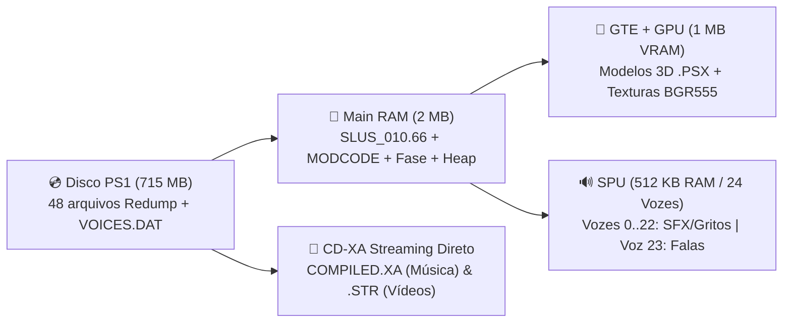
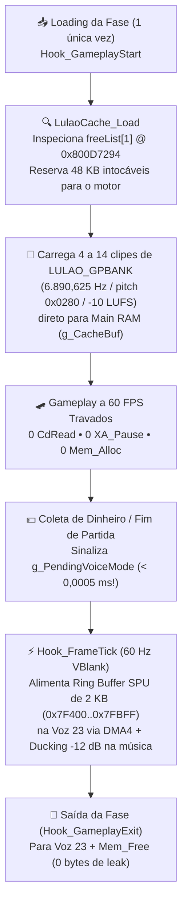
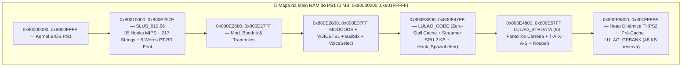

# 📖 A História Completa do Projeto THPS2 PSX Mod (`SLUS-01066`)

> **Um guia narrativo, passo a passo e extremamente didático de engenharia reversa no PlayStation 1:** como pegamos um clássico de 2000 sem código-fonte, abrimos cada camada do seu disco, da sua memória e do seu chip de som, e construímos um mod brasileiro completo — do primeiro byte decifrado até coletáveis 3D esculpidos sob medida e um motor MIPS rodando a 60 FPS travados.

---

## 🧭 Antes de Começar: Entendendo o "Tabuleiro" do PlayStation 1

Para entender a magia — e os desafios — de tudo o que construímos neste projeto, vale visualizar as restrições reais do hardware do **PlayStation 1 (PS1)** onde *Tony Hawk's Pro Skater 2* (NTSC-U, código `SLUS-01066`, lançado pela Neversoft/Activision em 2000) foi projetado para rodar:

| Componente do PS1 | Limite Real de Hardware | O que isso significa na prática para um Mod? |
| :--- | :--- | :--- |
| **CPU (MIPS R3000A)** | `33,8688 MHz`, 32 bits, sem ponto flutuante (FPU) | Toda a matemática 3D usa inteiros em ponto fixo (`4096 = 1.0`). Cada instrução de máquina ocupa exatamente **4 bytes**. |
| **Main RAM** | Apenas **2 MB** (`0x80000000..0x801FFFFF`) | O executável, os menus, a fase inteira, os skatistas, a física e os buffers de áudio disputam cada kilobyte. Qualquer exagero causa *Out-Of-Memory* (OOM). |
| **GPU + GTE + VRAM** | **1 MB** de VRAM (`1024×512` em 16-bit), **sem Z-Buffer** | As texturas (4-bit de 16 cores ou 8-bit de 256 cores) e paletas (CLUT) dividem esse 1 MB. A profundidade dos polígonos é ordenada manualmente por uma *Ordering Table*. |
| **SPU (Chip de Som)** | **512 KB** de SPU RAM, 24 vozes ADPCM 4-bit | Os efeitos sonoros globais + os efeitos da fase já consomem até **516.944 bytes de 520.176 bytes úteis** — deixando apenas **3,1 KB livres** nas fases pesadas! |
| **Drive de CD-ROM 2×** | Leitura em setores de **2.048 bytes** (~300 KB/s) | Se você mover um único arquivo de lugar sem critério ou tentar ler o CD no meio de uma manobra, a música trava e o jogo congela por mais de 1 segundo. |

Modificar um jogo assim **sem ter o código-fonte original em C** exige trabalhar como um relojoeiro-cirurgião: primeiro mapeamos o mecanismo inteiro, descobrimos as leis invisíveis da engine da Neversoft e só então fazemos intervenções cirúrgicas, 100% automatizadas, reproduzíveis e verificadas por auditoria forense e emulação ao vivo.

A seguir, vamos percorrer **toda essa jornada em ordem cronológica**, capítulo por capítulo.

---

## Capítulo 1 — Abrindo o Cofre da Neversoft (`CD.HED`, `CD.WAD` e o Hash `0x80053F10`)

Tudo começou com a imagem limpa e verificada (padrão *Redump*) de *Tony Hawk's Pro Skater 2 (USA)*: **`748.037.136 bytes`** (`318.043` setores). Ao abrir o disco, encontramos **48 arquivos**, mas quase todo o conteúdo do jogo — fases, skatistas, manobras, fontes, texturas, menus e efeitos sonoros — estava trancado dentro de um único gigante de centenas de megabytes chamado **`CD.WAD`**, acompanhado por um índice minúsculo chamado **`CD.HED`**.

### O primeiro grande enigma: arquivos sem nome!
Quando abrimos o `CD.HED` no editor hexadecimal, tivemos a primeira surpresa: **ele não guarda os nomes dos arquivos!** Cada uma das **1.531 entradas** do `CD.HED` tem apenas 12 bytes:
- `4 bytes`: um **hash numérico** de 32 bits (uma "impressão digital" do nome),
- `4 bytes`: o **offset** (posição exata em bytes dentro do `CD.WAD`, sempre múltiplo de `2.048`),
- `4 bytes`: o **tamanho** real em bytes.

Para saber o que era cada um dos 1.531 arquivos, fizemos duas frentes complementares:
1. **Censo de *Magic Numbers*:** examinamos os primeiros bytes de cada bloco extraído para classificar `.PSX` (modelos 3D/texturas), `.VAB`/`.SFX` (áudio), `.TRG` (gatilhos e posições das fases), `.BMP` (retratos), `.FNT` (fontes), `.BIN` (overlays de código) e `.PRE` (pacotes compactados internos).
2. **Engenharia reversa do executável `SLUS_010.66` no Ghidra:** localizamos a função exata `Neversoft_HashFilename @ RAM 0x80053F10` (`tolower` + rotação `rol32` + polinômio `0xEDB88320`). Com ela, conseguimos resolver automaticamente mais de **1.161 nomes reais** e escrever nossa ferramenta própria de desempacotamento e reempacotamento bit-a-bit: [`Scripts/thps2_wad.js`](Scripts/thps2_wad.js).

> 💡 **A Regra de Ouro que nasceu aqui ("Zero Deslocamento de Offsets"):**
> Como cada entrada do `CD.WAD` ocupa blocos inteiros de `2.048 bytes` (1 setor de CD), quase todo arquivo tem uma pequena "folga" no final do seu último setor. Se modificarmos um modelo ou textura mantendo-o dentro da mesma quantidade de setores originais, **nenhum dos outros 1.530 arquivos muda de posição**! Isso evita quebrar ponteiros internos e mantém o patch delta `.xdelta` minúsculo e ultra-estável.

A partir desse mapeamento, construímos uma **Enciclopédia Técnica completa** (`Docs/MAPA_01` até `MAPA_13`) documentando cada tabela crítica do jogo: `g_SkaterTable` (20 skatistas), `g_LevelTable` (11 fases e seus 10 objetivos), `g_MovieTable` (35 entradas de vídeo), `g_StringTable` (1.387 textos), `tricks.bin` (todas as manobras) e os 15 overlays `.BIN`.

---

## Capítulo 2 — Resgatando Bugs no Código Original e Criando o Escudo de 10 Estágios

Antes de construir recursos avançados, aplicamos uma disciplina de engenharia de produção: **garantir que a fundação estivesse 100% íntegra e segura**.

Durante a análise binária profunda de `SLUS_010.66`, encontramos e corrigimos defeitos críticos herdados de edições anteriores:
- **8 instruções MIPS corrompidas** (incluindo uma instrução inválida `0x0000FFF8` em `RAM 0x8005F320` num backup antigo — que passou a ser permanentemente proibido nas regras do projeto!),
- **Header `PS-X EXE` NTSC-U (`+0x4C`)** restaurado à assinatura original exata,
- **Bugs de texto/fonte (`char 0xE3`)** e **EOF prematuro** em vídeos `.STR`,
- **Ordem exata de LBAs Redump (48/48 arquivos)** + os **16 setores originais de licença NTSC-U** preservados em `Scripts/build_iso.js`,
- **Perfil otimizado de emulação (`SLUS-01066.ini`)** para o DuckStation (desativando *PGXP Depth Buffer* e *Widescreen Hack*, que faziam rampas e skatistas desaparecerem na *Ordering Table* do PS1, e configurando `MaxQueuedFrames = 2` para zero *input lag*), além de um guia completo para eliminar desconexões de controle DualShock 4 Bluetooth (`HidHide` + `DS4Windows` a 4 ms).

### O Escudo de Qualidade: Auditoria Forense de 10 Estágios + Distribuição Legal `.xdelta`
Criamos dois pilares que acompanham **cada única alteração** do projeto até hoje:
1. **`Scripts/audit_game.js` (Auditoria Forense de 10 Estágios):** a cada build, o script varre **todos os 319.066 setores (`715,7 MB`)** da ISO compilada verificando: código MIPS palavra por palavra, fronteiras de todas as strings e especificadores `printf`, todas as 1.531 entradas do `CD.HED`/`CD.WAD`, sincronismo de `options.pre` e `player.pre`, integridade 3D e costuras dos modelos `.PSX`, os 20 vídeos `.STR`, os 105.952 setores de música `COMPILED.XA`, os setores de licença e cada checksum EDC/MSF de CD-ROM Mode 2!
2. **`Scripts/sync_and_release.js` (Pipeline Automatizado + Patch `.xdelta`):** respeitando integralmente direitos autorais, **nunca** subimos a ISO comercial para o GitHub. Em vez disso, geramos automaticamente um **patch binário delta (`THPS2_MOD_NTSC-U.xdelta`)** verificado por *round-trip SHA-256* (aplicamos o patch de volta sobre o `.bin` original e conferimos que o resultado é 100% idêntico byte a byte!), empacotamos um instalador de arrastar-e-soltar (`Aplicar_Patch_THPS2.bat`) e sincronizamos Git + GitHub Release em um único comando.

---

## Capítulo 3 — Cinema, Trilha Sonora e o Truque do Setor 60 (Vídeos `.STR`, `COMPILED.XA` e Boot Aleatório)

O próximo grande marco foi dar uma cara brasileira completa às mídias audiovisuais do jogo:
- **Trilha Sonora (`COMPILED.XA`):** 105.952 setores de áudio ADPCM divididos em **8 canais intercalados** (13.244 setores por canal), decodificados, substituídos e validados setor a setor sem nenhum cabeçalho corrompido.
- **20 Vídeos Customizados (`.STR`):** no PS1, vídeos são fluxos *MDEC v2* (`320×240`) intercalados no próprio setor Mode 2 Form 2 com áudio XA (`File=1, Channel=1`). Descobrimos um detalhe crucial: 6 vídeos (`INTRO`, `LOGO`, `OD`, `PC`, `SM`, `MS`) usam áudio **37.800 Hz Estéreo**, enquanto os outros 14 usam **18.900 Hz Mono**, e o número de quadros codificados precisa sempre respeitar `num_frames` em `g_MovieTable @ 0x800C1CB4` — caso contrário o jogo congela no fim do vídeo! Automatizamos toda essa engenharia em `Scripts/replace_videos.js` e `Scripts/psx_media.js`.

### O Desafio do Boot Aleatório Persistente (`BootRand_PlaySlot`)
Queríamos que, toda vez que o jogador ligasse o videogame (ou reiniciasse o emulador), os 3 vídeos de abertura (**Activision**, **Neversoft** e **Intro**) sorteassem **3 vídeos diferentes** dentre os 20 vídeos customizados do disco — **sem** alterar os vídeos de final de carreira e **respeitando a duração exata original** (`208` frames = `13,87s` no Activision, `266` frames = `17,73s` no Neversoft e `≤1486` frames na Intro)!

Mas surgiu um problema clássico de emuladores: **em todo boot frio (`-fastboot`), os timers de hardware do PS1 começam praticamente no mesmo valor!** Se você sortear só com o relógio interno, o jogo quase sempre escolhe o mesmo vídeo.

**A solução genial em Assembly MIPS (`MODCODE @ 0x800E2800`):**
- Combinamos os contadores de hardware do PS1 com um **contador persistente salvo no Setor 60 (`0x3C`) do Memory Card** (uma região segura fora dos blocos de *save* do usuário), somado a um algoritmo de embaralhamento sem repetição entre os 3 slots.
- Criamos um **49º arquivo no final da ISO**, chamado **`VOICES.DAT` (`LBA 317893`)**, cujo setor inicial carrega nosso motor residente MIPS direto para a Main RAM (`0x800E2800..0x800E57FF`) no boot (`Mod_BootInit @ 0x800E2680`), empurrando o início da Heap dinâmica do THPS2 (`HeapStartPtr @ 0x800E2674` e `InitHeap @ 0x800A2950`) de forma totalmente limpa para `0x800E5800`!

---

## Capítulo 4 — Escultura 3D no PS1: Os 7 Skatistas Personalizados (28 Modelos `.PSX` + 7 Retratos)

Personalizar um personagem 3D de PlayStation 1 não é "trocar uma imagem de textura" — é operar diretamente na geometria e no esqueleto binário dos arquivos `.PSX` (cada skatista tem **4 arquivos**: *Style A Hi-LOD*, *Style A Lo-LOD*, *Style B Hi-LOD* e *Style B Lo-LOD* = **28 modelos `.PSX`** no total!).

### As 5 Leis Ocultas da Engenharia 3D do THPS2 que Descobrimos
1. **A Lei das Costuras Esqueletais (`w = 0, 1, 2`):** cada vértice de uma malha `.PSX` carrega um peso `w`. Vértices com `w = 0` são livres para esculpir; vértices com `w = 2` são **costuras rígidas** que conectam a cabeça ao pescoço ou o torso à cintura. Se você mover um vértice `w = 2`, a cabeça do skatista literalmente se descola do corpo durante um *Ollie*!
2. **A Armadilha do Espelho da GTE (`flipX`):** os mapeamentos UV dos torsos no THPS2 espelham horizontalmente o eixo `U`. Sem espelhar o texto antes de pintar a textura (`flipX: true`), palavras como `"UBER"`, `"LACTA"` ou `"POLICJA"` apareciam invertidas no peito do skatista!
3. **A Regra Anti-`0x0000` em CLUTs:** na GPU do PS1, uma cor `0x0000` na paleta pode virar pixel transparente (abrindo "buracos invisíveis" no rosto ou na roupa). Nossa biblioteca compartilhada [`Scripts/psx_skater_lib.js`](Scripts/psx_skater_lib.js) garante quantização BGR555 (8-bit de 256 cores e 4-bit *nibble-packed* de 16 cores) que substitui preto puro por `0x8421` (`RGB 1,1,1`) quando opaco.
4. **O Bug Histórico `Slot ≠ s2faceN.bmp`:** os retratos do mural de seleção (`s2face*.bmp`, exatamente `4.088 B` cada, sincronizados em `CD.WAD` e dentro de `options.pre`) **não seguem a ordem numérica dos slots**, mas sim a ordem alfabética original dos skatistas da Neversoft! Ao descobrir isso, corrigimos o mapeamento exato (resgatando o **Bucky Lasek** original em `s2face7.bmp`!) e colocamos validação cruzada automática na auditoria.
5. **Invariante de Normais (`nN === nV + nF`) ao Injetar Nova Geometria 3D:** ao criar peças 3D verdadeiramente novas (não apenas mover vértices existentes!), descobrimos que as malhas de torso do THPS2 exigem exatamente `nV + nF` normais e que todos os ponteiros subsequentes (`ptrMeta`, `meshOffs`, `texOffs`, `obj.ptrRgbs`) precisam ser deslocados com precisão cirúrgica.

### Galeria dos 7 Skatistas Esculpidos

| Slot | Skatista (Base Original) | Style A | Style B | Escultura 3D & Destaques Cirúrgicos |
| :---: | :--- | :--- | :--- | :--- |
| **1** | **Silvio Santos** *(ex-Bob Burnquist)* | Terno azul-marinho 2 botões, gravata, lenço branco + **Microfone 3D Geométrico no Peito** | Camisa havaiana azul-royal (balão amarelo, palmeiras, hibiscos) + bermuda xadrez (sem proteções) | **Injeção de geometria 3D real em `Chest Mesh[8]`** (`+23` vértices, `+41` normais, `+18` polígonos `POLY_FT3/FT4` = globo metálico facetado + anel cromado + haste + presilha, cabendo nos mesmos setores!), remoção 3D do chapéu pescador e capacete + topete + **13 vozes** (`s2face1.bmp`). |
| **2** | **Lulao** *(ex-Steve Caballero)* | Terno azul-marinho + faixa presidencial verde-amarela | Uniforme de presidiário listrado | Escultura facial 3D + **barriguinha 3D anatômica** esculpida em `Pelvis`/`Stomach`/`Chest` + biografia PT-BR + **14 vozes** + Modo Carreira exclusivo (`s2face2.bmp`). |
| **3** | **Bolsonaro** *(ex-Kareem Campbell)* | Terno + faixa presidencial | Uniforme listrado `"171"` | Reconstrução simétrica do crânio (removendo boné/dreadlocks), cabelo curto 360° + **transplante cirúrgico do pescoço fino do Tony Hawk (`hawk2.psx`)** em `Chest Mesh[8]` + biografia PT-BR + **14 vozes** (`s2face3.bmp`). |
| **4** | **Wagner Oliver** *(ex-Rune Glifberg)* | Moletom bordô `"CIÊNCIA DA COMPUTAÇÃO"` + jeans claro | Uniforme tático policial `"POLICJA"` + calça cargo + coturnos | Remoção completa da viseira 3D original em `HEAD Mesh[15]` + suporte aos `palId` distintos entre Hi-LOD e Lo-LOD (`s2face4.bmp`). |
| **7** | **Francis Paulo** *(ex-Rodney Mullen)* | Raglan branca `"UBER"` + `"99"` + jeans 4-bit | Kimono Shinigami *Bleach* preto + hakama 4-bit | Nivelamento automático `+19°` CCW + recuperação de sombra na foto, cabelo volumoso 3D e texturas 4-bit 16 cores *nibble-packed* (`s2face9.bmp`). |
| **9** | **Valter Pacheco** *(ex-Andrew Reynolds)* | Camisa azul chambray manga longa (`64×64`) + calça social | Camiseta verde `"SAN MICHEL"` + jeans com cinto e crachá | Renomeação em 4 offsets preservando `\X\REYNOLDS.STR;1`, restauração automática (*inpainting*) de riscos na foto 3×4 + cabelo grisalho e bigode 3D (`s2face10.bmp`). |
| **10** | **Natan Oliver** *(ex-Geoff Rowley)* | Camiseta azul `"LACTA"` com cordão vermelho/crachá + relógio | Terno preto 2 botões com gravata vermelha e punhos brancos | Escultura facial 3D + cabelo + texturização limpa em ambos os estilos (`s2face11.bmp`). |

---

## Capítulo 5 — Ensinando Português ao PlayStation 1 (`s2bio.fnt` e 5 Palavras MIPS)

Quando fomos escrever as **32 linhas de biografias satíricas em português** para o **Lulão** e o **Bolsonaro** (16 linhas cada em `SLUS_010.66`), batemos numa parede clássica dos jogos NTSC-U: a fonte `s2bio.fnt` (`CD.WAD[458]` e espelhada dentro de `player.pre +0x14`) **não tinha acentos do português (`ã, ê, í, ó`)!** Escrever `"Lulão"` ou `"político"` fazia o jogo pular letras ou imprimir símbolos quebrados.

**A solução cirúrgica em [`Scripts/mod_skater_bios.js`](Scripts/mod_skater_bios.js):**
1. **Desmontamos `Font_CharToGlyph @ RAM 0x8005B9B4`** no executável e descobrimos 4 glifos europeus não usados no jogo NTSC-U (`œ, ä, ö, ü` → índices `90..93`).
2. **Patcheamos apenas 5 instruções MIPS in-place** (`0x8005BAC4/BAF4/BAFC/BB0C/BB1C`) remapeando esses 4 slots diretamente para os códigos Latin-1 **`ã (0xE3)`**, **`ê (0xEA)`**, **`í (0xED)`** e **`ó (0xF3)`** (mantendo `á`, `é` e o `ç` original da Neversoft!).
3. **Desenhamos pixel-a-pixel em 4bpp** os glifos acentuados na paleta oficial de `s2bio.fnt`, preservando o tamanho exato de **`4.468 bytes`** — zero mudança no `CD.HED` e português impecável na tela de seleção de skatistas!

---

## Capítulo 6 — A Revolução Sonora: 41 Vozes SPU, Ducking `-12 dB` e os 9 Gritos de Queda em 0 Bytes Extras

Com os personagens prontos, faltava dar **voz** e **personalidade sonora** ao jogo.

### 1. 41 Vozes Rotativas na Seleção de Skatistas + Ducking Automático (`-12 dB`)
- Convertemos **41 áudios reais** (`14` do Lulão, `14` do Bolsonaro e `13` do Silvio Santos) para **SPU-ADPCM 4-bit a `11.025 Hz` mono** e os empacotamos em `VOICES.DAT`.
- **Reserva de Hardware da Voz 23:** modificamos uma única instrução em `SLUS_010.66 @ 0x80053690` (`slti v0, v1, 23`) para que o alocador de efeitos sonoros do jogo nunca use a **Voz 23** da SPU — deixando-a 100% dedicada às falas dos skatistas!
- **Hooks no Overlay `playsel.bin` (`+0x3388` Scroll e `+0x100C` Confirm):** toda vez que você navega com Esquerda/Direita ou confirma com **X**, a fala toca instantaneamente com rotação sem repetição imediata.
- **Ducking Automático (`-12 dB`):** adicionamos `Hook_CdMix @ 0x80038950` + uma flag privada `g_InPlaySel @ 0x800E27DC` (que também corrigiu o bug do botão *"Continuar"* voltando à Roda Gigante!). Assim, na tela de seleção de skatistas a música de fundo abaixa suavemente para **25% (`-12 dB`)** para as falas brilharem, e volta imediatamente para **100%** ao entrar nas fases.

### 2. Os 9 Gritos Alternados de Queda (*Bail*) — O Milagre dos 0 Bytes Extras em SPU RAM
O pedido era claro: toda vez que o skatista cair no chão (*bail*), deve sair um dos **9 gritos** extraídos dos vídeos, **sempre alternando entre si** (nunca repetindo o mesmo grito em sequência).

Aqui encontramos um dos maiores desafios de engenharia de hardware do projeto:
- A SPU RAM do PS1 tem apenas `520.176 bytes` úteis.
- Na fase mais pesada do jogo (`WAD[538]` + `skate2g.vab`), o jogo original já ocupa **`516.944 bytes`** — sobravam míseros **`3.232 bytes` livres**! Se nossos 9 gritos aumentassem o `.VAB` em apenas 4 KB, o jogo corromperia o som ou travaria!

**A solução de engenharia DSP + MIPS (`Scripts/mod_bail_screams.js` + `Hook_BailSfx @ 0x800E3400`):**
- Extraímos os 9 gritos, aplicamos filtragem passa-banda vocal (`85 Hz–3,6 kHz`), normalização `-0,8 dBFS`, *fades* anti-clique e codificamos em **SPU-ADPCM 4-bit a `7.796 Hz` (`center=90`)**, compactando todos os 9 gritos juntos em **`26.512 bytes`** — **272 bytes a menos** que o espaço original ocupado pelos sons de queda no `Program 2` dos 3 bancos globais (`skate2.vab`, `skate2g.vab` e `skate2p.vab`)!
- Resultado: **0 bytes extras de SPU RAM** e tamanho bit-a-bit idêntico ao original Redump!
- Em `SFX_Play @ 0x800527B8`, nosso `Hook_BailSfx` intercepta qualquer evento de queda, aplica **rotação estrita *round-robin* (`0→1→2→...→8→0`)** e um **cooldown anti-sobreposição de 50 frames (`~0,83s`)** para que colisões múltiplas na mesma queda nunca disparem dois gritos ao mesmo tempo.

---

## Capítulo 7 — O Modo Carreira do Lulão e a Guerra Contra o Travamento de 1,11 Segundo (`LULAO_GPBANK`)

Este foi o capítulo mais desafiador de engenharia de sistemas em tempo real de todo o projeto.

### Ato 1 — Modo Carreira Satírico & "Roubei mais 50!"
Construímos uma tabela dinâmica residente **`LULAO_STRDATA @ 0x800E4800`** (hoje com **93 ponteiros**) controlada por `Lulao_SyncStrings @ 0x800E3800`:
- Quando o jogador escolhe **Lulão (`Slot 2`)**, a função salva os ponteiros originais na primeira execução e troca automaticamente **todos os nomes dos objetivos das 8 fases do Modo Carreira**, os textos de pódio, o rótulo de dinheiro no HUD (`"Roubei $50"`), os banners de coleta (**`"Roubei mais 50!"`**, **`"Roubei mais 100!"`**, **`"Roubei mais 250!"`**, **`"Zerei o BNDES da Fase!"`**) — e **restaura 100% dos textos originais** assim que outro skatista é escolhido!
- Interceptamos os 3 chamadores de coleta de dinheiro (`0x800368D4`, `0x80036914`, `0x80036954`) e todas as 5 rotas de fim de partida (*Time is up*, *Pause → End Run*, competições) para disparar uma fala aleatória engraçada do Lulão a cada nota coletada e ao encerrar a partida.

### Ato 2 — O Problema Real: 1.110 ms de Travamento!
Na primeira versão, quando o Lulão pegava uma nota de dinheiro durante a partida, o jogo **congelava por ~1,11 segundo (~66 frames travados!)**.

Por quê? Porque ler áudio direto do CD-ROM no meio da partida obrigava a interromper o streaming musical `COMPILED.XA` (`XA_Pause`), reposicionar o leitor óptico (`CdlSetloc` até `VOICES.DAT` lá no `LBA 317893`), fazer `CdRead` síncrono bloqueando a CPU e retomar o CD-XA depois!

### Ato 3 — A Solução Definitiva: Pré-Cache Adaptativo Zero-Stall em Main RAM (`LULAO_GPBANK`)
Eliminamos **100% do acesso ao CD-ROM durante gameplay ativo** com uma arquitetura digna de engenharia de consoles de ponta:

E quando testamos nas fases mais pesadas de memória (*NY City*, *Venice Beach*, *School II*, *The Bullring*, *Skate Heaven*), descobrimos um segundo desafio sutil: a margem livre da Heap nessas fases era muito mais apertada do que no Hangar, o que inicialmente fazia o guarda de memória pular o carregamento e deixar o Lulão mudo!
- Medimos empiricamente com o DuckStation GDB o **pico real de alocação pós-load (`MaxDelta = 34.368 B`)** em todas as 10 fases (incluindo HUD, Pause e Fim de Partida).
- Recalibramos a reserva intocável para **`48 KB` (`49.152 B` → `>= 14,4 KB` de margem segura em todas as fases!)**, encolhemos o buffer de staging para `1 KB`, e construímos o sub-banco compacto **`LULAO_GPBANK`** no final de `VOICES.DAT` (`146` setores em anel duplicado `2×`, falas limpas sem silêncio inicial/final, `<= 2,85s`, EQ vocal `+3 dB @ 2,2 kHz` e normalização **`-10 LUFS`** para soar alto e cristalino sobre a música!).
- Resultado comprovado ao vivo via leitura direta da SPU RAM (`0x7F400..0x7FBFF`) via DMA4 nas **9 fases simultaneamente**: **`4` a `14` clipes aleatórios carregados em TODAS as 10 fases**, **`0 ms` de travamento (`0` frames perdidos)**, música `COMPILED.XA` ininterrupta e áudio forte e nítido em cada nota coletada!

---

## Capítulo 8 — O Mistério das Manobras Impossíveis (`G6` Trick+Gap) e o `T-A-X-A-S` 3D Dinâmico

Com o Modo Carreira do Lulão voando a 60 FPS, o teste prático em gameplay revelou um bug fascinante: **os objetivos de "Manobra + Gap" (`G6`, `type = 5`) — como *50-50 Joey's Sculpture* em NY City ou *Tailslide the Venice Ledge* em Venice Beach — não completavam com o Lulão!**

### A Descoberta Cirúrgica em `0x800662AC`
Desmontando o verificador de objetivos (`0x80066274..0x800662EC`), descobrimos a causa exata:
- Para objetivos `type == 5`, o motor do THPS2 usa o campo `SGoal[6].paramStr` (`+0x08`) **como string de busca lógica**, executando `strcasestr(nomeDaManobraExecutada, paramStr)` (`jal 0x8006E4BC`) contra os nomes em inglês de `tricks.bin` (`WAD[11]`)!
- Quando havíamos traduzido/zoado esse campo interno (`paramStr`) no Lulão (e até um resquício legado no próprio `SLUS_010.66 @ 0x800D50F8` que havia trocado `"Kickflip"` por `"Chutinho"` em School II!), o comparador nunca encontrava `"NOSEGRIND"`, `"Kickflip"`, `"50-50"`, `"Tailslide"` ou `"Blunt"`!
- **A correção perfeita:** preservamos intactos os 5 `paramStr` técnicos exigidos pelo matcher (restaurando inclusive `"Kickflip"` em `0x800D50F8` para **todos** os skatistas!), mantendo os nomes satíricos apenas no campo de exibição da lista (*"Nosegrind na Mandioca"*, *"Kickflip no Teto de Gasto"*, *"50-50 na Obra Superfatur."*, *"Tailslide no Triplex"*, *"Blunt no Toldo da PF"*).

### Esculpindo o `X` 3D para o Coletável Dinâmico `S-K-A-T-E` → `T-A-X-A-S`
O pedido seguinte foi genial: **para o Lulão, trocar o coletável `S-K-A-T-E` por `T-A-X-A-S`!**
O problema? O arquivo `items.psx` (`WAD[8]`) tem malhas 3D prontas para `S`, `K`, `A`, `T` e `E` — **mas não existe nenhuma letra `X` no jogo!**

**Como construímos o `T-A-X-A-S` 100% dinâmico (exclusivo do Lulão!):**
1. **Escultura 3D da Letra `X` (`M[13]`, hash `0x58585858`):** modelamos matematicamente uma letra **`X` maiúscula 3D** (`24` vértices, `22` normais, `22` quads = `1.012 bytes`) com a mesma inclinação itálica, espessura, chanfros e gradiente dourado `RGBs` das letras nativas da Neversoft, e a anexamos dentro da folga de setores já existente em `items.psx` (`39.096 → 40.152 B ≤ 40.960 B`, atualizando `ptrMeta`, `obj[0..13].ptrRgbs` e `texOffs[0..12]` com **0 deslocamento no `CD.WAD`**!).
2. **A Lei Empírica de Winding da GTE do PS1:** nessa escultura descobrimos e provamos matematicamente a lei de orientação de polígonos do THPS2: no espaço destro `(X, Y_baixo, Z)`, um quad Z-order `[v0, v1, v2, v3]` só passa no *back-face culling* (`NCLIP > 0`) quando `dot((v1 - v0) × (v2 - v0), normalExterna) < 0` para ambos os triângulos `(0,1,2)` e `(1,3,2)`! Codificamos um verificador automático (`assertPs1QuadWinding`) que impede qualquer face invertida de chegar à ISO.
3. **Hook MIPS `Hook_SpawnLetter @ 0x800E3848` (`0x80035D68`):** intercepta o spawn das 5 letras flutuantes na fase. Se `skater == 2` (Lulão), remapeia `S→T, K→A, A→X (0x58585858), T→A, E→S`! Se for qualquer outro skatista (Tony Hawk, Silvio Santos, Bolsonaro, etc.), continua spawnando **`S-K-A-T-E`** normalmente!
4. **Sincronia Total de HUD & Banners:** `LULAO_STRDATA` atualiza dinamicamente o HUD lateral (`0x800D7704..0x800D7714` = `T A X A S`) e os banners de coleta (`0x800C08E8..0x800C08F8`).

---

## Capítulo 9 — Transformando o Mundo 3D: Barris de Pinga 51 e 5 Garrafas 3D de Pitú

Com nossa pipeline 3D de mundo consolidada em [`Scripts/mod_lulao_world_assets.js`](Scripts/mod_lulao_world_assets.js), customizamos os coletáveis clássicos de duas fases icônicas:

1. **The Hangar (`LV 0`) — Barris de `PINGA 51 BRASIL`:**
   - Localizamos o barril `M[9]` (`0x4EB2C689`) em `skhan_o.psx` (`WAD[14]`) e `skhan_o2.psx` (`WAD[1109]` para 2 jogadores).
   - Apagamos o losango vermelho `"FLAMMABLE"` preservando o aço envelhecido e as nervuras metálicas originais, pintamos o escudo clássico **`PINGA 51 BRASIL`** em `ti=26` (`64×64 256c`) e um estêncil `"51"` na tampa metálica (`ti=25`, `64×64 16c`) — **0 bytes de alteração de tamanho!**
2. **Venice Beach (`LV 4`) — 5 Garrafas 3D Esculpidas de `PITÚ`:**
   - Substituímos a lata de spray original (`skven_o.psx M[4]`, `0xA09E4E74`, apenas `13v/13f`) por uma **garrafa octogonal 3D esculpida de vidro (`40` vértices, `38` quads/normais)**: fundo de vidro, corpo cilíndrico, ombro curvo cônico, gargalo fino com colarinho vermelho/dourado e tampa rosqueada vermelha (`9.076 → 10.192 B ≤ 10.240 B`, cabendo nos mesmos 5 setores!).
   - Pintamos as 3 texturas exclusivas em `skven_l.psx` (`T[127]` `48×48 256c` com rótulo frente/verso `"PITÚ"` + o clássico camarão vermelho em polaridade esquerda→direita validada ao vivo no DuckStation, `T[128]` base de vidro e `T[129]` tampa vermelha).

---

## Capítulo 10 — Recorte Cirúrgico 3D: Haddad no Hangar e Dilma no Barril em School II (e 2 Segredos Reais do Hardware PS1!)

O capítulo mais recente levou a customização de coletáveis 3D a outro nível com [`Scripts/mod_collectibles_haddad_dilma.js`](Scripts/mod_collectibles_haddad_dilma.js): pegar **duas imagens reais com fundos complexos**, recortá-las com precisão cirúrgica, esculpir **geometrias 3D sob medida (~1,5× o tamanho dos objetos originais)** e substituir os coletáveis da Fase 1 (*The Hangar*) e da Fase 2 (*School II*).

### 1. The Hangar (`LV 0`, `G5`) — *"5 Haddads Ajuste Fiscal"* (`skhan_o.psx` & `skhan_o2.psx`, `M[8]`)
- **Objeto substituído:** as 5 *Pilot Wings* (`0xD0C4F2DA`, `316×60×25`, raio `170`), cuja textura `ti=24` (`0xDA38F58B`, `128×32` 4-bit = `2.048 B`) é **100% exclusiva** de `M[8]`.
- **Recorte perfeito de `haddad_hangar.jpg` (`469×426`):** criamos um segmentador inteligente de barreira de tinta + *flood-fill* multi-bolso + remoção de componentes desconectados que eliminou 100% do fundo branco, das silhuetas cinzas da plateia, do chão bege em aquarela, dos traços soltos de movimento e da assinatura `"CLAYTON"` — mantendo intactos Fernando Haddad, a cartola, a toalha azul, as orelhas e o coelho gigante **`"AJUSTE FISCAL"`**!
- **O truque de textura `0 B`:** trocamos o formato de `ti=24` de `128×32` 4-bit para **`64×64` 4-bit (`2.048 B` exatos — 0 bytes extras e exatamente os mesmos `1.024` halfwords de VRAM!)**, com quantização ponderada ancorada no vermelho da gravata-borboleta, azul-celeste da toalha, rosa do focinho e branco puro do coelho.
- **Geometria 3D em Relevo Anatômico (`34v / 32n / 32f`, `1.452 B`):** em vez de um cartão 2D chapado ou uma caixa quadrada com bordas flutuantes, construímos uma **malha dupla-face esculpida em grade `5×5`** (`220×220`, `Y ∈ [-150..+70]` centralizado exatamente no brilho azul do coletável — ~1,5× a presença visual das *Pilot Wings*!), com as bordas externas encontrando-se perfeitamente em `Z = 0` e relevo anatômico tridimensional (`±10..±18` unidades) saltando na cabeça do Haddad, na cartola e na barriga gordinha do coelho!

### 2. School II (`LV 1`, `G4`) — *"5 Dilmas no Barril"* (`sksl2_o.psx M[5]` + `sksl2_l/l2.psx`)
- **Objeto substituído:** os 5 *School Bells* montados nas paredes de School II (`0x9DB64BF3`, `85×85×32`, `420 B`, `Z ∈ [0..+32]` saindo para fora da parede!), com 5 nós no arquivo de gatilhos `sksl2_t.trg` e textura exclusiva `0xFC079202` (`32×32` 4-bit = `512 B`) em `sksl2_l.psx` e `sksl2_l2.psx`.
- **Recorte perfeito de `dilma_barril.png` (`145×241`):** remoção limpa do fundo verde-menta via excesso espectral + *flood-fill* + supressão de halo verde nas bordas + limpeza do reflexo branco no canto inferior direito do barril.
- **Upgrade de Resolução em `sksl2_l.psx` e `sksl2_l2.psx` (`+150%` de pixels!):** aproveitamos os `840 B` livres dentro dos mesmos 167 setores de `sksl2_l.psx` e `sksl2_l2.psx` para expandir `0xFC079202` de `32×32` (`512 B`) para **`40×64` 4-bit (`1.280 B`, `+768 B`, sobrando `72 B` livres!)** — proporção exata `1 : 1,60` idêntica à foto original, deixando o sorriso da Dilma, o blazer vermelho e as aduelas do barril ultra-nítidos!
- **Geometria 3D Verdadeira de Meio-Barril Cilíndrico (`20v / 8n / 12f`, `588 B ≤ 604 B`):** esculpimos uma superfície **semicilíndrica 3D real (`5` colunas × `4` linhas, `100×156×42` ≈ 1,5× o sino original!)** cujas laterais curvam suavemente até encostar na parede de School II (`Z = 0`) enquanto a barriga do barril de carvalho se projeta **`+42` unidades para fora da parede** com a Dilma emergindo em relevo 3D no topo — **0 bordas flutuantes, 0 deslocamento no `CD.WAD`**!

### As 2 Descobertas Reais de Hardware PS1 Capturadas ao Vivo no DuckStation!
O teste ao vivo no DuckStation GDB pagou seu peso em ouro duas vezes seguidas nesse capítulo:
1. **A Sentinela de Distância de Desenho (`+24 = 0xFFFF7FFF`):** no primeiro teste ao vivo, os coletáveis podiam ser coletados (`"1 OF 5 HADDAD TAXA"`), mas apareciam invisíveis! Comparando com `items.psx`, descobrimos que o offset `+24` de todo cabeçalho de malha `.PSX` guarda `uint16 maxDrawDist` (`0x7FFF = 32.767` unidades) + `0xFFFF`. Com `0`, o motor da Neversoft fazia *distance-culling* a `0` unidades da câmera! Colocando `0xFFFF7FFF`, os modelos apareceram instantaneamente.
2. **A Chave Secreta de Transparência da Neversoft (`SLUS_010.66 @ 0x80052060..0x800520B4`):** quando a 3D Dilma apareceu linda em School II no segundo teste, notamos cantos pretos ao redor da cabeça dela apesar de `CLUT[0]` ser `0x0000`. Desmontando o carregador de paletas de `SLUS_010.66`, descobrimos a lei real do motor:
   - Se uma entrada da paleta `.PSX` for **`0x0000`**, o código em `0x8005209C` executa `ori r2, r3, 0x8000` e transforma propositalmente em **preto opaco (`0x8000`)**!
   - **Somente** quando a entrada da paleta é **`0x7C1F` (magenta puro)** é que o carregador em `0x8005206C..0x8005208C` grava **`0x0000`** na VRAM — ativando transparência 100% real por hardware na GPU do PS1!
   - Ao trocar `pal15[0]` para `0x7C1F`, tanto o **3D Haddad** no Hangar quanto a **3D Dilma no Barril** em School II renderizaram ao vivo no DuckStation com **recorte cristalino, zero cantos pretos e volume 3D impecável!**

---

## Capítulo 11 — A Arquitetura Completa Hoje (Mapa Geral & Números Finais)

### Placar Técnico Consolidado do Projeto

| Dimensão | Quantidade / Métrica Verificada |
| :--- | :--- |
| **Integridade da ISO Compilada** | **319.066 / 319.066 setores** (`715,7 MB`) • **10/10 Estágios PASS • 0 Erros • 0 Avisos** |
| **Compatibilidade Redump** | **48/48 arquivos originais** com LBA, tamanho e atributos CD-XA preservados + **16 setores de licença NTSC-U** |
| **Deslocamento de Offsets no `CD.WAD`** | **`0` bytes deslocados** em todas as **1.531 entradas** |
| **Hooks MIPS R3000A Cirúrgicos** | **35 hooks** em `SLUS_010.66` + **2 hooks** em `playsel.bin` + **6 setores residentes** em `VOICES.DAT` |
| **Skatistas Personalizados** | **7 skatistas** (*Silvio Santos*, *Lulao*, *Bolsonaro*, *Wagner*, *Francis*, *Valter*, *Natan*) = **28 modelos `.PSX` + 7 retratos `s2face*.bmp`** |
| **Mundo 3D & Coletáveis Customizados** | Letra 3D **`X`** (`T-A-X-A-S` dinâmico) + **Barris Pinga 51** + **5 Garrafas 3D de Pitú** + **5 Haddads 3D** (*Hangar*) + **5 Dilmas no Barril 3D** (*School II*) |
| **Motor de Áudio & Vídeos** | **20 vídeos `.STR`** (3 sorteados no boot via Setor 60) + **`COMPILED.XA` (8 canais)** + **41 vozes menu** + **14×2 `LULAO_GPBANK` Zero-Stall (`0 ms`)** + **9 gritos de queda (`0 B` SPU RAM extra)** |
| **Idioma & Fonte** | **32 linhas de biografias PT-BR** com acentos nativos `á, ã, ç, é, ê, í, ó` em `s2bio.fnt` + **93 strings dinâmicas** do Modo Carreira do Lulão |

---

## 📚 Glossário Didático Rápido (Para Quem Está Chegando Agora)

- **`.PSX`**: formato proprietário da Neversoft que guarda modelos 3D (vértices, normais, polígonos) e/ou texturas BGR555 com suas paletas (CLUT).
- **`CD.HED` / `CD.WAD`**: arquivo índice (`HED`, hashes + posições) e contêiner gigante (`WAD`) com os 1.531 ativos internos do jogo.
- **CLUT (Color Look-Up Table)**: paleta de 16 cores (4-bit) ou 256 cores (8-bit) usada pelo chip gráfico do PS1. No THPS2, `0x7C1F` (magenta) vira transparência por hardware (`0x0000`).
- **SPU-ADPCM / Voz 23**: formato de compressão de áudio nativo do chip de som do PS1 (taxa 3,5:1). O PS1 tem 24 vozes simultâneas; reservamos a de número 23 só para falas.
- **GTE (*Geometry Transformation Engine*)**: coprocessador 3D do PS1 que projeta triângulos e quads na tela e descarta faces viradas para trás (*back-face culling* via `NCLIP`).
- **Hook MIPS**: substituir uma instrução original de 4 bytes por um salto (`jal`) para uma rotina nossa em RAM, que executa o recurso novo e devolve o controle perfeitamente ao jogo original.
- **Patch `.xdelta`**: arquivo de diferença binária que transforma legalmente a cópia original do usuário no mod completo sem distribuir arquivos comerciais protegidos.

---

> 🛠️ **Quer explorar os detalhes técnicos de cada endereço RAM ou rodar os scripts?**
> Comece pelo **[README.md](README.md)**, navegue pelos 13 mapas da enciclopédia em **[`Docs/`](Docs/)** e veja todos os scripts open-source em **[`Scripts/`](Scripts/)**.
