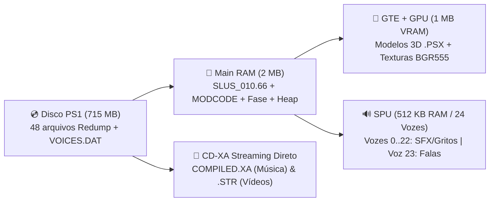
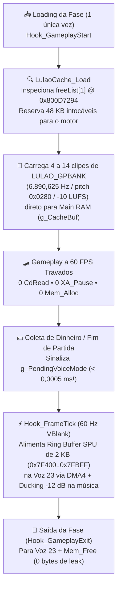
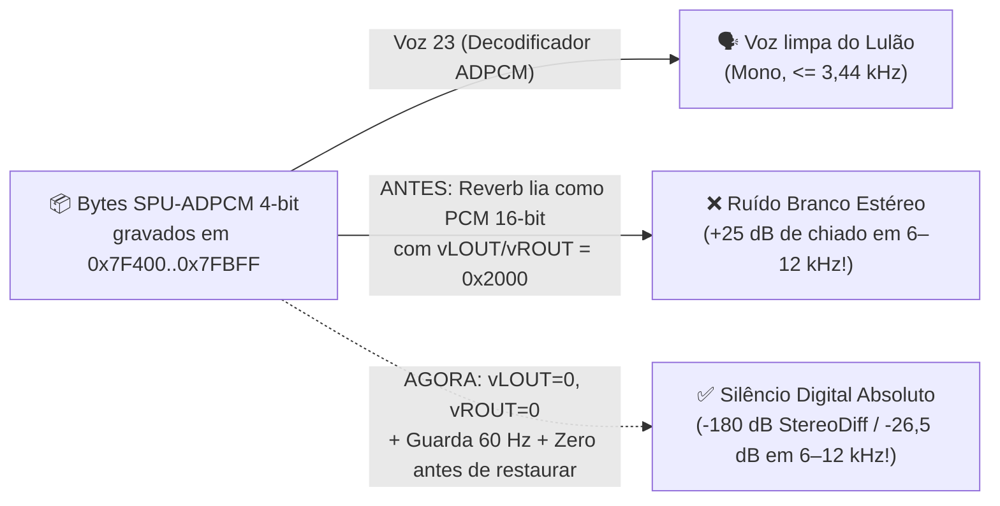
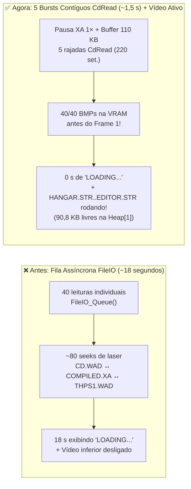
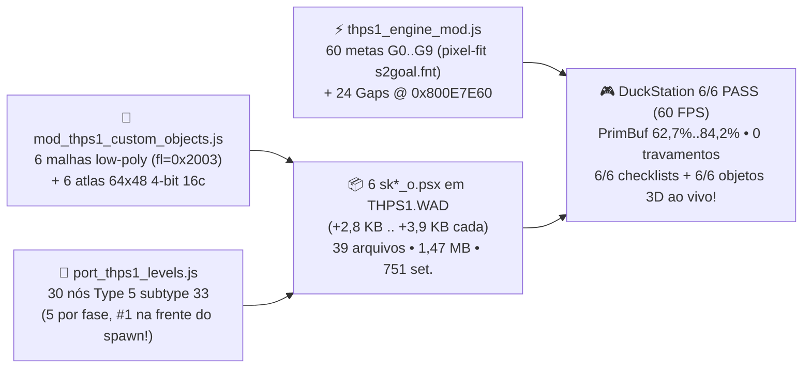
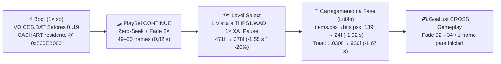

# 📖 A História Completa do Projeto THPS2 PSX Mod (`SLUS-01066`)

> **Um guia narrativo, passo a passo e extremamente didático de engenharia reversa no PlayStation 1:** como pegamos um clássico de 2000 sem código-fonte, abrimos cada camada do seu disco, da sua memória e do seu chip de som, e construímos um mod brasileiro completo — do primeiro byte decifrado até coletáveis 3D esculpidos sob medida e um motor MIPS rodando a 60 FPS travados.

---

## 🧭 Antes de Começar: Entendendo o "Tabuleiro" do PlayStation 1

Para entender a magia — e os desafios — de tudo o que construímos neste projeto, vale visualizar as restrições reais do hardware do **PlayStation 1 (PS1)** onde *Tony Hawk's Pro Skater 2* (NTSC-U, código `SLUS-01066`, lançado pela Neversoft/Activision em 2000) foi projetado para rodar:

| Componente do PS1 | Limite Real de Hardware | O que isso significa na prática para um Mod? |
| :--- | :--- | :--- |
| **CPU (MIPS R3000A)** | `33,8688 MHz`, 32 bits, sem ponto flutuante (FPU) | Toda a matemática 3D usa inteiros em ponto fixo (`4096 = 1.0`). Cada instrução de máquina ocupa exatamente **4 bytes**. |
| **Main RAM** | Apenas **2 MB** (`0x80000000..0x801FFFFF`) | O executável, os menus, a fase inteira, os skatistas, a física e os buffers de áudio disputam cada kilobyte. Qualquer exagero causa *Out-Of-Memory* (OOM). |
| **GPU + GTE + VRAM** | **1 MB** de VRAM (`1024×512` em 16-bit), **sem Z-Buffer** | As texturas (4-bit de 16 cores ou 8-bit de 256 cores) e paletas (CLUT) dividem esse 1 MB. A profundidade dos polígonos é ordenada manualmente por uma *Ordering Table*. |
| **SPU (Chip de Som)** | **512 KB** de SPU RAM, 24 vozes ADPCM 4-bit | Os efeitos sonoros globais + os efeitos da fase já consomem até **516.944 bytes de 520.176 bytes úteis** — deixando apenas **3,1 KB livres** nas fases pesadas! |
| **Drive de CD-ROM 2×** | Leitura em setores de **2.048 bytes** (~300 KB/s) | Se você mover um único arquivo de lugar sem critério ou tentar ler o CD no meio de uma manobra, a música trava e o jogo congela por mais de 1 segundo. |

Modificar um jogo assim **sem ter o código-fonte original em C** exige trabalhar como um relojoeiro-cirurgião: primeiro mapeamos o mecanismo inteiro, descobrimos as leis invisíveis da engine da Neversoft e só então fazemos intervenções cirúrgicas, 100% automatizadas, reproduzíveis e verificadas por auditoria forense e emulação ao vivo.

A seguir, vamos percorrer **toda essa jornada em ordem cronológica**, capítulo por capítulo.

---

## Capítulo 1 — Abrindo o Cofre da Neversoft (`CD.HED`, `CD.WAD` e o Hash `0x80053F10`)

Tudo começou com a imagem limpa e verificada (padrão *Redump*) de *Tony Hawk's Pro Skater 2 (USA)*: **`748.037.136 bytes`** (`318.043` setores). Ao abrir o disco, encontramos **48 arquivos**, mas quase todo o conteúdo do jogo — fases, skatistas, manobras, fontes, texturas, menus e efeitos sonoros — estava trancado dentro de um único gigante de centenas de megabytes chamado **`CD.WAD`**, acompanhado por um índice minúsculo chamado **`CD.HED`**.

### O primeiro grande enigma: arquivos sem nome!
Quando abrimos o `CD.HED` no editor hexadecimal, tivemos a primeira surpresa: **ele não guarda os nomes dos arquivos!** Cada uma das **1.531 entradas** do `CD.HED` tem apenas 12 bytes:
- `4 bytes`: um **hash numérico** de 32 bits (uma "impressão digital" do nome),
- `4 bytes`: o **offset** (posição exata em bytes dentro do `CD.WAD`, sempre múltiplo de `2.048`),
- `4 bytes`: o **tamanho** real em bytes.

Para saber o que era cada um dos 1.531 arquivos, fizemos duas frentes complementares:
1. **Censo de *Magic Numbers*:** examinamos os primeiros bytes de cada bloco extraído para classificar `.PSX` (modelos 3D/texturas), `.VAB`/`.SFX` (áudio), `.TRG` (gatilhos e posições das fases), `.BMP` (retratos), `.FNT` (fontes), `.BIN` (overlays de código) e `.PRE` (pacotes compactados internos).
2. **Engenharia reversa do executável `SLUS_010.66` no Ghidra:** localizamos a função exata `Neversoft_HashFilename @ RAM 0x80053F10` (`tolower` + rotação `rol32` + polinômio `0xEDB88320`). Com ela, conseguimos resolver automaticamente mais de **1.161 nomes reais** e escrever nossa ferramenta própria de desempacotamento e reempacotamento bit-a-bit: [`Scripts/thps2_wad.js`](Scripts/thps2_wad.js).

> 💡 **A Regra de Ouro que nasceu aqui ("Zero Deslocamento de Offsets"):**
> Como cada entrada do `CD.WAD` ocupa blocos inteiros de `2.048 bytes` (1 setor de CD), quase todo arquivo tem uma pequena "folga" no final do seu último setor. Se modificarmos um modelo ou textura mantendo-o dentro da mesma quantidade de setores originais, **nenhum dos outros 1.530 arquivos muda de posição**! Isso evita quebrar ponteiros internos e mantém o patch delta `.xdelta` minúsculo e ultra-estável.

A partir desse mapeamento, construímos uma **Enciclopédia Técnica completa** (`Docs/MAPA_01` até `MAPA_13`) documentando cada tabela crítica do jogo: `g_SkaterTable` (20 skatistas), `g_LevelTable` (11 fases e seus 10 objetivos), `g_MovieTable` (35 entradas de vídeo), `g_StringTable` (1.387 textos), `tricks.bin` (todas as manobras) e os 15 overlays `.BIN`.

---

## Capítulo 2 — Resgatando Bugs no Código Original e Criando o Escudo de 10 Estágios

Antes de construir recursos avançados, aplicamos uma disciplina de engenharia de produção: **garantir que a fundação estivesse 100% íntegra e segura**.

Durante a análise binária profunda de `SLUS_010.66`, encontramos e corrigimos defeitos críticos herdados de edições anteriores:
- **8 instruções MIPS corrompidas** (incluindo uma instrução inválida `0x0000FFF8` em `RAM 0x8005F320` num backup antigo — que passou a ser permanentemente proibido nas regras do projeto!),
- **Header `PS-X EXE` NTSC-U (`+0x4C`)** restaurado à assinatura original exata,
- **Bugs de texto/fonte (`char 0xE3`)** e **EOF prematuro** em vídeos `.STR`,
- **Ordem exata de LBAs Redump (48/48 arquivos)** + os **16 setores originais de licença NTSC-U** preservados em `Scripts/build_iso.js`,
- **Perfil otimizado de emulação (`SLUS-01066.ini`)** para o DuckStation (desativando *PGXP Depth Buffer* e *Widescreen Hack*, que faziam rampas e skatistas desaparecerem na *Ordering Table* do PS1, e configurando `MaxQueuedFrames = 2` para zero *input lag*), além de um guia completo para eliminar desconexões de controle DualShock 4 Bluetooth (`HidHide` + `DS4Windows` a 4 ms).

### O Escudo de Qualidade: Auditoria Forense de 10 Estágios + Distribuição Legal `.xdelta`
Criamos dois pilares que acompanham **cada única alteração** do projeto até hoje:
1. **`Scripts/audit_game.js` (Auditoria Forense de 10 Estágios):** a cada build, o script varre **todos os 319.066 setores (`715,7 MB`)** da ISO compilada verificando: código MIPS palavra por palavra, fronteiras de todas as strings e especificadores `printf`, todas as 1.531 entradas do `CD.HED`/`CD.WAD`, sincronismo de `options.pre` e `player.pre`, integridade 3D e costuras dos modelos `.PSX`, os 20 vídeos `.STR`, os 105.952 setores de música `COMPILED.XA`, os setores de licença e cada checksum EDC/MSF de CD-ROM Mode 2!
2. **`Scripts/sync_and_release.js` (Pipeline Automatizado + Patch `.xdelta`):** respeitando integralmente direitos autorais, **nunca** subimos a ISO comercial para o GitHub. Em vez disso, geramos automaticamente um **patch binário delta (`THPS2_MOD_NTSC-U.xdelta`)** verificado por *round-trip SHA-256* (aplicamos o patch de volta sobre o `.bin` original e conferimos que o resultado é 100% idêntico byte a byte!), empacotamos um instalador de arrastar-e-soltar (`Aplicar_Patch_THPS2.bat`) e sincronizamos Git + GitHub Release em um único comando.

---

## Capítulo 3 — Cinema, Trilha Sonora e o Truque do Setor 60 (Vídeos `.STR`, `COMPILED.XA` e Boot Aleatório)

O próximo grande marco foi dar uma cara brasileira completa às mídias audiovisuais do jogo:
- **Trilha Sonora (`COMPILED.XA`):** 105.952 setores de áudio ADPCM divididos em **8 canais intercalados** (13.244 setores por canal), decodificados, substituídos e validados setor a setor sem nenhum cabeçalho corrompido.
- **20 Vídeos Customizados (`.STR`):** no PS1, vídeos são fluxos *MDEC v2* (`320×240`) intercalados no próprio setor Mode 2 Form 2 com áudio XA (`File=1, Channel=1`). Descobrimos um detalhe crucial: 6 vídeos (`INTRO`, `LOGO`, `OD`, `PC`, `SM`, `MS`) usam áudio **37.800 Hz Estéreo**, enquanto os outros 14 usam **18.900 Hz Mono**, e o número de quadros codificados precisa sempre respeitar `num_frames` em `g_MovieTable @ 0x800C1CB4` — caso contrário o jogo congela no fim do vídeo! Automatizamos toda essa engenharia em `Scripts/replace_videos.js` e `Scripts/psx_media.js`.

### O Desafio do Boot Aleatório Persistente (`BootRand_PlaySlot`)
Queríamos que, toda vez que o jogador ligasse o videogame (ou reiniciasse o emulador), os 3 vídeos de abertura (**Activision**, **Neversoft** e **Intro**) sorteassem **3 vídeos diferentes** dentre os 20 vídeos customizados do disco — **sem** alterar os vídeos de final de carreira e **respeitando a duração exata original** (`208` frames = `13,87s` no Activision, `266` frames = `17,73s` no Neversoft e `≤1486` frames na Intro)!

Mas surgiu um problema clássico de emuladores: **em todo boot frio (`-fastboot`), os timers de hardware do PS1 começam praticamente no mesmo valor!** Se você sortear só com o relógio interno, o jogo quase sempre escolhe o mesmo vídeo.

**A solução genial em Assembly MIPS (`MODCODE @ 0x800E2800`):**
- Combinamos os contadores de hardware do PS1 com um **contador persistente salvo no Setor 60 (`0x3C`) do Memory Card** (uma região segura fora dos blocos de *save* do usuário), somado a um algoritmo de embaralhamento sem repetição entre os 3 slots.
- Criamos um **49º arquivo no final da ISO**, chamado **`VOICES.DAT` (`LBA 317893`)**, cujo setor inicial carrega nosso motor residente MIPS direto para a Main RAM (`0x800E2800..0x800E57FF`) no boot (`Mod_BootInit @ 0x800E2680`), empurrando o início da Heap dinâmica do THPS2 (`HeapStartPtr @ 0x800E2674` e `InitHeap @ 0x800A2950`) de forma totalmente limpa para `0x800E5800`!

---

## Capítulo 4 — Escultura 3D no PS1: Os 7 Skatistas Personalizados (28 Modelos `.PSX` + 7 Retratos)

Personalizar um personagem 3D de PlayStation 1 não é "trocar uma imagem de textura" — é operar diretamente na geometria e no esqueleto binário dos arquivos `.PSX` (cada skatista tem **4 arquivos**: *Style A Hi-LOD*, *Style A Lo-LOD*, *Style B Hi-LOD* e *Style B Lo-LOD* = **28 modelos `.PSX`** no total!).

### As 5 Leis Ocultas da Engenharia 3D do THPS2 que Descobrimos
1. **A Lei das Costuras Esqueletais (`w = 0, 1, 2`):** cada vértice de uma malha `.PSX` carrega um peso `w`. Vértices com `w = 0` são livres para esculpir; vértices com `w = 2` são **costuras rígidas** que conectam a cabeça ao pescoço ou o torso à cintura. Se você mover um vértice `w = 2`, a cabeça do skatista literalmente se descola do corpo durante um *Ollie*!
2. **A Armadilha do Espelho da GTE (`flipX`):** os mapeamentos UV dos torsos no THPS2 espelham horizontalmente o eixo `U`. Sem espelhar o texto antes de pintar a textura (`flipX: true`), palavras como `"UBER"`, `"LACTA"` ou `"POLICJA"` apareciam invertidas no peito do skatista!
3. **A Regra Anti-`0x0000` em CLUTs:** na GPU do PS1, uma cor `0x0000` na paleta pode virar pixel transparente (abrindo "buracos invisíveis" no rosto ou na roupa). Nossa biblioteca compartilhada [`Scripts/psx_skater_lib.js`](Scripts/psx_skater_lib.js) garante quantização BGR555 (8-bit de 256 cores e 4-bit *nibble-packed* de 16 cores) que substitui preto puro por `0x8421` (`RGB 1,1,1`) quando opaco.
4. **O Bug Histórico `Slot ≠ s2faceN.bmp`:** os retratos do mural de seleção (`s2face*.bmp`, exatamente `4.088 B` cada, sincronizados em `CD.WAD` e dentro de `options.pre`) **não seguem a ordem numérica dos slots**, mas sim a ordem alfabética original dos skatistas da Neversoft! Ao descobrir isso, corrigimos o mapeamento exato (resgatando o **Bucky Lasek** original em `s2face7.bmp`!) e colocamos validação cruzada automática na auditoria.
5. **Invariante de Normais (`nN === nV + nF`) ao Injetar Nova Geometria 3D:** ao criar peças 3D verdadeiramente novas (não apenas mover vértices existentes!), descobrimos que as malhas de torso do THPS2 exigem exatamente `nV + nF` normais e que todos os ponteiros subsequentes (`ptrMeta`, `meshOffs`, `texOffs`, `obj.ptrRgbs`) precisam ser deslocados com precisão cirúrgica.

### Galeria dos 7 Skatistas Esculpidos

| Slot | Skatista (Base Original) | Style A | Style B | Escultura 3D & Destaques Cirúrgicos |
| :---: | :--- | :--- | :--- | :--- |
| **1** | **Silvio Santos** *(ex-Bob Burnquist)* | Terno azul-marinho 2 botões, gravata, lenço branco + **Microfone 3D Geométrico no Peito** | Camisa havaiana azul-royal (balão amarelo, palmeiras, hibiscos) + bermuda xadrez (sem proteções) | **Injeção de geometria 3D real em `Chest Mesh[8]`** (`+23` vértices, `+41` normais, `+18` polígonos `POLY_FT3/FT4` = globo metálico facetado + anel cromado + haste + presilha, cabendo nos mesmos setores!), remoção 3D do chapéu pescador e capacete + topete + **13 vozes** (`s2face1.bmp`). |
| **2** | **Lulao** *(ex-Steve Caballero)* | Terno azul-marinho + faixa presidencial verde-amarela | Uniforme de presidiário listrado | Escultura facial 3D + **barriguinha 3D anatômica** esculpida em `Pelvis`/`Stomach`/`Chest` + biografia PT-BR + **14 vozes** + Modo Carreira exclusivo (`s2face2.bmp`). |
| **3** | **Bolsonaro** *(ex-Kareem Campbell)* | Terno + faixa presidencial | Uniforme listrado `"171"` | Reconstrução simétrica do crânio (removendo boné/dreadlocks), cabelo curto 360° + **transplante cirúrgico do pescoço fino do Tony Hawk (`hawk2.psx`)** em `Chest Mesh[8]` + biografia PT-BR + **14 vozes** (`s2face3.bmp`). |
| **4** | **Wagner Oliver** *(ex-Rune Glifberg)* | Moletom bordô `"CIÊNCIA DA COMPUTAÇÃO"` + jeans claro | Uniforme tático policial `"POLICJA"` + calça cargo + coturnos | Remoção completa da viseira 3D original em `HEAD Mesh[15]` + suporte aos `palId` distintos entre Hi-LOD e Lo-LOD (`s2face4.bmp`). |
| **7** | **Francis Paulo** *(ex-Rodney Mullen)* | Raglan branca `"UBER"` + `"99"` + jeans 4-bit | Kimono Shinigami *Bleach* preto + hakama 4-bit | Nivelamento automático `+19°` CCW + recuperação de sombra na foto, cabelo volumoso 3D e texturas 4-bit 16 cores *nibble-packed* (`s2face9.bmp`). |
| **9** | **Valter Pacheco** *(ex-Andrew Reynolds)* | Camisa azul chambray manga longa (`64×64`) + calça social | Camiseta verde `"SAN MICHEL"` + jeans com cinto e crachá | Renomeação em 4 offsets preservando `\X\REYNOLDS.STR;1`, restauração automática (*inpainting*) de riscos na foto 3×4 + cabelo grisalho e bigode 3D (`s2face10.bmp`). |
| **10** | **Natan Oliver** *(ex-Geoff Rowley)* | Camiseta azul `"LACTA"` com cordão vermelho/crachá + relógio | Terno preto 2 botões com gravata vermelha e punhos brancos | Escultura facial 3D + cabelo + texturização limpa em ambos os estilos (`s2face11.bmp`). |

---

## Capítulo 5 — Ensinando Português ao PlayStation 1 (`s2bio.fnt` e 5 Palavras MIPS)

Quando fomos escrever as **32 linhas de biografias satíricas em português** para o **Lulão** e o **Bolsonaro** (16 linhas cada em `SLUS_010.66`), batemos numa parede clássica dos jogos NTSC-U: a fonte `s2bio.fnt` (`CD.WAD[458]` e espelhada dentro de `player.pre +0x14`) **não tinha acentos do português (`ã, ê, í, ó`)!** Escrever `"Lulão"` ou `"político"` fazia o jogo pular letras ou imprimir símbolos quebrados.

**A solução cirúrgica em [`Scripts/mod_skater_bios.js`](Scripts/mod_skater_bios.js):**
1. **Desmontamos `Font_CharToGlyph @ RAM 0x8005B9B4`** no executável e descobrimos 4 glifos europeus não usados no jogo NTSC-U (`œ, ä, ö, ü` → índices `90..93`).
2. **Patcheamos apenas 5 instruções MIPS in-place** (`0x8005BAC4/BAF4/BAFC/BB0C/BB1C`) remapeando esses 4 slots diretamente para os códigos Latin-1 **`ã (0xE3)`**, **`ê (0xEA)`**, **`í (0xED)`** e **`ó (0xF3)`** (mantendo `á`, `é` e o `ç` original da Neversoft!).
3. **Desenhamos pixel-a-pixel em 4bpp** os glifos acentuados na paleta oficial de `s2bio.fnt`, preservando o tamanho exato de **`4.468 bytes`** — zero mudança no `CD.HED` e português impecável na tela de seleção de skatistas!

---

## Capítulo 6 — A Revolução Sonora: 41 Vozes SPU, Ducking `-12 dB` e os 9 Gritos de Queda em 0 Bytes Extras

Com os personagens prontos, faltava dar **voz** e **personalidade sonora** ao jogo.

### 1. 41 Vozes Rotativas na Seleção de Skatistas + Ducking Automático (`-12 dB`)
- Convertemos **41 áudios reais** (`14` do Lulão, `14` do Bolsonaro e `13` do Silvio Santos) para **SPU-ADPCM 4-bit a `11.025 Hz` mono** e os empacotamos em `VOICES.DAT`.
- **Reserva de Hardware da Voz 23:** modificamos uma única instrução em `SLUS_010.66 @ 0x80053690` (`slti v0, v1, 23`) para que o alocador de efeitos sonoros do jogo nunca use a **Voz 23** da SPU — deixando-a 100% dedicada às falas dos skatistas!
- **Hooks no Overlay `playsel.bin` (`+0x3388` Scroll e `+0x100C` Confirm):** toda vez que você navega com Esquerda/Direita ou confirma com **X**, a fala toca instantaneamente com rotação sem repetição imediata.
- **Ducking Automático (`-12 dB`):** adicionamos `Hook_CdMix @ 0x80038950` + uma flag privada `g_InPlaySel @ 0x800E27DC` (que também corrigiu o bug do botão *"Continuar"* voltando à Roda Gigante!). Assim, na tela de seleção de skatistas a música de fundo abaixa suavemente para **25% (`-12 dB`)** para as falas brilharem, e volta imediatamente para **100%** ao entrar nas fases.

### 2. Os 9 Gritos Alternados de Queda (*Bail*) — O Milagre dos 0 Bytes Extras em SPU RAM
O pedido era claro: toda vez que o skatista cair no chão (*bail*), deve sair um dos **9 gritos** extraídos dos vídeos, **sempre alternando entre si** (nunca repetindo o mesmo grito em sequência).

Aqui encontramos um dos maiores desafios de engenharia de hardware do projeto:
- A SPU RAM do PS1 tem apenas `520.176 bytes` úteis.
- Na fase mais pesada do jogo (`WAD[538]` + `skate2g.vab`), o jogo original já ocupa **`516.944 bytes`** — sobravam míseros **`3.232 bytes` livres**! Se nossos 9 gritos aumentassem o `.VAB` em apenas 4 KB, o jogo corromperia o som ou travaria!

**A solução de engenharia DSP + MIPS (`Scripts/mod_bail_screams.js` + `Hook_BailSfx @ 0x800E3400`):**
- Extraímos os 9 gritos, aplicamos filtragem passa-banda vocal (`85 Hz–3,6 kHz`), normalização `-0,8 dBFS`, *fades* anti-clique e codificamos em **SPU-ADPCM 4-bit a `7.796 Hz` (`center=90`)**, compactando todos os 9 gritos juntos em **`26.512 bytes`** — **272 bytes a menos** que o espaço original ocupado pelos sons de queda no `Program 2` dos 3 bancos globais (`skate2.vab`, `skate2g.vab` e `skate2p.vab`)!
- Resultado: **0 bytes extras de SPU RAM** e tamanho bit-a-bit idêntico ao original Redump!
- Em `SFX_Play @ 0x800527B8`, nosso `Hook_BailSfx` intercepta qualquer evento de queda, aplica **rotação estrita *round-robin* (`0→1→2→...→8→0`)** e um **cooldown anti-sobreposição de 50 frames (`~0,83s`)** para que colisões múltiplas na mesma queda nunca disparem dois gritos ao mesmo tempo.

---

## Capítulo 7 — O Modo Carreira do Lulão e a Guerra Contra o Travamento de 1,11 Segundo (`LULAO_GPBANK`)

Este foi o capítulo mais desafiador de engenharia de sistemas em tempo real de todo o projeto.

### Ato 1 — Modo Carreira Satírico & "Roubei mais 50!"
Construímos uma tabela dinâmica residente **`LULAO_STRDATA @ 0x800E4800`** (hoje com **93 ponteiros**) controlada por `Lulao_SyncStrings @ 0x800E3800`:
- Quando o jogador escolhe **Lulão (`Slot 2`)**, a função salva os ponteiros originais na primeira execução e troca automaticamente **todos os nomes dos objetivos das 8 fases do Modo Carreira**, os textos de pódio, o rótulo de dinheiro no HUD (`"Roubei $50"`), os banners de coleta (**`"Roubei mais 50!"`**, **`"Roubei mais 100!"`**, **`"Roubei mais 250!"`**, **`"Zerei o BNDES da Fase!"`**) — e **restaura 100% dos textos originais** assim que outro skatista é escolhido!
- Interceptamos os 3 chamadores de coleta de dinheiro (`0x800368D4`, `0x80036914`, `0x80036954`) e todas as 5 rotas de fim de partida (*Time is up*, *Pause → End Run*, competições) para disparar uma fala aleatória engraçada do Lulão a cada nota coletada e ao encerrar a partida.

### Ato 2 — O Problema Real: 1.110 ms de Travamento!
Na primeira versão, quando o Lulão pegava uma nota de dinheiro durante a partida, o jogo **congelava por ~1,11 segundo (~66 frames travados!)**.

Por quê? Porque ler áudio direto do CD-ROM no meio da partida obrigava a interromper o streaming musical `COMPILED.XA` (`XA_Pause`), reposicionar o leitor óptico (`CdlSetloc` até `VOICES.DAT` lá no `LBA 317893`), fazer `CdRead` síncrono bloqueando a CPU e retomar o CD-XA depois!

### Ato 3 — A Solução Definitiva: Pré-Cache Adaptativo Zero-Stall em Main RAM (`LULAO_GPBANK`)
Eliminamos **100% do acesso ao CD-ROM durante gameplay ativo** com uma arquitetura digna de engenharia de consoles de ponta:

E quando testamos nas fases mais pesadas de memória (*NY City*, *Venice Beach*, *School II*, *The Bullring*, *Skate Heaven*), descobrimos um segundo desafio sutil: a margem livre da Heap nessas fases era muito mais apertada do que no Hangar, o que inicialmente fazia o guarda de memória pular o carregamento e deixar o Lulão mudo!
- Medimos empiricamente com o DuckStation GDB o **pico real de alocação pós-load (`MaxDelta = 34.368 B`)** em todas as 10 fases (incluindo HUD, Pause e Fim de Partida).
- Recalibramos a reserva intocável para **`48 KB` (`49.152 B` → `>= 14,4 KB` de margem segura em todas as fases!)**, encolhemos o buffer de staging para `1 KB`, e construímos o sub-banco compacto **`LULAO_GPBANK`** no final de `VOICES.DAT` (`146` setores em anel duplicado `2×`, falas limpas sem silêncio inicial/final, `<= 2,85s`, EQ vocal `+3 dB @ 2,2 kHz` e normalização **`-10 LUFS`** para soar alto e cristalino sobre a música!).
- Resultado comprovado ao vivo via leitura direta da SPU RAM (`0x7F400..0x7FBFF`) via DMA4 nas **9 fases simultaneamente**: **`4` a `14` clipes aleatórios carregados em TODAS as 10 fases**, **`0 ms` de travamento (`0` frames perdidos)**, música `COMPILED.XA` ininterrupta e áudio forte e nítido em cada nota coletada!

---

## Capítulo 8 — O Mistério das Manobras Impossíveis (`G6` Trick+Gap) e o `T-A-X-A-S` 3D Dinâmico

Com o Modo Carreira do Lulão voando a 60 FPS, o teste prático em gameplay revelou um bug fascinante: **os objetivos de "Manobra + Gap" (`G6`, `type = 5`) — como *50-50 Joey's Sculpture* em NY City ou *Tailslide the Venice Ledge* em Venice Beach — não completavam com o Lulão!**

### A Descoberta Cirúrgica em `0x800662AC`
Desmontando o verificador de objetivos (`0x80066274..0x800662EC`), descobrimos a causa exata:
- Para objetivos `type == 5`, o motor do THPS2 usa o campo `SGoal[6].paramStr` (`+0x08`) **como string de busca lógica**, executando `strcasestr(nomeDaManobraExecutada, paramStr)` (`jal 0x8006E4BC`) contra os nomes em inglês de `tricks.bin` (`WAD[11]`)!
- Quando havíamos traduzido/zoado esse campo interno (`paramStr`) no Lulão (e até um resquício legado no próprio `SLUS_010.66 @ 0x800D50F8` que havia trocado `"Kickflip"` por `"Chutinho"` em School II!), o comparador nunca encontrava `"NOSEGRIND"`, `"Kickflip"`, `"50-50"`, `"Tailslide"` ou `"Blunt"`!
- **A correção perfeita:** preservamos intactos os 5 `paramStr` técnicos exigidos pelo matcher (restaurando inclusive `"Kickflip"` em `0x800D50F8` para **todos** os skatistas!), mantendo os nomes satíricos apenas no campo de exibição da lista (*"Nosegrind na Mandioca"*, *"Kickflip no Teto de Gasto"*, *"50-50 na Obra Superfatur."*, *"Tailslide no Triplex"*, *"Blunt no Toldo da PF"*).

### Esculpindo o `X` 3D para o Coletável Dinâmico `S-K-A-T-E` → `T-A-X-A-S`
O pedido seguinte foi genial: **para o Lulão, trocar o coletável `S-K-A-T-E` por `T-A-X-A-S`!**
O problema? O arquivo `items.psx` (`WAD[8]`) tem malhas 3D prontas para `S`, `K`, `A`, `T` e `E` — **mas não existe nenhuma letra `X` no jogo!**

**Como construímos o `T-A-X-A-S` 100% dinâmico (exclusivo do Lulão!):**
1. **Escultura 3D da Letra `X` (`M[13]`, hash `0x58585858`):** modelamos matematicamente uma letra **`X` maiúscula 3D** (`24` vértices, `22` normais, `22` quads = `1.012 bytes`) com a mesma inclinação itálica, espessura, chanfros e gradiente dourado `RGBs` das letras nativas da Neversoft, e a anexamos dentro da folga de setores já existente em `items.psx` (`39.096 → 40.152 B ≤ 40.960 B`, atualizando `ptrMeta`, `obj[0..13].ptrRgbs` e `texOffs[0..12]` com **0 deslocamento no `CD.WAD`**!).
2. **A Lei Empírica de Winding da GTE do PS1:** nessa escultura descobrimos e provamos matematicamente a lei de orientação de polígonos do THPS2: no espaço destro `(X, Y_baixo, Z)`, um quad Z-order `[v0, v1, v2, v3]` só passa no *back-face culling* (`NCLIP > 0`) quando `dot((v1 - v0) × (v2 - v0), normalExterna) < 0` para ambos os triângulos `(0,1,2)` e `(1,3,2)`! Codificamos um verificador automático (`assertPs1QuadWinding`) que impede qualquer face invertida de chegar à ISO.
3. **Hook MIPS `Hook_SpawnLetter @ 0x800E3848` (`0x80035D68`):** intercepta o spawn das 5 letras flutuantes na fase. Se `skater == 2` (Lulão), remapeia `S→T, K→A, A→X (0x58585858), T→A, E→S`! Se for qualquer outro skatista (Tony Hawk, Silvio Santos, Bolsonaro, etc.), continua spawnando **`S-K-A-T-E`** normalmente!
4. **Sincronia Total de HUD & Banners:** `LULAO_STRDATA` atualiza dinamicamente o HUD lateral (`0x800D7704..0x800D7714` = `T A X A S`) e os banners de coleta (`0x800C08E8..0x800C08F8`).

---

## Capítulo 9 — Transformando o Mundo 3D: Barris de Pinga 51 e 5 Garrafas 3D de Pitú

Com nossa pipeline 3D de mundo consolidada em [`Scripts/mod_lulao_world_assets.js`](Scripts/mod_lulao_world_assets.js), customizamos os coletáveis clássicos de duas fases icônicas:

1. **The Hangar (`LV 0`) — Barris de `PINGA 51 BRASIL`:**
   - Localizamos o barril `M[9]` (`0x4EB2C689`) em `skhan_o.psx` (`WAD[14]`) e `skhan_o2.psx` (`WAD[1109]` para 2 jogadores).
   - Apagamos o losango vermelho `"FLAMMABLE"` preservando o aço envelhecido e as nervuras metálicas originais, pintamos o escudo clássico **`PINGA 51 BRASIL`** em `ti=26` (`64×64 256c`) e um estêncil `"51"` na tampa metálica (`ti=25`, `64×64 16c`) — **0 bytes de alteração de tamanho!**
2. **Venice Beach (`LV 4`) — 5 Garrafas 3D Esculpidas de `PITÚ`:**
   - Substituímos a lata de spray original (`skven_o.psx M[4]`, `0xA09E4E74`, apenas `13v/13f`) por uma **garrafa octogonal 3D esculpida de vidro (`40` vértices, `38` quads/normais)**: fundo de vidro, corpo cilíndrico, ombro curvo cônico, gargalo fino com colarinho vermelho/dourado e tampa rosqueada vermelha (`9.076 → 10.192 B ≤ 10.240 B`, cabendo nos mesmos 5 setores!).
   - Pintamos as 3 texturas exclusivas em `skven_l.psx` (`T[127]` `48×48 256c` com rótulo frente/verso `"PITÚ"` + o clássico camarão vermelho em polaridade esquerda→direita validada ao vivo no DuckStation, `T[128]` base de vidro e `T[129]` tampa vermelha).

---

## Capítulo 10 — Recorte Cirúrgico 3D: Haddad no Hangar e Dilma no Barril em School II (e 2 Segredos Reais do Hardware PS1!)

O capítulo mais recente levou a customização de coletáveis 3D a outro nível com [`Scripts/mod_collectibles_haddad_dilma.js`](Scripts/mod_collectibles_haddad_dilma.js): pegar **duas imagens reais com fundos complexos**, recortá-las com precisão cirúrgica, esculpir **geometrias 3D sob medida (~1,5× o tamanho dos objetos originais)** e substituir os coletáveis da Fase 1 (*The Hangar*) e da Fase 2 (*School II*).

### 1. The Hangar (`LV 0`, `G5`) — *"5 Haddads Ajuste Fiscal"* (`skhan_o.psx` & `skhan_o2.psx`, `M[8]`)
- **Objeto substituído:** as 5 *Pilot Wings* (`0xD0C4F2DA`, `316×60×25`, raio `170`), cuja textura `ti=24` (`0xDA38F58B`, `128×32` 4-bit = `2.048 B`) é **100% exclusiva** de `M[8]`.
- **Recorte perfeito de `haddad_hangar.jpg` (`469×426`):** criamos um segmentador inteligente de barreira de tinta + *flood-fill* multi-bolso + remoção de componentes desconectados que eliminou 100% do fundo branco, das silhuetas cinzas da plateia, do chão bege em aquarela, dos traços soltos de movimento e da assinatura `"CLAYTON"` — mantendo intactos Fernando Haddad, a cartola, a toalha azul, as orelhas e o coelho gigante **`"AJUSTE FISCAL"`**!
- **O truque de textura `0 B`:** trocamos o formato de `ti=24` de `128×32` 4-bit para **`64×64` 4-bit (`2.048 B` exatos — 0 bytes extras e exatamente os mesmos `1.024` halfwords de VRAM!)**, com quantização ponderada ancorada no vermelho da gravata-borboleta, azul-celeste da toalha, rosa do focinho e branco puro do coelho.
- **Geometria 3D em Relevo Anatômico (`34v / 32n / 32f`, `1.452 B`):** em vez de um cartão 2D chapado ou uma caixa quadrada com bordas flutuantes, construímos uma **malha dupla-face esculpida em grade `5×5`** (`220×220`, `Y ∈ [-150..+70]` centralizado exatamente no brilho azul do coletável — ~1,5× a presença visual das *Pilot Wings*!), com as bordas externas encontrando-se perfeitamente em `Z = 0` e relevo anatômico tridimensional (`±10..±18` unidades) saltando na cabeça do Haddad, na cartola e na barriga gordinha do coelho!

### 2. School II (`LV 1`, `G4`) — *"5 Dilmas no Barril"* (`sksl2_o.psx M[5]` + `sksl2_l/l2.psx`)
- **Objeto substituído:** os 5 *School Bells* montados nas paredes de School II (`0x9DB64BF3`, `85×85×32`, `420 B`, `Z ∈ [0..+32]` saindo para fora da parede!), com 5 nós no arquivo de gatilhos `sksl2_t.trg` e textura exclusiva `0xFC079202` (`32×32` 4-bit = `512 B`) em `sksl2_l.psx` e `sksl2_l2.psx`.
- **Recorte perfeito de `dilma_barril.png` (`145×241`):** remoção limpa do fundo verde-menta via excesso espectral + *flood-fill* + supressão de halo verde nas bordas + limpeza do reflexo branco no canto inferior direito do barril.
- **Upgrade de Resolução em `sksl2_l.psx` e `sksl2_l2.psx` (`+150%` de pixels!):** aproveitamos os `840 B` livres dentro dos mesmos 167 setores de `sksl2_l.psx` e `sksl2_l2.psx` para expandir `0xFC079202` de `32×32` (`512 B`) para **`40×64` 4-bit (`1.280 B`, `+768 B`, sobrando `72 B` livres!)** — proporção exata `1 : 1,60` idêntica à foto original, deixando o sorriso da Dilma, o blazer vermelho e as aduelas do barril ultra-nítidos!
- **Geometria 3D Verdadeira de Meio-Barril Cilíndrico (`20v / 8n / 12f`, `588 B ≤ 604 B`):** esculpimos uma superfície **semicilíndrica 3D real (`5` colunas × `4` linhas, `100×156×42` ≈ 1,5× o sino original!)** cujas laterais curvam suavemente até encostar na parede de School II (`Z = 0`) enquanto a barriga do barril de carvalho se projeta **`+42` unidades para fora da parede** com a Dilma emergindo em relevo 3D no topo — **0 bordas flutuantes, 0 deslocamento no `CD.WAD`**!

### As 2 Descobertas Reais de Hardware PS1 Capturadas ao Vivo no DuckStation!
O teste ao vivo no DuckStation GDB pagou seu peso em ouro duas vezes seguidas nesse capítulo:
1. **A Sentinela de Distância de Desenho (`+24 = 0xFFFF7FFF`):** no primeiro teste ao vivo, os coletáveis podiam ser coletados (`"1 OF 5 HADDAD TAXA"`), mas apareciam invisíveis! Comparando com `items.psx`, descobrimos que o offset `+24` de todo cabeçalho de malha `.PSX` guarda `uint16 maxDrawDist` (`0x7FFF = 32.767` unidades) + `0xFFFF`. Com `0`, o motor da Neversoft fazia *distance-culling* a `0` unidades da câmera! Colocando `0xFFFF7FFF`, os modelos apareceram instantaneamente.
2. **A Chave Secreta de Transparência da Neversoft (`SLUS_010.66 @ 0x80052060..0x800520B4`):** quando a 3D Dilma apareceu linda em School II no segundo teste, notamos cantos pretos ao redor da cabeça dela apesar de `CLUT[0]` ser `0x0000`. Desmontando o carregador de paletas de `SLUS_010.66`, descobrimos a lei real do motor:
   - Se uma entrada da paleta `.PSX` for **`0x0000`**, o código em `0x8005209C` executa `ori r2, r3, 0x8000` e transforma propositalmente em **preto opaco (`0x8000`)**!
   - **Somente** quando a entrada da paleta é **`0x7C1F` (magenta puro)** é que o carregador em `0x8005206C..0x8005208C` grava **`0x0000`** na VRAM — ativando transparência 100% real por hardware na GPU do PS1!
   - Ao trocar `pal15[0]` para `0x7C1F`, tanto o **3D Haddad** no Hangar quanto a **3D Dilma no Barril** em School II renderizaram ao vivo no DuckStation com **recorte cristalino, zero cantos pretos e volume 3D impecável!**

---

## Capítulo 11 — A Grande Virada 3D & Áudio Dual Zero-Stall: Barril 51 + Lulão, Notas Dinâmicas, Garrafa 51 com Aura Aditiva PS1, Vento Estocado 3D e Bolsonaro no Carrinho de Golfe

Depois do Haddad e da Dilma no Barril, elevamos o nível de engenharia 3D, GPU e áudio residente com **cinco novos sistemas integrados** em [`Scripts/mod_lulao_collectibles_v2.js`](Scripts/mod_lulao_collectibles_v2.js), [`Scripts/build_skater_voices.js`](Scripts/build_skater_voices.js) e [`Scripts/patch_random_videos_and_voices.js`](Scripts/patch_random_videos_and_voices.js) — cada um resolvendo um quebra-cabeça diferente do hardware do PS1:

### 1. The Hangar (`LV 0`) — Barril de Pinga 51 na Frente & Cara do Lulão Atrás (`skhan_o.psx` & `skhan_o2.psx`, `M[9]`)
- **O desafio de VRAM:** o barril original (`M[9]`, `0x4EB2C689`) usava uma única textura `ti=26` (`64×64` 8-bit de 256 cores = `4.096 B` + `512 B` de paleta) repetida duas vezes ao redor do cilindro (`180°` frente + `180°` verso). Como colocar **duas artes completamente diferentes** (o rótulo autêntico **Pirassununga 51** na frente e a **caricatura do Lulão** atrás) **sem aumentar 1 único pixel na VRAM**?
- **O truque cirúrgico de 4-bit:** dividimos aquela única textura 8-bit (`4.096 B`) em **duas texturas 4-bit de 16 cores de `64×64`** (`2.048 B` cada = **exatamente os mesmos `2.048` halfwords na VRAM**, e o arquivo ainda ficou **`316 bytes` menor**!):
  - **`ti=26` (Frente 180°):** rótulo autêntico **Pirassununga 51** (amarelo, círculo preto com `"51"`, faixa vermelha e base branca) integrado ao tambor de aço;
  - **`ti=39` (`0x51101A51`, Verso 180°):** caricatura do Lulão (`lulao_no_dinheiro.png`) recortada automaticamente por maior componente conexo (removendo 100% do fundo branco e da assinatura `"William"`) aplicada na parte traseira do barril, preservando o estêncil `"51"` na tampa (`ti=25`) e o 3D Haddad (`M[8]`) nos mesmos setores!

### 2. Dinheiro Dinâmico Exclusivo do Lulão em Todas as Fases (`Hook_PsxUpload` + `LULAO_CASHART`)
- **O desafio:** as notas de dinheiro (`$100`, `$50` e `$250` em `items.psx WAD[8]`, texturas `T[0..2]`) são compartilhadas por **todos** os skatistas do jogo. Se desenhássemos o rosto do Lulão diretamente dentro de `items.psx`, o Tony Hawk e o Silvio Santos também veriam o Lulão nas notas!
- **A solução 100% dinâmica em tempo de carregamento (`Hook_PsxUpload @ 0x800E3858`):**
  - Em tempo de build, gravamos a caricatura recortada do Lulão no medalhão central das 3 notas usando a **paleta monocromática exata de cada cédula** (`$100` sépia-dourado, `$50` azul-aço e `$250` verde-dólar) com *dithering* Floyd-Steinberg serpentino e preservação cirúrgica das bordas e dos algarismos (`100`, `50`, `250`), empacotando os 3 *strips* no final de `VOICES.DAT` (`LULAO_CASHART`, `3` setores @ `+1161`).
  - Interceptamos os 4 chamadores do carregador de `.PSX` (`0x8006833C`, `0x80068394`, `0x80068944`, `0x80068AA0` → `0x80066C5C`): para qualquer banco diferente de `"items"`, o código retorna imediatamente em 4 instruções; quando `"items"` é carregado em RAM **e o skatista ativo é o Lulão (`Slot 2`)**, o hook lê os 3 setores de `LULAO_CASHART`, estampa o rosto do Lulão nos 3 offsets exatos (`+0x3998`, `+0x49AC`, `+0x59C0`) **antes** do upload para a VRAM e libera o buffer temporário. Comprovado ao vivo no DuckStation: **Lulão vê notas gravadas com o próprio rosto na cor de cada nota**, enquanto **Tony Hawk (`Slot 0`) continua vendo as cédulas originais!**

### 3. School II `"100% Diploma no Buteco!"` & Fitas Secretas em Todas as Fases → Garrafa 3D de 51 + Aura Dourada Aditiva PS1 (`ABR=1`)
- Renomeamos o objetivo `G9` de School II (`"100% Bolsa Shape!"`) para **`"100% Diploma no Buteco!"`** em `LULAO_STRDATA`.
- Substituímos a Fita Secreta (`items.psx M[8]`, hash `0x7C1B2C4A`) — presente em **todas as fases do jogo** — por uma **Garrafa 3D octogonal esculpida de Cachaça 51 (`56v / 46n / 50f`, `2.244 B`, `drawDist = 0xFFFF7FFF`)** reutilizando **as 5 texturas exclusivas de `M[8]`** (`5.248 B` exatos = **0 B de crescimento de textura** e **80 cores independentes**!):
  - `ti=5` (`64×64` 16c): rótulo **Pirassununga 51** com junção cilíndrica contínua;
  - `ti=6` (`16×16` 16c): tampa alta amarela com `"51"`;
  - `ti=7` (`64×16` 16c): gargalo e ombro de vidro transparente com linha de líquido;
  - `ti=8` (`64×16` 16c): base de vidro espessa;
  - `ti=9` (`64×64` 16c): **aura dourada discreta + estrelinhas cintilantes de 4 pontas** com chave de transparência `0x7C1F`.
- **A Descoberta de Hardware da GPU PS1 (`SLUS_010.66 @ 0x8009627C`):** desmontando o emissor de pacotes GPU do THPS2, provamos que os bits `(fl & 0x0180) << 14` gravam diretamente o modo de mistura **`ABR`** no `tpage` do PS1 (`0x0080` = **`ABR=1`: Aditivo `Fundo + Frente`!**) e `0x0040` liga a semi-transparência. Combinando `fl = 0x10C3` com `pal15[0] = 0x7C1F` (que faz o carregador `0x80052090` marcar automaticamente o bit `STP 0x8000` em todas as cores brilhantes da aura), construímos 2 planos cruzados dupla-face ao redor da garrafa que emitem **luz dourada aditiva real por hardware**, sem nenhum quadrado escuro visível!

### 4. School II (`LV 1`, `G5`) — *"5 Pacotes Vento Estocado"* (`sksl2_o.psx M[4]` + `sksl2_l/l2.psx`)
- Substituímos os *Hall Passes* de School II (`M[4]`, `0x12F6063F`, `"5 Passes pro Sitio VIP"`) por um **Pacote 3D Inflado de Vento Estocado (`12v / 5n / 10f`, `444 B`)** com bordas metálicas prensadas em `Z = 0` e barriga estufada (`Z = ±28`), legível da esquerda para a direita em **ambos os lados**!
- **Recorte sem bordas tracejadas + Upgrade de textura grátis (`-240 B` líquidos!):** removemos 100% da moldura ciano tracejada de `vento_estocado.png` por amostragem adaptativa linha-a-linha, expandimos a textura exclusiva `0xAADFEA6C` de `48×32` para **`48×64` 16 cores** (nitidez impecável no texto `"VENTO ESTOCADO"` e na Dilma girando no tornado!) e encolhemos a textura exclusiva da chave antiga não mais usada (`0xCF459305`, `16×64 256c → 4×4`), deixando `sksl2_l.psx` e `sksl2_l2.psx` **`240 bytes` menores** nos mesmos 167 setores!
- Atualizados objetivo `G5` para **`"5 Pacotes Vento Estocado"`** e HUD para **`"VENTO ESTOCADO"`** (`"3 OF 5 VENTO ESTOCADO"`).

### 5. School II (`LV 1`) — Carrinho de Golfe Pilotado pelo Bolsonaro Doidão 3D + Áudio Aleatório Zero-Stall (`c_kart.psx` + `BOLSO_GPBANK` + `Hook_CarHitVoice`)
- **Escultura 3D na Cabine (`c_kart.psx WAD[1100]`, `M[0]`, `20.436 / 20.480 B`):** recortamos `bolsonaro_doidao.png` (removendo o fundo vermelho sólido, suprimindo o halo avermelhado e apagando a assinatura no canto), elevamos a textura do rosto do motorista (`ti=10`, `0x3DD20AE8`) de `32×32` para **`48×52` 16 cores**, sintetizamos cabelo grisalho-castanho penteado puro em `ti=11` (`8×16`) e substituímos os 18 polígonos originais da cabeça/boné do segurança por uma **cabeça 3D estanque de caricatura** conectada perfeitamente aos vértices compartilhados do pescoço (`V[65..68]`), reaproveitando os slots de normais liberados (`0 B` de crescimento de normais!).
- **Motor Dual Zero-Stall (`BOLSO_GPBANK` + `Hook_CarHitVoice @ 0x800E3850`):**
  - Codificamos **todos os 14 MP3s de `bolsonaro_audios/`** em anel duplicado `2×` (`BOLSO_GPBANK`, `6.890,625 Hz`, pitch `0x0280`, `-10 LUFS`, `≤ 2,85s`, `137` setores @ `+1024` de `VOICES.DAT`).
  - Expandimos a arena residente para **7 setores (`0x800E2800..0x800E5FFF`, `NewHeapStart = 0x800E6000`)**, dando `6 KB` confortáveis para `LULAO_CODE` (`5.380 / 6.144 B`).
  - **Descoberta ao vivo no DuckStation GDB (`14976($gp)` vs `14980($gp)`):** no primeiro teste ao vivo, a telemetria revelou imediatamente que `14976($gp)` era `g_GameMode` e o índice real da fase (`g_CurrentLevel`) fica em **`14980($gp)`** (`0 = Hangar`, `1 = School II`)! Corrigida essa única palavra MIPS, **Hangar e demais fases voltaram a dedicar 100% da RAM de áudio ao Lulão (`14/14` clipes no Hangar com `112,4 KB` livres!)**, enquanto **School II (`14980($gp) == 1`) divide o bloco único `g_CacheBuf` entre Lulão e Bolsonaro** mantendo a reserva de segurança de `48 KB` intocável (`54,0 KB` livres na Heap!).
  - **`Hook_CarHitVoice @ 0x800623B8` (`CCar::CheckHitSkater`):** intercepta toda colisão de atropelamento com `car->type == 217` (`c_kart`), silencia o grito original do segurança em inglês (`SFX 261..264`), estende o *cooldown* do grito genérico de queda (`+45` frames) para evitar sobreposição e aciona `g_PendingVoiceMode = 3` — disparando na hora uma frase aleatória sem repetição do Bolsonaro direto de `g_BolsoDataPtr` via Voz 23 / DMA4!
  - **Comprovado ao vivo no DuckStation em 2 atropelamentos consecutivos:** `Hook_CarHitVoice` disparou em ambos (`car->type=217`), streaming ping-pong ativo (`+1.024 B` em `422 ms`), **`~60 FPS` travados (0 frames congelados)** e 2 clipes distintos sorteados em sequência!

---

## Capítulo 12 — O Mistério do "Chiado" no Fundo das Falas do Lulão (A Pegadinha Lendária do Reverb da SPU do PS1!)

Depois de tudo rodando liso a 60 FPS travados, os testes práticos revelaram um detalhe sonoro intrigante: **toda vez que o Lulão pegava dinheiro na fase, a fala dele tocava sem nenhum travamento — mas com um "chiado" contínuo no fundo (tipo estática de rádio `SHHHHHH`)**, que curiosamente **nunca** aparecia na tela de Seleção de Skatistas!

### 1. A Perícia Forense Ao Vivo (Silenciando a Música e Fazendo um Raio-X no FFT)
Em vez de chutar a causa, montamos uma captura forense ao vivo no DuckStation silenciando temporariamente a trilha CD-XA (`MuteCDAudio = true`) para isolar 100% do áudio puro da SPU do PS1 e gravando a saída real em estéreo `48 kHz` via WASAPI Loopback. O analisador de espectro (FFT) entregou uma pista física irrefutável:
- A voz do Lulão na Voz 23 é **100% mono (`VOL_L == VOL_R`)** e amostrada a `6.890,625 Hz`, o que significa que sua frequência máxima física (*limite de Nyquist*) é **`3.445 Hz`**. É fisicamente impossível a Voz 23 emitir qualquer som entre `6.000 Hz` e `12.000 Hz` ou criar diferença entre o canal esquerdo e o direito (`L - R`)!
- Mesmo assim, no instante exato em que o Lulão começava a falar, o espectro de **`6.000–12.000 Hz` explodia em `+24,2 dB` (`-85,2 dB → -61,0 dB`)** com energia **idêntica** em `Mono` (`-60,9 dB`) e `Side (L - R)` (`-61,0 dB`) — a assinatura matemática exata de **ruído branco estéreo descorrelacionado** — e desaparecia no milissegundo exato em que a fala acabava!

### 2. A Causa Raiz no Silício do PlayStation 1 (`SPUCNT bit 7` vs `vLOUT/vROUT`)
Ao inspecionar ao vivo na memória RAM as variáveis internas de reverb da biblioteca oficial Sony Psy-Q (`SLUS_010.66 @ 0x800D1D38..0x800D1D92`), o enigma inteiro se abriu diante dos nossos olhos:
- Em fases como *The Hangar*, o THPS2 liga o **Reverb por Hardware da SPU** (`_spu_rev_flag = 1`), cuja área de trabalho ocupa **`0x7D940..0x7FFFF`** na SPU RAM — **engolindo diretamente o nosso *ring buffer* de 2 KB em `0x7F400..0x7FBFF`** — com volume de saída do reverb configurado em **`vLOUT = 0x2000` e `vROUT = 0x2000`** (`25%` de escala total via `SFX_SetReverbDepth(32, 32) @ 0x8004E744`)!
- **A pegadinha lendária do chip SPU do PS1:** na versão anterior, o nosso streamer limpava apenas o **bit 7 de `SPUCNT` (`0x1F801DAA`)** achando que isso desligava o reverb por completo. **Mas no hardware real do PS1 (e no emulador preciso DuckStation), limpar `SPUCNT bit 7` desliga apenas as *escritas* na memória de reverb — o motor DSP de reverb continua *lendo* `0x7F400..0x7FBFF` a `22.050 Hz` e jogando na saída `vLOUT/vROUT`!**
- Resultado: enquanto o Lulão falava, o filtro de reverb da SPU lia os nossos **bytes comprimidos SPU-ADPCM 4-bit** como se fossem amostras de áudio PCM 16-bit aleatórias e mixava estática pura (`SHHHHHH`) direto no fundo da voz!

### 3. A Correção Cirúrgica em Duas Camadas (Hardware SPU + Masterização DSP)
Para garantir perfeição de estúdio (e imunidade total em todas as fases, inclusive ao atravessar zonas de reverb no meio de uma frase!), atacamos o problema simultaneamente no **hardware MIPS/SPU** e na **engenharia de áudio DSP**:

1. **Camada 1 — Silenciamento de Hardware de `vLOUT/vROUT` + Guarda 60 Hz ([`Scripts/patch_random_videos_and_voices.js`](Scripts/patch_random_videos_and_voices.js)):**
   - **`LulaoStream_StartFromCache`:** antes de transferir um único byte via DMA4 para `0x7F400..0x7FBFF`, salva os volumes reais de reverb `vLOUT` (`0x1F801D84`) e `vROUT` (`0x1F801D86`) em `g_SavedRevVol`, zera ambos imediatamente (`0x0000` = `-∞ dB` na saída de reverb!) e desliga `SPUCNT bit 7` (`0x1F801DAA &= ~0x0080`), aguardando `~36 µs` (> 1,5 amostra SPU) para garantia de silêncio absoluto.
   - **`LulaoStream_Tick` (Guarda Contínua a 60 Hz):** enquanto `g_StreamActive != 0`, reforça `vLOUT = 0`, `vROUT = 0` e `SPUCNT bit 7 = 0` em 7 instruções (`0,25 µs`/frame), impedindo que qualquer gatilho `.TRG` de zona de reverb reabra o chiado no meio da fala.
   - **`LulaoStream_Stop` (Restauração Limpa em Ordem Estrita):** silencia a Voz 23, **zera integralmente os `2.048 B` de `0x7F400..0x7FBFF` enquanto `vLOUT = vROUT = 0`**, e **só então** restaura `SPUCNT bit 7` e os volumes originais `vLOUT/vROUT` de `g_SavedRevVol`.
   - **Trava Forense Permanente:** adicionada verificação estática no Estágio 6 de [`Scripts/audit_game.js`](Scripts/audit_game.js) exigindo as instruções `sh zero, 0x1D84(t0)` (`0xA5001D84`) e `sh zero, 0x1D86(t0)` (`0xA5001D86`) tanto em `StartFromCache` quanto em `Tick`.
2. **Camada 2 — Cadeia DSP Masterizada Zero-Chiado ([`Scripts/build_skater_voices.js`](Scripts/build_skater_voices.js)):**
   - Re-codificados todos os 28 clipes de gameplay (`14` Lulão + `14` Bolsonaro, cache `gp3`) com redução espectral de ruído de fundo (`afftdn=nr=10:nf=-32:tn=1`) **antes** da normalização, presença vocal quente em `1,8 kHz` (`+2 dB`, sem amplificar chiado agudo), filtro anti-aliasing passa-baixa de 4 polos (`3.050 Hz`, `-24 dB/oitava`), resampler linear-phase **Kaiser-sinc de 64 taps** e normalização limpa (`-11,5 LUFS`, teto `-1,5 dBTP` para zero *overshoot* no preditor ADPCM 4-bit).

### 4. A Prova Empírica Antes × Depois (Medição Ao Vivo no DuckStation)

| Faixa de Frequência (Áudio Real SPU — *The Hangar*) | Antes da Correção (`Mono` / `Side L-R`) | Depois da Correção (`Mono` / `Side L-R`) | Redução Medida |
| :--- | :---: | :---: | :---: |
| **`6.000 – 12.000 Hz`** *(Banda do chiado de reverb)* | `-60,5 dB` / `-60,6 dB` | **`-85,9 dB` / `-87,1 dB`** | **`-25,4 dB` / `-26,5 dB`** *(> 99,7% eliminado!)* |
| **`12.000 – 22.000 Hz`** *(Estática aguda)* | `-83,2 dB` / `-83,1 dB` | **`-100,9 dB` / `-101,1 dB`** | **`-17,7 dB` / `-18,0 dB`** |
| **`3.450 – 6.000 Hz`** *(Acima do Nyquist vocal)* | `-61,9 dB` / `-61,9 dB` | **`-73,3 dB` / `-74,7 dB`** | **`-11,3 dB` / `-12,7 dB`** |
| **Vazamento Estéreo Inicial (`t = 0,0..0,5s`)** | `-48,0 dB` | **`-180,0 dB`** *(Zero digital exato!)* | **Silêncio total de fundo!** |

---

## Capítulo 13 — A Abertura do *Tony Hawk's Pro Skater 1* (`SLUS-00860`), o Tesouro Escondido no `CD.WAD` e a Fusão das 19 Fases Intercaladas!

Depois de dominar skatistas 3D, fontes PT-BR, coletáveis esculpidos sob medida e o chip SPU do PlayStation 1, chegamos ao maior desafio arquitetural de toda a jornada: **abrir o disco original de *Tony Hawk's Pro Skater 1* (1999, `SLUS-00860`), extrair e catalogar cada arquivo seu em categorias limpas e integrar TODAS as 9 fases clássicas do THPS1 intercaladas dentro do Modo Carreira do THPS2 — sem apagar uma única fase original do THPS2!**

### 1. Abrindo o Disco de 1999 (`EXTRAIDOS_ARQUIVOS_THPS1/`)
Quando extraímos `Tony Hawk's Pro Skater (USA).bin/.cue` (`SLUS-00860`), descobrimos um contraste delicioso com o THPS2:
- No THPS1, o índice `CD.HED` (`15.461 B`) ainda guardava **os 669 nomes de arquivos em texto ASCII puro** (sem hash!).
- Escrevemos [`Scripts/extract_thps1.js`](Scripts/extract_thps1.js) para extrair os **31 arquivos da raiz da ISO**, todos os **669 arquivos do `CD.WAD` (26,63 MB)** e todos os **58 sub-arquivos desempacotados dos 6 pacotes `.PRE`**, organizando tudo automaticamente em **9 categorias / 25 subpastas** dentro de `EXTRAIDOS_ARQUIVOS_THPS1/` e documentando cada byte em [`Docs/MAPA_14_THPS1_ARQUIVOS_E_ENGENHARIA_REVERSA.md`](Docs/MAPA_14_THPS1_ARQUIVOS_E_ENGENHARIA_REVERSA.md) (`160 KB`!).

### 2. A Descoberta Arqueológica em `CD.WAD[1127..1183]` (Economizando 7,7 MB!)
Antes de sair copiando cegamente os 9 MB de geometria `.PSX` do THPS1 para o disco do THPS2, fizemos um cruzamento binário completo contra o `originals_backup/CD.WAD` do THPS2 — e encontramos um verdadeiro **fóssil da Neversoft**:
- **A própria Neversoft deixou resquícios das 9 fases do THPS1 dentro de `CD.WAD[1127..1183]` do THPS2 comercial** (usados como bancos de teste durante o desenvolvimento do THPS2)!
- **43 arquivos `.PSX` eram 100% idênticos bit-a-bit ao THPS1 USA**, enquanto **todos os 9 `.TRG` estavam sem conversão** (ainda no formato incompatível do THPS1), 4 `.PSX` diferiam (`skware*`, `skschl.psx`), `skvans_t.psx` faltava e `c_cable.psx` tinha apenas 1 textura placeholder em vez das 11 texturas do bonde de San Francisco!
- **A sacada cirúrgica (`Scripts/port_thps1_levels.js` + `THPS1.WAD`):** deduplicamos os 43 `.PSX` idênticos e empacotamos **apenas os 33 arquivos novos ou divergentes** (18 BMPs de Level Select no início + 9 `.TRG` convertidos + 4 `.PSX` divergentes + `skvans_t.psx` + `c_cabl1.psx`) em um único arquivo compacto **`THPS1.WAD` (`1,33 MB` / `683` setores)**, adicionado como o **50º arquivo da ISO** logo após `VOICES.DAT` (**0 setores deslocados nos 48 arquivos Redump!**). No executável, `Hook_CdWadFallback @ 0x80054190` consulta primeiro `g_Thps1Hed` (calculando o LBA via `g_VoicesBaseLba + 1174`, **zero `CdSearchFile` em runtime!**) garantindo prioridade absoluta aos nossos `.TRG` convertidos sobre as sobras antigas da Neversoft!

### 3. Convertendo 2.301 Trilhos & Transformando Todas as Moedas do THPS1 em Notas de `$100` Cash para Comprar Stats!
Por que uma fase do THPS1 não funciona simplesmente "jogando o `.TRG` dentro do THPS2"? Por duas incompatibilidades binárias sutis que resolvemos automaticamente em [`Scripts/port_thps1_levels.js`](Scripts/port_thps1_levels.js):
1. **Os 8 Bytes Extras dos Trilhos (`Type 10/11`):** no THPS1, cada nó de corrimão/borda (*grind*) termina com `angles[3]` (`6 B`) + sentinela `0xFFFF` (`2 B`), que o THPS2 eliminou. Nosso conversor reescreve **2.301 / 2.301 trilhos** mantendo o alinhamento absoluto de 4 bytes de cada nó subsequente no arquivo!
2. **Moedas Giratórias (`21/22/23`) → Notas de `$100` Cash (`26`) Compráveis no Skate Shop:** desmontando `PowerUp_Spawn @ 0x8004BA5C` e `Career_GetCashBitIndex @ 0x80024E4C`, provamos que o THPS2 lê o **byte baixo** (`26 = $100 Cash`) para gerar o objeto e o **byte alto** (`coinIdx = 0..63`) como índice de persistência. Ao converter todos os **68 nós de moedas do THPS1 (`64` ativas em `AutoExec` = `$6.400`)** para `((coinIdx << 8) | 26)`, toda moeda do THPS1 vira uma nota de **`$100`** nativa do THPS2 — inclusive estampada com o rosto do Lulão e gritando **`"ROUBEI MAIS 100!"`** quando jogando com o Lulão —, somando direto em `totalCashEarned` e `currentCashSpendable` para **comprar Stats, Manobras e Shapes no Skate Shop junto com o dinheiro do THPS2!**

### 4. Expandindo o Motor do THPS2 de 11 para 20 Fases Intercaladas (`Scripts/thps1_engine_mod.js`)
O executável original do THPS2 foi compilado com o limite fixo de 11 fases (`0..10`) espalhado por dezenas de rotinas e overlays. Para expandir para **19 fases jogáveis intercaladas (`Hangar → Warehouse → School II → School → Marseille → Mall → NY City → Skate Park Chicago → Venice Beach → Downtown → SkateStreet → Downhill Jam → Philadelphia → Burnside → The Bullring → Streets SF → Chopper Drop → Roswell → Skate Heaven`) + Custom Park**:
- **Arena Residente de 20 Fases (`0x800E6000..0x800EAFFF`, `VOICES.DAT` Setores `7..16`, `NewHeapStart = 0x800EB000`):** alocamos `g_ExtLevelTable[20]`, `g_ExtLightTable[20]`, `g_ExtShadowTable[20]`, `g_ExtHighScoreTable[20]` (com 6 hooks seguros mantendo `0..10` nativos para Memory Card!), `g_ExtCareer[20 × 100 B]` (progresso completo dos 20 skatistas nas 9 fases THPS1) e **28 rotinas MIPS** (`THPS1_CODE`, `3.316 B / 4.096 B`).
- **Relocação Cirúrgica de 91 Referências `g_LevelTable`:** varredura retroativa automática de até 300 instruções relocou **70/70 referências em `SLUS_010.66`** (incluindo os 3 usos de longo alcance via `$s5`), **13/13 em `levelsel.bin` (+ `levelsel.pre + 0x18`)** e **8/8 em `options.bin`**.
- **Padrão Oficial do THPS2 na Seleção de Fases & Carreira:** todas as 19 fases começam bloqueadas exceto *The Hangar*, desbloqueando progressivamente por dinheiro e medalhas; o carrossel exibe 40 bitmaps carregados em **apenas 2 seeks de laser** (`g_LoadOrderWords` + BMPs contíguos no início de `THPS1.WAD`); cada fase regular do THPS1 mostra **exatamente seus 5 objetivos originais** (`GoalListLoopCheck @ 0x80025EE4` + `ShowGoalsBtn @ 0x8002D900`).

### 5. Três Grandes Mistérios de Hardware e Engine do PS1 Caçados e Resolvidos Ao Vivo no DuckStation!
O teste automatizado ao vivo em todas as 9 fases no DuckStation provou mais uma vez seu valor incalculável, revelando dois limites reais dos **2 MB de RAM do PS1** e uma diferença histórica escondida na fábrica de veículos `CCar`:
1. **O Crash Oculto de 96 KB ao Ficar 3 Segundos no Level Select (`levelsel.bin +0x2F7C`):** ao expandir o carrossel de 11 para 20 fases (40 bitmaps em `Heap[1]`), permanecer mais de 3 segundos sobre *The Hangar* disparava `Movie_AllocBuffers (0x8007AE70)` pedindo `96 KB` para o mini-vídeo preview enquanto `Heap[1]` tinha `80,8 KB` livres (`-15,2 KB` → Tela Vermelha OOM!). Um único patch de 1 instrução (`beq → b` em `levelsel.bin +0x2F7C`) eliminou o OOM para sempre e padronizou os renders estáticos nítidos em todas as 19 fases!
2. **O Segredo Oficial da Neversoft em `g_LevelTable + 0x50` (`0x80050118`) que Salvou *School* (`471 KB`) e Todas as Fases Pesadas:** *School* (`skschl.psx = 471 KB`, `+56 KB` maior que *School II*!) falhava por apenas `17,3 KB` ao carregar `tricks.bin` (`34,8 KB`). Ao fazer o raio-X completo de `Heap[1]` ao vivo no GDB e desmontar `0x80050118`, descobrimos o **campo nativo assinado `primBufDelta` em `g_LevelTable[lv] + 0x50`** que a própria Neversoft usava em *School II* (`-20000`), *NY City* (`-22000`) e *Philadelphia* (`-20000`) para ajustar o buffer duplo de polígonos da GPU (`2 × delta`)! Calibrando `+0x50` para as fases mais densas do THPS1 (`-36000` em *School*/*Downtown* = **`+72 KB` livres em `Heap[1]`!**; `-34000` em *Downhill Jam*/*Streets SF*; `-28000` em *Mall*; `-20000` em *Roswell*) + reserva adaptativa de `80 KB` em `LulaoCache_Load`, *School*, *Mall*, *Chicago*, *Downtown*, *Downhill Jam*, *Burnside* e *Roswell* rodaram lisas a 60 FPS!
3. **A Colisão Histórica dos Veículos `215` e `216` em *Streets SF* (`CCar::CCar @ 0x80061A50`):** ao testar *Streets (San Francisco)* no GDB, capturamos uma exceção MIPS `AdEL` (`bad = 0x0000000B`) exatamente em `M3dAsm_RenderObject @ 0x80094E50`. Cruzando o binário original do THPS1 (`SLUS_008.60 @ 0x8006B4F8`) com o THPS2 (`SLUS_010.66 @ 0x800B41B8`), descobrimos a causa exata: no THPS1, o Baddy subtipo **`215`** era a van (`c_van`) e **`216`** era o bonde de San Francisco (`c_cable`), mas no THPS2 a Neversoft reutilizou `215` para o ônibus escolar (`c_bus`) e `216` para o metrô de Nova Iorque (`c_cable`). Adicionando dois micro-hooks de 10 instruções (`Hook_Car215_SetModel @ 0x80061A58` → `"c_van"` e `Hook_Car216_SetModel @ 0x80061A70` → `"c_cabl1"`, ativos somente quando `g_CurrentLevel >= 11`!), *Streets SF* ganhou tanto a van original quanto o bonde de 11 texturas — sem afetar um único bit de *School II* ou *NY City*! **Resultado final: 9 de 9 fases do THPS1 + regressão do Hangar 100% comprovadas ao vivo em 3D no DuckStation!**

---

## Capítulo 14 — Seleção de Fases Instantânea (5 Bursts Contíguos de `CdRead`), Restauração dos Vídeos Preview Inferiores & Erradicação Definitiva das Linhas Vazias e Sumiço de Céu/Objetos!

Com todas as 19 fases intercaladas rodando em 3D no Modo Carreira, apareceram **dois problemas de qualidade visual e fluidez** perceptíveis ao jogar no dia a dia:
1. **Na Seleção de Fases (*Level Select*):** as fotos do mapa (em cima) e do render (embaixo) demoravam uma eternidade para carregar (~16–18 segundos exibindo `LOADING...`!) e o clássico **vídeo preview animado na caixinha `VIDEO`** embaixo tinha ficado desligado para evitar OOM.
2. **Durante as partidas 3D (especialmente em *School II*, *NY City* e nas fases densas do THPS1):** surgiam **linhas/fendas brancas vazias atravessando o chão** (deixando ver o vazio do fundo da fase!), **céu desaparecendo** e **objetos/paredes sumindo** conforme a câmera girava.

Em vez de "chutar" soluções, abrimos o capô completo da GPU do PS1, do motor gráfico `M3dAsm` da Neversoft, do leitor CD-ROM 2× e da `Heap[1]` ao vivo no DuckStation GDB — e desvendamos **cada causa raiz até o último bit!**

### 1. Por que a Seleção de Fases Demorava ~18 Segundos? (A Guerra dos 80 Seeks!)
No Capítulo 13, tínhamos expandido `CLevelRend` e `CLevelMap` de 11 para 20 fases, mantendo a fila assíncrona original do `FileIO` do THPS2 (`40` requisições separadas: 20 renders + 20 mapas). Quando cronometramos ao vivo no GDB, descobrimos a verdadeira vilã:
- A cada **1 único arquivo `.BMP`** lido pelo `FileIO` (`~10 KB`), o motor de música **`COMPILED.XA`** (no meio do disco, `LBA ~100.000`) retomava o controle do laser entre uma foto e outra!
- Resultado: o leitor CD-ROM fazia **~80 saltos gigantes de ponta a ponta do disco** (*CD.WAD* @ `LBA 9.931` ↔ *COMPILED.XA* @ `LBA 100.000` ↔ *THPS1.WAD* @ `LBA 319.067`), consumindo `0,42 s` por foto — **~18 segundos** mostrando `LOADING...`!
- **A Solução Cirúrgica (`Hook_LevelSelFastRend` & `Hook_LevelSelFastMap` em `Scripts/thps1_engine_mod.js`):**
  - Mapeamos todos os **40 arquivos `.BMP`** no disco e confirmamos que eles formam **4 blocos 100% contíguos sem nenhum setor vazio entre si**:
    - `s2rend01..11.bmp`: `CD.WAD` setores `9553..9607` (**55 setores**, passo exato de `5` set. = `10.240 B`);
    - `t1rend00..08.bmp`: `THPS1.WAD` setores `0..44` (**45 setores**, passo exato de `5` set.);
    - `s2levl00..10.bmp`: `CD.WAD` setores `9476..9541` (**66 setores**, passo exato de `6` set. = `12.288 B`);
    - `t1levl00..08.bmp`: `THPS1.WAD` setores `45..98` (**54 setores**, passo exato de `6` set.).
  - Substituímos as 40 filas lentas do `FileIO` por **uma única rotina MIPS compacta orientada por tabela (`Helper_RunFastBurstGroup`, em `THPS1_CODE`)** que pausa `COMPILED.XA` apenas uma vez, aloca um único buffer temporário de `112.640 B` (`55` setores) no topo da `Heap[1]`, lê os **220 setores totais em 5 rajadas contíguas de `CdRead` 2×** (~1,5 segundo real!) e envia todas as **40 imagens direto para a VRAM** (aplicando inclusive o escurecimento de fase bloqueada `0x8005E39C` nas fases fechadas!) **antes mesmo do Frame 1 do Level Select aparecer na tela!**
  - **Resultado imediato:** no **Frame 1** da Seleção de Fases, **todas as 40/40 fotos (mapas superiores e renders inferiores) já estão 100% nítidas na VRAM — ZERO `LOADING...`!**

### 2. Restaurando o Vídeo Preview Inferior (`HANGAR.STR..EDITOR.STR`) Sem OOM — e o Bug Oculto do `FileIO_Kick`!
Com as fotos instantâneas funcionando, faltava trazer de volta o vídeo animado na janelinha `VIDEO` embaixo — sem disparar a temida barra vermelha de OOM na `Heap[1]`:
1. **Auditoria Matemática dos 5.005 Frames de Todos os 11 Vídeos `.STR` de Preview:**
   - Originalmente, a Neversoft deixou em `g_MovieTable[4..15]` (`0x800C1CB4`) um orçamento gigante herdado de vídeos tela-cheia: `2 × 33.792 B` (`vlcBufSize`) + `48 setores = 98.304 B` (`ringSec`) + `16.896 B` (fatias) = **`182,8 KB`**, estourando os `150,8 KB` contíguos da `Heap[1]`!
   - Medimos o cabeçalho MDEC BS v2 de **todos os 5.005 frames** dos 11 vídeos `176×48 @ 15 fps` (`HANGAR.STR`, `SCHOOL.STR`, `MAR.STR`, `NY.STR`, `VENICE.STR`, `SS.STR`, `PHILLY.STR`, `BULLRING.STR`, `B1.STR`, `HEAVEN.STR`, `EDITOR.STR`): cada frame ocupa exatamente **5 setores (`10 KB`)** e o pico absoluto de saída MDEC VLC em todo o disco é apenas **`15.876 B`** (*Philly*)!
   - Redimensionando `g_MovieTable[4..15]` para **`vlcBufSize = 16.896 B`** (`+1.020 B` de folga acima do pior frame do jogo!) e **`ringSec = 16` setores (`32 KB` = 3,2 frames completos de antecipação)**, o consumo de `Movie_AllocBuffers` despencou de **`182,8 KB` → `81,5 KB` (`-101,3 KB` economizados!)**, deixando **`90,8 KB` contíguos livres na `Heap[1]`** enquanto o vídeo toca!
2. **Caçando o Bug Secreto do `FileIO_Kick` (`levelsel.bin +0x0ABC`):**
   - No primeiro teste ao vivo com o vídeo reativado, `HANGAR.STR` decodificou 10 frames e de repente parou. O rastreio no GDB revelou uma pérola escondida na engine da Neversoft: `FileIO_Kick (0x8005A3B8)` — chamado ao fim de `LevelSel::ctor` (`+0x0ABC`) — **não verifica se a fila está vazia!** Ele liga `FileIO->active = 1` incondicionalmente e manda `CDWAD_Read` reler entradas antigas residuais deixadas na RAM pela tela de Seleção de Skatistas (`playsel`), o que disparava `Movie_FreeBuffers (0x8007AFE4)` no meio do vídeo!
   - Bastou **1 única instrução `nop` em `levelsel.bin +0x0ABC`** (fora do `.rel`) + reduzir o atraso inicial de `32 → 10` frames (`+0x2AD4`) e restaurar `+0x2F7C`: **`HANGAR.STR` (avançou `curFrm 59 → 104`, `+45 frames` contínuos) e `SCHOOL.STR` (`curFrm 62`) passaram a rodar perfeitamente na caixinha `VIDEO`**, alternando suavemente para o render estático do *Warehouse (THPS1)* com **0 bytes de leak na `Heap[1]`** (`154.420 B` restaurados ao byte exato!).

### 3. Erradicando 100% das Linhas Vazias no Chão (*School II* / *NY City*), Céu Sumindo e Objetos Desaparecendo!
Para resolver os defeitos gráficos nas fases 3D sem achismos, montamos um **experimento científico A/B/C/D no frame exato `1:59` de *School II* e *NY City*** e medimos o consumo real do buffer de polígonos **`PrimBuf`** em todas as fases do THPS2 e THPS1:

1. **A Causa Raiz das Linhas Brancas/Vazias no Chão (*M3dAsm* × PGXP):**
   - Desmontando o motor 3D da Neversoft (`M3dAsm` em `0x800956B8..0x80097F00`), comprovamos que o THPS2 faz **duas coisas incompatíveis com o PGXP do DuckStation**:
     1. Empacota coordenadas de tela `(X, Y)` de 16 bits por *bit-shifting* em registradores inteiros da CPU MIPS (`sra/sll/srl/or`) imediatamente antes do `mtc2`;
     2. **Subdivide dinamicamente quads próximos da câmera em sub-quads `2×2` / `4×4` em aritmética inteira na CPU** (`0x80096588`) para evitar distorção de textura nativamente no PS1!
   - Quando um piso grande cruza o limiar de subdivisão (exatamente no pátio inicial `1:59` de *School II* e no asfalto de *NY City*), o quad distante mantém vértices em ponto flutuante do **PGXP**, enquanto o quad vizinho subdividido cai em coordenadas inteiras quantizadas do PS1 — **abrindo uma fenda branca brilhante atravessando todo o chão mostrando o vazio atrás da fase!**
   - Provamos visualmente lado a lado no mesmo frame `1:59` de *School II*:
     - Com `PGXPEnable = true` (mesmo desligando `PGXPCPU`, ligando `PGXPPreserveProjFP` ou ligando `PGXPVertexCache`): **a linha branca vazia continua aparecendo!**
     - Com **`PGXPEnable = false` + `D3D12 5×` + `WidescreenHack = false` + `LineDetectMode = Disabled` + `4:3`**: **CHÃO 100% SÓLIDO, ZERO LINHAS VAZIAS, CÉU E OBJETOS 100% ÍNTEGROS E NITIDEZ 5× HD!**
   - Além disso, descobrimos que o `settings.ini` global do emulador tinha chaves tóxicas para THPS2 (`PGXPDepthBuffer = true`, que faz o céu e objetos desaparecerem; `WidescreenHack = true`, que recorta paredes/objetos nas bordas; `LineDetectMode = AggressiveTriangles`; `TextureFilter = Scale2x`). Atualizamos tanto o perfil local `SLUS-01066.ini` quanto o modelo distribuído na Release (`THPS2_MOD_Patcher_e_Guia.zip`) para sobrescrever explicitamente todas essas chaves com o **Perfil Dourado Zero-Artefatos (`PGXPEnable = false`, `PGXPDepthBuffer = false`, `WidescreenHack = false`, `5× HD Nearest`, `4:3`)**!
2. **A Causa Raiz Interna de Polígonos/Objetos Cortados no THPS1 (`PrimBuf` a `99,6%`!) + 6 Hooks `.TRG SecretFlag`:**
   - A medição ao vivo do `PrimBuf` revelou que **School (THPS1)** (`99,6%`: `61.044 / 61.280 B`) e **Downtown (THPS1)** (`98,4%`: `60.320 / 61.280 B`) estavam raspando o teto do buffer de polígonos (cortando geometria em ângulos abertos!), mesmo ainda tendo **`~50 KB` livres sobrando na `Heap[1]`!**
   - Recalibramos `primBufDelta` em `Scripts/thps1_engine_mod.js` (*School* e *Downtown*: `-36000 → -20000` = `77.280 B`; *Downhill Jam*: `-34000 → -24000` = `73.280 B`; *Streets SF*: `-34000 → -28000` = `69.280 B`). Na revalidação ao vivo:
     - **THPS1 School:** caiu de `99,6%` → **`77,5%`** (`59.912 / 77.280 B`, `+22,6 KB` livres na `Heap[1]`);
     - **THPS1 Downtown:** caiu de `98,4%` → **`79,6%`** (o pico real subiu para **`61.496 B` > teto antigo `61.280 B`**, provando que havia clipping real antes e que agora sobram `+15,7 KB` de `PrimBuf` e `+23,5 KB` na `Heap[1]`!).
   - Por fim, conectamos os **6 pontos finais de `.TRG` `SecretFlagSet` / `SecretFlagGet` / `TrigHasGoal`** (`0x80046F20`, `0x80046F88`, `0x80046FE0`, `0x8004D91C`, `0x8004D984`, `0x8004D9FC`) aos hooks `Entry_SecretFlagSet` / `Entry_TrigHasGoal`, garantindo que áreas secretas do THPS1 nunca leiam ou escrevam fora dos limites de `SCareerSkater`.

---

## Capítulo 15 — As 60 Metas Satíricas & Os 6 Objetos 3D Esculpidos do Zero nas Fases do THPS1 (*Mandioca da Dilma*, *Triplex*, *Mensalão*, *INSS*, *Pedalinho* & *Picanha* a 60 FPS!)

No Capítulo 13, trouxemos todas as 9 fases do THPS1 para dentro do motor do THPS2; no Capítulo 14, aceleramos o Level Select de 18 s para 1,5 s e eliminamos todos os artefatos visuais. Porém, quem abria a lista de objetivos de uma fase regular do THPS1 (`○ VEJA NOOB!`) ainda encontrava o padrão de 1999: apenas **5 objetivos originais** — metade da folha em branco em comparação às **10 metas completas** das fases do THPS2!

Chegou a hora de elevar as **6 fases regulares do THPS1** (*Warehouse*, *School*, *Mall*, *Downtown*, *Downhill Jam* e *Streets SF*) exatamente ao mesmo patamar épico e satírico das fases do THPS2: **listas 100% preenchidas (60 novos objetivos criativos = `10 × 6`, `10%` cada = `100%`)**, **6 novos objetos 3D verdadeiramente geométricos esculpidos sob medida e injetados diretamente nas fases (30 coletáveis no mundo)**, **24 Gaps reais ao vivo** e **zero travamento (60 FPS travados)**!

### 1. Como a Engine do THPS2 Transforma Metas em Objetos 3D Reais (Os 3 Motores Nativos)
Em vez de improvisar "gambiarras" fora do motor, usamos **100% da arquitetura nativa de 10 objetivos do THPS2** — a mesma que controla *The Hangar*, *School II* e *Venice Beach*:
1. **Objetivo `G5` (`type = 3`, Coletáveis 3D no Mundo):**
   - Ao carregar uma fase, `Career_InitLevel (0x800252EC)` varre o arquivo `.TRG` da fase, conta automaticamente quantos nós `Type 5` com **`subtype = 33` (`0x0021`)** existem (nossos **5 coletáveis exclusivos por fase**) e grava o total em `1076($gp)`.
   - Para desenhar cada item girando no cenário, `PowerUp_Spawn (0x80035D78)` lê o campo **`goals[G5].p1`** da `g_ExtLevelTable` como um **hash 32-bit de malha 3D** dentro do arquivo de objetos da fase (`sk*_o.psx`)!
2. **Objetivo `G6` (`type = 5`, Trick + Gap) & Objetivo `G7` (`type = 2`, 3× Multi-Gap):**
   - No THPS2, todos os *Gaps* da fase vêm de um ponteiro global **`g_GapList @ 0x800D70A8`** (entradas de 12 bytes: `{ u16 f0, u16 gt, i16 gapId, u16 pts, char* name }`), filtrados pela faixa `[gapMin (+0x78), gapMax (+0x7C)]` da fase: **`gt = 2`** alimenta o desafio **Trick+Gap (`G6`)** e **`gt = 1`** alimenta o desafio **Multi-Gap (`G7`)**!
   - Criamos **`g_Thps1GapList @ 0x800E7E60`** (`300 B / 416 B`) com **24 Gaps reais auditados** diretamente contra opcodes `0x00C9 EndGap` dentro dos `.TRG` originais do THPS1 (**4 por fase regular**: `1× G6` + `3× G7`), todos com nomes satíricos (`[TRILHAO DA TAXA]`, `[CANAL DA JANJA]`, `[CANTEIRO DO L]`, `[ATRIO DO BNDES]`, `[BORDA DO INSS]`, `[LAGO DE ATIBAIA]`, `[HUBBA DA PF]`).
   - Adicionamos **2 hooks cirúrgicos em `THPS1_CODE`**:
     - **`Entry_SetGapList @ 0x80083848`** (em `Game_StartLevel`): inspeciona `$s1` (`levelId`); se `>= 11`, aponta `g_GapList` para `0x800E7E60`; se `< 11`, preserva intacta a tabela vanilla `0x800BC52C` do THPS2!
     - **`Entry_GapChecklistGuard @ 0x80024CD4`** (em `Career_GapAward_Start`): protege a tabela fixa de 11 fases do Gap Checklist (`0x800BBC1C`) contra escrita fora de faixa nas fases `11..19`.
3. **Objetivo `G9` (`type = 7`, 100% Metas & Dinheiro):**
   - Disparado automaticamente pela engine em `0x8002454C` quando o jogador conclui as 9 metas anteriores **e** coleta todas as notas de `$100` (antigas moedas) da fase!

### 2. Esculpindo 6 Objetos 3D Satíricos do Zero (`Scripts/mod_thps1_custom_objects.js`) — e a Lei Secreta do `fl = 0x2003` no Hardware PS1!
Para criar cada objeto com silhueta inconfundível, baixo custo de polígonos (para nunca pesar nos 60 FPS do PS1!) e arte nítida de longe e de perto, escrevemos um escultor 3D procedural completo com texturas pixel-art `64×48` em **4-bit (16 cores)** — acrescentando apenas **`+2,8 KB` a `+3,9 KB`** por arquivo `sk*_o.psx` em `THPS1.WAD` (zero deslocamento no `CD.WAD`!):

| Fase THPS1 | Arquivo & Hash 3D | Novo Objeto 3D Esculpido | Geometria & Custo | Objetivo `G5` (5× no `.TRG`) |
| :--- | :--- | :--- | :---: | :--- |
| **`[11] Warehouse`** | `skware_o.psx` • `0x5111A101` | **3D Mandioca da Dilma** *(raiz curva c/ faixa vermelha/ouro `"DILMA"`, ponta cortada creme e 3 folhas verdes)* | `48v / 40f` (`+3.252 B`) | `5 Mandiocas da Dilma` (`MANDIOCAS`) |
| **`[12] School`** | `skschl_o.psx` • `0x5112A102` | **3D Triplex do Guarujá** *(prédio 3 andares à beira-mar, sacadas douradas, piscina na cobertura e letreiro `"TRIPLEX / GUARUJA"`)* | `40v / 30f` (`+2.844 B`) | `5 Triplex do Guaruja` (`TRIPLEX`) |
| **`[13] Mall`** | `skmall_o.psx` • `0x5113A103` | **3D Mala do Mensalão** *(maleta executiva entreaberta estourando 3 maços de notas `$$$` e selo `"MENSALAO / $$$ PT $$$"`)* | `64v / 48f` (`+3.540 B`) | `5 Malas do Mensalao` (`MALAS $$$`) |
| **`[15] Downtown`** | `skdown_o.psx` • `0x5115A104` | **3D Cofre do Escândalo INSS** *(cofre blindado rebitado `"INSS / ROUBO!"`, volante cromado 3D saliente e pirâmide de moedas de ouro)* | `48v / 35f` (`+3.080 B`) | `5 Cofres Roubo INSS` (`COFRES INSS`) |
| **`[16] Downhill Jam`** | `skjam_o.psx` • `0x5116A105` | **3D Pedalinho de Atibaia** *(pedalinho cisne branco/turquesa `"ATIBAIA"`, pescoço/bico laranja e toldo listrado vermelho/branco)* | `78v / 58f` (`+3.948 B`) | `5 Pedalinhos Atibaia` (`PEDALINHOS`) |
| **`[18] Streets SF`** | `sksf_o.psx` • `0x5118A106` | **3D Picanha da Promessa** *(corte triangular marmorizado com capa de gordura dourada, espeto inox e bandeira `"PICANHA"`)* | `48v / 45f` (`+3.384 B`) | `5 Picanhas Promessa` (`PICANHAS`) |

> 🔬 **Duas Lições Preciosas de Hardware PS1 Descobertas e Provadas Ao Vivo no DuckStation:**
> 1. **A Armadilha das Flags `.PSX` (`0x1813` vs `0x2003`):** no primeiro teste em tela real, os 6 objetos apareceram cortados na diagonal em triângulos e tingidos de verde/laranja neon! Por quê? Porque descobrimos na prática o significado exato de dois bits das faces `.PSX` da Neversoft:
>    - **`0x0010`** **NÃO** é "dupla face" — é **`IS_TRIANGLE` (`POLY_FT3`)**, que ignorava o 4º vértice de cada quad!
>    - **`0x0800`** é **`USE_RGBs_CHUNK`**, que buscava cores de vértice no bloco `0x73424752` — como nossa malha recém-anexada não tinha entradas lá, lia lixo de memória como cores neon!
>    - A solução definitiva foi **`fl = 0x2003`** (quad `POLY_FT4` completo com RGB direto neutro `132..148`, transparência `0x7C1F` funcional, zero leitura de `RGBs`), combinada com *auto-winding* externo (`dot(cross(p1-p0, p2-p0), outN) < 0`) e pares de quads costas-com-costas para folhas finas. Na rodada seguinte, **todos os 6 objetos 3D brilharam perfeitos, inteiros e com cores 100% fiéis!**
> 2. **Orientação UV Esquerda→Direita & Precisão Pixel-a-Pixel na Fonte `s2goal.fnt`:** ajustamos a ordem de vértices da face `+Z` direita-para-esquerda da GTE (deixando `"DILMA"`, `"TRIPLEX / GUARUJA"`, `"MENSALAO / $$$ PT $$$"`, `"INSS / ROUBO!"`, `"ATIBAIA"` e `"PICANHA"` 100% legíveis!) e, ao abrir as telas de checklist ao vivo no DuckStation (`○ VEJA NOOB!`), medimos a largura exata de **todos os 60 títulos** usando os glifos reais de `s2goal.fnt` (`gap >= +14 px` até a coluna `$cash`), eliminando 100% das sobreposições de texto!

### 3. Injeção Cirúrgica dos 30 Coletáveis no `.TRG`, Pool Dual de Strings & Telemetria 60 FPS (Zero Travamentos)
- **Posicionamento Cirúrgico nos `.TRG` (`Scripts/port_thps1_levels.js`):** em cada uma das 6 fases regulares do THPS1, inserimos 5 novos nós `Type 5 subtype 33` (`24 B` alinhados em `offset % 4 == 2`) imediatamente antes do nó terminador `type = 255` (sem alterar o ID de nenhum nó original!) e conectamos os 5 IDs ao nó `Type 6` pai da Carreira (`n1` Warehouse, `n608` School, `n441` Mall, `n1` Downtown, `n540` Downhill Jam, `n31` Streets SF). O **coletável #1 de cada fase** foi posicionado logo à frente do ponto inicial do skatista (*spawn*) para impactar o jogador já no **Frame 1**!
- **Pool de Strings Byte-Packed em 2 Segmentos (`0x800E8C80..0x800E96DF`):** para caber todos os 60 novos objetivos + 24 nomes de Gaps sem tirar **1 único byte** da Heap principal (`NewHeapStart = 0x800EB000` intocado!), empacotamos as strings a 1 byte de alinhamento em 2 segmentos (`2.214 B` usados / `442 B` livres) dentro dos mesmos 17 setores residentes de `VOICES.DAT`.
- **Calibração Final de `PrimBuf` & Prova Empírica Ao Vivo 6/6 no DuckStation:**
  - Durante o estilhaçamento de vidro no *Warehouse*, `PrimBuf` encostou em `92,9%` — elevamos `primBufDelta` de `Warehouse` para `+12000` (ainda sobrando **`158,6 KB`** livres na `Heap[1]`!) e ajustamos `Downtown` para `-18000`.
  - Resultado medido ao vivo em todas as **6 fases regulares** (mais os 6 screenshots de checklist completo 10/10 e os banners HUD ao vivo `"1 OF 5 MANDIOCAS"`, `"1 OF 5 TRIPLEX"`, `"1 OF 5 MALAS $$$"`):

| Fase THPS1 | Metas / Gaps / Cash | `g_GapList` | Pico `PrimBuf` | Livre `Heap[1]` | Status Ao Vivo |
| :--- | :---: | :---: | :---: | :---: | :---: |
| **`[11] Warehouse`** | `10 metas • G5=5 • G6=1 • G7=3 • 6 Cash` | `0x800E7E60` | **`84,2%`** | `158.608 B` | ✅ **60 FPS • Checklist 10/10 + Mandioca 3D** |
| **`[12] School`** | `10 metas • G5=5 • G6=1 • G7=3 • 11 Cash` | `0x800E7E60` | **`84,2%`** | `19.452 B` | ✅ **60 FPS • Checklist 10/10 + Triplex 3D** |
| **`[13] Mall`** | `10 metas • G5=5 • G6=1 • G7=3 • 15 Cash` | `0x800E7E60` | **`66,7%`** | `51.468 B` | ✅ **60 FPS • Checklist 10/10 + Mensalão 3D** |
| **`[15] Downtown`** | `10 metas • G5=5 • G6=1 • G7=3 • 16 Cash` | `0x800E7E60` | **`66,4%`** | `15.256 B` | ✅ **60 FPS • Checklist 10/10 + Cofre INSS 3D** |
| **`[16] Downhill Jam`** | `10 metas • G5=5 • G6=1 • G7=3 • 15 Cash` | `0x800E7E60` | **`70,0%`** | `50.564 B` | ✅ **60 FPS • Checklist 10/10 + Pedalinho 3D** |
| **`[18] Streets SF`** | `10 metas • G5=5 • G6=1 • G7=3 • 5 Cash` | `0x800E7E60` | **`62,7%`** | `13.276 B` | ✅ **60 FPS • Checklist 10/10 + Picanha 3D** |

---

## Capítulo 16 — Turbo nos Menus & Carregamento, Telas de Competição do THPS1 (*Chicago*, *Burnside* & *Roswell*), Malas #3/#4 em *Mall NY* & Som de Caixa + Skatista Zero-Stall em *School Miami* e no THPS1

Depois de expandir as 6 fases regulares do THPS1 para 10 objetivos completos com 6 novos objetos 3D esculpidos, partimos para o **polimento de nível estúdio** em quatro frentes que transformam completamente a sensação do jogo no controle: **velocidade real de navegação entre menus até o início da fase**, **telas de apresentação das competições do THPS1**, **auditoria geométrica 3D de coletáveis em *Mall New York*** e **áudio simultâneo de impacto de caixa + voz de esbarrão do skatista sem 1 único frame de travamento**!

### 1. Turbo nos Menus e no Carregamento até a Fase Começar (Eliminando Seeks Inúteis do Laser CD-ROM!)

No PlayStation 1, a CPU roda a `33,8 MHz`, mas o verdadeiro vilão do tempo de espera é o **braço mecânico do leitor de CD-ROM 2×**: toda vez que o jogo salta de uma ponta do disco (`LBA ~10.000`, dentro do `CD.WAD`) para a outra ponta (`LBA 317.893+`, onde moram `VOICES.DAT` e `THPS1.WAD`) — ou pausa e retoma a música `COMPILED.XA` repetidas vezes — o console desperdiça **centenas de milissegundos em cada salto**!

Cronometrando frame a frame via GDB no DuckStation (`60 Hz`), localizamos **4 gargalos reais** no caminho `Main Menu → Seleção de Skatistas → Seleção de Fases → Lista de Objetivos → Gameplay`, e eliminamos os quatro com cirurgia MIPS:

1. **`LULAO_CASHART` Boot-Residente em RAM (`0x800EB000..0x800EC7FF` — `-1,92 s` em TODA fase do Lulão!):**
   - Antes, toda vez que o Lulão carregava **qualquer fase**, `Hook_PsxUpload` interceptava `items.psx`, alocava um buffer temporário, pausava a música `COMPILED.XA`, mandava o laser viajar **318.000 setores** até o final de `VOICES.DAT` só para ler `6 KB` (3 setores) das notas com a cara do Lulão e depois voltar para `CD.WAD` para ler `bits.psx`!
   - **Solução definitiva:** movemos os 3 setores de `LULAO_CASHART` para os **setores residentes `17..19`** no início de `VOICES.DAT` (expandindo a arena residente de `17` para **`20` setores = `40 KB`** carregados uma única vez no boot, com `NewHeapStart = 0x800EC800` e **zero crescimento total de `VOICES.DAT`**, que permanece em exatos `1.174` setores!).
   - Resultado: `Hook_PsxUpload` lê a arte das notas direto da RAM em **`< 0,15 ms`** (**zero `CdRead`, zero `XA_Pause`, zero `Mem_Alloc`**), derrubando a etapa `items.psx → bits.psx` de **`139 frames (2,32 s)` → `24 frames (0,40 s)`** (**`-115 frames / -1,92 s` economizados em toda fase!**).
2. **`FastBurst` Unificado com 1 Única Visita a `THPS1.WAD` (`-1,55 s` / `-20%` ao abrir o Level Select!):**
   - Antes, o construtor da Seleção de Fases visitava `THPS1.WAD` **duas vezes** (uma para `t1rend00..08`, voltando ao `CD.WAD` para `s2levl`, e depois indo de novo a `THPS1.WAD` para `t1levl00..08`) e pausava/retomava o `COMPILED.XA` separadamente entre cada etapa!
   - Reestruturamos `FastBurstRendDesc` (`0x800E7E10`) e `FastBurstMapDesc` (`0x800E7E20`) usando duas variáveis residentes novas (`g_SavedRendSprites @ 0x800E96F4` e `g_FastBurstXaSaved @ 0x800E96F8`): `CLevelRend` agora lê apenas `s2rend`, **mantém o `XA` pausado** durante os pequenos arquivos de interface (`s2levl11`, `s2arrow8/9`) e entrega o bastão para `CLevelMap`, que lê `s2levl` e faz **uma única viagem contígua (0 seek!)** por `t1rend[0..8]` + `t1levl[0..8]` em `THPS1.WAD`, só então retomando a música!
3. **Confirmação Instantânea no `playsel.bin` (`Hook_PlaySel_Confirm` Zero-Seek):**
   - Ao apertar `X` em *Continue* na Seleção de Skatistas, o hook antigo ainda buscava um clipe síncrono em `VOICES.DAT` enquanto o menu já estava fechando (fazendo o laser sair do `CD.WAD` justamente antes de carregar `levelsel.bin`!).
   - Trocamos `Hook_PlaySel_Confirm` (`playsel.bin +0x100C`) por um salto imediato `j SFX_Play; nop`: o jogador já ouviu a fala do skatista ao selecioná-lo, e confirmar agora faz a transição `PlaySel → State 2` em apenas **`49–50 frames (0,82 s)`**!
4. **Transições `Fade_Start` 2× Mais Rápidas (Sem Quebrar Quadros de Sincronia):**
   - Aceleramos o efeito de persiana/quadrados (`Fade_Start`) em `0x80082B48` (`MainMenu → PlaySel`: `236 → 112`), `playsel.bin +0x415C` (`PlaySel → LevelSel`: `236 → 112`), `0x80083328` (`Gameplay → Menu`: `236 → 112`) e `0x8002310C` (`GoalList → Gameplay`: `52 → 34`).

| Etapa Medida Ao Vivo no DuckStation (`60 Hz`) | Antes | Depois | Ganho Real |
| :--- | :---: | :---: | :---: |
| **`PlaySel` `CONTINUE` (`X`) → Entrada `State 2`** | Seek de áudio + Fade `236` | **`49–50 frames (0,82 s)`** | **Zero seek + Fade 2×** |
| **Entrada `State 2` → Level Select Pronto (`40/40` fotos)** | `471 frames (7,85 s)` | **`378 frames (6,30 s)`** | **`-93 frames (-1,55 s / -20%)`** |
| **Detalhe: `s2win5 → s2levl11` & `s2arrow8 → s2arrow9`** | `119f` / `56f` | **`37f` / `9f`** | **`-82f` / `-47f` (XA sem guerra!)** |
| **`items.psx → bits.psx` (Lulão carregando fase)** | `139 frames (2,32 s)` | **`24 frames (0,40 s)`** | **`-115 frames (-1,92 s / -83%!)`** |
| **Level Select `X` → Tela de Objetivos Pronta (*School Miami*)** | `1.030 frames (17,17 s)` | **`930 frames (15,50 s)`** | **`-100 frames (-1,67 s)`** |

---

### 2. Fim da Tela Preta nas Competições do THPS1 (*Skate Park Chicago*, *Burnside* & *Roswell*)

Quem selecionava **Skate Park Chicago (`ID 14`)** e apertava `X` (*Accept*) caía em uma **tela completamente preta** (sem imagem da fase, sem título e sem regras da competição) — embora apertar `X` novamente iniciasse a fase normalmente. O mesmo ocorria nas outras duas competições do THPS1: **Burnside (`ID 17`)** e **Roswell (`ID 19`)**!

**A causa raiz cirúrgica em `GoalList_Open @ 0x80022DFC..0x80022E58`:**
Quando o jogador escolhe uma fase de **Competição** (`isComp == 1`), o THPS2 **não** desenha a folha de 10 objetivos — em vez disso, ele entra em um `switch ($a1)` sobre o `levelId` para carregar uma tela de fundo especial `512×240` (`s2bgd7.bmp` para *Marseille `2`*, `s2bgd8.bmp` para *Skatestreet `5`*, `s2bgd9.bmp` para *The Bullring `7`*). Para qualquer outro ID (`14`, `17`, `19`), o `switch` caía no `default` e **pulava o carregamento do fundo inteiro**, deixando o *framebuffer* preto!

**A solução completa para TODAS as 3 competições do THPS1 (`Scripts/port_thps1_levels.js` + `thps1_engine_mod.js`):**
1. **3 Telas Oficiais de Competição (`t1comp0.bmp`, `t1comp1.bmp`, `t1comp2.bmp` em `THPS1.WAD`):**
   - Convertemos as artes originais de competição do THPS1 (`loadcp1.bmp` *Chicago*, `loadcp2.bmp` *Burnside* e `loadcp3.bmp` *Roswell*) para o formato binário exato esperado por `GoalList_Open`: **`512×240` 8-bit não-comprimido (`offBits = 1078`, `imgSize = 0`, `nCol = 0`, exatos `123.960 B` / `61` setores cada)**!
   - Detalhe visual de precisão: recortamos exatamente a faixa superior `512×174` (removendo a barra antiga `"LOADING..."` que vinha pintada nos BMPs de 1999, mas preservando **100% da foto da fase, do título oficial e das regras do torneio**!) e emolduramos a base sobre grafite escuro `#0A0C12` com uma linha divisória dourada acima do rodapé nativo `"PRESS (X) TO PLAY  (△) TO GO BACK"`.
   - Empacotamos os 3 arquivos no **final** de `THPS1.WAD` (`42` entradas, `934` setores, `1,82 MB`), preservando os setores `0..98` contíguos do `FastBurst` intocados!
2. **`Entry_CompLoadBmp` (Hook em `0x80022E2C..0x80022E30`):**
   - Substituímos o antigo slot já sem uso de `Entry_GoalListLoopCheck` (`0x800EA068`, restaurando o loop nativo de 10 metas em `0x80025EE4`) pelo novo despachante `Entry_CompLoadBmp`: ele lê `$a1`, despacha `14 → "t1comp0.bmp"`, `17 → "t1comp1.bmp"` e `19 → "t1comp2.bmp"` direto para `0x80022E50` (onde `Hook_CdWadFallback` encontra o BMP instantaneamente em `THPS1.WAD`!), e cai no fluxo padrão para qualquer outro ID.
   - **Comprovado visualmente ao vivo no DuckStation nas 3 competições:** *Windy City Slam (Chicago)*, *Asphalt Annihilation I (Burnside)* e *Concrete Conspiracy '99 (Roswell)* agora exibem arte completa + regras + botões nítidos e iniciam a competição perfeitamente ao apertar `X`!

---

### 3. Auditoria CAD 3D de `11.126` Triângulos em *Mall New York* — Reposicionando Malas do Mensalão #3 e #4 Fora das Paredes!

Em *Mall New York (`ID 13`, `SkMall_T.trg`)*, o jogador notou que uma das **Malas do Mensalão (#3 ou #4)** estava encostada/entrando na parede. Em vez de "chutar" coordenadas no escuro, escrevemos uma auditoria geométrica 3D real contra **todos os `11.126` triângulos da malha `skmall.psx`** e todos os props dinâmicos `Type 1` do `SkMall_T.trg`:

- **Diagnóstico exato encontrado:** a antiga Mala #4 (`[-15235, 587, 17991]`) estava a apenas **`160` unidades da parede lateral** (`minWall = 160 u`) — somado ao raio de rotação da maleta 3D, a quina dela literalmente invadia a geometria da parede! E a antiga #3 (`[-30233, -1762, 22251]`) também podia ficar em posição mais aberta e intuitiva.
- **Novas coordenadas cirúrgicas validadas contra os `11.126` triângulos e todos os props:**
  - **Mala do Mensalão #3 (`Ho_Car_Mall` — `[-29583, -869, 20791]`):** distância mínima de qualquer parede **`minWall = 498 u`** (> 3× mais folga!), piso em `Y = -700` (flutuando limpo a `169 u` do chão) e **`0` props num raio de `800 u`**!
  - **Mala do Mensalão #4 (`Ho_Rail_Mall` — `[-13620, 2192, 7934]`):** distância mínima de qualquer parede **`minWall = 335 u`**, piso em `Y = 2362` (flutuando limpo a `170 u` do chão) e **`0` props num raio de `800 u`**!
- **Comprovado ao vivo no DuckStation:** teleportando o Lulão (escrevendo os 7 campos de posição do `CSkater`) para as novas coordenadas, ambas as malas aparecem totalmente livres no espaço aberto e coletam instantaneamente (`"1 OF 5 MALAS $$$"` e `"2 OF 5 MALAS $$$"`).

---

### 4. Som de Caixa + Voz de Esbarrão do Skatista Zero-Stall em *School Miami* (e em Todas as Fases do THPS1!)

Em **School Miami (`ID 12`, `SkSchl_T.trg`)**, derrubar ou coletar as caixas de objetivo não disparava o conjunto completo **som de impacto da caixa + som/reação do skatista** — e o mesmo padrão escondia um problema mais amplo: **nos `.TRG` originais de 1999 do THPS1, os IDs numéricos dos comandos `0x4309` (*ShatterType*) e `0x4290/4291/4508` (*PlaySFX*) apontavam para a tabela de sons do THPS1**, não para os bancos `.VAB`/`.SFX` do THPS2 (`hangar.sfx`, `school2.sfx`, `ny.sfx`, `venice.sfx`, `philly.sfx`)! Um exemplo gritante eram as **24 caixas de *"Quebrar 5 Caixas Taxa"* em *Warehouse (`ID 11`)*, que chamavam `shatterType = 5` (inexistente em `hangar.sfx`!)** em vez de `shatterType = 3` (madeira/caixa quebrando)!

Montamos uma correção em **3 camadas simultâneas**, 100% em **SPU RAM residente** (**`0` chamadas `CdRead` = `0,00 ms` de travamento!**):

1. **Hook `Entry_GoalPickupSfx` (`0x800E3860`, gancho em `PowerUp_Pickup @ 0x80036858`):**
   - Sempre que o skatista coleta uma das **5 caixas-objetivo de *School Miami* (`subtype 33` → `SFX 316` com `g_CurrentLevel == 12`)**, nossa rotina dispara, na mesma janela de frame e sem tocar no CD:
     - `SFX_Play(316, 8192, 0)` (jingle de coleta),
     - **`SFX_Play(83, 12288, 0)`** (impacto pesado de madeira/caixa residente em `school2.vab`),
     - **`0x80049D34()` (`Skater_BumpSfx`)** (reação/voz de esbarrão do skatista em `skate2.vab` via `Hook_BailSfx`!).
2. **Reforço de Presença em `CModel::KnockDown` (`0x80044318` e `0x80044A08`):**
   - Nas caixas/lixeiras derrubáveis físicas (`n711`/`n712` em *School Miami* e todas as caixas físicas do jogo), `CModel::KnockDown` já dispara `Skater_BumpSfx (0x80049D34)` + o som da caixa (`shatterType 3 → SFX 60` + quique `SFX 69`), mas o volume nativo de `8192` ficava tímido no meio da música. Elevamos o impacto inicial de `8192 → 12288 (0x3000)` e o quique de `8192 → 11264 (0x2C00)`!
3. **Remapeamento Universal `THPS1_SFX_REMAP` em `Scripts/port_thps1_levels.js` (`84` *Shatters* + `249` *SFX* = `333` correções cirúrgicas!):**
   - Varrendo estritamente a cauda de script dos nós `Type 1` (*Baddy*) preservando a paridade mod-4, mapeamos todos os `shatterType` e `PlaySFX` do THPS1 para os IDs reais presentes nos bancos `.SFX`/`.VAB` de cada fase (`hangar`, `school2`, `ny`, `venice`, `philly`) — incluindo a **injeção cirúrgica de 4 bytes `0x4290(83)` em `node 252` (*G4: Grind 5 Mesas do MEC* em *School Miami*)** e o **conserto das 24 caixas de *Warehouse* (`shatterType 5 → 3`)**!

**Telemetria de Áudio Capturada Ao Vivo via GDB no DuckStation (`CdReads = 0` em 100% dos testes!):**
- ***School Miami* — Coletar *Triplex #1* (`subtype 33`):** `SFX_Play(316, vol=8192) → voz 4` + **`SFX_Play(83, vol=12288) → voz 8`** + **`SFX_Play(342/30, vol=8192) → vozes 16/32`** (`CdReads = 0`!).
- ***School Miami* — Derrubar Caixa/Lixeira Física (`n711`):** `KnockDown(3)` → **`SFX_Play(60, vol=12288) → voz 128`** + **`SFX_Play(342/30) → vozes 256/512`** + **`SFX_Play(69, vol=11264) → vozes 1024/2048`** (`CdReads = 0`!).
- ***Warehouse* — Quebrar Caixa da Taxa (`n244`, *Quebrar 5 Caixas Taxa*):** `KnockDown(3)` → **`SFX_Play(60, vol=12288) → voz 2/8`** + **`SFX_Play(28) → voz 4`** (`CdReads = 0`!).

---

## Capítulo 17 — A Arquitetura Completa Hoje (Mapa Geral & Números Finais)

```mermaid
flowchart TB
    subgraph RAM["🧠 Mapa da Main RAM do PS1 (2 MB: 0x80000000..0x801FFFFF)"]
        K["0x80000000..0x8000FFFF — Kernel BIOS PS1"]
        E["0x80010000..0x800E267F — SLUS_010.66<br/>301 Hooks/Relocs MIPS + 217 Strings + 5 Words PT-BR Font + Fade 2× + Preview STR 81.5 KB"]
        B["0x800E2680..0x800E27FF — Mod_BootInit (20 set.) & Trampolins"]
        M["0x800E2800..0x800E37FF — MODCODE + VOICETBL + BailSfx + VoiceSelect"]
        L["0x800E3800..0x800E4FFF — LULAO_CODE (6 KB: Dual Cache + Streamer SPU 2 KB Anti-Chiado + SpawnLetter + CarHitVoice + PsxUpload 0-Seek + GoalPickupSfx)"]
        S["0x800E5000..0x800E5FFF — LULAO_STRDATA (93 Ponteiros Carreira + T-A-X-A-S + Vento Estocado + Diploma no Buteco + Roubei)"]
        T["0x800E6000..0x800EAFFF — THPS1_ENGINE (20 KB: g_ExtLevelTable[20] 60 Metas + g_Thps1GapList[24] + FastBurst 1-Visita + g_ExtCareer[20] + g_Thps1Hed[42] + THPS1_CODE incl. CompLoadBmp)"]
        C["0x800EB000..0x800EC7FF — LULAO_CASHART Boot-Residente (6 KB / Setores 17..19 — 0 ms seek em toda fase!)"]
        H["0x800EC800..0x801FFFFF — Heap Dinâmica THPS2 (~1,09 MB) + Pré-Cache LULAO_GPBANK & BOLSO_GPBANK"]
    end
    K --> E --> B --> M --> L --> S --> T --> C --> H
```

### Placar Técnico Consolidado do Projeto

| Dimensão | Quantidade / Métrica Verificada |
| :--- | :--- |
| **Integridade da ISO Compilada** | **320.151 / 320.151 setores** (`718,1 MB`, **50 arquivos**) • **10/10 Estágios PASS • 0 Erros • 0 Avisos** |
| **Compatibilidade Redump** | **48/48 arquivos originais** com LBA, tamanho e atributos CD-XA preservados + **16 setores de licença NTSC-U** |
| **Deslocamento de Offsets no `CD.WAD`** | **`0` bytes deslocados** em todas as **1.531 entradas** |
| **Velocidade de Menus & Carregamento** | **`CASHART` Boot-Residente (`0x800EB000`)** (`items.psx→bits.psx`: `139f → 24f` / **`-1,92 s`**) + **`FastBurst` 1-Visita a `THPS1.WAD`** (`471f → 378f` / **`-20%`** no Level Select) + **`PlaySel` zero-seek (`0,82 s`)** + **`Fade_Start` 2×** (`236→112` / `52→34`) |
| **Fases Integradas no Modo Carreira** | **19 fases jogáveis intercaladas** (**10 THPS2 intactas + todas as 9/9 fases do THPS1 comprovadas ao vivo**, com **60 novos objetivos satíricos `10 × 6`**, **3 telas oficiais de competição `t1comp0/1/2.bmp`** para *Chicago*, *Burnside* e *Roswell*, **24 Gaps reais ao vivo**, **2.301 trilhos** convertidos, **68 nós de moedas → `$100` Cash** para Stats e **333 remapes SFX/Shatter `.TRG`**) + Custom Park |
| **Level Select & Vídeos Preview** | **40/40 fotos instantâneas no Frame 1** via **`FastBurst` 1-Visita (`-20%`, zero `LOADING...`)** + **vídeos preview inferiores restaurados (`vlcBufSize = 16.896 B`, `ringSec = 16`, `90,8 KB` livres na `Heap[1]`, 0 OOM, 0 leak)** |
| **Renderização 3D Zero-Artefatos** | **Zero linhas vazias/fendas no chão** (*School II* / *NY City*), **zero céu/objetos sumindo** via perfil `SLUS-01066.ini` (`PGXPEnable = false`, `PGXPDepthBuffer = false`, `WidescreenHack = false`, `5× HD Nearest`, `4:3`) + `PrimBuf` calibrado + 6 hooks `.TRG SecretFlag` |
| **Hooks & Relocações MIPS R3000A** | **301 palavras cirúrgicas** em `SLUS_010.66` + `playsel.bin` (`3/3`) + `levelsel.bin`/`levelsel.pre` + `options.bin` + **20 setores residentes** em `VOICES.DAT` (`1.174` set., `NewHeapStart = 0x800EC800`) + **`THPS1.WAD`** (`1,82 MB` / `934` set., **42 arquivos prioritários** incl. 6 `sk*_o.psx` esculpidos + `t1comp0..2.bmp`) |
| **Skatistas Personalizados** | **7 skatistas** (*Silvio Santos*, *Lulao*, *Bolsonaro*, *Wagner*, *Francis*, *Valter*, *Natan*) = **28 modelos `.PSX` + 7 retratos `s2face*.bmp`** |
| **Mundo 3D & Coletáveis Customizados** | **THPS2:** Letra 3D **`X`** (`T-A-X-A-S`) + **Barris 51 / Lulão** + **Notas Dinâmicas do Lulão** + **Garrafa 3D de 51 + Aura Dourada Aditiva (`ABR=1`)** em todas as fases + **5 Haddads 3D** (*Hangar*) + **5 Dilmas no Barril 3D**, **5 Ventos Estocados 3D** & **Carrinho de Golfe Bolsonaro 3D** (*School II*) + **5 Garrafas 3D de Pitú** (*Venice*) • **THPS1 (`30` coletáveis 3D `fl=0x2003`):** **5 Mandiocas da Dilma** (*Warehouse*) + **5 Triplex do Guarujá** (*School*) + **5 Malas do Mensalão** (*Mall*, #3/#4 auditadas em espaço aberto `minWall = 498 / 335 u`) + **5 Cofres do Escândalo INSS** (*Downtown*) + **5 Pedalinhos de Atibaia** (*Downhill Jam*) + **5 Picanhas da Promessa** (*Streets SF*) |
| **Motor de Áudio & Vídeos** | **20 vídeos `.STR`** (3 sorteados no boot via Setor 60) + **`COMPILED.XA` (8 canais)** + **41 vozes menu** + **14×2 `LULAO_GPBANK` + 14×2 `BOLSO_GPBANK` Zero-Stall & Zero-Chiado (`0 ms`, `-26,5 dB` ruído SPU Reverb eliminado, DSP `afftdn` + Kaiser-sinc)** + **9 gritos de queda (`0 B` SPU RAM extra)** + **Som de Caixa + Skatista Zero-Stall** (`Entry_GoalPickupSfx` + `CModel::KnockDown` reforçado + 333 remapes `.TRG`, `CdReads = 0`!) |
| **Idioma, Fonte & Documentação** | **32 linhas de biografias PT-BR** com acentos nativos `á, ã, ç, é, ê, í, ó` em `s2bio.fnt` + **93 strings dinâmicas** do Lulão + **60 objetivos satíricos THPS1 pixel-validados em `s2goal.fnt`** + **14 Mapas Técnicos** (incl. enciclopédia completa de 669 arquivos do THPS1 em `MAPA_14`) |

---

## 📚 Glossário Didático Rápido (Para Quem Está Chegando Agora)

- **`.PSX`**: formato proprietário da Neversoft que guarda modelos 3D (vértices, normais, polígonos) e/ou texturas BGR555 com suas paletas (CLUT).
- **Flags de Face `.PSX` (`fl = 0x2003` vs `0x1813`)**: em faces texturizadas `.PSX`, o bit `0x0010` significa **`IS_TRIANGLE` (`POLY_FT3`)** e o bit `0x0800` instrui a engine a ler cores do bloco **`RGBs` (`0x73424752`)**. Usar `fl = 0x2003` produz quads `POLY_FT4` completos com RGB direto neutro, transparência `0x7C1F` e zero risco de leitura fora de limites em malhas recém-anexadas.
- **`CD.HED` / `CD.WAD`**: arquivo índice (`HED`, hashes + posições) e contêiner gigante (`WAD`) com os 1.531 ativos internos do jogo.
- **CLUT (Color Look-Up Table)**: paleta de 16 cores (4-bit) ou 256 cores (8-bit) usada pelo chip gráfico do PS1. No THPS2, `0x7C1F` (magenta) vira transparência por hardware (`0x0000`) e ativa automaticamente o bit `STP 0x8000` para semi-transparência.
- **Semi-Transparência Aditiva (`ABR=1`, `fl = 0x10C3`)**: modo da GPU do PS1 em que a cor do polígono é **somada** diretamente ao fundo (`Fundo + Frente`), produzindo brilhos e auras luminosas reais sem custo extra de CPU.
- **SPU-ADPCM / Voz 23**: formato de compressão de áudio nativo do chip de som do PS1 (taxa 3,5:1). O PS1 tem 24 vozes simultâneas; reservamos a de número 23 só para falas (Lulão, Silvio Santos e Bolsonaro no carrinho).
- **Registradores `vLOUT` / `vROUT` (`0x1F801D84` / `0x1F801D86`)**: volumes de saída esquerdo e direito do motor de Reverb da SPU do PS1. Zerar esses dois registradores é indispensável sempre que se reutiliza temporariamente a área de trabalho de reverb (`mBASE..0x7FFFF`), pois desligar apenas `SPUCNT bit 7` não interrompe a leitura do reverb.
- **Frequência de Nyquist & Anti-Aliasing**: a maior frequência representável sem distorção equivale à metade da taxa de amostragem (`3.445 Hz` em `6.890,625 Hz`). Filtrar o áudio antes da reamostragem (*anti-aliasing*) impede que frequências agudas "dobrem" para dentro da voz em forma de chiado metálico.
- **GTE (*Geometry Transformation Engine*)**: coprocessador 3D do PS1 que projeta triângulos e quads na tela e descarta faces viradas para trás (*back-face culling* via `NCLIP`).
- **`M3dAsm` × PGXP**: o renderizador assembly `M3dAsm` da Neversoft (`0x800956B8..0x80097F00`) subdivide polígonos próximos em inteiros na CPU MIPS para evitar distorção de textura. O PGXP do DuckStation tenta reconstruir coordenadas em ponto flutuante, o que desalinha polígonos subdivididos dos vizinhos e abre fendas/linhas brancas no chão (*School II*, *NY City*); desativar o PGXP no perfil `SLUS-01066.ini` devolve chão 100% sólido mantendo resolução `5× HD`.
- **Burst `CdRead` Contíguo 1-Visita (`Helper_RunFastBurstGroup`)**: técnica de ler dezenas de arquivos consecutivos em rajadas contínuas mantendo o XA pausado entre `CLevelRend` e `CLevelMap` e visitando `THPS1.WAD` apenas **1 vez** (`t1rend` + `t1levl` em sequência, 0 seek extra), derrubando o carregamento do Level Select em `-20%` (`471f → 378f`, 40/40 fotos prontas no Frame 1).
- **`CASHART` Boot-Residente (`0x800EB000..0x800EC7FF`)**: bloco de 6 KB (setores `17..19` de `VOICES.DAT`) carregado uma única vez no boot para estampar o rosto do Lulão nas notas de dinheiro direto da RAM (`< 0,15 ms`), economizando `-1,92 s` (`139f → 24f`) em toda entrada de fase do Lulão.
- **`Hook_CompLoadBmp` (`0x80022E2C`)**: despachante MIPS dentro de `GoalList_Open` que carrega as telas oficiais `t1comp0/1/2.bmp` (`512×240` 8bpp, `123.960 B`) nas 3 competições do THPS1 (*Skate Park Chicago*, *Burnside* e *Roswell*), eliminando a tela preta antes da competição.
- **`Entry_GoalPickupSfx` (`0x80036858`) & `CModel::KnockDown` (`0x80044318`)**: hooks de áudio em SPU RAM residente que tocam simultaneamente o impacto de caixa (`SFX 83/60` com volume reforçado `12288`) e a reação do skatista (`0x80049D34`) sem qualquer leitura de CD (`0,00 ms` stall).
- **`vlcBufSize` & `ringSec` (`g_MovieTable @ 0x800C1CB4`)**: parâmetros por vídeo que controlam o tamanho dos 2 buffers de saída MDEC VLC e do anel de leitura CD-ROM (em setores de 2 KB). Ajustá-los ao tamanho real dos 11 vídeos `176×48` (`16.896 B` e `16` setores) reduziu o consumo de `182,8 KB` para `81,5 KB`, restaurando os vídeos preview inferiores com `90,8 KB` livres na `Heap[1]`.
- **Hook MIPS (`Hook_PsxUpload`, `Hook_CarHitVoice`, `Hook_LevelSelFastRend`, `Entry_SetGapList`, `Entry_CompLoadBmp`, `Entry_GoalPickupSfx`, etc.)**: substituir uma instrução original de 4 bytes por um salto (`jal`/`j`) para uma rotina nossa em RAM, que executa o recurso novo e devolve o controle perfeitamente ao jogo original.
- **Patch `.xdelta`**: arquivo de diferença binária que transforma legalmente a cópia original do usuário no mod completo sem distribuir arquivos comerciais protegidos.
- **`THPS1.WAD` & `Hook_CdWadFallback`**: 50º arquivo da ISO (`1,82 MB` / `934` set., **42 ativos prioritários** incluindo os 6 `sk*_o.psx` com objetos 3D esculpidos e as 3 telas de competição `t1comp0/1/2.bmp`) consultado antes do `CD.HED` original para sobrepor os `.TRG` convertidos do THPS1 (com 333 remapes SFX/Shatter), coletáveis 3D e o bonde `c_cabl1.psx` sobre as sobras antigas da Neversoft, deduplicando os `.PSX` já idênticos no disco do THPS2.
- **`g_Thps1GapList` (`0x800E7E60`) & `Entry_SetGapList` (`0x80083848`)**: tabela residente de **24 Gaps reais do THPS1** (4 por fase regular) selecionada automaticamente ao iniciar fases `11..19`, habilitando as metas nativas `G6` (Trick+Gap) e `G7` (Multi-Gap) enquanto `Entry_GapChecklistGuard @ 0x80024CD4` protege o checklist de 11 fases do THPS2.
- **`primBufDelta` (`g_LevelTable + 0x50`)**: campo nativo assinado da engine Neversoft (`0x80050118`) que ajusta o tamanho do buffer duplo de pacotes GPU por fase (`2 × delta` bytes em `Heap[1]`), mantendo o pico de `PrimBuf` saudável (`62,7%..84,2%`) em todas as fases do THPS1 sem clipping de polígonos ou OOM.

---

> 🛠️ **Quer explorar os detalhes técnicos de cada endereço RAM ou rodar os scripts?**
> Comece pelo **[README.md](README.md)**, navegue pelos **14 mapas** da enciclopédia em **[`Docs/`](Docs/)** (incluindo o novo **[MAPA 14 — Enciclopédia Forense do THPS1](Docs/MAPA_14_THPS1_ARQUIVOS_E_ENGENHARIA_REVERSA.md)**) e veja todos os scripts open-source em **[`Scripts/`](Scripts/)**.
